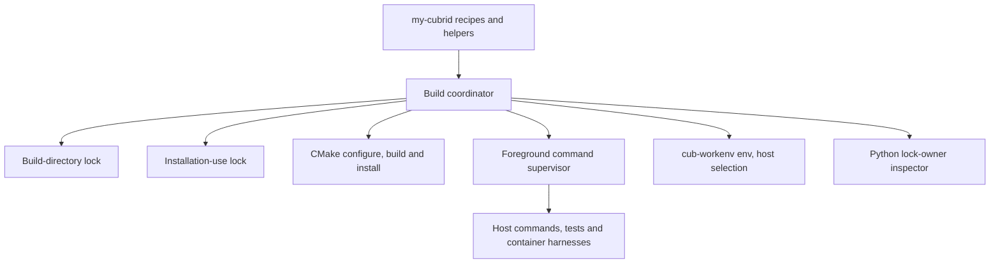
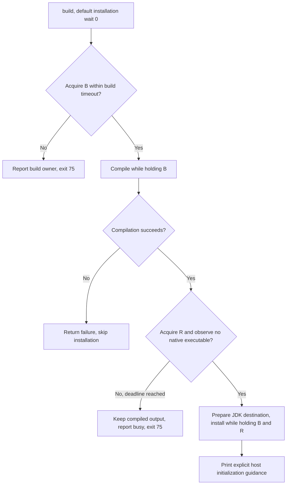
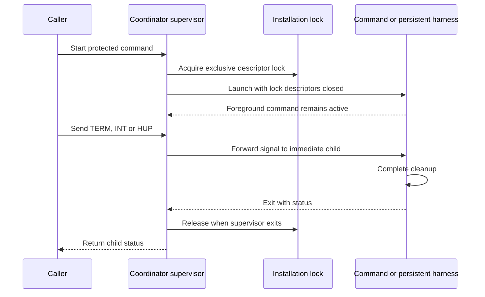
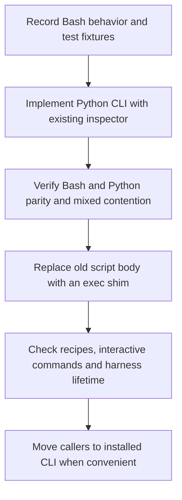

# CUBRID build coordinator: responsibilities and Python extraction

Date: 2026-10-20 (Asia/Seoul)

`cubrid-build-coordinator.sh` coordinates operations that share a CUBRID build directory or installation. It serializes build mutations, protects installed files during cooperating commands, and defers installation when the selected installation is busy. Compilation can finish while a database or editor continues running. Ordinary builds never stop those processes.

The intended destination is a separate Python project at `~/gh/cubrid-build-coordinator`, with repository `github.com/vimkim/cubrid-build-coordinator`. This document describes the existing implementation first. The Python design and migration sequence are proposals for that extraction.

## Evidence and scope

The analysis uses the local `my-cubrid` checkout at revision `601223548ef761e46bd407fb1eaf20dd050f9a1d`. The checkout was clean. The inspected script contains 411 lines and has this SHA-256:

```text
cf9642bb2cb56c1324c1bb32b92d2144e8bbba58b9d45131e6860dc4f25e53b6
```

The adjacent `cubrid-workenv` checkout is at `73ba1a89f9641690e7f72c99bdd2b44b8fe74332`. The proposed destination directory did not exist during inspection. No Python replacement or remote repository was created for this analysis.

The source of behavior is the script, its callers, and its existing tests. [ADR-0002][authority] establishes the ownership boundary: `cub-workenv` owns host preparation and selection. Earlier runtime-engine behavior does not define the extraction requirements.

## 1. Where it sits



The coordinator owns synchronization and command lifetime. CMake owns the actual build. `cub-workenv` owns explicit initialization, saved environment settings, and database creation. Container helpers own container identity and cleanup.

The runtime lock reserves an installation, even when the protected command is an editor or a test harness. It is separate from CUBRID transaction locks, page latches, and database file locks. [Coordinator source][coordinator] and [current architecture guide][runtime-guide] describe this distinction.

## 2. The complete action contract

All synchronization locks are exclusive. In this table, **B** means the build-directory lock. **R** means the installation-use lock, named `runtime` in the implementation. **Idle check** means a scan for native executables under the installation prefix.

| Action | Locks and checks | Work performed | Default wait for R |
| --- | --- | --- | --- |
| `configure` | B | `cmake --preset PRESET_MODE` | None |
| `compile` | B | `cmake --build --preset PRESET_MODE` | None |
| `target TARGET` | B, then R and idle check | Build one target, conservatively treating it as a possible installer | 0 seconds |
| `build [SECONDS]` | B, compile, then R and idle check | Compile, install, print explicit initialization guidance | 0 seconds |
| `install [SECONDS]` | B, then R and idle check | Install existing build output, print initialization guidance | 0 seconds |
| `install-target TARGET [SECONDS]` | B, then R and idle check | Build a target such as `3rdparty/install` | 0 seconds |
| `runtime [SECONDS] -- COMMAND...` | R, host selection, optional DB registration check | Supervise a host command in the selected work environment | 300 seconds |
| `installation-use [SECONDS] -- COMMAND...` | R, optional DB registration check | Supervise a command without requiring host initialization | 300 seconds |
| `installation-delete [SECONDS]` | B, then R and idle check, deletion guards | Remove the selected installation | 300 seconds |
| `stop-and-build` | B, compile, then R, host selection, explicit stop | Wait for native processes to exit, install, print initialization guidance | 300 seconds |
| `locks [--all] [--json]` | Read-only inspection | Delegate to `cubrid-lock-status.py` | None |

The action dispatcher provides the definitive ordering. [Source: action dispatch][dispatch].

### Inputs and timeouts

Except for `locks`, every action requires `PRESET_MODE`, `CUBRID_BUILD_DIR`, and `CUBRID`. The script also checks for `cmake`, `flock`, and `sha256sum`, even for actions that do not invoke CMake.

`CUBRID_BUILD_LOCK_TIMEOUT` changes the default B wait from 600 seconds. `CUBRID_RUNTIME_LOCK_TIMEOUT` changes the default R wait from 300 seconds for runtime use, deletion, and explicit stopping. It does **not** change the zero-second installation default for `build`, `install`, or `install-target`.

Timeouts must be non-negative integer strings. They limit lock acquisition or the idle guard. They do not limit compilation or the command's execution time. The idle guard polls every two seconds, so its timeout is approximate.

The runtime parser also accepts `--database NAME` before the command separator. The existing callers supply a numeric wait first:

```sh
cubrid-build-coordinator.sh runtime 300 --database testdb -- csql -S -u dba testdb
```

The parser treats the first argument as a timeout unless it is `--`. Therefore, omitting the timeout before `--database` does not work. `installation-use` shares this parser, although it skips host selection.

## 3. Two resources require two locks

The namespace is per user and runtime directory:

```text
ROOT = ${XDG_RUNTIME_DIR:-/tmp}/cubrid-dev-locks-${UID}
B = ROOT/build-SHA256(canonical(CUBRID_BUILD_DIR)).lock
R = ROOT/runtime-SHA256(canonical(CUBRID)).lock
canonical(path) = GNU realpath -m -- path
```

The hash covers the canonical path bytes without a trailing newline. The coordinator creates the namespace directory with mode `0700`. It opens each lock file and uses `flock` on its descriptor. [Source: lock setup and acquisition][lock-setup].

The resource path defines identity. A branch name, preset name, database name, or source commit does not define identity.

| Situation | Result |
| --- | --- |
| Two coordinated compiles use the same build directory | B serializes them |
| Different build directories install into the same prefix | Builds can overlap, R serializes installation |
| Two coordinated commands use different databases in one installation | R serializes both commands |
| A runtime command uses an installation while another caller compiles | Compilation can proceed, installation must wait or return 75 |
| A symlink resolves to the same resource path | Both callers should select the same lock |

An action that needs both locks always acquires B before R. It retains B while waiting for R and while installing. Consequently, a waiting installer also delays other coordinated compiles for that build directory.

The locks are advisory. Direct commands, other users, and callers using different namespaces do not automatically participate. Runtime entry is not recursive: a protected command that launches another coordinator for the same R can block itself.

## 4. Why a successful compile can produce exit 75



For installation, acquiring R is necessary but insufficient. The coordinator scans `/proc/PID/exe` for executables below the canonical installation prefix. It removes the kernel's ` (deleted)` suffix before comparing paths. This catches visible native processes that started without the wrapper.

When the scan finds an active process, the coordinator releases R before retrying. It retains B. If R itself is busy, the failure report inspects its owner instead. Neither path sends a stop signal. [Source: native scan and idle guard][idle-guard].

A configuration editor illustrates the effect. It holds R while waiting for input. A concurrent `just build` can finish compilation, then fail installation with 75. After the editor closes, `just install` can install the existing output.

This is synchronous deferral. The coordinator does not create a background queue or schedule an automatic retry.

## 5. The supervisor controls lock lifetime

`run_locked` retains the descriptors in the Bash supervisor and closes them in the command child. The child uses a small Python launcher to restore normal SIGINT and SIGQUIT handling before execution. It inherits the caller's standard input. [Source: supervision][supervision].



The parent waits through signal interruption until the child exits. It does not release the lock at the start of cleanup. Ordinary command exit status passes through to the caller.

Daemons started by the child do not retain the descriptors. After their launcher exits, the native executable scan provides the additional installation check. A container instead needs its foreground harness to remain alive until the owned container disappears. The container helper implements that lifetime.

Signal forwarding targets the immediate child. The coordinator does not implement a general process-tree killer. Forced supervisor termination cannot preserve cleanup ordering. The Python replacement must retain these limits when describing its guarantees.

## 6. Host selection, stopping, and deletion

### Host runtime validation

The `runtime` action acquires R, then invokes:

```sh
cub-workenv env --worktree "$PWD" --preset "$PRESET_MODE" --install "$CUBRID"
```

`CUB_WORKENV_CLI` can override the executable. The coordinator evaluates the emitted Bash code, preserves a selection failure, and requires `CUBRID_RUNTIME_READY=1`. Selection is cheap. It is not a full `doctor` diagnosis.

With `--database NAME`, the coordinator checks the first column of `$CUBRID_DATABASES/databases.txt`. It checks registration, not whether a database is running or safe for concurrent access. It does not create a missing database. [Source: runtime validation][selection].

Build and installation do not initialize a host work environment. `installation-use` also works before initialization, which supports ctest and container callers.

### Explicit stop and build

`stop-and-build` compiles **before** stopping anything. After it acquires R and validates selection, it reads the selected installation's `cubrid server status`. It stops reported `Server` and `HA-Server` databases after checking their registrations. It then attempts `service stop` and `broker stop`.

The coordinator polls for native executable exit for up to approximately 30 seconds. A stop timeout returns 1 and prevents installation. It does not escalate to forced killing. After a successful stop, it installs without automatically restarting the servers. [Source: stopping][stopping].

The shared `just` recipe asks for confirmation before this action. The coordinator action itself does not display a confirmation prompt.

### Installation deletion

Deletion first requires B, R, and the native idle check. It then refuses a prefix that lexically contains the current working directory, home directory, or configured build directory. It also refuses a prefix containing a regular file matching `*_vinf` or `*_lgat`.

If those checks pass, it runs `/bin/rm -rf` on the canonical installation prefix. These guards do not establish a complete inventory of database storage. The action does not reset workenv allocations or authorize deletion of external databases. [Source: deletion][deletion].

### JDK destination adjustment

Before a full installation, the coordinator reconciles `vm/jdk8` between the build and installation trees. It removes an installed directory when the build uses a symlink. It removes an installed symlink when the build uses a directory.

The surrounding `ensure-build-jdk` recipe selects or prepares the build JDK. The coordinator handles only the installation destination transition. Installation is not atomic: JDK adjustment or a failed CMake install can leave partial changes. [Source: JDK preparation and installation][jdk].

## 7. Lock diagnosis is already Python

The `locks` action delegates to `bin/cubrid-lock-status.py` before ordinary environment validation or lock-directory creation. This helper already provides the Python implementation for owner discovery.


The helper joins `/proc/locks` with live descriptors and their `fdinfo` records. The PID in a kernel record alone can miss the live supervisor after the short-lived `flock` utility exits. A process that merely opens the lock file is not necessarily a holder.

The report includes accessible PIDs, users, descriptor numbers, commands, working directories, terminals, start times, and process ages. It redacts common credential arguments. Process age is not lock duration.

`locks --all` works without a selected environment and filters idle files from its result. `locks --json` uses schema version 1, with root fields `schema_version`, `namespace`, and `locks`. Lock entries include `kind`, `resource`, `path`, `state`, and `owners`.

Status is an observation. A changing or unreadable state can produce `unknown`. An existing lock file does not prove a held lock. Deleting its pathname can split future callers across different inodes, so deletion is not a release operation. [Source: inspector][inspector].

| Exit status | Meaning |
| --- | --- |
| `0` | Successful action, including completed held/idle inspection |
| `75` | Build lock, runtime lock, or installation idle guard could not proceed |
| `64` | Coordinator usage error detected by its explicit argument checks |
| Other command status | CMake, selection, or protected command failure propagates |
| `1` from inspection | Unknown lock state or inspection failure |
| `2` from inspection | Inspector argument error |

Shell-level failures are not uniformly normalized to 64. A missing required environment variable, for example, fails through Bash parameter expansion. Busy operations retain 75 even if owner inspection fails.

## 8. Callers that extraction must preserve

| Caller in `my-cubrid` | Coordinator use | Migration concern |
| --- | --- | --- |
| `stow/cubrid/.just/core.just` | Configure, compile, build, install, targets, stop, delete, status | Preserve defaults, build logs, and recipe exit status |
| `stow/cubrid/.just/core.just`, ctest recipe | `installation-use 300` | Keep host initialization optional |
| `stow/cubrid/.just/db.just` | Server lifecycle, SQL, configuration tools and editors | Preserve database checks and interactive lock lifetime |
| `stow/cubrid/.just/debug.just` | Interactive debugger commands | Preserve terminal input and signal behavior |
| `stow/cubrid/.just/ctp.just` | Host shell helpers and container harness | Retain R until persistent harness cleanup ends |
| `stow/cubrid/.just/profile.just`, `oos.just`, root `justfile` | Profiling, selected tests and configuration commands | Include less frequent wrappers in the migration inventory |
| `bin/cubrid-workenv-db` | Host database convenience helper | Retain workenv authority and the runtime wrapper |
| Existing tooling tests | Fixed coordinator pathname and sibling inspector | Adapt entrypoint discovery without weakening assertions |

These are inspected callers, not a guarantee that no external script invokes the coordinator. Most use `${MY_CUBRID:-$HOME/my-cubrid}/bin/cubrid-build-coordinator.sh`. A compatibility shim at that path can preserve them during extraction. [Sources: core recipes][core], [database recipes][db], [debug recipes][debug], and [container recipes][containers].

Some mutations remain outside the coordinator. `ensure-build-jdk` runs before the action, and direct cache/build-directory deletion recipes do not acquire B. Configuration and build also use separate coordinator invocations. Extraction alone does not make the whole recipe sequence atomic.

## 9. Proposed Python project

Keep the initial replacement as a foreground Linux CLI with the existing action names and environment inputs. A daemon or scheduler would add a new lifecycle that the current callers do not require.

An initial package can use these boundaries. Module names are proposals, not an accepted public API.

| Module | Responsibility |
| --- | --- |
| `cli.py` | Parse actions, retain command argument boundaries, map documented exit statuses |
| `coordinator.py` | Implement action ordering, installation policy, JDK transitions and explicit stop/delete rules |
| `locks.py` | Canonical resource identities, compatible namespace, descriptor ownership, timeout and idle acquisition |
| `processes.py` | Supervise commands and signals, inspect native executable paths |
| `workenv.py` | Adapt the external selection interface and registration check |
| `status.py` | Reuse and adapt the existing Python owner inspector |

The core interface should express operations such as compile, install, and run with installation use. It should hide descriptor handling and `/proc` details from the CLI. Keep the current workenv state schema and database lifecycle outside the new package.

### Compatibility requirements

1. Preserve canonical path keys, namespace names, hash bytes, and Linux `flock` semantics. Bash and Python must contend on the same inode during migration.
2. Preserve B-before-R ordering and B ownership across compile, installation wait, and install.
3. Preserve the idle scan in addition to R acquisition. Do not treat an unlocked file as proof of an idle installation.
4. Preserve foreground ownership through command cleanup. Child and daemon processes must not inherit lock descriptors.
5. Preserve stdin, stdout, stderr, argument boundaries, and meaningful child exit status. Normalize signal termination deliberately at the CLI boundary.
6. Preserve exit 75 for retryable contention, explicit host initialization, and selection before host execution.
7. Preserve all existing actions, including deletion guards, explicit stopping, JDK transitions, and read-only owner reports.
8. Preserve the owner JSON schema and credential redaction when moving the inspector.

Python can replace the `flock` subprocess with `fcntl.flock`, hashing with `hashlib`, and Bash supervision with `subprocess` and `signal`. Use non-inheritable descriptors and explicit child descriptor closure. Use a monotonic deadline for waits. These are implementation proposals that require parity tests.

Path normalization needs explicit tests. A convenient Python path API is not proof of exact GNU `realpath -m` equivalence for symlinks and nonexistent components. Hash filesystem bytes consistently with the existing inspector.

### The workenv integration seam

At the inspected workenv revision, `env` emits Bash cleanup code followed by `source` of an environment artifact. It has no JSON output option. The cleanup changes PATH and library paths, removes inherited CUBRID settings, and sets readiness to zero before selection. [Sources: workenv CLI][workenv-cli] and [environment loader][workenv-loading].

The Python replacement must not treat this output as a list of `KEY=value` assignments. Two possible approaches need an implementation decision:

| Approach | Benefit | Cost |
| --- | --- | --- |
| Bounded Bash adapter that executes the existing emitted code and captures the resulting environment | Preserves current authority and cleanup behavior during initial extraction | Retains a Bash dependency and needs careful status/stream handling |
| Add a versioned structured selection/environment interface to `cubrid-workenv` | Provides a direct Python integration boundary | Requires a separate workenv change and coordinated compatibility checks |

The adapter is the smaller first step. The structured interface is a possible later improvement. Neither approach should duplicate workenv's internal state interpretation inside the coordinator.

The new code should also check that the selected installation matches the locked resource. Selection failures must prevent command execution. Running `doctor` automatically would change the current cheap-selection contract.

### Failure boundaries to keep visible

The native scan cannot prevent a direct launcher from starting after the scan. It does not inventory processes that only map installed libraries. Permissions and PID namespaces limit observation. Existing coordinator locks are cooperative, not complete host isolation.

The initial rewrite should document these limits. Stronger exclusion, shared runtime locks, recursive wrappers, automatic restarts, and transactional installation would change behavior and need separate design decisions.

## 10. Migration and acceptance



1. Create the separate project with a CLI, package, and isolated test fixtures. Keep source-worktree configuration in `my-cubrid`.
2. Parameterize the existing tests so they can invoke either implementation. Reuse the owner inspector and its tests.
3. Add mixed-implementation contention tests. Bash and Python must exclude each other for identical canonical resources.
4. Compare command traces, lock scope, statuses, diagnostics, and environment selection. Include failure cases before replacing the old path.
5. Convert the old script to an `exec` shim only after parity passes. Avoid a fallback that could bypass locking or repeat a partially completed action.
6. Verify representative recipes and persistent container cleanup. Keep the shim while external callers still depend on its pathname.

Acceptance should cover behavior that a direct language translation can miss:

| Area | Required evidence |
| --- | --- |
| Resource identity | Aliases, symlinks, missing path components, distinct installs, and shared install across different builds |
| Concurrency | Same-build serialization, installation exclusion, mixed Bash/Python callers, and B retention while waiting for R |
| Installation | Compile success followed by 75, install-only retry, native executable refusal, partial targets, and JDK path transitions |
| Host selection | Uninitialized runtime refusal, build-only installation use, selection failure, multiple registered database names |
| Supervision | Interactive input, normal nonzero exit, TERM/INT/HUP forwarding, cleanup retention, and no daemon descriptor inheritance |
| Explicit lifecycle | Compile failure before stop, stop timeout, no automatic restart, broad-path and database-marker deletion refusal |
| Inspection | Supervisor ownership, unrelated openers, owner replacement, unknown state, JSON schema, and redacted arguments |
| Caller integration | Build log pipeline preserves failure, debugger/editor retain input, container harness retains R through removal |

These are proposed acceptance requirements. The current suites cover many of them, but they do not establish complete coverage for the Python extraction.

## 11. Verification performed

The following existing suites ran successfully against the inspected Bash implementation:

```text
python3 -B tests/runtime-lock-test.py
Ran 15 tests in 2.610s — OK

python3 -B tests/lock-status-test.py
Ran 13 tests in 3.275s — OK
```

The suites use temporary namespaces and fixture commands. They test real descriptor locking and child processes without compiling CUBRID or operating on user databases. These results establish a baseline for the current implementation. They do not validate a Python replacement or the complete host/container workflow.

The analysis also inspected all script actions, the owner inspector, shared recipe callers, the workenv CLI and loader, and the current authority decision. The required PR lookup from the original CUBRID `develop` checkout returned multiple historical matches. No single CUBRID PR was selected for this tooling analysis.

## Source map

All links below identify the inspected revisions.

| Source | Evidence |
| --- | --- |
| [Coordinator][coordinator] | Full current action and synchronization implementation |
| [Lock setup][lock-setup] and [idle guard][idle-guard] | Resource identity, build locking, native process observation and deferral |
| [Supervision][supervision] | Descriptor closure, signal forwarding and command lifetime |
| [Runtime selection][selection] | Environment loading, readiness and named registration checks |
| [JDK/install][jdk], [stopping][stopping], [deletion][deletion] | Less frequent behavior that extraction must retain |
| [Owner inspector][inspector] | Existing Python diagnostic implementation |
| [Coordinator tests][runtime-tests] and [owner tests][status-tests] | Executed baseline suites |
| [Core recipes][core], [database recipes][db], [debug recipes][debug], [container recipes][containers] | Integration and caller lifetime |
| [Host authority ADR][authority] and [runtime guide][runtime-guide] | Accepted boundaries and documented limits |
| [Workenv CLI][workenv-cli] and [loader][workenv-loading] | Bash output interface and selection behavior |

[coordinator]: https://github.com/vimkim/my-cubrid/blob/601223548ef761e46bd407fb1eaf20dd050f9a1d/bin/cubrid-build-coordinator.sh
[dispatch]: https://github.com/vimkim/my-cubrid/blob/601223548ef761e46bd407fb1eaf20dd050f9a1d/bin/cubrid-build-coordinator.sh#L305-L411
[lock-setup]: https://github.com/vimkim/my-cubrid/blob/601223548ef761e46bd407fb1eaf20dd050f9a1d/bin/cubrid-build-coordinator.sh#L55-L105
[idle-guard]: https://github.com/vimkim/my-cubrid/blob/601223548ef761e46bd407fb1eaf20dd050f9a1d/bin/cubrid-build-coordinator.sh#L107-L186
[selection]: https://github.com/vimkim/my-cubrid/blob/601223548ef761e46bd407fb1eaf20dd050f9a1d/bin/cubrid-build-coordinator.sh#L188-L217
[supervision]: https://github.com/vimkim/my-cubrid/blob/601223548ef761e46bd407fb1eaf20dd050f9a1d/bin/cubrid-build-coordinator.sh#L219-L246
[jdk]: https://github.com/vimkim/my-cubrid/blob/601223548ef761e46bd407fb1eaf20dd050f9a1d/bin/cubrid-build-coordinator.sh#L248-L267
[stopping]: https://github.com/vimkim/my-cubrid/blob/601223548ef761e46bd407fb1eaf20dd050f9a1d/bin/cubrid-build-coordinator.sh#L269-L303
[deletion]: https://github.com/vimkim/my-cubrid/blob/601223548ef761e46bd407fb1eaf20dd050f9a1d/bin/cubrid-build-coordinator.sh#L380-L396
[inspector]: https://github.com/vimkim/my-cubrid/blob/601223548ef761e46bd407fb1eaf20dd050f9a1d/bin/cubrid-lock-status.py
[runtime-tests]: https://github.com/vimkim/my-cubrid/blob/601223548ef761e46bd407fb1eaf20dd050f9a1d/tests/runtime-lock-test.py
[status-tests]: https://github.com/vimkim/my-cubrid/blob/601223548ef761e46bd407fb1eaf20dd050f9a1d/tests/lock-status-test.py
[core]: https://github.com/vimkim/my-cubrid/blob/601223548ef761e46bd407fb1eaf20dd050f9a1d/stow/cubrid/.just/core.just
[db]: https://github.com/vimkim/my-cubrid/blob/601223548ef761e46bd407fb1eaf20dd050f9a1d/stow/cubrid/.just/db.just
[debug]: https://github.com/vimkim/my-cubrid/blob/601223548ef761e46bd407fb1eaf20dd050f9a1d/stow/cubrid/.just/debug.just
[containers]: https://github.com/vimkim/my-cubrid/blob/601223548ef761e46bd407fb1eaf20dd050f9a1d/stow/cubrid/.just/ctp.just
[authority]: https://github.com/vimkim/my-cubrid/blob/601223548ef761e46bd407fb1eaf20dd050f9a1d/docs/adr/0002-workenv-authority.md
[runtime-guide]: https://github.com/vimkim/my-cubrid/blob/601223548ef761e46bd407fb1eaf20dd050f9a1d/docs/runtime-locks.md
[workenv-cli]: https://github.com/vimkim/cubrid-workenv/blob/73ba1a89f9641690e7f72c99bdd2b44b8fe74332/cubrid_workenv/cli.py#L38-L41
[workenv-loading]: https://github.com/vimkim/cubrid-workenv/blob/73ba1a89f9641690e7f72c99bdd2b44b8fe74332/cubrid_workenv/loading.py
