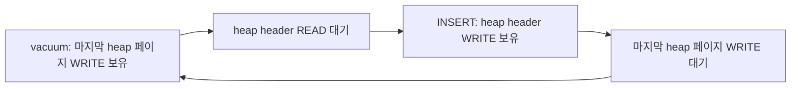

# PR 7990 R2의 vacuum과 힙 페이지 할당 교착

2026-10-31, Asia/Seoul. OOS 작성자와 리뷰어가 [hornetmj의 R2](https://github.com/CUBRID/cubrid/pull/7990#discussion_r4399323155)를 이해하고 수정 여부를 판단하기 위한 기록이다. PR 8235는 이 경로를 수정하지 않는다. 이 작업에서 실제 vacuum worker로 래치 순환을 재현했고, 로컬 수정 후 같은 테스트가 통과했다. 티켓 발급과 회사 PR 게시는 아직 하지 않았다.

## 기준과 범위

| 항목 | 기준 |
| --- | --- |
| 저장소·소스 | `CUBRID/cubrid`, `dcbf09e4f7fd02ff9c8fc6493ec8887fc2919d67` |
| source 작업 | `/home/vimkim/gh/cb/pr7990-hornet-r2`, `review/pr7990-hornet-r2` |
| 로컬 커밋 | 실패 테스트 `e1d0aa65a`, 수정 `b5d53109a`. 둘 다 미게시이며 티켓이 없어 `[CBRD-26357]`을 임시로 쓴다. |
| 반영 대상 | `feature/oos-merge`. R5를 기반으로 쌓지 않고 독립 검증한다. |
| 비교한 PR | [8235](https://github.com/CUBRID/cubrid/pull/8235), merge `9b93263d07cab80edf02217e8d6c4f0fcf2fd9ac` |
| 문서 작업 | `my-cubrid-docs-pr7990-hornet-r2`, `docs/pr7990-hornet-r2-20261031` |
| 작업 추적 | Work 508. PR 7990 전체 완료와 R2 완료를 구분한다. |
| 규범 | `OOS-CONTEXT.md`, SHA-256 `6300aa1fa6ffb54033b9c7f7ea959466e9d88f0530e1ab0d7178b4459d4fcf63` |

## PR 8235는 다른 대기 순환을 수정한다

`git merge-base --is-ancestor 9b93263d07cab80edf02217e8d6c4f0fcf2fd9ac dcbf09e4f7fd02ff9c8fc6493ec8887fc2919d67`은 1을 반환했다. 따라서 PR 8235의 merge commit은 현재 OOS 소스에 포함돼 있지 않다.

PR 8235의 변경은 병렬 힙 스캔, 통계 sampling, 병렬 index build의 비트맵 페이지 순회와 `heap_remove_page_on_vacuum`의 대기자 처리다. OOS 파일 조회, 레코드 준비, 새 힙 페이지 할당은 변경하지 않는다. 따라서 해당 PR을 반영해도 R2는 남는다. [변경 커밋](https://github.com/CUBRID/cubrid/commit/9b93263d07cab80edf02217e8d6c4f0fcf2fd9ac).

## 래치 소유와 재시작 계약

OOS VFID는 heap header에 저장된다. `heap_oos_find_vfid(..., false)`는 그 헤더를 READ·UNCONDITIONAL로 고정한다. [heap_file.c의 조회](https://github.com/CUBRID/cubrid/blob/dcbf09e4f7fd02ff9c8fc6493ec8887fc2919d67/src/storage/heap_file.c#L13229-L13353).

`VACUUM_HEAP_HELPER`는 고정한 home·forward 페이지, 현재 slot, 복사 레코드, MVCC header와 페이지별 OOS VFID를 보유한다. `REC_HOME` 준비는 home WRITE를, `REC_RELOCATION` 준비는 home과 forward WRITE를 보유한 상태에서 처음 필요한 OOS VFID를 조회한다. [vacuum의 준비 경로](https://github.com/CUBRID/cubrid/blob/dcbf09e4f7fd02ff9c8fc6493ec8887fc2919d67/src/query/vacuum.c#L2009-L2263), [OOS 조회 helper](https://github.com/CUBRID/cubrid/blob/dcbf09e4f7fd02ff9c8fc6493ec8887fc2919d67/src/query/vacuum_oos.cpp#L389-L424).

반대로 `heap_alloc_new_pages`는 heap header WRITE를 얻고 이를 유지한 채 `heap_get_last_page`에서 기존 마지막 페이지를 요청한다. 순서 고정 래치(`pgbuf_ordered_fix`)의 규칙도 header를 데이터 페이지보다 먼저 잡는다. vacuum이 보유한 home 또는 forward가 이 마지막 페이지라면 서로의 래치를 기다린다. 페이지 래치에는 교착 탐지가 없다. [힙 페이지 할당](https://github.com/CUBRID/cubrid/blob/dcbf09e4f7fd02ff9c8fc6493ec8887fc2919d67/src/storage/heap_file.c#L28554-L28640).

`REC_BIGONE`의 준비 경로는 header를 조건부로 조회한다. 실패하면 home의 기존 bulk 변경을 로그에 남기고 home을 놓는다. header를 기다린 뒤 home을 다시 고정하고 `retry_prepare`에서 slot과 record type부터 다시 읽는다. [기존 재시작 선례](https://github.com/CUBRID/cubrid/blob/dcbf09e4f7fd02ff9c8fc6493ec8887fc2919d67/src/query/vacuum.c#L2162-L2189).

`heap_oos_find_vfid`의 다른 호출자는 heap 데이터 페이지를 쥔 채 header를 기다리지 않는다. forward walk의 `vacuum_oos_vfid_lookup`은 로그 처리 중에 호출되고, insert·replication·TDE·통계·삭제 경로는 데이터 페이지 고정 전이나 밖에서 호출된다. 따라서 수정 범위는 `vacuum_heap_prepare_record`의 두 호출 지점이다.

## 실행 재현

`unit_tests/oos/test_oos_real_vacuum_server.cpp`에 `OosRealVacuum.VacuumWaitsForHeapHeaderWithoutHoldingLastPage`를 추가했다. in-process SERVER_MODE 서버와 실제 vacuum worker를 사용한다. 테스트 스레드는 header를 먼저 잡는 할당자 역할을 한다.

1. `heap_alloc_new_pages`로 마지막 페이지를 만들고 OOS를 참조하는 행을 그 페이지에 넣은 뒤 commit한다.
2. 그 행의 로그 블록이 닫히기 전에 heap header를 WRITE로 고정한다.
3. OOS insert와 로그 flush로 블록을 닫는다. 트랜잭션 종료는 고정 페이지를 허용하지 않으므로(`lock_unlock_all`의 `pgbuf_unfix_all`) commit 대신 이 방법을 쓴다. vacuum master는 append 위치 근처의 블록을 건너뛰므로 flush가 필요하다.
4. vacuum worker가 header 대기열에 들어오면(`pgbuf_has_any_waiters`) 마지막 페이지를 조건부 WRITE로 요청한다. 성공하면 실제 `heap_alloc_new_pages`를 호출해 끝나는지 확인한다.
5. header를 놓은 뒤 vacuum이 그 행의 insert MVCCID를 지우고 OOS 값이 남아 있는지 확인한다.

조건부 요청을 쓰므로 수정 전에도 300초를 기다리지 않고 실패한다.

| 실행 | 설치된 `libcubrid` SHA-256 앞자리 | 결과 |
| --- | --- | --- |
| 수정 전, 최종 테스트 | `c0365dac` (`dcbf09e` 기준 빌드) | `last_page_free` 실패, 1.31초 |
| 수정 전, 계측 | 같음 | vacuum이 header를 기다리는 동안 마지막 페이지를 READ로도 잡지 못함. header를 놓자 commit 전에 vacuum이 행을 처리함 |
| 수정 전, 실제 할당 1회 실험 | 같음 | `heap_alloc_new_pages`가 약 316초 막힌 뒤 `ER_PAGE_LATCH_TIMEDOUT`. debug 빌드는 `pgbuf_timed_sleep`의 `assert (0)`에서 중단 |
| 수정 후 | `7eec12eb` | 통과, 215 ms |

실제 할당 실험과 계측은 원인 확인용이며 커밋한 테스트에는 남기지 않았다. 리뷰어의 306~311초 abort와 같은 성격의 대기를 이 작업에서 직접 관측했다.

## 수정

`b5d53109a`는 `REC_BIGONE`의 방식을 OOS 파일 조회에 적용한다.

- `heap_oos_find_vfid_nowait`를 추가한다. header를 조건부 READ로 한 번만 시도한다. false는 "답 없음"이며 오류 설정을 보장하지 않는다.
- `heap_oos_find_vfid`는 서명과 "false는 실제 오류" 계약을 유지한다. 두 함수는 정적 본문 하나를 공유한다.
- `vacuum_heap_prepare_oos_vfid`가 `REC_HOME`과 `REC_RELOCATION`의 조회를 맡는다. header가 바쁘면 forward를 놓고 `vacuum_heap_page_log_and_reset`으로 home을 놓는다. 페이지 없이 header를 기다려 조회한 뒤 home만 다시 고정하고 `retry_prepare`로 돌아간다.
- 재시작은 레코드당 한 번이다. 기다린 조회의 답을 최종으로 쓴다. 상한이 없으면 header 읽기가 계속 실패할 때 release build가 페이지 해제와 재고정을 끝없이 반복한다.

home이나 forward가 heap header 자체이면 같은 스레드의 WRITE 보유가 조건부 READ 재고정을 허용하므로(`page_buffer.c:6380-6387`) 해제 경로를 타지 않는다. 이 수정은 그 경우의 header 보유 시간을 줄이지 않는다.

R5는 실행 단계에서 forward 슬롯 삭제 후 sysop 종료까지 forward 페이지를 보유한다. R2의 재시작은 sysop 시작 전 준비 단계에서만 일어나고, 재시작 뒤 `REC_RELOCATION`은 forward를 다시 고정한다. [R5의 삭제·복구 계약](../cbrd-27858/README.md).

설계는 architect 절차로 정했다. opus와 sonnet 후보가 같은 제어 흐름으로 수렴했다. 수정 파일이 적고 기존 계약을 바꾸지 않는 opus 안을 기반으로, sonnet 안의 재시작 상한을 레코드 지역 변수로 옮겨 넣었다. 기본 인자로 `heap_oos_find_vfid`에 latch 조건을 더하는 안은 "false는 오류" 계약을 조건부로 약하게 만들어 제외했다.

## 검증

| 확인 | 결과 |
| --- | --- |
| 재현 테스트 | 수정 전 실패, 수정 후 통과 |
| 전체 CTest 44건, 수정 후 | 모두 통과, 498.5초 |
| R5 `628857607`를 커밋 없이 결합한 전체 CTest | 44건 모두 통과, 439.9초. 재현 테스트 245 ms. 확인 뒤 결합을 되돌리고 수정만 다시 설치함 |
| GNU indent·astyle 사전 점검 | 변경 없음 |

로컬 빌드는 `debug_gcc`이다. 작업 환경은 `cub-workenv init --no-db`로 R2 worktree에 격리했다. CTest의 `LD_LIBRARY_PATH`가 설치본을 먼저 읽으므로 런타임 검증 전에는 `just build-and-install`이 필요하다.

## 진행 체크리스트

- [x] 최신 R2 원문과 PR 8235 변경을 확보한다.
- [x] PR 8235가 현재 소스에 포함되지 않았고 R2 경로도 변경하지 않음을 확인한다.
- [x] `REC_HOME`, `REC_BIGONE`, `REC_RELOCATION`의 래치와 재시작 계약을 비교한다.
- [x] 별도 테스트 DB에서 실제 vacuum과 힙 할당의 대기 순환을 재현한다.
- [x] 확인한 원인에 맞춰 최소 수정 구조를 결정한다.
- [x] 같은 재현과 전체 CTest를 검증한다.
- [x] R5 결합 검증을 마친다.
- [ ] 별도 티켓 중복 여부와 회사 PR 초안을 준비한다.

## 현재 증거와 한계

단계별 판단과 로그는 `/home/vimkim/temp/pr7990-hornet-r2-20261031/`의 `decisions.tsv`에 남겼다. 주요 로그는 `ctest-red-final.log`, `ctest-diag2.log`, `ctest-stall.log`, `ctest-green.log`, `ctest-full-fix.log`, `ctest-full-r5combo.log`이다.

- 재현 테스트는 `heap_alloc_new_pages`를 직접 호출한다. bestspace를 거치는 논리 INSERT와 SQL 종단 실행은 재현하지 않았다.
- `REC_RELOCATION`의 경합 경로는 실행으로 검증하지 않았다. 두 호출 지점은 같은 helper를 쓰며 차이는 forward 해제뿐이다. 리뷰어도 이 경로는 코드로만 확인했다.
- release 빌드와 SQL·shell 회귀는 실행하지 않았다.
- 재현 테스트는 header를 쥔 채 OOS insert와 log flush를 하는 테스트 전용 순서를 쓴다. 엔진 코드에는 테스트 seam을 추가하지 않았다.

이전 세션에서 GDB 기반 드라이버 작성 위임과 test seam 조사 위임이 자동 검토의 "possible cybersecurity risk"로 거절됐다. 두 요청은 재전송하지 않았다. 이번 세션은 fixture 소스를 직접 확인하고 표준 GoogleTest 케이스로 재현했다. 실제 보안 결함을 뜻하지 않는다.
