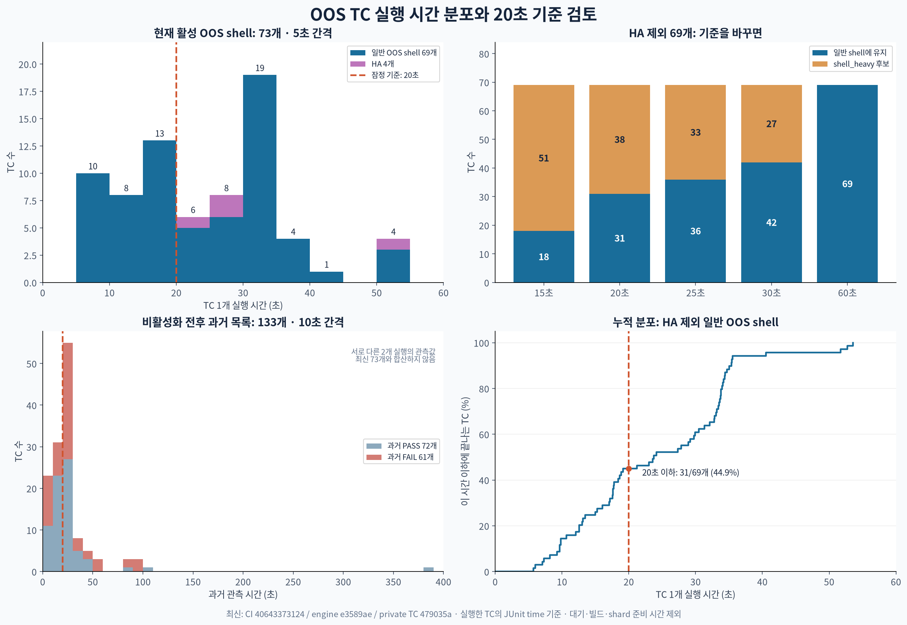
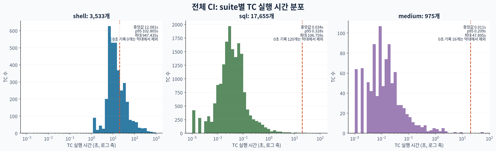

# OOS TC 실행 시간 분포와 HA·heavy 분류

작성: 2026-10-28 (Asia/Seoul). 독자: TC 실행 위치를 정하는 개발·QA 담당자.
질문: 개별 TC는 얼마나 걸리며, HA를 제외하고 20초 초과 사례를
`shell_heavy`로 분리하면 무엇이 남는가?

## 관측 결과

[CI 40643373124](https://github.com/CUBRID/cubrid/actions/runs/40643373124)의
OOS shell 73개는 HA 4개와 일반 OOS shell 69개다. **20초를 초과하는
일반 OOS TC는 38개, 20초 이하 TC는 31개**다. 38개는 이 69개의
누적 실행 시간 중 75.3%를 차지한다. 실행 위치를 옮기는 기준이며,
결함 검출 가치나 병렬 CI 완료 시간의 단축률을 뜻하지 않는다.

| 기준 n | 일반 shell에 유지: time ≤ n | heavy 후보: time > n | 후보 누적 시간 | 일반 OOS 69개 시간 중 비중 |
| --- | ---: | ---: | ---: | ---: |
| 15초 | 18 | 51 | 1,490.583초 | 89.0% |
| 20초 | 31 | 38 | 1,261.615초 | 75.3% |
| 25초 | 36 | 33 | 1,145.886초 | 68.4% |
| 30초 | 42 | 27 | 972.991초 | 58.1% |
| 60초 | 69 | 0 | 0초 | 0.0% |

20초는 사용자가 제안한 잠정값이다. 정확히 n초인 사례는 일반 shell에
남긴다. 이번 변경은 HA 제외를 반영하며, heavy 후보를 실제로 이동하거나
기존 실패를 재활성화하지 않는다. HA 4개는 모든 시간 기준에서 별도 분류한다.

38개의 1,261.615초는 전체 shell 누적 TC 시간 101,659.040초의 **1.24%**다.
전체 shell에서도 1,091/3,533개가 20초를 초과한다. 이 제안은 이번 OOS
TC의 분류이며, 기존 전체 shell에 20초 기준을 일괄 적용하지 않는다.

## 전체 CI와 비교

| Suite | 실행 시간 기록 수 | 중앙값 | p95 | 최대 |
| --- | ---: | ---: | ---: | ---: |
| shell | 3,533 | 12.081초 | 102.805초 | 947.435초 |
| SQL | 17,655 | 0.034초 | 0.328초 | 106.759초 |
| medium | 975 | 0.011초 | 0.209초 | 47.895초 |

Shell의 SKIP 30개는 시간 통계에서 제외했다. SQL/medium의 0초 기록은
각각 120개와 16개다. 그래프의 로그 축에서만 0초를 제외했으며,
0초 기록이 실제 비용 0을 뜻하지 않는다. Shell은 fixture·기동·정리를
포함하고 SQL/medium은 runner의 케이스 본문 측정값이다. 세 suite의
숫자를 동일한 작업 비용으로 해석하지 않는다.

## 입력과 검산

- Engine: `e3589ae42d42b04eb020e1ae43e165b01d31b12a`.
- Public TC: `45e21ad799d82ebadc04a93c7d2f69517d53bf39`.
- Private-ex TC: `479035a45f06545db1974e1369e88000fb98a89a`.
- 측정 대상은 위 실행 attempt 1의 shell 50개·SQL 10개·medium 1개 shard다.
- 61개 shard의 JUnit과 runner status/summary를 수집했다. 모든 shell의
  전체·실행·성공·실패·skip 수가 일치하고, SQL/medium의 모든 JUnit
  identity·판정·밀리초가 `summary_info`와 일치한다. 중복 case가 없다.
- SQL 2개는 JUnit에 없고 summary에만 있어 그 관측값을 사용했다.
  `_05_plcsql/_01_testspec/_05_bug_fix/cbrd-27556`의
  `33_static_sql_group_by_having_alias.sql`은 498ms,
  `33_static_sql_group_by_having_alias_error.sql`은 43ms다.
  누락을 0초로 대체하지 않았다.
- 원본 결과는 해당 run의 Artifacts에 연결된 내부 run directory의
  `<suite>/shard/<NN>/test-results/*.xml`, `test_status.data`,
  `summary_info`, `tc.read`, `build.read`, `plan/split.meta`에서 읽었다.
  Raw 자료와 전체 CSV, 검산·재생성 스크립트, 대화형 탐색기는 Git 밖에 보존했다.

과거 133개 패널은
[고정 inventory](https://github.com/CUBRID/cubrid-testcases-private-ex/blob/02d023932b8aa39b2807cc6a77d72f3d58e231d6/disabled/oos-pr8128-inventory.tsv)의
40311481032 또는 40324320840 관측값이다. 72개 PASS·61개 FAIL이며
최신 73개와 합산하지 않는다. 실패·60초 초과로 비활성화된 사례의 긴
꼬리를 보여 주는 별도 자료다. 추가 HA 결함 재현 2개는 처음부터 비활성이므로
최신 CI의 시간 분포에 없다.

한 번의 CI에서 서로 다른 TC의 실행 시간을 모은 분포다. 같은 TC를 반복
측정한 변동성 분포가 아니다. 예를 들어 `alt_duplicate_values`는 과거
27.668초에서 이번 실행 16.052초로 바뀌었다. 경계 부근의 분류는 이후
측정에서 바뀔 수 있다. Runner 대기·build·shard 준비 비용은 이 통계에 없다.

## HA 분류 변경

HA shell의 목적지는 세 번째 저장소인
[`cubrid-testcases-private/HA/shell`](https://github.com/CUBRID/cubrid-testcases-private/tree/develop/HA/shell)이다.
Private-ex의
[`02d023932`](https://github.com/CUBRID/cubrid-testcases-private-ex/commit/02d023932b8aa39b2807cc6a77d72f3d58e231d6)는
기존 HA 4개를 원문·mode 그대로 `disabled/ha/`로 옮겨 일반 GitHub CI에서
제외한다. [선택 manifest](https://github.com/CUBRID/cubrid-testcases-private-ex/blob/02d023932b8aa39b2807cc6a77d72f3d58e231d6/disabled/ha/oos-pr8128.tsv)는
마지막 시간·관측 리비전·원래 경로·예정 목적지를 보존한다.

이 그림은 분류 변경 전 run40643373124의 관측값을 유지한다. 별도
[검증 CI 40692318846](https://github.com/CUBRID/cubrid/actions/runs/40692318846)의
shell 계획은 3,559개로 정확히 4개 줄었다. SQL 17,655개와 medium 975개는
그대로다. 전용 HA 저장소 이전의 실행 결과와 게시 범위는 별도 PR 초안에 기록한다.

검증 CI는 **42분28초, FAILURE**로 종료했다. 두 build와 SQL·medium은
성공했다. Shell은 3,528 PASS·1 FAIL·30 SKIP이며, 수정하지 않은
`_36_damson/cbrd_23608_tde/temp_enc_06`에서 출력 비교가 실패했다.
이 기록만으로 실패와 HA 제외의 인과관계를 확정하지 않는다. 추가 수정·재실행은 하지 않았다.
TC PR #3688·#4365는 OPEN이며, 원래 TC Merge Gate의 머지/종료 처리는 사람에게 남는다.

전용 HA 저장소에는 로컬 커밋 `ae2bcec1f6a68fb76e90c0a9d50fec4b3463ca51`로
활성4개·비활성재현2개와 공용파일5개의 이전을 준비했다. 원문과 mode는
모두 일치한다. 마지막 native 실행은2 PASS·2 FAIL·0 SKIP이며,
[HA PR 본문 초안](CBRD-26659-oos-ha-suite-pr-body_ae2bcec_codex.md)과
[게시 범위](CBRD-26659-oos-ha-suite-pr-context_ae2bcec_codex.md)에
반복 실행의 변동과 전용 HA job 미실행을 기록했다. 2026-10-29 사용자 승인 후
[draft HA TC PR #1666](https://github.com/CUBRID/cubrid-testcases-private/pull/1666)에
동일한 본문과 소스 커밋을 게시했다. 게시 과정에서 추가 시험·수정·CI 재실행은 하지 않았다.
