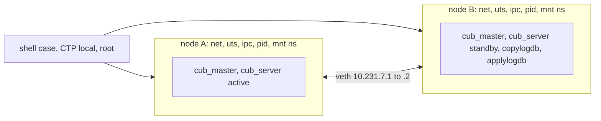

# CBRD-26659: 실제 두 노드 OOS HA 복제 TC와 PR CI shell 경로

작성: 2026-10-27 (Asia/Seoul). 갱신: 2026-10-28, 실제 PR CI 결과 반영. Work463. 이 문서는 실행 증거와 남은 범위를 기록한다. 새 spec이나 승인된 테스트 행렬이 아니다.

## 결론

현재 PR CI의 `gha-ci` **shell** suite 안에서, shell TC 하나가 스스로 격리된 HA 노드 두 개(active/standby)를 구성하고 OOS 값의 실제 복제를 검증할 수 있다. 새 suite나 HA 전용 job이 필요 없다.

- CI와 같은 이미지·entrypoint·CTP로 로컬에서 실행했다. 결과는 PASS(81 OK, 0 NOK)다.
- **실제 PR CI에서도 통과했다.** PR #8128의 `/run shell` run [40507894187](https://github.com/CUBRID/cubrid/actions/runs/40507894187) shard 18에서 `[OK]`다. 그 shard의 72건이 모두 통과했다.
- 같은 run의 `test_shell` 실패는 shard 39의 server-side loaddb case `_enhance_1008` 한 건이다. 이 실패는 HA TC와 관계없다고 판단한다([근거](#실제-pr-ci-실행)). 재실행 run [40552401255](https://github.com/CUBRID/cubrid/actions/runs/40552401255)에서 OK가 되었고, 현재 head의 `gha-ci` context 다섯 개가 모두 pass다.
- 장애 전환(failover)은 다루지 않는다. 별도 단계로 범위를 정한다.

## 입력 revision

| 항목 | 값 |
|---|---|
| Engine | `e3589ae42d42b04eb020e1ae43e165b01d31b12a` (PR #8128 head), `11.5.0.2793-e3589ae` optdebug |
| Build image | `cubridci/cubridci:build_rl8.10` `sha256:f8ff31b3a5d7432cbf0f6e36ac82688f0cce0c961bbfc191ac2dc01612a8a887`, `/entrypoint.sh build -m optdebug` (CI shard와 같은 build mode) |
| Test image | `cubridci/cubridci:test_rl8.10` `sha256:54e1835de00fa38c2539d268023ab1d34e653f0558f32f5f450e8b6b2721a15d` (2026-10-26) |
| CTP | `cubrid-testtools` develop `7dc9f4192bb96988d1bab78df3e45df88628b814` |
| Workflow | `CUBRID/cubrid` develop `2d925cb8685600135eb1fb1781811f6b45fdecb0` `.github/workflows/gha-ci.yml` |
| Testcase | `cubrid-testcases-private-ex` `tc/pr-8128` `3bba57e1f`. `task/oos-ha-replication`을 `5a3c7d8ff` 위에 fast-forward merge하고 2026-10-27에 push |

## CI shell 경로에서 확인한 사실

- shell shard는 `/entrypoint.sh test shell`로 CTP shell runner를 **local mode, root**로 실행한다. `conf/shell_ci.conf`에는 `env.*.ssh.host`가 없다. pod는 `privileged: true`다.
- shard는 optdebug build를 푼다(`gha-ci.yml` shard의 `$SHA/debug`, build matrix `-m optdebug`).
- test image에는 `iproute`(`ip`)이 **없다**. `unshare`, `nsenter`, `ifconfig`, `perl`은 있다.
- 이미지 자체는 `ha_repl`, `ha_shell` category를 지원한다. 그러나 두 번째 컨테이너(`/entrypoint.sh node`)와 SSH가 필요하다. `gha-ci`의 `SUITES`에는 shell, sql, medium만 있다.
- CI의 `/entrypoint.sh cases shell <root>`는 새 case를 찾는다(3621건 중 하나). Linux exclude list와 `_25_unstable`에 해당하지 않는다. shard의 `keep case` 단계는 `cases` 디렉터리만 지우므로 `oos_common/`은 남는다.

## 두 노드 구성

| 요구 | 근거 | 해결 |
|---|---|---|
| 노드마다 다른 hostname | heartbeat가 `GETHOSTNAME`으로 자기 노드를 `ha_node_list`에서 찾는다 (`src/executables/master_heartbeat.c:5024`) | 노드마다 UTS namespace |
| 같은 port를 두 노드가 listen | master TCP와 heartbeat UDP가 `INADDR_ANY`에 bind (`src/connection/tcp.c:663`, `master_heartbeat.c:5105`) | 노드마다 network namespace, veth로 연결 |
| master socket file 분리 | `css_get_master_domain_path`가 `$CUBRID_TMP/CUBRID<port>`를 쓴다 (`src/connection/tcp.c:135`) | 노드마다 `CUBRID_TMP` |
| `/etc/hosts` 수정 금지 | `use_user_hosts=on`이면 `$CUBRID/conf/cubrid_hosts.conf`를 쓴다 (매뉴얼 `admin/config.rst` use_user_hosts) | 노드별 conf |
| 외부 설치본 보호 | createdb, server, heartbeat가 conf, log, var, databases에 쓴다 | 노드별 `$CUBRID` view: binary는 symlink, 나머지는 사본. 외부 `$CUBRID`를 read-only로 mount해 검증 |
| `ip` 없음 | test image | `oos_veth_pair.pl`이 `RTM_NEWLINK` 요청을 직접 보낸다 |
| 고아 daemon 회수 | `hb_get_deactivating_server_count`가 `kill(pid, 0)`으로 server 종료를 확인한다 | node holder(PID namespace의 PID 1)가 `waitpid`로 회수. `sleep`이면 zombie 때문에 `heartbeat stop`이 끝나지 않았다(r1) |
| 비 root 실행(QA VM, 개인 runner) | — | root가 아니면 root로 mapping된 user namespace 하나가 두 노드의 namespace를 소유 |

시작 순서는 CTP `make_ha_upper.sh`와 같다. A의 heartbeat를 먼저 시작하고 `to-be-active`를 기다린 뒤 B를 시작한다. 그다음 B `standby`, A `active`를 기다린다. A는 slave가 붙을 때까지 `to-be-active`에 머문다.

정리: B, A 순서로 `cubrid heartbeat stop`(각 60초 제한), node log를 case 디렉터리 `ha_logs/`에 복사, 기록한 holder pid만 SIGKILL(PID namespace 전체 종료), work dir 삭제, 잔존 검사.

## TC 내용과 판정 기준

`shell/_40_guava/cbrd_26659_ha_replication/cases/cbrd_26659_ha_replication.sh`. 모든 표에 PK가 있다(매뉴얼 `ha.rst`: HA는 PK 기반 복제).

각 단계 후 master의 barrier row를 갱신하고, slave에서 그 값이 보일 때까지 최대 120초 polling한다. applylogdb는 commit 순서로 적용하므로 이전 commit이 모두 적용됐다는 뜻이다. 검사는 **각 노드에서 따로**, TC에 적은 기대값 식과 비교한다. master와 slave를 서로 비교하지 않는다. OOS OID는 비교하지 않는다.

| 단계 | 동작 | 노드별 검사 |
|---|---|---|
| setup | A active, B standby | B에 쓰기 시도가 `updates are disabled`로 거부 |
| dml.insert | 6 B inline, 5107 B 1 chunk, 36009 B chain | 값 전체 equality, `octet_length`, HAS_OOS `1:0,2:1,3:1`, `SHOW HEAP OOS` chunk 4개 |
| dml.update | 할당된 OOS 값 교체, 미할당 OOS(태그만 변경), inline에서 OOS로 | 값, HAS_OOS 모두 1 |
| dml.rollback | 한 transaction에서 insert, update 2건, delete 후 rollback | 직전 상태 유지 |
| dml.delete | OOS row 삭제 | 남은 row와 값 |
| policy | DEFAULT, `PREFER_INLINE`, `FORCE_OUTLINE` 표 | `SHOW HEAP OOS` 바이트 3532/2532/332로 어느 값이 강등됐는지 확인, B의 `show create table`에 STORAGE 절 유지 |
| key | 5 KB OOS `bit varying` PK, 그 PK를 참조하는 `ON DELETE CASCADE` FK. PK로 row 갱신, PK 값 변경, cascade 삭제 | 부모/자식 값, PK·FK index lookup, 부모/자식 HAS_OOS |
| key_ctl | 같은 단계를 inline `varchar(8)` key로 반복 | OOS 고유 실패와 일반 HA 실패를 구분하는 대조군 |

HAS_OOS는 `SELECT /*+ SELECT_RECORD_INFO */`의 `t_flags & 0x08`이다. 삭제 대기 version과 해제된 slot(`REC_MARKDELETED`, `REC_DELETED_WILL_REUSE`)은 제외한다. `REC_HOME`이 아닌 record는 `<id>:t<type>`으로 출력되어 비교에서 실패한다.

## 실행 결과

모든 run은 `podman run --privileged`(rootless podman)에서 `/entrypoint.sh test shell`, `TEST_SCENARIO=<case dir>`로 실행했다.

| Run | 입력 | 결과 | 시간 |
|---|---|---|---|
| r1 | 초기 TC | NOK. TC 쪽 결함 두 가지: `disk_size(bit varying)`이 length prefix와 정렬을 포함(6→8, 5107→5112), rollback된 insert의 `REC_DELETED_WILL_REUSE` slot을 행으로 셈. 또 holder가 zombie를 회수하지 않아 `heartbeat stop`이 60초 제한에 걸림 | 168 s |
| r2 | 세 결함 수정 | PASS, 81 OK, 0 NOK | 48 s |
| r3, r4, r5 | r2와 같은 TC, 동시 실행 3개 | 모두 PASS | 각 78 s |
| sab1 | setup 직후 B의 applylogdb를 `SIGSTOP`하는 사본 | 의도대로 NOK: `dml.insert` barrier가 120초 안에 slave에 적용되지 않음. cleanup OK | 162 s |
| r6 | 커밋 `3bba57e1f`와 같은 파일(sha256 일치) | PASS, `[OK]`, 81 OK, 0 NOK, CTP `All Tests are passed`, cleanup status 0 | 53 s (CTP 50 s) |
| rootless | 같은 library를 host(el9)에서 uid 1000으로 실행, 최소 sentinel | PASS: setup 31 s, B에서 exact 값과 `t_flags=9`, 잔존 process·work dir 없음 | 36 s |

r6 단계별 시간: setup 약 27 s(A `to-be-active` 2 s 포함), 검사 약 14 s, 정리 4 s.

## 실제 PR CI 실행

입력: PR #8128 head `e3589ae`, `tc/pr-8128` `3bba57e1f`, CTP `7dc9f41`. 2026-10-27 12:57:19Z에 `/run shell`을 게시했다([comment](https://github.com/CUBRID/cubrid/pull/8128#issuecomment-6442446964)). 직전 run 40499093799(`tc/pr-8128` `5a3c7d8ff`, 새 case 없음)가 끝난 뒤 게시해서 그 run을 취소하지 않았다.

| Run | 내용 | 결과 |
|---|---|---|
| [40507894187](https://github.com/CUBRID/cubrid/actions/runs/40507894187) shard 18 (job 122202487940) | 새 case 배정과 실행. provenance: engine `11.5.0.2793-e3589ae` optdebug, private-ex `3bba57e1f`, CTP `7dc9f41` | `[OK]`, case 약 44 s. shard: assigned 72 / run 72 / failed 0 / skipped 0 |
| 40507894187 전체 | shell suite | `test_shell` failure. shard 39에서 `_35_cherry/issue_21654_server_side_loaddb/loaddb_CS/_01_utility/_17_loaddb/_enhance_1008` 한 건이 NOK (assigned 72 / run 71 / failed 1 / skipped 1) |
| [40552401255](https://github.com/CUBRID/cubrid/actions/runs/40552401255) | `/run rerun 40507894187` | `_enhance_1008`만 재실행, `[OK]` (assigned 1 / run 1 / failed 0). `test_shell` success |

`_enhance_1008` 실패가 HA TC와 관계없다고 보는 근거:

- 같은 engine `e3589ae`의 직전 run 40499093799에서 `_enhance_1008`은 OK(shard 47)였다. 그 run의 유일한 NOK인 `cbrd_23280_auth`(같은 server-side loaddb 영역)는 이번 run에서 OK였다. 같은 영역의 서로 다른 case가 run마다 실패한다.
- HA case는 shard 18의 별도 pod에서 실행됐다. shard 39와 process, network를 공유하지 않는다.
- 같은 commit의 재실행에서 OK였다.

`_enhance_1008`의 실패 원인은 분석하지 않았다.

`/run rerun 40507894187` 댓글은 `vimkim` 계정으로 세 번(17:29Z, 17:35Z, 17:37Z) 게시됐다. 앞의 두 run(40551063742, 40551989314)은 `gate` job에서 `could not read the jobs of run 40507894187`로 실패했다(GitHub API HTTP 502, stream error). 세 번째가 위의 40552401255다.

## 한계와 미실행

- 실제 ARC pod(root, `privileged: true`)에서 통과한 것은 한 번(run 40507894187)이다. 반복 실행 안정성은 로컬 동시 실행 3회 외에는 측정하지 않았다.
- 비 root 경로는 library 최소 sentinel만 실행했다. 전체 TC를 비 root CTP로 실행하지 않았다. 개인 native runner(`cubrid-test-shell-run`)로도 실행하지 않았다.
- 장애 전환, 재기동, master 교체 후 OOS 값, 대량/동시 쓰기에서의 queue alignment는 다루지 않는다. coverage R28의 queue alignment 부분은 여전히 미검증이다.
- 기존 QA HA corpus(`cubrid-testcases-private/HA/shell`)와는 별개다.

## 다른 문서에 영향을 주는 관찰

- `cubrid-oos-context`의 [test recipes](https://github.com/vimkim/cubrid-oos-context/blob/main/docs/reference/test-recipes.md)는 `CAST(REPEAT('AA', N) AS BIT VARYING)`이 디스크에 N 바이트이고 `DISK_SIZE`로 확인한다고 쓴다. 이 engine에서 `DISK_SIZE`는 직렬화 크기다. 255 B 미만은 1 B, 그 이상은 5 B의 length prefix와 4 B 정렬을 포함한다. 정확한 값 크기는 `OCTET_LENGTH`로 확인한다. 이 문서는 비규범 문서이므로 수정은 별도로 판단한다.

## 다음 단계

TC를 `tc/pr-8128`에 merge, push하고 PR CI에서 실행하는 단계는 2026-10-27에 끝났다.

1. failover 범위 결정: 같은 library로 A의 server 종료 후 B 승격, 승격 후 OOS 읽기·쓰기, 이전 master 재합류.
