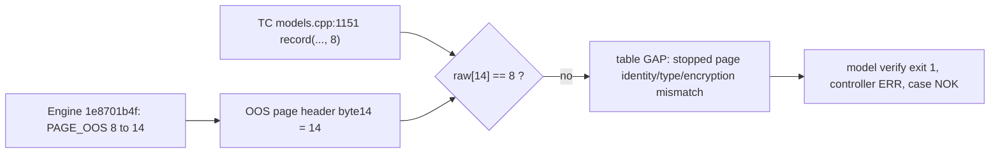

# PR #8128 CI run 40472072791 — shell 실패 3건 원인 분석

작성일: 2026-10-27 (Asia/Seoul) · 작성: Claude (claude-opus-5-5) · 관련: CBRD-26659, CBRD-26357, [PR #8128](https://github.com/CUBRID/cubrid/pull/8128), private TC PR #4365, Work513

## 1. 요약과 결정 경계

**질문.** [run 40472072791](https://github.com/CUBRID/cubrid/actions/runs/40472072791)에서 `cbrd_26659_record_residual.sh`, `cbrd_26659_record_layout.sh`, `cbrd_26659_record_keys.sh`가 왜 실패했는가?

**독자.** PR #8128과 OOS 보강 TC PR(public #3688, private #4365)의 작성자와 리뷰어.

**주요 결론 (신뢰도: 높음).** 세 실패는 **하나의 공통 원인**에서 나온다. Engine commit [`1e8701b4f`](https://github.com/CUBRID/cubrid/commit/1e8701b4f27f54a4069e1e8fe05f8a80ebf02121) (CBRD-26357)는 `PAGE_TYPE` enum에서 `PAGE_OOS`를 맨 끝으로 옮겼다. 따라서 디스크에 기록되는 OOS page type이 **8에서 14로 바뀌었다**. 이 변경은 2026-10-27에 승인된 ADR-0006의 "page type은 append-only" 결정과 일치한다. 그런데 private TC의 native 물리 검증기(`oos_native model verify`)는 OOS page의 raw page type을 여전히 **8로 하드코딩**한다. 그래서 OOS stub을 가진 모든 표에서 `stopped page identity/type/encryption mismatch`가 발생하고 검증기가 exit 1로 끝난다.

- 불일치는 **testcase 관찰 도구(fixture) 계약**에서 시작한다. Engine 동작은 승인된 명세와 일치한다. 실행 환경이나 flaky 문제의 근거는 없다.
- PR 관련성은 `direct`다. 실패한 세 case와 그 검증기는 이 PR의 private TC(tc/pr-8128, #4365) 내용이다. Engine 변경은 이미 PR base(`feature/oos-merge` `dcbf09e4f`)에 있고, 기준 동기화 commit `e3589ae42`가 이를 PR head로 가져왔다.
- 이 보고서는 분석만 한다. Engine/TC 수정, 기대값 변경·비활성화, push, CI 재실행은 하지 않았다.

**결정 경계.**

- 세 실패의 직접 원인은 관측으로 확정했다. CI 원격 증거에는 표별 판정이 없다. 동일 Engine/TC revision의 로컬 재현(§5.2)과 SA probe(§5.3)가 그 공백을 채운다.
- 상수를 14로 고친 뒤에도 그 다음 검사(chunk header, stamp, census)가 통과하는지는 **관측하지 않았다**. 검증기는 표마다 첫 예외에서 멈추기 때문이다(§5.4 미확인 사항).
- Merge-base baseline은 수집이 실패해 비교할 수 없다(§6). 회귀 판정은 하지 않는다. 시간 순서는 원인의 근거가 아니다. 원인 판단은 소스·재현·명세 근거에만 기댄다.



## 2. CI 스냅샷

| Suite | 상태 | Run/attempt | Verdict | 집계 |
| --- | --- | --- | --- | --- |
| `test_shell` | `completed` (검증됨) | [40472072791](https://github.com/CUBRID/cubrid/actions/runs/40472072791) / 1 | fail | planned 3,559 = run 3,529 + unrun 0 + skipped 30; tests 3,559 = passed 3,526 + failures 3 + errors 0 + skipped 30 |
| `test_sql` | 이번 수집 범위 밖 | 40472072791 | SUCCESS (check context) | 수집하지 않음 |
| `test_medium` | 이번 수집 범위 밖 | 40472072791 | SUCCESS (check context) | 수집하지 않음 |
| build (release/debug) | 이번 수집 범위 밖 | 40472072791 | SUCCESS (check context) | — |

- 사용자 요청에 따라 `test_shell`만 수집했다. 다른 suite의 상태는 같은 PR의 `gha-ci` check context 값이다. 이 보고서는 그 suite들을 검증하지 않았다.
- shell shard 50개 중 47개 PASS, 3개 FAIL이다. 실패 shard마다 실패 case는 1건이다.
- Report-mode gate: `{"mode":"full","regression_conclusions_allowed":false,"comparison_scope":"none"}`. Baseline이 `unavailable`이어서 비교 범위는 `none`이다.

## 3. 증거 범위

| 항목 | 값 |
| --- | --- |
| PR | #8128 `[CBRD-26659] Initialize OOS testcase review`, base `feature/oos-merge` |
| 분석한 Engine commit | `e3589ae42d42b04eb020e1ae43e165b01d31b12a` (live PR head와 동일, 2026-10-27 19:50 KST 확인) |
| Public TC | `45e21ad799d82ebadc04a93c7d2f69517d53bf39` (tc/pr-8128) |
| Private TC (shell) | `98723aa473cde722abbc729799cf489b7f3f732f` (tc/pr-8128); summary의 모든 shard가 같은 SHA를 기록 |
| Runner | cubrid-testtools `7dc9f4192bb96988d1bab78df3e45df88628b814` |
| Build mode (shell shard) | debug (`build.read`: `mode=debug`, run 40472072791 attempt 1) |
| Collector | `cubrid-ci 0.2.0 (dd290e9f7b9b, release)`, `doctor` healthy |
| 수집 시각 | 2026-10-27T10:50:35.698559320Z |
| Observation | `20261027T105026.713821090Z-3414688-0`, outcome `complete` |
| 검증 | request/result v1, command-result v2, manifest v2, suite-summary v2, raw-index v2, failure v2 schema 모두 통과. observation command와 저장한 결과가 같음. 집계가 맞음 |

**제한 사항.**

1. CI는 shard마다 `test-shell.xml`만 artifact server에 올렸다. 검증기의 표별 판정 파일(`b12.*physical.json`)은 runner의 일회성 CTP tree에만 남고 업로드되지 않았다. 그래서 CI 증거만으로는 표별 오류를 볼 수 없다.
2. Collector의 `message.txt`에는 controller log 전체가 들어 있다. native 검증기는 stderr에 아무것도 쓰지 않았다. 이 사실은 "표 단위 오류 경로로 exit 1"이라는 추론의 근거가 된다(§5.1).
3. 로컬 재현은 같은 commit의 debug_gcc build로 실행했다. CI container와 host 환경은 다르다.

## 4. 실패 목록

| # | Shard/job | Testcase (private TC 기준 경로) | 시간 | 최초 불일치 | Baseline 분류 | 범주 | PR 관련성 | 신뢰도 |
| --- | --- | --- | --- | --- | --- | --- | --- | --- |
| 1 | 14 / [122086744588](https://github.com/CUBRID/cubrid/actions/runs/40472072791/job/122086744588) | `shell/_40_guava/cbrd_26659_record_residual/cases/cbrd_26659_record_residual.sh` | 22.557 s | `controller.sh:133` `model verify` (사전 물리 검증); 표 `b12_atmax`, `b12_reject` GAP | `uncomparable` | TC 관찰 도구 상수 불일치 | `direct` | 높음 |
| 2 | 23 / [122086744633](https://github.com/CUBRID/cubrid/actions/runs/40472072791/job/122086744633) | `shell/_40_guava/cbrd_26659_record_layout/cases/cbrd_26659_record_layout.sh` | 22.928 s | `controller.sh:112` `model verify ... .before_update`; 표 `b12_update_s_priority`, `b12_update_s_exhaust` GAP | `uncomparable` | 같음 | `direct` | 높음 |
| 3 | 40 / [122086744964](https://github.com/CUBRID/cubrid/actions/runs/40472072791/job/122086744964) | `shell/_40_guava/cbrd_26659_record_keys/cases/cbrd_26659_record_keys.sh` | 8.23 s | `controller.sh:159` 최종 `model verify`; 표 `b12_key_inpage`, `b12_key_overflow`, `b12_key_large` GAP | `uncomparable` | 같음 | `direct` | 높음 |

집계: head 실패 3, `also_observed_on_base` 0, `additional_on_head` 0, `uncomparable` 3. `base_only`는 baseline 증거가 없어 평가할 수 없다.

CI에서 관측한 공통 signature (세 case가 같은 형식):

```text
NOK record boundary assertion failed: ../../oos_record_boundaries/controller.sh:10: exit=1
  command=bash ../../oos_native/oos_native.sh "$@"
  last_completed_command=bash ../../oos_common/oos_sa_observer.sh b12.guard{2|_before2|5} w456b12 cubrid diagdb -d 2 w456b12
  exit_status=0
```

`controller.sh:10` 은 `oos_native()` wrapper 함수의 정의 줄이다. 실제 호출 위치는 직전에 성공한 `diagdb -d 2` 관찰 단계(guard 이름)로 정한다. 각 case 진입 스크립트의 17행이 controller를 호출하고, 21행이 controller log의 마지막 16,000 byte로 NOK를 기록한다.

## 5. 원인 분석 — 공통 원인 A: OOS page type 상수 불일치

### 5.1 CI 관측과 소스 연결

**관측 (CI, collector bundle).**

- 세 case 모두 직전 단계는 `oos_sa_observer.sh ... diagdb -d 2`이고 그 exit는 0이다. 실패 명령은 `oos_native.sh`이고 exit는 1이다.
- Controller log는 ERR context 줄로 시작한다. 그 앞에 native binary의 stderr 출력이 없다.

**소스 (private TC `98723aa47`).**

- [`oos_record_boundaries/controller.sh`](https://github.com/CUBRID/cubrid-testcases-private-ex/blob/98723aa473cde722abbc729799cf489b7f3f732f/shell/_40_guava/oos_record_boundaries/controller.sh) 에서 `diagdb -d 2` 다음 명령은 다음과 같다.
  - residual 131→133행 `oos_native model verify ... > b12.before.physical.json`
  - layout 109→112행 `... b12.before-model.json .before_update`
  - keys 157→159행 `... > b12.physical.json`
  - 그 사이의 `oos_observe.sh files` 호출(132, 110, 158행)이 실패했다면 ERR context는 `controller.sh:10`이 아니라 해당 행을 가리켰을 것이다.
- [`oos_native.sh`](https://github.com/CUBRID/cubrid-testcases-private-ex/blob/98723aa473cde722abbc729799cf489b7f3f732f/shell/_40_guava/oos_native/oos_native.sh#L18) 는 자기 오류를 exit 2로 끝낸다(18행). 97행은 binary를 `exec`한다. 따라서 exit 1은 binary가 반환한 값이다.
- [`models.cpp`](https://github.com/CUBRID/cubrid-testcases-private-ex/blob/98723aa473cde722abbc729799cf489b7f3f732f/shell/_40_guava/oos_native/modules/models.cpp#L995-L1323) 의 `boundary_verify`가 exit 1을 내는 경로는 두 가지다.
  - 표마다 예외를 잡아 `errors`에 넣고 stdout JSON으로 출력한 뒤 1을 반환한다(1312, 1323행).
  - 최상위 예외는 `legacy_status`가 stderr로 출력한 뒤 1을 반환한다(1366–1374행).
  - stderr가 비어 있으므로 **표 단위 오류 경로**만 남는다.
- 같은 함수의 `record` lambda(1045–1067행)는 page header byte 14(page type)가 기대 type과 같은지 검사한다(1053행). 다르면 `stopped page identity/type/encryption mismatch`를 던진다(1055행).
  - HOME record는 type 2로 읽는다(1109행).
  - OOS stub이 가리키는 chunk는 **type 8**로 읽는다(1151행: `record(vol, page, slot, 8)`).
  - 이 호출은 `phase = "conformance"`(1157행)보다 앞에 있다. 그래서 실패한 표의 판정은 `GAP`이다.

**소스 (Engine).**

| Revision | `PAGE_OOS` | 근거 |
| --- | --- | --- |
| `c4c4f5c5e` (직전 shell PASS run의 Engine) | 8 (`PAGE_OVERFLOW` 다음) | `src/storage/storage_common.h` 159행 |
| `e3589ae42` (이번 run) | **14** (`PAGE_VACUUM_DATA` 다음, `PAGE_LAST`) | [`storage_common.h` 149–167행](https://github.com/CUBRID/cubrid/blob/e3589ae42d42b04eb020e1ae43e165b01d31b12a/src/storage/storage_common.h#L149-L167) |

- 변경 commit은 [`1e8701b4f`](https://github.com/CUBRID/cubrid/commit/1e8701b4f27f54a4069e1e8fe05f8a80ebf02121) "[CBRD-26357] Reject databases of another storage format at boot"(2026-10-27 14:54 KST)이다.
  - commit message: "PAGE_OOS and PERF_PAGE_OOS move to the end of their enums, so the page types of develop keep their numbers."
  - 같은 commit이 [`DISK_STORAGE_FORMAT_REVISION 1`](https://github.com/CUBRID/cubrid/blob/e3589ae42d42b04eb020e1ae43e165b01d31b12a/src/storage/disk_manager.h#L37-L42)을 추가했다.
- 이 commit은 merge base `dcbf09e4f`와 PR head `e3589ae42`의 조상이다. `c4c4f5c5e`의 조상은 아니다.

**명세 (cubrid-oos-context `OOS-CONTEXT.md`, SHA-256 `6300aa1f…cf63`, Last updated 2026-10-27).**

- §5 "Storage-Format Boot Check (ADR-0006)": "Page types are append-only (`PAGE_OOS`/`PERF_PAGE_OOS` last)."
- ADR-0006 (accepted 2026-10-27): "Page types are stored on disk: append new types, never insert."
- 따라서 Engine의 14는 승인된 설계와 일치한다. TC의 8은 ADR-0006 이전 번호다.

### 5.2 로컬 재현 (관측)

CI가 표별 판정을 남기지 않았다. 그래서 같은 Engine/TC revision으로 세 case를 `cubrid-test-shell-run` 절차로 한 번 실행했다. 분리한 변수는 검증기의 표별 오류 문구 하나다. TC와 Engine은 수정하지 않았다.

| 항목 | 값 |
| --- | --- |
| Source/install | `work456-publication-ci-source-20261026` worktree, HEAD `e3589ae42`, clean; install `11.5.0.2793-e3589ae` debug_gcc; preflight `commit_match=yes` |
| Private TC | `tc-pr-8128` checkout, HEAD `98723aa47`, clean, 수정 없음 |
| Runner | native `testkit shell` (`cubrid-testkit dev`, SHA-256 `31be3b1e…5f5a`), `TESTKIT_NATIVE=shell TESTKIT_CONTAIN=1`, containment available |
| Config | `shell_ci.conf` 복사본, `parallel_slots=1`, `scenario_disk=on`, retry 0, update/continue off, file feedback, `testcase_from_file`=3건; SHA-256 `ed52f84e…a4` |
| 격리 | attempt 전용 CUBRID/CTP 복사본, `HOME`, 빈 `databases`; 원래 install·DB·daemon 재사용 없음 |
| 결과 | 3/3 NOK (CI와 동일), 48 s; runner exit 0 (verdict 아님) |

검증기 출력(`$CTP_HOME/result/work456-ticket12/<mode>/b12.*physical.json`):

| Mode | 실패 위치 (first-failure) | GAP 표 (오류) | PASS 표 |
| --- | --- | --- | --- |
| residual | `guard2` 다음, `b12.before.physical.json` | `b12_atmax`, `b12_reject` — `stopped page identity/type/encryption mismatch` | `b12_bigone` |
| layout | `guard_before2` 다음, `b12.before_update.physical.json` | `b12_update_s_priority`, `b12_update_s_exhaust` — 같은 오류 | `b12_update_priority`, `b12_update_exhaust` |
| keys | `guard5` 다음, `b12.physical.json` | `b12_key_inpage`, `b12_key_overflow`, `b12_key_large` — 같은 오류 | `b12_default_inpage`, `b12_default_overflow` |

- 각 mode의 first-failure log는 CI 메시지와 같은 guard 이름과 `controller.sh:10` frame을 기록했다.
- 실패한 표는 모두 OOS stub이 있는 표다. stub이 없는 HOME 표와 bigone 표는 같은 실행에서 PASS했다. 따라서 page id·volume·encryption 같은 공통 검사는 정상이다. 차이는 OOS chunk page를 type 8로 읽는 호출에서만 생긴다.
- `testkit-focused.py verify`는 FAIL이다. 이유는 두 가지다. (1) 세 case가 NOK다. (2) testkit summary가 `LINUX_NOT_SUPPORTED` macro로 skip된 21건을 total에 넣어 `total case count is 24, expected 3`이 되었다. 두 번째는 집계 방식 문제이며 NOK 판정과는 무관하다.

### 5.3 디스크 page type probe (관측)

`stopped page identity/type/encryption mismatch`는 여러 조건을 한 메시지로 묶는다. type 조건을 따로 확인하려고 같은 attempt install에서 SA mode probe를 실행했다. daemon은 띄우지 않았고, 일회성 DB를 만든 뒤 삭제했다.

1. `cubrid createdb pt8 en_US.utf8`, 그리고 data volume(page 0의 type이 VOLHEADER=3인 파일)에서 저장 page id와 위치가 같은 page만 골라 byte 14 분포를 기록했다.
2. `create table t(id int primary key, p bit varying)`, 6,000 byte 값 1행 insert, 그리고 `show heap oos of t` → `Has_oos_file 1`, `Oos_num_user_pages 2`, `Oos_num_recs 1`.
3. 같은 분포를 다시 기록했다.

| Volume | insert 전 | insert 후 |
| --- | --- | --- |
| `pt8` | type 14: 0, type 8: 0 | 변화 없음 |
| `pt8_x001` | type 14: 0, type 8: 0 | **type 14: 2**, type 8: 0 |

새 OOS file의 page 2개가 모두 byte 14 = 14로 기록되었다. 검증기의 `raw[14] == 8` 조건은 이 Engine에서 항상 거짓이다. probe DB는 `deletedb`로 지웠고 registry에도 남지 않았다.

### 5.4 추론, 미확인 사항, 반증 조건, 다음 행동

**추론.**

- 세 case가 실패한 이유는 TC의 native 물리 검증기가 OOS page type을 8로 고정했기 때문이다. Engine `e3589ae42`는 승인된 ADR-0006에 따라 14를 기록한다.
- 직전 PASS run [40335925801](https://github.com/CUBRID/cubrid/actions/runs/40335925801)과 비교한다.
  - TC closure는 byte 단위로 같다. `oos_native/`, `oos_common/`, `oos_record_boundaries/`, 세 case directory가 private TC `8486abdac`와 `98723aa47` 사이에 diff 0이다. `models.cpp` blob은 둘 다 `abc57108…`이다.
  - Runner도 `7dc9f41`로 같다.
  - Engine만 `c4c4f5c5e`(PAGE_OOS=8)에서 `e3589ae42`(PAGE_OOS=14)로 바뀌었다.
  - 이 대조는 merge-base baseline이 아니라 맥락 증거다. 그래도 TC 입력이 같다는 점은 원인 귀속을 강하게 뒷받침한다.

**활성 OOS case 중 왜 이 세 건만 실패했는가.**

같은 상수를 쓰는 다른 경로는 모두 비활성 case에만 있다.

| 하드코딩 위치 (private TC `98723aa47`) | 사용하는 case | 이번 run 실행 여부 |
| --- | --- | --- |
| `oos_native/modules/models.cpp:1048, 1151` (`model verify`) | `cbrd_26659_record_{residual,layout,keys}` | 실행 → 3건 FAIL |
| `oos_native/stopped_format.cpp:223`, `modules/physical.cpp:215` (`record_bytes`, `alt_record_bytes`) | `partition_add_drop_*`, `partition_promote_*`, `alt_stub_*` | `disabled/failing/` 아래, 미실행 |
| `oos_native/modules/capture.cpp:219, 291` (`oos08_partition_capture`, `oos15_release_bytes`) | `partition_hash_*`, `partition_move` 등, `notify_*` | 비활성, 미실행 |
| `oos_common/oos_page_census.c:18`, `oos_qualified_reuse.sh` 의 jq `ptype==8` (82–151행) | `cbrd_26659_qualified_reuse` (snapshot controller `qualified` scenario) | 비활성, 미실행 |
| `oos_native/selftest.cpp:130`, `tests/physical_fixture.cpp:117` | 합성 page self-test | CI case 아님 |

- 활성 `cbrd_26659_snapshot_visibility`는 `snapshot_controller.sh`의 `visibility` scenario만 사용한다. 이 scenario는 census 경로에 들어가지 않는다(343–356행).
- 활성 `cbrd_26659_gap_recreate`의 `recreate_records`는 SQL `SELECT_RECORD_INFO` 결과만 `dml_check`로 검사한다. raw OOS page는 읽지 않는다.
- 이 경로 분석의 예측은 "raw OOS page type을 읽는 활성 case는 실패하고, 나머지는 통과한다"이다. 관측 결과(활성 OOS 69건 중 66 PASS / 3 FAIL)와 정확히 일치한다.

**미확인 사항.**

1. 검증기는 표마다 첫 예외에서 멈춘다. 그래서 `e3589ae42`에서 OOS stub 표의 chunk header, length, link, stamp, census 검사(1151행 이후, `phase = "conformance"`)는 실행되지 않았다. 상수를 고친 뒤 다른 불일치가 드러날 수 있다.
   - 위험을 낮추는 근거: `c4c4f5c5e..e3589ae42` 범위에서 `src/storage/oos*`, `object_representation*`, `slotted_page*`의 diff는 0이다. `vacuum_oos.cpp`는 오류 처리 5줄, `heap_file.c`는 오류 전파 변경만 있다. 하지만 이것은 소스 근거일 뿐 관측은 아니다.
2. CI host에서 검증기 JSON을 직접 보지 못했다. 로컬 재현은 같은 commit이지만 다른 host와 build 환경이다.
3. 비활성 case가 다른 이유로도 실패하는지는 이 분석 범위 밖이다. 위 표는 "다시 활성화하려면 이 상수도 고쳐야 한다"는 뜻일 뿐이다.

**반증 조건.**

- F1: `e3589ae42`에서 TC 사본의 OOS page type 상수를 모두 14로 바꾸었는데도 세 case가 같은 `stopped page identity/type/encryption mismatch`로 실패하면 이 원인은 틀렸다.
- F2: PAGE_OOS=8인 Engine(예: `c4c4f5c5e`)에서 TC `98723aa47`가 같은 오류로 실패하면 틀렸다. 현재 증거: run 40335925801에서 같은 TC closure가 PASS했다.
- F3: `e3589ae42`가 만든 OOS page의 byte 14가 8이면 틀렸다. 현재 증거: probe에서 14로 관측했다.

**다음 행동.**

1. (TC 수정 결정, 사용자 몫) 검증기의 OOS page type을 14로 바꾼다. 위 표의 모든 위치를 함께 바꾸고, 하나의 이름 있는 상수로 모은 뒤 ADR-0006과 `storage_common.h`를 주석으로 가리키는 방식을 권한다. self-test 합성 page(`selftest.cpp:130`, `physical_fixture.cpp:117`)도 같이 바꾸어야 한다. 이 fixture의 `badpagetype` 음성 대조(7)는 그대로 의미가 있다. Engine은 수정하지 않는다. Engine은 승인된 명세와 일치한다.
2. 수정한 TC로 세 case를 `cubrid-test-shell-run`으로 다시 실행한다. 기대 결과는 3/3 PASS다. 이것은 F1의 직접 시험이며 미확인 사항 1도 해소한다. `oos_native.sh --self-test`와 `oos_native/tests/*.sh` 대조도 함께 실행한다.
3. 그 다음 PR #8128의 CI를 별도 승인 절차로 실행한다.
4. (선택) CI 증거 개선: NOK일 때 `b12.*physical.json`의 `errors`를 stderr 또는 NOK 메시지에 넣으면, 다음 실패부터 원격 증거만으로 표별 원인을 볼 수 있다.

## 6. Baseline 비교

| 항목 | 값 |
| --- | --- |
| Pinned head | `e3589ae42d42b04eb020e1ae43e165b01d31b12a` (head 수집과 동일) |
| Target | `feature/oos-merge` tip `dcbf09e4f7fd02ff9c8fc6493ec8887fc2919d67` |
| Merge base | `dcbf09e4f` (target tip과 같음), 해석 시각 2026-10-27T10:56:03.998600853Z |
| Discovery | `exact_commit_links`: 모든 paginated commit status와 check run; repository 전체 workflow 검색은 하지 않음 |
| `test_shell` 후보 | run 40464422209 (07:00:09Z PENDING → 08:01:30Z FAILURE), run 40471760533 (08:11:24Z PENDING → 08:45:11Z SUCCESS) |
| 선택 | run 40471760533 attempt 1 (40464422209의 rerun) |
| 상태 | `collection_failed`, exit 3, observation `20261027T105856.946374833Z-3465058-0` outcome `incomplete`; request/result v2, command v3, manifest v3 schema 통과 |
| 진단 | rerun source run 40464422209에서 shell shard 10개(10, 11, 13, 15, 29, 33, 38, 41, 44, 47)가 job 수준으로 실패했고, shard 10 `tc.read` 가 404여서 testcase provenance를 얻을 수 없음 |

- Baseline 상태: `unavailable`. 비교 결론은 내리지 않는다. 세 실패는 모두 `uncomparable`이다.
- 추가 제한: baseline run의 실제 TC revision은 검증되지 않았다. 현재 `tc/pr-7990` private head(= feature TC tip `75a02020e`)에는 세 case와 `oos_native/`가 없다. 그래서 baseline 수집이 성공했더라도 같은 case를 비교할 수 없었을 가능성이 크다.
- 설정 차이: head와 base는 TC 입력이 다르다(PR TC와 feature TC). 이것만으로도 비교 범위가 제한된다.

## 7. Testcase 이력

| 항목 | 값 |
| --- | --- |
| 도구 | `cubrid-tcc 0.3.0`, suite `shell` |
| 첫 조회 | 세 case 모두 `NOT_INDEXED`, freshness `UNKNOWN` (`needs_refresh=true`) |
| 제한된 refresh | `sync-data --run 40472072791 --run 40335925801 --suite shell --revisit-limit 0`: exit 0, snapshot 100 (partial 100), observation 7,112, unavailable 0 |
| 다시 조회 (세 case 동일) | `status` FAILING, flakiness `UNKNOWN`, freshness FRESH; `explain --run 40472072791`: `history_result=UNKNOWN_HISTORY`, `prior_verified_executions=1`, 이전 실패 0 |
| 선택한 occurrence | run 40472072791 FAIL (Engine `e3589ae`, TC `98723aa`) |
| 이전 occurrence | run 40335925801 PASS (Engine `c4c4f5c`, TC `8486abd`) |
| Coverage | 기본 window 2026-10-14 ~ 2026-10-26T13:30Z, `discovery_complete=false`, 누락 run 다수 |

- 기록된 이전 실패는 없다. 하지만 coverage가 불완전하므로 "처음 관측"이라고 단정하지 않는다.
- Flaky 판단: CLI는 `UNKNOWN`이다. 같은 revision에서 PASS와 FAIL이 섞인 관측은 없다. 로컬 재현은 3/3 같은 오류로 결정적으로 실패했다. 이는 flaky가 아니라는 주장과 맞지만, 이력 판단을 대신하지는 않는다.

## 8. 우선순위 조치와 증거 목록

**조치 (우선순위 순).**

1. TC 수정 여부 결정 (§5.4 다음 행동 1). 담당은 TC PR #4365 작성자다. Engine 변경은 필요 없다.
2. 수정 후 세 case 로컬 native 실행과 self-test (F1 시험).
3. PR #8128 CI를 별도 승인으로 실행. 세 case PASS 확인.
4. 비활성 case를 다시 활성화할 때 같은 상수 수정을 전제 조건으로 기록.
5. (선택) NOK 메시지에 검증기 `errors`를 포함하도록 TC 개선.

**증거 파일 (machine-local, Git에 넣지 않음).**

| 증거 | 위치 |
| --- | --- |
| Head bundle (manifest, summary, failure message/diff, raw) | `~/.local/share/cubrid-ci-data/github-actions/CUBRID-cubrid/pr-8128/e3589ae42d42b04eb020e1ae43e165b01d31b12a/` |
| Baseline bundle | `~/.local/share/cubrid-ci-data/github-actions/CUBRID-cubrid/commits/dcbf09e4f7fd02ff9c8fc6493ec8887fc2919d67/` |
| 이전 세션의 run 기록, job log, 입력 provenance | `~/temp/pr8128-baseline-sync-20261027.VG5dBf/` (`execution-summary.json`, `ci-input-provenance.json`, `ci-failed-shell{14,23,40}-api.log`) |
| 직전 PASS run 기록 | `~/temp/work456-quarantine-correction-20261026.Wm7mYo/ci/terminal-summary.json` |
| 로컬 재현 attempt (identity, config, run.log, verify.log, 결과, probe) | `~/temp/pr8128-shell-repro-20261027.IWCfvb/` (`CTP/result/work456-ticket12/{keys,layout,residual}/`, `ptype-probe2/`) |
| status, collect, collect-base, tcc 조회 JSON | 세션 scratchpad의 `cubrid-ci-analysis.AWpYjZ/` (임시) |
