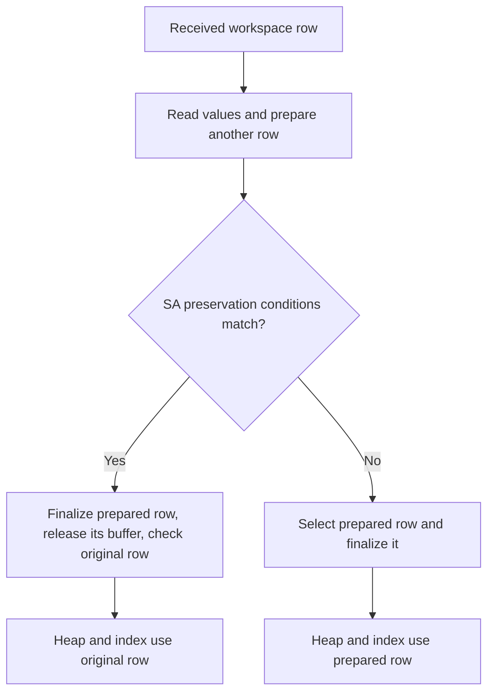

# PR7925: assess the SA path that preserves the original inline row

Date: 2026-10-16, Asia/Seoul. Work Items: 397 and 393.

**The reviewer is right about the late check and the difference between modes.**
The current branch does not avoid preparation. Its value for database correctness is not established by the evidence examined here.
However, removing this branch changes an accepted requirement and extends the lifetime of the prepared buffer.
The report supports reconsidering the branch. It does not approve an untested production change.

The [review comment](https://github.com/CUBRID/cubrid/pull/7925#discussion_r4257963742) applies to engine commit `b755678cd9a3ab465215228d5664f7f1edf24846`.
All source conclusions below use that commit unless another revision appears explicitly.
The reviewer is `hornetmj`. The comment was last edited on 2026-10-13.

**What the comment means**

A workspace holds objects in memory before CUBRID stores them.
The workspace writer encodes an object as a row. A heap stores that encoded row.
OOS stores selected large values outside the row. The row then contains references to those values.
An inline value stays inside the row.

An owner controls the lifetime of a buffer. A view refers to the buffer without owning its memory.

SA means standalone execution. Client/server execution uses the server version of this function.
That server version uses `SERVER_MODE`. The client library's `CS_MODE` does not compile this server function.
The review's reference to CS describes client/server operation.

`locator_finalize_oos_record` receives an encoded row after the caller selects its destination.
For eligible received rows, `heap_prepare_oos_record` reads the values and prepares another encoded row.
This step can select OOS values. It does not immediately write their chains to the destination.
Finalization performs the remaining publication and storage work.
[Source: the locator helper](https://github.com/vimkim/cubrid/blob/b755678cd9a3ab465215228d5664f7f1edf24846/src/transaction/locator_sr.c#L4947),
[source: preparation](https://github.com/vimkim/cubrid/blob/b755678cd9a3ab465215228d5664f7f1edf24846/src/storage/heap_file.c#L13317).

The special SA branch follows preparation. It requires every condition in this table.

| Condition | Meaning |
| --- | --- |
| The build uses `SA_MODE` | The branch exists only in the standalone build |
| `from_workspace` is true | The input carries workspace origin |
| `pending` is null | The caller supplied no pending owner |
| The original row contains no OOS reference | The original row is fully inline |
| The prepared row contains no OOS reference | Preparation selected no OOS values |
| Both representation IDs are equal | Preparation did not select a different schema representation |

The outer helper condition also excludes root and system classes. It requires a positive input length.

The reviewer questions why the yes path exists after CUBRID already creates the prepared row.
Keeping the original row at that point cannot remove the earlier decoding, layout work, or allocation.
The client/server path uses the prepared row without this SA branch.
The two modes therefore select different buffers for the same class of input.

The reviewer compared several data types. He reports equal values and differences only in unused padding.
Padding occupies space but does not represent a column value.
A bound bit records whether a fixed attribute has a non-NULL value.
For example, one fixed attribute uses one meaningful bound bit. Its aligned bound-bit area occupies four bytes.
The remaining bits do not describe additional attributes.

The reviewer proposes two alternatives.

1. Remove the late SA branch and use the prepared row in both modes.
2. Establish why original bytes must survive. Then check whether preparation can be omitted before CUBRID performs it.

The second alternative needs coordination with PR7927. It needs consistent criteria for standalone and server execution.
This coordination does not authorize a separate partition implementation in PR7925.

**Which claims the source supports**

| Review claim | Assessment | Evidence and limit |
| --- | --- | --- |
| The branch follows preparation | Checked | The call to `heap_prepare_oos_record` precedes the SA condition |
| The branch avoids no preparation cost | Checked | Preparation reads values, determines layout, allocates a buffer, and writes the prepared representation |
| SA and server execution select different paths | Checked | `SA_MODE` encloses the original-row branch |
| Unused bound bits can contain previous allocation bytes | Supported by source | Fixed writers change individual attribute bits. The shown column writer does not clear the entire aligned bitmap first |
| Unused bound bits do not determine an attribute's value | Supported for the bound-bit accessors | Each accessor masks the requested attribute bit |
| Only padding can differ for every eligible input | Not established | The review describes samples. The predicate does not prove complete byte identity |
| Disabling the branch passes the reported tests | Reviewer observation | This analysis did not repeat his disabled-branch experiment |
| Passing those tests proves the branch unnecessary | Not established | Existing assertions do not directly check original-buffer selection or complete input-byte preservation |
| Removing the branch improves runtime | Not measured | It removes some work after preparation. It does not remove preparation itself |

The [column writer](https://github.com/vimkim/cubrid/blob/b755678cd9a3ab465215228d5664f7f1edf24846/src/storage/heap_file.c#L13792)
finds the aligned bound-bit area and processes the attributes.
The [fixed writer](https://github.com/vimkim/cubrid/blob/b755678cd9a3ab465215228d5664f7f1edf24846/src/storage/heap_file.c#L13500)
sets or clears the bit for each fixed attribute.
The [bound-bit macros](https://github.com/vimkim/cubrid/blob/b755678cd9a3ab465215228d5664f7f1edf24846/src/base/object_representation.h#L658)
explain the four-byte alignment and the individual masks.
The [workspace writer](https://github.com/vimkim/cubrid/blob/b755678cd9a3ab465215228d5664f7f1edf24846/src/object/transform_cl.c#L743)
copies the workspace's bound-bit area into the encoded row.
These paths explain why meaningful bits can match while unused bits differ.

CHN means cache change number. The source also preserves the input header during preparation.
`heap_prepare_oos_record` reads the input header and restores it to the prepared row.
It adjusts the representation ID and OOS flag for the prepared representation.
The header operations include CHN, transaction identifiers, and the previous-version address.
Therefore, the late SA branch is not the only mechanism that preserves CHN.
[Source: header transfer](https://github.com/vimkim/cubrid/blob/b755678cd9a3ab465215228d5664f7f1edf24846/src/storage/heap_file.c#L13336),
[source: header fields](https://github.com/vimkim/cubrid/blob/b755678cd9a3ab465215228d5664f7f1edf24846/src/base/object_representation_sr.c#L4349).

This header transfer does not prove complete byte identity.
The prepared row keeps its generated offset width and bound-bit layout.
The existing comparison fixture also permits optional collection-domain encodings.
That fixture compares decoded collection values instead of requiring equal encoded collection bytes.
This is a limit on a universal byte claim. It is not a reproduced counterexample to the reviewer's samples.
[Source: comparison rules](https://github.com/vimkim/cubrid/blob/b755678cd9a3ab465215228d5664f7f1edf24846/unit_tests/oos/sql/test_oos_sql_workspace_bytes.cpp#L143).

**Benefits and costs if we accept removal**

| Aspect | Benefit | Cost or limit |
| --- | --- | --- |
| Control flow | Both modes use the existing prepared-row path | The original workspace bytes no longer survive by this branch |
| Ownership | The received owner retains the active prepared row through force processing | The prepared buffer stays allocated until the owner leaves scope |
| Operations | The code removes the early buffer reset and the final check of the original header | Preparation and its allocation still occur |
| Maintenance | Reviewers follow fewer special transitions between original and prepared rows | The accepted preservation contract needs an explicit revision |
| Testing | One path can serve both modes | Existing passing tests do not directly establish equivalence of all relevant header and ownership behavior |
| Performance | Some operations after preparation disappear | Runtime, memory, and allocator effects require measurement |
| Storage bytes | Normal re-encoding remains the common policy | Raw dumps and complete byte comparisons can change despite equal values |

The lifetime cost deserves separate attention.
The current branch releases the prepared buffer before heap and index processing.
Removal keeps that buffer alive through those consumers.
That change can increase live temporary memory during their work.
The source does not quantify the effect.
This limit qualifies the review's cost argument. It does not change the fact that preparation already occurred.
[Source: release operation](https://github.com/vimkim/cubrid/blob/b755678cd9a3ab465215228d5664f7f1edf24846/src/storage/record_descriptor.cpp#L245),
[source: owner lifetime](https://github.com/vimkim/cubrid/blob/b755678cd9a3ab465215228d5664f7f1edf24846/src/storage/heap_pending_record.hpp#L33).

Finalization must remain in the selected path.
Even an inline prepared row clears the state used to publish OOS references for the next write.
Both the current SA branch and the existing normal path call finalization once after preparation.
Removing the SA branch must retain the normal finalization call and its errors.
Releasing memory does not undo database changes.
[Source: finalization](https://github.com/vimkim/cubrid/blob/b755678cd9a3ab465215228d5664f7f1edf24846/src/storage/heap_oos.cpp#L120).

For a row without OOS references, `heap_oos_validate_disk_record` checks basic header bounds and returns.
It does not decode the columns again. Removing that call saves only this header check.
[Source: inline validation](https://github.com/vimkim/cubrid/blob/b755678cd9a3ab465215228d5664f7f1edf24846/src/storage/heap_oos.cpp#L58).

**The earlier check is a different change**

An earlier check can avoid preparation when the input proves that preparation is unnecessary.
It cannot use the prepared row to make that decision, because that row does not exist yet.
The check needs conservative rules for size, representation, storage policy, and existing OOS references.
A small `FORCE_OUTLINE` value still needs preparation. An old representation can need new defaults or a new layout.
An existing OOS reference can need a new destination owner.

The open PR7927 head `9ba5b9b927e5c1820f2f9d7a6f7d9acfa447e773` adds such a preparation filter.
It checks size, existing OOS references, the current representation, and variable attributes with `FORCE_OUTLINE`.
It also retains the publication transition when it omits preparation.
These observations describe that source revision. They do not establish shared integration or complete conformance of its size rule.
[Source: PR7927 filter](https://github.com/vimkim/cubrid/blob/9ba5b9b927e5c1820f2f9d7a6f7d9acfa447e773/src/storage/heap_oos.cpp#L120),
[source: caller](https://github.com/vimkim/cubrid/blob/9ba5b9b927e5c1820f2f9d7a6f7d9acfa447e773/src/transaction/locator_sr.c#L4957).

A conservative filter can still prepare a row that ultimately remains inline.
Therefore, adding that filter does not automatically preserve the old contract for every inline result.
The decision about the late SA branch remains necessary for those rows.
PR7927 still requires actual integration before PR7925's final shared acceptance.

**The accepted requirement needs a deliberate decision**

The [accepted simplification specification](../.scratch/pr7925-review-simplification/spec.md)
requires keeping the input row when preparation selects no OOS values.
It also requires prompt release of an unused conversion buffer.
The [reviewer guide](review-guide-pr7925-28b65d18a-ko.md#inline-publication) explains the branch as an implementation of that requirement.
Commit [28b65d18a](https://github.com/vimkim/cubrid/commit/28b65d18a9302b17d49281e06cb4621b86e9f24d) introduced the current preservation behavior.
The requirement establishes its historical purpose. It does not prove that preserving all original bytes is necessary for database semantics.

My recommendation is to accept the request to reconsider that requirement.
I prefer the common prepared-row path when preparation is necessary.
I also prefer the dependency's conservative shared filter for inputs that can safely omit preparation.
Before implementation, the decision must state which byte-preservation guarantees remain and why.
The change must preserve meaningful values, headers, OOS selection, destination ownership, and transaction behavior.
It must not treat unused padding as a new required value.

This recommendation does not select a new OOS threshold or a partition algorithm.
Those changes remain outside this review's scope.

**Evidence and checks**

This analysis inspected the helper, preparation, finalization, header transfer, bitmap accessors, owner lifetime, tests, accepted specification, and relevant commits.
It made no engine change. It did not repeat the reviewer's byte samples or his disabled-branch build.
It did not measure the performance of branch removal.

Earlier independent checks in this session passed on unchanged `b755678cd`.
They executed 38 CTests and 374 GoogleTest cases.
Those cases included all 21 stored-row comparisons and 13 loader/workspace scenarios.
Native medium checks passed 558 cases with the required 114-case predecessor workload.
The partition shell check passed one case with 28 successful assertions.
Those results establish the current implementation's checked behavior. They do not establish the behavior after removal.

The user then requested one full CI run before production changes.
The [request](https://github.com/CUBRID/cubrid/pull/7925#issuecomment-6209558975) contains exactly `/run all`.
All five contexts selected [run 38861566581](https://github.com/CUBRID/cubrid/actions/runs/38861566581).
The engine input is `b755678cd9a3ab465215228d5664f7f1edf24846`.
The selected published public TC head is `26f964b8a6e222c33765fa317eaaf4fe666d5f44`.
The selected published private TC head is `a261508a624efc7115ac181073d40bca7fc9448c`.
The terminal report must check the actual consumed revisions.
At 15:36 KST, the medium shard passed. The 60 SQL and shell shards remained queued.
That job snapshot does not establish terminal suite verdicts.
CI on this unchanged source cannot establish that branch removal is safe.

The final implementation check should cover these conditions.

1. Preserve values and meaningful header fields through INSERT and UPDATE.
2. Preserve NULL, empty values, compression, collections, JSON, object references, and existing external LOBs.
3. Preserve old-representation defaults, `FORCE_OUTLINE`, OOS selection, and bigone behavior.
4. Preserve publication reset and error propagation when a row remains inline.
5. Keep buffers valid through heap, index, and foreign-key processing.
6. Preserve logged rollback, filtered-error continuation, and successful no-logging loads.
7. Preserve all 21 comparison cases and all 13 utility/workspace cases.
8. Measure small-row and OOS workloads if allocation or buffer lifetime changes.
9. Check the combined implementation after the dependency's actual integration.

The evidence does not justify a performance percentage, a universal byte-equivalence claim, or a blanket statement that existing tests prove removal safe.
It supports simplifying the late SA path after a clear contract decision and focused verification.
