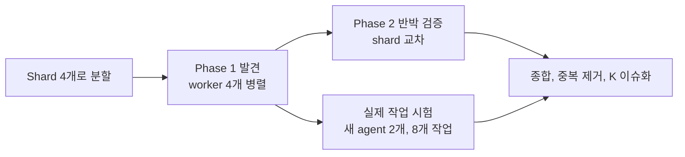

# develop AGENTS.md 메타 감사 — AI agent를 오도하는 지시사항 전수 조사

- 기준: `CUBRID/cubrid` `develop` `3d9a7b4ea8` (2026-11-26, CBRD-27539 PR #8751 `4ebd7020f0` 병합 직후)
- 대상: `AGENTS.md` 24개(루트, `src/`, 모듈 19개, `pl_engine/`, `unit_tests/`, `unit_tests/oos/`), `src/storage/docs/*.md` 7개, `CONTRIBUTING.md`, `README.md`, `.github/PULL_REQUEST_TEMPLATE.md`, `docs/install_build_requirements.md`
- 정답 기준: 소스 코드, `CMakeLists.txt`, `CMakePresets.json`, `build.sh`, `.github/workflows/`, `.github/actions/`
- 작성: 2026-11-26. 수정은 하지 않았다(보고 전용).

## 결론

1. **재작성된 루트·`src/` 문서는 대체로 정확하다.** 사실 오류(A)는 1건이고, `4ebd7020f0`가 지운 규칙 가운데 다시 살려야 할 것은 없다(F 0건). 남은 문제는 계층 간 충돌과 절차의 빈칸이다.
2. **재작성되지 않은 모듈 문서가 오류의 대부분을 차지한다.** A 51건 중 50건이 모듈 문서에 있다. 대부분 "Key Files"와 "Where to Look" 표에 적힌 파일명·함수명·역할 설명이 낡은 것이다. 4ebd7020f0과 같은 원칙(낡기 쉬운 사실은 지우고 발견할 수 없는 불변식만 남긴다)으로 모듈 문서를 다시 쓰는 것이 개별 수정보다 효과가 크다.
3. **문서 계층 간 우선순위가 정의되어 있지 않은데, 실제로 서로 충돌한다.** `compat`은 에러 코드를 `dbi_compat.h`에도 넣으라 하고 `src/`는 넣지 말라고 한다. `optimizer`와 `query`는 자기 모듈의 빌드 모드를 `src/`와 다르게 설명한다.
4. **"이 절차를 따라 하면 되는가"라는 기준에서는 결함이 더 많다.** 문서끼리는 맞는데 따라 하면 틀리는 경우다. 문서만 보고 8개 작업 계획을 세운 실험에서, 에러 코드 추가 절차를 글자 그대로 따르면 `er_set`이 거부하는 코드가 만들어졌다. 새 recovery index 절차는 TDE 분류(`LOG_MAY_CONTAIN_USER_DATA`)를 빠뜨려 사용자 데이터가 평문으로 로그에 남을 수 있다.
5. **문서가 아니라 코드를 고쳐야 하는 항목(K)이 13건이다.** 6개 이슈로 묶었다. 1건은 CBRD-28388과 중복이라 댓글 보완을 제안한다.
6. **개인 지시 체계에서 가장 시급한 문제:** `develop` worktree에 stow로 연결된 `AGENTS.override.md`가 "root `AGENTS.md`는 낡았으니 읽지 말라"고 지시한다. root는 오늘 갱신됐다. Codex는 같은 디렉터리의 override를 `AGENTS.md` 대신 읽으므로 갱신된 규칙을 보지 못한다. Claude Code는 이 파일을 읽지 않아서, 두 agent의 root 지침이 갈라진다.

## 방법

- **Phase 1:** Herdr worker 4개가 shard별로 문서의 모든 구체적 주장을 정답 기준과 대조했다. 근거(명령과 출력, 또는 `file:line`)가 없으면 finding으로 인정하지 않았다.
- **Phase 2:** 다른 shard를 맡았던 worker가 각 finding을 반박하려 시도했다. 판정은 CONFIRMED, ADJUSTED, REFUTED, UNVERIFIABLE 중 하나다.
- **실제 작업 시험:** 감사 결과와 개인 지시 파일을 보지 않은 새 agent 2개가 repo 문서만 보고 8개 작업의 계획을 먼저 썼다(Stage 1). 그 뒤 코드와 대조해 틀린 단계를 DOC-WRONG, DOC-AMBIGUOUS, DOC-SILENT, MY-ERROR로 분류했다(Stage 2).
- **결함 유형:**

| 유형 | 의미 |
|---|---|
| A | 사실 오류 |
| B | 계층 간 충돌 |
| C | 모호하거나 과도하게 엄격함 |
| D | 위험한 지시, 또는 필요한 경고 누락 |
| E | 낭비 |
| F | 재작성이 지운 규칙 중 여전히 필요한 것 |
| K | 문서가 아니라 코드를 고쳐야 함 |
| P | 개인 정책(`~/my-cubrid/CUBRID.md`)과 충돌 |

## 수치

| Shard | 범위 | A | B | C | D | E | K | P | 합계 |
|---|---|---|---|---|---|---|---|---|---|
| T1 | 루트, `src/`, `src/base`, CONTRIBUTING/README/PR template/install | 1 | 4 | 6 | 3 | 1 | 4 | 4 | 23 |
| T2 | `storage`, `transaction`, `storage/docs` | 12 | 1 | 3 | 0 | 1 | 2 | 0 | 19 |
| T3 | `query`, `xasl`, `optimizer`, `parser`, `object`, `compat`, `sp`, `method`, `pl_engine` | 20 | 3 | 5 | 1 | 2 | 3 | 1 | 35 |
| T4 | `broker`, `communication`, `connection`, `executables`, `loaddb`, `monitor`, `thread`, `unit_tests` | 18 | 2 | 3 | 1 | 0 | 4 | 2 | 30 |
| 합계 | | 51 | 10 | 17 | 5 | 4 | 13 | 7 | 107 |

- **반박 검증:** 107건 중 CONFIRMED 90건, ADJUSTED 15건(주로 심각도 하향, 범위 축소, 수정안 보정), REFUTED 2건(둘 다 P 유형). 검증자가 놓친 결함 4건을 추가로 찾았고, 1건은 기존 finding과 중복이다.
- **실제 작업 시험:** 8개 작업에서 DOC-WRONG 7건, DOC-AMBIGUOUS 14건, DOC-SILENT 41건, MY-ERROR 2건이 나왔다.
- **shard별 차이:** `src/storage/AGENTS.md`와 storage 설계 문서 7개는 인용된 심볼 약 340개가 모두 존재했고 흐름 설명도 맞았다. T2의 문제 19건 중 13건이 `src/transaction/AGENTS.md`에 있다.

## 주요 발견

### 1. 계층 우선순위 미정과 실제 충돌 (B)

| ID | 충돌 | 실제 |
|---|---|---|
| T1-01 / T3-01 | `src/compat/AGENTS.md:19,34,70` "에러 코드를 `dbi_compat.h`에도 추가" ↔ `src/AGENTS.md:50` "추가하지 않는다" | `dbi_compat.h:44`는 `error_code.h`를 include하고 `ER_*` 정의가 없다. 코드 주석 `error_code.h:28`도 낡은 쪽을 지지한다(K). |
| T1-07 / T3-08 | `src/optimizer/AGENTS.md` "client-side only" ↔ `src/AGENTS.md` histogram 예외 | `src/optimizer/histogram/`은 SERVER_MODE로 빌드된다. |
| T3-M1 | `src/query/AGENTS.md:3` "Server-side" ↔ 같은 파일 18행, `src/AGENTS.md:18` | `cs/CMakeLists.txt`가 query 일부를 `cubridcs`에 넣는다. 서버 전용 호출을 넣으면 client 빌드가 깨진다. |
| T1-06 | 루트, `src/`, 모듈 사이의 우선순위 | 어디에도 정의되어 있지 않다. 위 충돌에서 agent가 고를 근거가 없다. |
| T4-17 | `_cl`/`_sr` 접미사 규칙 ↔ 같은 문서의 빌드 표 | 접미사는 힌트일 뿐이고 빌드 표가 맞다. |

권장: 루트 "Read First"에 한 줄을 넣는다. 예: "하위 문서가 상위 문서와 충돌하면 코드와 빌드 파일이 이기며, 충돌을 보고한다." 그리고 위 충돌들을 실제로 해소한다.

### 2. 모듈 문서의 사실 drift (A) — 영향이 큰 항목

| ID | 문서 | 내용 | 검증 |
|---|---|---|---|
| T1-04 / T4-01 | 루트, `unit_tests/AGENTS.md` | "빌드 후 `ctest`"를 따라도 활성 모듈 17개 중 12개는 ctest에 등록되어 있지 않다. 그 모듈 하나만 켜면 "No tests were found"로 exit 0이 되어 통과로 오인한다. | CONFIRMED(심각도 상향) |
| T4-19 | `src/executables` | utility 등록은 `util_common.c`가 아니라 `util_admin.c`의 `ua_Utility_Map[]`이다. `util_service.c`의 `us_Service_map[]`에도 등록해야 `cubrid <name>`으로 호출된다. | ADJUSTED(수정안 보강) |
| T4-09 | `src/monitor` | "통계 추가" 절차가 아무도 쓰지 않는 registry를 가리킨다. | CONFIRMED |
| T4-15 / probe P2 2.a | `src/communication` | 서버 handler 파일은 `network_interface_sr.cpp`다(`.c` 아님). 요청은 목록 끝에 추가해야 하는데(중간에 넣으면 이후 요청 번호가 모두 밀려 프로토콜 호환이 깨진다) 문서에 없다. | CONFIRMED |
| T3-02 | `pl_engine` | `ninja pl_server`라는 target은 없다. 실제는 `pl_build`, `pl_unittest`다. | ADJUSTED(즉시 드러나는 오류라 med) |
| T3-04, T3-23 | `src/sp` | `cub_server`가 JNI를 쓴다고 설명한다. 실제로는 별도 `cub_pl` 프로세스와 socket으로 통신한다. | CONFIRMED |
| T2-04, T2-05, T2-06 | `src/transaction` | `LOG_LSN` 타입은 없다(`LOG_LSA`). commit/abort와 WAL append API는 `log_manager.c`에 있다. | CONFIRMED |
| T2-01 | `src/transaction` | 교착 처리 안내가 전체가 `ENABLE_UNUSED_FUNCTION`로 컴파일 제외된 `wait_for_graph.c`를 가리킨다. | ADJUSTED(med) |
| T2-17 | `src/storage` | OOS(`oos_file.cpp`, `heap_oos.cpp`, …)가 storage 안내 어디에도 없다. | CONFIRMED |
| T3-07, T3-09, T3-10, T3-15, T3-16 | `optimizer`, `query`, `compat` | 파일 역할이 틀렸다. 예: `plan_generation.c`는 비용 기반 선택이 아니라 XASL 생성이다. 집계는 `query_aggregate.cpp`, hash join은 `query_hash_join.c`에 있다. `db_vdb.c`는 view가 아니라 SQL 문 API다. | CONFIRMED |

이런 표는 파일이 이동하거나 이름이 바뀔 때마다 낡는다. agent는 grep으로 같은 정보를 더 정확하게 얻을 수 있다. 권장 방향은 다음과 같다.
- 모듈 문서에는 발견할 수 없는 것(불변식, 등록 절차, 호환성 제약)만 남긴다.
- 파일 지도는 줄이거나 지운다.

### 3. 절차의 빈칸 — 실제 작업 시험에서 드러난 것

| 작업 | 문서대로 하면 생기는 일 | 근거 |
|---|---|---|
| 에러 코드 추가 | "`ER_LAST_ERROR` 갱신"을 "새 코드로 설정"으로 읽으면, `er_set`이 그 코드를 무효로 처리한다. `ER_LAST_ERROR`는 마지막 코드보다 하나 더 낮은 sentinel이다. `cubrid.msg` 두 카탈로그의 `Last Error` 메시지도 함께 옮겨야 한다. | `error_manager.c:1508`, `msg/*/cubrid.msg`. T1-03(C/med)이 같은 지점을 짚었다. |
| recovery index 추가 | `src/AGENTS.md` 체크리스트에 TDE 분류(`tde.h:107` `LOG_MAY_CONTAIN_USER_DATA`)가 없다. 사용자 데이터를 담는 새 레코드가 TDE 테이블에서 평문으로 로그에 남는다. 또 `RCV_IS_*` 판단 기준과 parallel redo 동기화 목록(`log_rv_need_sync_redo`)도 없다. "enum 끝에 추가"를 글자 그대로 읽으면 `RV_NOT_DEFINED = 999` 뒤에 넣게 된다. | probe P1 3.1, 3.4–3.6 |
| XASL member 추가 | `xts_sizeof_*` 크기 계산 단계를 함께 고쳐야 한다는 말이 없어서, buffer가 작게 잡힌다. 병렬 hash join이 쓰는 `xasl_spawner.cpp` 복사도 언급이 없다. `src/xasl/AGENTS.md`의 "mode guard 금지"는 사실과 다르다(T3-12). | probe P2 1.a, 1.b, 1.e |
| OOS GoogleTest 추가 | `TIMEOUT`(60초 이하)이 없으면 configure가 `FATAL_ERROR`로 실패해 모든 사람의 빌드가 깨진다. fixture가 `$CUBRID/conf/cubrid.conf`를 수정하고 DB를 만들었다 지운다. release 빌드에서는 boot 검사가 `assert`라 빠진다. | probe P2 3.c, 3.e, 3.f. T4-04(D), T4-08 |
| PL engine 변경 | CI는 `google-java-format` 1.7을 `-a`(AOSP, 4칸)로 돌린다. 기본 스타일로 포맷하면 code-style 검사가 실패한다. `./gradlew build`를 직접 돌리면 테스트도 실행되고, 평문 HTTP로 JDBC를 받는다. | T3-18, T3-19, probe P2 4.b, 4.c |
| PR 전 검증 | "PR `/run` 또는 격리된 CTP"인데 `/run`은 PR이 있어야 쓸 수 있다. CTP 격리 환경을 만드는 방법은 없다. 모듈별로 어느 suite를 돌려야 하는지 매핑도 없다. | probe P1 4.4, 4.7 |

### 4. 과도하게 엄격한 규칙 (C, over-strict)

재작성 대상이 아니었던 모듈 문서에 남아 있다.

| ID | 규칙 | 실제 |
|---|---|---|
| T3-12 | `src/xasl/AGENTS.md` "no mode-specific guards allowed" | `xasl.h`에는 직렬화되지 않는 서버 전용 필드를 위한 guard가 여러 곳 있다. 실제 규칙은 "직렬화되는 member는 guard 밖에 둔다"이다. 실험에서도 DOC-WRONG으로 확인됐다. |
| T2-14, T3-27 | "모든 함수의 첫 인자는 `thread_p`" | client 쪽이나 유틸 함수는 그렇지 않다. |
| T3-26 | 식별자 비교 규칙 | 실제 코드보다 범위가 넓다. |

**F 결과:** `4ebd7020f0`가 지우거나 완화한 규칙을 하나씩 검토했다. 예를 들어 `#pragma once`는 헤더 48개가 쓰고 있고, STL `try/catch`도 실제로 쓰인다. 지운 판단은 모두 타당했고, 다시 넣어야 할 규칙은 없다.

### 5. 위험 (D)

| ID | 내용 |
|---|---|
| T1-08 | 루트는 `-p`만 경고한다. 그런데 `build.sh`의 기본 target(`all`)과 `clean`은 `-b`가 가리키는 디렉터리에도 `rm -rf $build_dir/*`를 실행한다. |
| T4-04 | OOS ctest fixture가 실제 `$CUBRID/conf/cubrid.conf`를 수정한다. 경고가 없다. |
| T3-19 | Gradle을 직접 실행하는 경로는 CMake 경로와 다르다. 로컬 JDBC를 쓰지 않고, 테스트를 실행하고, 외부 HTTP 저장소를 쓴다. |
| T1-18 | `c_to_cpp.sh`를 인자 없이 실행하면 작업 디렉터리 아래의 모든 `.c`를 `.cpp`로 바꾼다. 문서에 경고가 없다. |
| T1-19 | `install_build_requirements.md`가 시스템 파일을 덮어쓰고, 정리 단계가 깨져 있다. |

## K — 코드 수정 대상과 JIRA 계획

모두 `3d9a7b4ea8`에서 코드로 재확인했다(검증자의 K-CONFIRMED와 별도로 작성자가 직접 확인). 중복 확인은 `cubrid-jira-dup`(2026-11-26 04:00 UTC 동기화, complete)으로 했다.

| # | 묶음 | Finding | 중복 확인 | 제안 |
|---|---|---|---|---|
| K1 | `unit_tests`의 ctest 미등록과 CMake 위생 | T1-05, T4-K1–K4 | **[CBRD-28388](https://jira.cubrid.org/browse/CBRD-28388) 중복**(Confirmed, 2026-11-25, PR #8751 리뷰에서 생성) | 새 이슈 대신 28388에 댓글로 보완한다. 보완할 내용: LOADDB 블록이 `add_subdirectory(monitor)`를 부르는 복붙 오류(`unit_tests/CMakeLists.txt:156-162`), `UNIT_TEST_OBJECT_FACTORY` option 선언 누락, lockfree 관련 낡은 주석(`:87`), legacy 모듈(`lockfree`, `string_buffer`)에 성능·시간 측정 모드가 섞여 있다는 주의. |
| K2 | PR 정적 검사가 rename된 파일을 건너뜀 | T1-10 | 없음 | 신규. `.github/actions/changed-files/action.yml`이 `added`와 `modified`만 고르므로, `.c`를 `.cpp`로 바꾸면서 내용도 고친 파일은 license, code-style, cppcheck, memory-monitor 검사를 모두 피한다. |
| K3 | `build.sh -h`가 실제 동작과 다름 | T1-11 | 없음 | 신규(low). `-i`와 `-a`를 쓰면 usage를 출력하고 exit 1로 끝난다. `-b`와 `-j`의 기본값 설명도 틀렸다. |
| K4 | `pl_unittest`가 `-DbuildDir`을 넘김 | T3-32 | 없음 | 신규(low). 소스 트리 안에서 다시 컴파일한다. `-PbuildDir`로 고친다. |
| K5 | PL Gradle이 평문 HTTP로 버전 고정 없는 JDBC를 받음 | T3-34 | [CBRD-23727](https://jira.cubrid.org/browse/CBRD-23727) 관련(2020, Won't Fix: maven.cubrid.org가 HTTPS 미지원) | 신규. 범위를 HTTPS 전환이 아니라 `latest.integration` 고정, 그리고 submodule이 없으면 실패하는 쪽으로 정한다. |
| K6 | 죽은 코드와 낡은 주석 | T1-02, T2-02, T2-16, T3-33 | 없음(CBRD-27269는 PGBUF 한정) | 신규(low, cleanup). `wait_for_graph.c/.h`, `catalog_destroy` 선언, `error_code.h:28` 주석, `execute_statement.c`의 serial `-e36` 주석. |

이슈 생성과 댓글은 외부 게시라서 사용자 승인 후에 `cubrid-jira`로 실행한다.

## P — 개인 지시 체계와의 관계

| ID | 내용 | 판단 |
|---|---|---|
| P-1 (실험 중 발견) | `develop/AGENTS.override.md` → `~/my-cubrid/stow/cubrid/AGENTS.override.md`. 이 파일이 "root `AGENTS.md`는 stale이니 대신 이 파일을 쓴다"고 지시한다. | **조치 필요(high).** root는 `4ebd7020f0`에서 갱신됐다. Codex는 갱신된 root 규칙을 보지 못하고, Claude Code는 이 override를 읽지 않는다. 권장: "root `AGENTS.md`를 읽은 뒤 개인 정책을 우선 적용한다"로 바꾼다. |
| T2-19 | `src/storage/AGENTS.md`의 "effective checkout instructions", "local overrides"가 정의되어 있지 않다. | repo 문서 쪽에서 표현을 다듬는다. 개인 override 체계를 가리키는 의도라면 그대로 두되 정의를 붙인다. |
| T1-P1–P4, T4-P1 | 빌드·ctest·`/run`·CTP를 repo 문서는 프로젝트 도구로, 개인 정책은 `just`, `cubrid-ci-trigger`, native testkit으로 안내한다. | 충돌이 아니다. `CUBRID.md`가 "조직용 문서는 프로젝트 도구로 표현한다"고 정해 두었고, 개인 정책이 우선한다. 조치 불필요. |
| T3-35, T4-P2 | | REFUTED |

## 권장 수정 순서

1. **개인 override 수정**(Tier 1, 바로 할 수 있음): P-1.
2. **repo 문서 PR**(Tier 2, 승인 필요). CBRD-27539 후속 또는 새 티켓으로 진행한다.
   1. 루트에 우선순위 규칙을 넣고, B 유형 충돌을 해소한다. 특히 `compat`의 에러 코드 규칙.
   2. 절차의 빈칸을 메운다: 에러 코드 sentinel, recovery index의 TDE·`RCV_IS_*`·sync redo, XASL `xts_sizeof`, 네트워크 요청 추가 위치, OOS `TIMEOUT`과 fixture 경고, google-java-format 1.7 `-a`.
   3. 모듈 문서(특히 `transaction`, `executables`, `communication`, `connection`, `monitor`, `thread`, `sp`, `compat`, `unit_tests`)를 4ebd7020f0 원칙으로 다시 쓴다. 파일 지도를 줄이고 불변식만 남긴다.
3. **K 이슈**: K1은 CBRD-28388 댓글, K2–K6은 신규 이슈(승인 후).

## 한계

- worker는 모두 Claude Opus 5.5였다(`ai-agent` launcher가 Claude backend를 골랐다). 발견자와 검증자가 같은 모델이라 맹점을 공유할 수 있다. 다만 반박 검증이 15건을 조정(ADJUSTED)하고 놓친 결함 3건을 추가한 점, 작성자가 K 6묶음을 직접 재확인한 점이 이를 일부 보완한다.
- 인용된 줄 번호가 1–2줄씩 어긋난 경우가 있다(예: `pl_engine/CMakeLists.txt` 69행으로 인용된 곳이 실제 71행).
- CTP(`cubrid-testtools`)와 CLA는 외부 저장소나 프로세스라 로컬에서 확인할 수 없었다. 이 항목은 UNVERIFIABLE로 두었다.
- 서브모듈(`cubrid-cci`, `cubrid-jdbc`)의 문서는 범위에서 제외했다.
- 실제 작업 시험은 8개 작업을 표본으로 한 것이고, 계획만 세웠을 뿐 빌드나 실행은 하지 않았다.

## 부록 A. 원자료

각 finding의 근거(명령과 출력, `file:line`) 전문은 로컬 무시 경로 `.scratch/cbrd-27539-agents-audit/`에 있다. 수정 PR을 만들 때 참고한다.

| 경로 | 내용 |
|---|---|
| `findings/T1–T4.md` | Phase 1 finding 전문 |
| `verify/T1–T4.verify.md` | 반박 검증 판정과 Missed 항목 |
| `probes/P1.md`, `probes/P2.md` | 실제 작업 시험의 Stage 1(계획)과 Stage 2(대조) |
| `jira/` | K 이슈 초안 stub과 중복 검색 결과 JSON |
| `BRIEF.md`, `VERIFY.md`, `PROBE.md` | worker에게 준 지시문(재현용) |

## 부록 B. 전체 finding 목록

검증 열의 ADJUSTED는 유형, 심각도, 수정안 중 하나 이상이 바뀌었다는 뜻이다. 바뀐 내용은 원자료에 있다.

| ID | 유형 | 심각도 | 검증 | 문서 | 제목 |
|---|---|---|---|---|---|
| T1-01 | B | high | ADJUSTED | `src/compat/AGENTS.md:70` | src/compat/AGENTS.md tells agents to add error codes to dbi_compat.h; src/AGENTS.md says it has none |
| T1-02 | K | low | CONFIRMED | `src/AGENTS.md:50` | error_code.h header comment still says to add codes to dbi_compat.h |
| T1-03 | C | med | CONFIRMED | `src/AGENTS.md:50` | "update ER_LAST_ERROR" does not say it must stay one past the newest code, or that the msg files' "Last Error" entry moves too |
| T1-04 | A | med | ADJUSTED | `AGENTS.md:26` | Root says to run `ctest`, but 13 of the 17 enabled unit-test modules register no ctest test |
| T1-05 | K | med | ADJUSTED | `AGENTS.md:26` | Most unit-test modules skip add_test, unlike the five that register |
| T1-06 | B | med | CONFIRMED | `AGENTS.md:9` | Precedence between root, src/, and module AGENTS.md is undefined while they conflict |
| T1-07 | B | med | CONFIRMED | `src/optimizer/AGENTS.md:3` | src/optimizer/AGENTS.md says the optimizer is client-side only; src/AGENTS.md excepts histogram/ |
| T1-08 | D | med | CONFIRMED | `AGENTS.md:24` | build.sh warning covers only `-p`; the default/`clean` target also runs `rm -rf $build_dir/*` on whatever `-b` names |
| T1-09 | B | low | CONFIRMED | `README.md:39` | README tells readers to run bare `./build.sh`; root requires an explicit target |
| T1-10 | K | low | CONFIRMED | `AGENTS.md:27` | PR static checks skip renamed files |
| T1-11 | K | low | CONFIRMED | `AGENTS.md:24` | `./build.sh -h` (which root tells agents to trust) lists flags and defaults the script does not honor |
| T1-12 | C | med | CONFIRMED | `AGENTS.md:28-29` | tc-merge-gate grouped under "Regression CI"; tc-branch-finalize omitted |
| T1-13 | C | low | CONFIRMED | `src/AGENTS.md:68` | "header guards" rule placed under "new `.c` files" |
| T1-14 | C | low | CONFIRMED | `AGENTS.md:31` | "link/anchor checks" names no tool |
| T1-15 | C | low | CONFIRMED | `src/base/AGENTS.md:181` | Severity "ordering" in src/base/AGENTS.md is the reverse of the numeric enum |
| T1-16 | E | low | CONFIRMED | `src/base/AGENTS.md:112` | Volatile parameter count kept although the rewrite dropped counts as volatile |
| T1-17 | C | low | CONFIRMED | `src/AGENTS.md:50` | "bump the submodule separately" ignores the automated bump receiver |
| T1-18 | D | low | CONFIRMED | `src/AGENTS.md:5` | c_to_cpp.sh is mentioned with no warning that it renames every `.c` under the working directory when given no argument |
| T1-19 | D | low | CONFIRMED | `docs/install_build_requirements.md:29-30` | install_build_requirements.md overwrites system files and has a broken cleanup |
| T1-P1 | P | low | CONFIRMED | `AGENTS.md:24` | Build entrypoint: repo build.sh/presets vs personal `just` recipes |
| T1-P2 | P | med | CONFIRMED | `AGENTS.md:29` | Triggering CI: root says comment `/run` directly; personal policy routes through cubrid-ci-trigger |
| T1-P3 | P | med | CONFIRMED | `AGENTS.md:30-31` | Local regression runs: root says isolated CTP; personal policy says native cubrid-testkit, CTP only on request |
| T1-P4 | P | low | CONFIRMED | `AGENTS.md:26` | Unit-test run command: `ctest` vs `just build-test` |
| T2-01 | A | high | ADJUSTED | `src/transaction/AGENTS.md:10` | Deadlock-fix navigation points at a file that is compiled out |
| T2-02 | K | low | CONFIRMED | `src/transaction/AGENTS.md:10` | `wait_for_graph.c` is compiled into server and SA targets but contains only dead code |
| T2-03 | A | med | ADJUSTED | `src/transaction/AGENTS.md:33` | `logpb_checkpoint()` is placed in the wrong file |
| T2-04 | A | med | CONFIRMED | `src/transaction/AGENTS.md:48` | `LOG_LSN` does not exist; the log address type is `LOG_LSA` |
| T2-05 | A | med | CONFIRMED | `src/transaction/AGENTS.md:22` | The commit/abort logic is in `log_manager.c`, not `transaction_sr.c` |
| T2-06 | A | med | CONFIRMED | `src/transaction/AGENTS.md:12` | The WAL append API is in `log_manager.c`; `log_append.cpp` is the prior-list layer |
| T2-07 | A | med | CONFIRMED | `src/transaction/AGENTS.md:3` | "Server-side" is false; the module has a client subset |
| T2-08 | C | med | CONFIRMED | `src/transaction/AGENTS.md:5-23` | The Key Files table omits the files needed for recovery records and MVCC snapshots |
| T2-09 | A | low | CONFIRMED | `src/transaction/AGENTS.md:55-62` | The lock hierarchy omits the live lock modes BU, SIX and NULL |
| T2-10 | A | low | CONFIRMED | `src/transaction/AGENTS.md:40` | The MVCC header field names and snapshot contents are wrong |
| T2-11 | A | low | CONFIRMED | `src/transaction/AGENTS.md:69` | Boot naming convention is false |
| T2-12 | A | low | CONFIRMED | `src/transaction/AGENTS.md:17` | `log_comm.c` is not "replication support" |
| T2-13 | E | low | CONFIRMED | `src/transaction/AGENTS.md:73` | Stale line counts |
| T2-14 | C | low | CONFIRMED | `src/transaction/AGENTS.md:66` | "`thread_p` first parameter everywhere" is over-strict |
| T2-15 | A | med | ADJUSTED | `src/storage/docs/catalog-statistics-maintenance.md:35` | `catalog_destroy()` is listed as an entry point but has no definition |
| T2-16 | K | low | CONFIRMED | `src/storage/docs/catalog-statistics-maintenance.md:35` | Dangling `catalog_destroy` prototype in `system_catalog.h` |
| T2-17 | A | med | CONFIRMED | `src/storage/AGENTS.md:24-38` | Out-of-row overflow storage (OOS) is missing from storage navigation |
| T2-18 | B | low | ADJUSTED | `src/storage/AGENTS.md:93-94` | Exception-translation rule differs between storage and `src/` levels |
| T2-19 | C | low | ADJUSTED | `src/storage/AGENTS.md:8-9` | Undefined "effective checkout instructions" and "local overrides" |
| T3-01 | B | high | ADJUSTED | `src/compat/AGENTS.md:19` | dbi_compat.h is said to mirror error_code.h; contradicts src/AGENTS.md and the code |
| T3-02 | A | high | ADJUSTED | `pl_engine/AGENTS.md:54` | `ninja pl_server` is not a build target |
| T3-03 | A | med | ADJUSTED | `src/sp/AGENTS.md:33` | SP DB_VALUE marshalling is attributed to the wrong files |
| T3-04 | A | med | CONFIRMED | `src/sp/AGENTS.md:1` | SP architecture: cub_server does not use JNI; JNI runs inside the separate cub_pl process |
| T3-05 | A | med | CONFIRMED | `src/sp/AGENTS.md:16` | pl_file.c is described as JAR upload/management; it manages the PL server info file |
| T3-06 | A | med | CONFIRMED | `src/method/AGENTS.md:1` | Method scan is described as the path for Java SPs; it handles only C methods, and Java SPs go through fetch.c |
| T3-07 | A | med | CONFIRMED | `src/optimizer/AGENTS.md:11` | plan_generation.c is said to do plan enumeration and costing; it generates XASL |
| T3-08 | B | med | CONFIRMED | `src/optimizer/AGENTS.md:3` | Optimizer is called client-only and histogram/ is not mentioned; src/AGENTS.md lists the exception |
| T3-09 | A | med | CONFIRMED | `src/query/AGENTS.md:17` | query_opfunc.c is called the aggregate implementation; aggregates are in query_aggregate.cpp |
| T3-10 | A | med | CONFIRMED | `src/query/AGENTS.md:21` | query_hash_scan.c is called the hash join; hash join is query_hash_join.c |
| T3-11 | A | med | CONFIRMED | `src/query/AGENTS.md:41` | The "add new function" recipe omits the operator table and the compiled path |
| T3-12 | C | med | CONFIRMED | `src/xasl/AGENTS.md:44` | xasl/ "no mode-specific guards allowed" is false and blocks correct edits |
| T3-13 | B | low | CONFIRMED | `src/xasl/AGENTS.md:38-39` | xasl/ coordination list is narrower than src/AGENTS.md and omits the on-disk stream and clone reset |
| T3-14 | A | med | CONFIRMED | `src/object/AGENTS.md:71` | Serial range stated backwards; code uses ±(10^38−1) |
| T3-15 | A | med | CONFIRMED | `src/compat/AGENTS.md:15` | db_vdb.c is called "Virtual database (view) support"; it is the SQL statement interface |
| T3-16 | A | med | CONFIRMED | `src/compat/AGENTS.md:29` | Type conversion is sent to db_macro.c; the coercion engine is object_domain.c |
| T3-17 | D | low | CONFIRMED | `src/compat/AGENTS.md:42-44` | DB_VALUE struct sketch names fields and enums that do not exist |
| T3-18 | A | med | ADJUSTED | `pl_engine/AGENTS.md:85` | google-java-format is not pinned and its AOSP mode is not mentioned |
| T3-19 | D | med | CONFIRMED | `pl_engine/AGENTS.md:57-59` | Direct Gradle commands differ from the CMake build: no local JDBC, tests run, external HTTP repo |
| T3-20 | A | med | CONFIRMED | `src/parser/AGENTS.md:35-36` | Parser "Add SQL keyword" recipe omits keyword.c and the lexer; wrong report file name; GLR not mentioned |
| T3-21 | A | low | CONFIRMED | `src/sp/AGENTS.md:60` | SP connection: "TCP for remote PL engine" — TCP is loopback only |
| T3-22 | C | low | CONFIRMED | `src/sp/AGENTS.md:65` | "PL engine must be running" implies a manual start; cub_server forks and restarts cub_pl |
| T3-23 | A | low | CONFIRMED | `src/sp/AGENTS.md:40` | sp prefix convention: `jsp_` is the client-side DDL/CALL API, not JNI/communication |
| T3-24 | A | low | CONFIRMED | `src/method/AGENTS.md:47` | `SCAN_TYPE_METHOD` does not exist |
| T3-25 | A | low | CONFIRMED | `src/parser/AGENTS.md:12` | Parser API: `parser_create_parser()` location |
| T3-26 | C | low | CONFIRMED | `src/parser/AGENTS.md:68` | Identifier comparison rule is over-strict |
| T3-27 | C | low | CONFIRMED | `src/query/AGENTS.md:70` | Query module conventions: "thread_p first parameter on all functions" is over-strict |
| T3-28 | E | low | CONFIRMED | `src/object/AGENTS.md:39-52` | System-view query-spec rules are a lossy copy of the header |
| T3-29 | E | low | CONFIRMED | `src/query/AGENTS.md:9` | Volatile sizes and line counts that have already drifted |
| T3-30 | A | low | CONFIRMED | `src/query/AGENTS.md:15` | query/AGENTS.md says xasl.h defines REGU_VARIABLE |
| T3-31 | C | low | CONFIRMED | `pl_engine/AGENTS.md:94` | `ANTLR grammar changes require ./gradlew generateGrammarSource` is unnecessary |
| T3-32 | K | low | ADJUSTED | `pl_engine/AGENTS.md:55` | pl_unittest passes buildDir as a JVM system property; pl_build passes it as a project property |
| T3-33 | K | low | CONFIRMED | `src/object/AGENTS.md:71` | Stale serial default comment in execute_statement.c contradicts the code |
| T3-34 | K | med | CONFIRMED | `pl_engine/AGENTS.md:93` | PL engine Gradle falls back to a plaintext-HTTP Maven repo with a dynamic JDBC version |
| T3-35 | P | low | REFUTED | `pl_engine/AGENTS.md:52-60` | pl_engine build commands vs personal `just` workflow |
| T4-01 | A | high | CONFIRMED | `unit_tests/AGENTS.md:15-18` | Most unit-test binaries are not registered with ctest; the documented "build then ctest" flow gives a false pass |
| T4-02 | A | med | CONFIRMED | `unit_tests/AGENTS.md:23-39` | Module table is stale: four live modules missing, lockfree wrongly marked disabled |
| T4-03 | A | med | CONFIRMED | `unit_tests/AGENTS.md:1-3` | "Catch2 Unit Tests" framing is false for most active modules |
| T4-04 | D | med | CONFIRMED | `unit_tests/AGENTS.md:17-18` | OOS ctest fixtures edit the live `$CUBRID/conf/cubrid.conf` and create/delete databases, with no warning |
| T4-05 | C | med | CONFIRMED | `unit_tests/AGENTS.md:5-19` | Enabling any unit test changes engine compilation; this is not mentioned |
| T4-06 | C | low | CONFIRMED | `unit_tests/AGENTS.md:84-87` | "Adding a New Test Module" omits the guard and `add_test`; Catch2 is a dependency, not a link |
| T4-07 | A | low | CONFIRMED | `unit_tests/AGENTS.md:92` | Network needs: Catch2 downloads at build time; googletest at configure time |
| T4-08 | C | low | CONFIRMED | `unit_tests/oos/AGENTS.md:1-5` | OOS subtree doc omits the configure-time TIMEOUT rule |
| T4-09 | A | high | CONFIRMED | `src/monitor/AGENTS.md:3` | Monitor "Add a new statistic" points at a registry nothing uses |
| T4-10 | A | med | CONFIRMED | `src/connection/AGENTS.md:9-17` | Connection doc lists files that are now `.cpp` and omits the server connection-worker subsystem |
| T4-11 | A | med | CONFIRMED | `src/connection/AGENTS.md:13` | heartbeat.c is not the HA node-to-node heartbeat; this conflicts with executables doc |
| T4-12 | A | low | CONFIRMED | `src/connection/AGENTS.md:40` | Wrong client connection API names |
| T4-13 | A | med | CONFIRMED | `src/connection/AGENTS.md:47` | "Must handle short reads/writes" is handled inside the send/receive helpers |
| T4-14 | A | low | CONFIRMED | `src/connection/AGENTS.md:45` | SA_MODE connection file list is incomplete and "no TCP" is misleading |
| T4-15 | A | med | CONFIRMED | `src/communication/AGENTS.md:15` | Adding a server request: wrong handler file, and nothing says to append to the list |
| T4-16 | A | low | CONFIRMED | `src/communication/AGENTS.md:7-18` | Communication doc omits the stream-transport files and names nonexistent callback functions |
| T4-17 | B | low | ADJUSTED | `src/communication/AGENTS.md:31` | `_cl`/`_sr` mode rule contradicts the same doc's build table; memory_wrapper rule is broader than src/AGENTS.md |
| T4-18 | A | med | CONFIRMED | `src/executables/AGENTS.md:37-45` | Executables binary map: wrong build targets; loaddb/unloaddb/compactdb are not binaries |
| T4-19 | A | high | ADJUSTED | `src/executables/AGENTS.md:33` | Utility registration is in util_admin.c, not util_common.c; "Add new utility" recipe is wrong |
| T4-20 | A | med | CONFIRMED | `src/broker/AGENTS.md:44` | Broker slow-query log points to the log-analysis tools, not the writer |
| T4-21 | A | med | CONFIRMED | `src/broker/AGENTS.md:12` | Broker/CAS IPC is not only shared memory, and the shm structs are not packed |
| T4-22 | A | med | CONFIRMED | `src/thread/AGENTS.md:10` | Thread doc names nonexistent symbols and files, and misdescribes worker_pool and daemon creation |
| T4-23 | A | low | CONFIRMED | `src/loaddb/AGENTS.md:58` | Loaddb grammar regen note is inaccurate |
| T4-24 | B | low | CONFIRMED | `src/executables/AGENTS.md:50` | Executables doc misses the CS path for the "standalone" utilities (cross-ref with loaddb doc) |
| T4-K1 | K | med | CONFIRMED | `unit_tests/AGENTS.md:82` | Three Catch2 test modules build a binary but never register it with ctest |
| T4-K2 | K | low | CONFIRMED | `unit_tests/AGENTS.md:37` | Stale "does not compile" comment keeps log_prior_inflight split from lockfree |
| T4-K3 | K | low | CONFIRMED | `unit_tests/AGENTS.md:58` | Commented-out LOADDB block registers the monitor directory |
| T4-K4 | K | low | CONFIRMED | `unit_tests/AGENTS.md:29` | `UNIT_TEST_OBJECT_FACTORY` is used but never declared as an option |
| T4-P1 | P | low | CONFIRMED | `unit_tests/AGENTS.md:7-19` | Unit-test build/run commands differ from the owner's `just` workflow |
| T4-P2 | P | low | REFUTED | `unit_tests/AGENTS.md:23-39` | Personal preset names unit modules absent from this revision |
| T1-M1 | A | med | (검증 중 발견) | `src/compat/AGENTS.md:9` | `db_make_*()`는 `db_macro.c`가 아니라 `dbtype_function.i`(inline)와 `dbtype_function.h`에 있다 |
| T1-M2 | A | low | (검증 중 발견, T3-15와 중복) | `src/compat/AGENTS.md:15` | `db_vdb.c`는 view 지원이 아니라 SQL 문 API다 |
| T3-M1 | B | med | (검증 중 발견) | `src/query/AGENTS.md:3` | query 모듈을 "Server-side"라 했지만 client 부분 집합이 `cubridcs`에 빌드된다 |
| T3-M2 | A | low | (검증 중 발견) | `pl_engine/AGENTS.md:3` | 전송 수단을 UDS로만 설명하지만 Windows와 port 설정 시에는 TCP loopback을 쓴다 |
