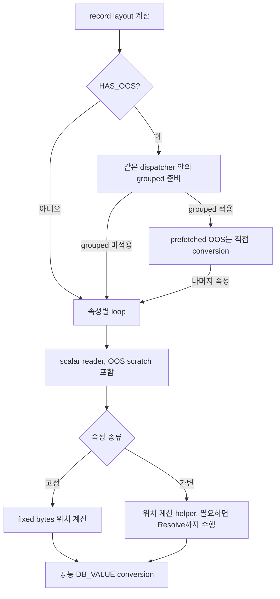
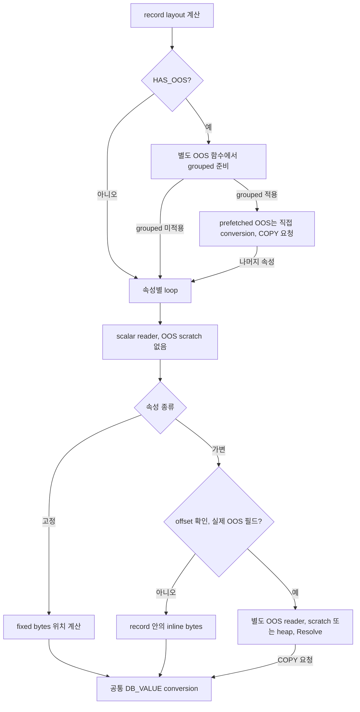
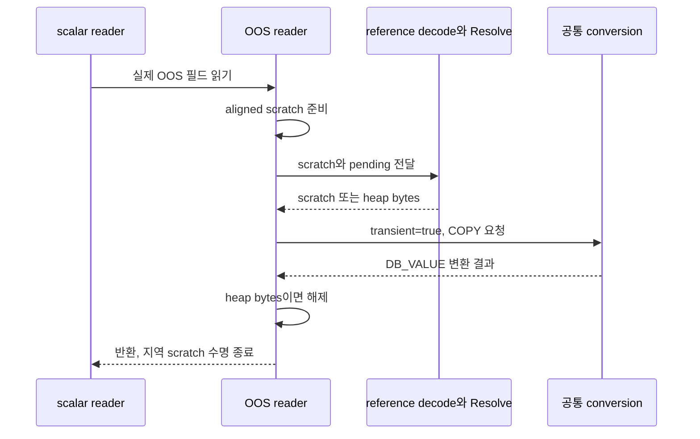

# CBRD-27785 일반 행 읽기 최적화 코드 해설서

팀원이 이번 diff의 변경 이유와 실행 경로를 이해하고, 코드 리뷰 질문에 답하기 위한 문서다.
핵심 질문은 "실제 OOS 값을 읽지 않는 경우에 OOS 준비 비용을 어떻게 줄이면서 기존 값 변환과 버퍼 수명을 유지하는가?"다.

**핵심 결론.** 공통 속성 reader에서 OOS 전용 scratch를 분리하고, grouped Resolve 준비 상태를 별도 함수로 옮겼다. inline 가변값의 위치를 찾을 때는 이미 계산한 record layout을 재사용한다. 고정값·inline 가변값·OOS 값은 기존 변환 함수를 공유한다. 이 구조는 아래 고정 revision의 코드에서 확인했다. CPU 개선 폭은 [기존 측정 기록](#verification)에 근거하며, 이번 문서 작성에서는 실행하지 않았다.

<a id="scope"></a>
## 1. 설명 대상과 근거

작성일과 근거 확인일은 2026-10-29, Asia/Seoul이다. 저장소는 `CUBRID/CUBRID`이며, 로컬 작업 브랜치는 `CBRD-27785-oos-performance`다. 관련 이슈는 [CBRD-27785](https://jira.cubrid.org/browse/CBRD-27785)다.

| 구분 | 고정 revision과 의미 |
| --- | --- |
| 변경 전 | `dcbf09e4f7fd02ff9c8fc6493ec8887fc2919d67`, 확인 당시 로컬 `feature/oos-merge` tip이자 merge-base |
| 설명 대상 | `f1b99031c0402d521a785815f107be7a83b27717`, 현재 체크아웃의 HEAD |
| 공유용 소스 링크 | `bcb900d1696756a120ec0a2b7885c212f71ebc07`, 게시된 초기 읽기 최적화 revision |
| 기존 성능 측정 기준 | `4781495f01523a3ecc5891e3377ad62cf876a1cd`, OOS 통합 전 기준 |

이번에 `git diff f1b99031c bcb900d16 -- src unit_tests contrib`가 비어 있음을 확인했다. 따라서 변경 후 소스 링크는 접근 가능한 `bcb900d16`에 고정한다. 두 commit의 전체 차이는 `.scratch/oos-performance/`의 계획·완료 기록 네 파일이다. GitHub에서도 변경 전 commit과 공유용 commit의 존재를 확인했다.

현재 로컬 브랜치에 대한 `gh-pr-info` 조회는 연결된 PR을 찾지 못했다. [기존 게시 기록](CBRD-27785-oos-read-performance-pr-context_bcb900d_codex.md)에 따르면 `bcb900d16`은 PR #8299의 초기 게시 revision이다. **이 문서는 현재 PR #8299 전체 변경이나 이후 UPDATE 개선의 해설이 아니다.** 현재 PR 상태·댓글·CI는 이번에 별도로 수집하지 않았다.

실행 흐름은 코드에서 확인한 사실로 설명한다. 과거 테스트·성능 결과에는 "기존 기록"을 붙인다. 컴파일러 효과나 설계 비용의 해석에는 추론임을 밝힌다.

목차는 다음과 같다.

- [배경과 목표](#background)
- [코드를 읽기 전에](#mental-model)
- [변경 전후 실행 흐름](#flows)
- [핵심 변경과 선택의 이유](#changes)
- [버퍼 수명과 연결되는 영향](#ownership)
- [검증 결과와 한계](#verification)
- [팀원 질문 찾아보기와 설명 연습](#questions)
- [변경 파일과 근거 확인 방법](#evidence)

<a id="background"></a>
## 2. 배경과 목표

일반 행을 읽는 사용자는 OOS에 저장한 큰 값을 가져오지 않아도 속성 디코드 경로를 통과한다. 변경 전 `heap_attrvalue_read`에는 OOS Resolve용 `IO_MAX_PAGE_SIZE + MAX_ALIGNMENT` 크기의 지역 scratch 배열이 있었다. 고정값이나 inline 가변값도 이 함수로 들어왔다. [변경 전 scalar reader, L11540](https://github.com/CUBRID/cubrid/blob/dcbf09e4f7fd02ff9c8fc6493ec8887fc2919d67/src/storage/heap_file.c#L11540)에서 확인할 수 있다.

큰 지역 배열이 있다는 사실만으로 매번 배열 전체를 초기화하거나 heap allocation을 한다고 해석하면 안 된다. 소스의 stack 배열 선언, 생성된 assembly의 frame 크기, 실행에서 소비한 instructions는 서로 다른 근거다. [기존 분석 보고서](CBRD-27785-oos-read-performance_bcb900d_codex.md)는 assembly와 진단 실험을 구분해 기록하며, scratch 분리·inlining·코드 배치 각각의 기여율을 분해했다고 주장하지 않는다.

이번 변경은 실제 OOS 필드에 필요한 준비를 별도 함수로 옮긴다. 일반 heap 행을 읽는 CPU 비용을 줄이는 것이 목표이며, 값·NULL·기본값·기존 representation 처리와 OOS 임시 bytes의 수명은 유지해야 한다. 계획과 목표는 원본 HEAD의 `.scratch/oos-performance/spec.md`에 명시돼 있다.

예를 들어 `SUM(v)`로 고정 정수 하나를 읽는 경우와 `LENGTH(payload)`로 inline 문자열을 읽는 경우 모두 불필요한 OOS scratch가 없는 scalar 경로를 사용한다. 실제 OOS 필드를 읽으면 여전히 Resolve와 COPY가 필요하다. 이것이 [변경 후 scalar reader](https://github.com/vimkim/cubrid/blob/bcb900d1696756a120ec0a2b7885c212f71ebc07/src/storage/heap_file.c#L11591)의 분기 구조다.

<a id="mental-model"></a>
## 3. 코드를 읽기 전에

### 3.1 데이터와 해석 정보를 구분한다

| 이름 | 책임과 읽을 때의 의미 |
| --- | --- |
| `RECDES` | 입력 record 또는 임시 raw bytes의 주소·길이를 전달한다. descriptor 자체가 모든 경우의 소유권을 보장하지는 않는다. |
| `HEAP_REC_LAYOUT` | 한 record의 variable offset table 시작, offset 폭, fixed 영역 시작과 bound bitmap 위치를 보관한다. |
| `HEAP_CACHE_ATTRINFO` | 요청한 속성 목록과 record를 해석할 representation 정보를 보관한다. |
| `HEAP_ATTRVALUE` | 속성별 representation, decode plan, 읽기 상태와 결과 `DB_VALUE`를 보관한다. |
| `OR_ATTRIBUTE` | 해당 representation에서 속성의 타입과 위치를 설명한다. |
| `DB_VALUE` | 타입별 변환을 마친 호출자용 값이다. bytes를 빌리는지 복사하는지는 변환 경로에 따라 달라진다. |

layout과 속성 cache의 실제 필드는 [heap_attrinfo.h, L48](https://github.com/vimkim/cubrid/blob/bcb900d1696756a120ec0a2b7885c212f71ebc07/src/query/heap_attrinfo.h#L48), layout 계산은 [heap_rec_layout_init, L10969](https://github.com/vimkim/cubrid/blob/bcb900d1696756a120ec0a2b7885c212f71ebc07/src/storage/heap_file.c#L10969)에 있다. record bytes를 어느 타입으로 읽을지 결정하는 일과, bytes가 실제 어디에 있는지 찾는 일을 구분해서 읽으면 된다.

**layout은 이번에 새로 만든 cache가 아니다.** 변경 전 dispatcher도 record당 한 번 layout을 계산해 속성 loop로 전달했다. [변경 전 dispatcher, L11670](https://github.com/CUBRID/cubrid/blob/dcbf09e4f7fd02ff9c8fc6493ec8887fc2919d67/src/storage/heap_file.c#L11670)와 비교하면 확인된다.

### 3.2 record의 요약 flag와 개별 필드의 flag를 구분한다

`HAS_OOS`는 record의 요약 정보다. 반면 variable offset entry의 `IS_OOS`는 특정 필드의 bytes가 OOS reference인지 나타낸다. 같은 `HAS_OOS` record에도 고정값, inline 가변값과 OOS 필드가 함께 있을 수 있다. 용어는 저장소의 [OOS vocabulary](../CONTEXT.md)를 따른다.

record dispatcher는 `HAS_OOS`로 grouped 준비 경로를 고른다. 개별 variable reader는 raw offset entry의 `IS_OOS`를 별도로 검사한다. 따라서 record 요약 flag가 없다는 이유만으로 개별 필드를 무조건 inline bytes로 읽는 구현은 아니다. [필드 분류 코드, L11224](https://github.com/vimkim/cubrid/blob/bcb900d1696756a120ec0a2b7885c212f71ebc07/src/storage/heap_file.c#L11224)가 이 구분을 유지한다.

### 3.3 읽기 진입점과 실제 변경 위치

`heap_attrinfo_read_dbvalues`는 입력 record의 representation이 cache와 맞는지 확인한 뒤 내부 dispatcher를 호출한다. OID가 없는 진입점도 같은 dispatcher를 사용한다. lazy 읽기는 보관한 record와 layout으로 필요한 속성을 `heap_attrvalue_read`에 전달한다. [일반 진입점, L11923](https://github.com/vimkim/cubrid/blob/bcb900d1696756a120ec0a2b7885c212f71ebc07/src/storage/heap_file.c#L11923), [without-OID, L12121](https://github.com/vimkim/cubrid/blob/bcb900d1696756a120ec0a2b7885c212f71ebc07/src/storage/heap_file.c#L12121), [lazy 소비자, L12389](https://github.com/vimkim/cubrid/blob/bcb900d1696756a120ec0a2b7885c212f71ebc07/src/storage/heap_file.c#L12389)가 연결된다.

코드는 record dispatcher, scalar reader, variable 위치 계산, OOS reader, 공통 conversion 순으로 읽는 것을 권한다. public 진입점의 기존 cache 처리 전체를 먼저 외울 필요는 없다.

<a id="flows"></a>
## 4. 변경 전후 실행 흐름

### 4.1 변경 전에는 scalar reader가 OOS scratch까지 가진다

아래는 유효한 instance record에서 요청 속성을 읽는 대표 흐름이다. shared·class·default 분기는 그림에서 생략했다. [변경 전 dispatcher](https://github.com/CUBRID/cubrid/blob/dcbf09e4f7fd02ff9c8fc6493ec8887fc2919d67/src/storage/heap_file.c#L11670), [변경 전 scalar reader](https://github.com/CUBRID/cubrid/blob/dcbf09e4f7fd02ff9c8fc6493ec8887fc2919d67/src/storage/heap_file.c#L11540), [변경 전 variable helper](https://github.com/CUBRID/cubrid/blob/dcbf09e4f7fd02ff9c8fc6493ec8887fc2919d67/src/storage/heap_file.c#L11207)를 요약했다.



record에 OOS가 없으면 grouped helper 호출은 변경 전에도 건너뛰었다. 이번 변경을 "이전에는 모든 일반 행에서 vector를 할당했다"라고 설명하면 부정확하다. 실제 차이는 grouped 상태를 가진 함수의 분리와 scalar reader의 scratch 분리다.

### 4.2 변경 후에는 실제 OOS 필드만 scratch가 있는 reader로 간다

대표 흐름은 [새 dispatcher, L11711](https://github.com/vimkim/cubrid/blob/bcb900d1696756a120ec0a2b7885c212f71ebc07/src/storage/heap_file.c#L11711)와 [scalar reader, L11591](https://github.com/vimkim/cubrid/blob/bcb900d1696756a120ec0a2b7885c212f71ebc07/src/storage/heap_file.c#L11591)에 대응한다.



두 그림의 conversion은 같은 `heap_attrvalue_transform_to_dbvalue`다. grouped OOS bytes는 scalar reader를 거치지 않고 이 함수를 직접 호출한다. 따라서 "모든 값이 scalar reader 하나를 통과한다"라고 설명해서도 안 된다. [prefetched 소비자, L11679](https://github.com/vimkim/cubrid/blob/bcb900d1696756a120ec0a2b7885c212f71ebc07/src/storage/heap_file.c#L11679)에서 이 차이를 확인할 수 있다.

<a id="changes"></a>
## 5. 핵심 변경과 선택의 이유

<a id="change-dispatch"></a>
### 5.1 record dispatcher에서 grouped 준비 상태를 분리한다

`heap_attrinfo_read_dbvalues_with_oos_prefetch`의 책임은 representation 확인이 끝난 record를 읽을 경로로 보내는 것이다. 변경 전에는 일반 경로와 grouped payload vector를 가진 경로가 같은 함수 안에 있었다. 변경 후에는 `HAS_OOS` record를 새 `heap_attrinfo_read_oos_dbvalues`로 보낸다. 새 함수가 vector, grouped 적용 여부, prefetch 오류 정리와 최종 payload 정리를 맡는다. [변경 후 L11711](https://github.com/vimkim/cubrid/blob/bcb900d1696756a120ec0a2b7885c212f71ebc07/src/storage/heap_file.c#L11711), [새 helper L11737](https://github.com/vimkim/cubrid/blob/bcb900d1696756a120ec0a2b7885c212f71ebc07/src/storage/heap_file.c#L11737)에 해당한다.

이 경계가 필요한 이유는 grouped Resolve가 여러 OOS 값의 임시 bytes를 함께 준비하고 해제해야 하기 때문이다. 이 상태를 일반 record loop에 포함할 필요는 없다. 분리를 빼도 올바른 값은 읽을 수 있지만, 일반 경로와 OOS 준비의 구조적 결합이 남는다. 함수 분리가 실제 생성 코드와 CPU 비용에 주는 효과는 컴파일러에 의존하며, 소스만으로 절감량을 산출할 수 없다.

grouped 적용 기준은 record의 전체 컬럼 수가 아니다. **요청한 OOS 속성이 두 개 이상인지**다. `HAS_OOS` record에서도 요청 OOS 속성이 0개 또는 1개면 scalar loop로 돌아온다. 이 정책은 이번에 새로 만든 것이 아니며, 변경하지 않은 [heap_oos_read_grouped_payloads, L734](https://github.com/vimkim/cubrid/blob/bcb900d1696756a120ec0a2b7885c212f71ebc07/src/storage/heap_oos.cpp#L734)에 있다.

<a id="change-scalar"></a>
### 5.2 scalar reader는 bytes를 고르고, 실제 OOS 필드는 별도로 읽는다

`heap_attrvalue_read`는 속성마다 default, fixed bytes, inline variable bytes 또는 OOS bytes를 선택해 `DB_VALUE`를 채운다. 변경 후 fixed·default·inline 경로에는 OOS scratch가 없다. variable helper가 `is_oos=true`를 반환하는 경우만 새 `heap_attrvalue_read_oos`로 이동한다. [scalar reader L11591](https://github.com/vimkim/cubrid/blob/bcb900d1696756a120ec0a2b7885c212f71ebc07/src/storage/heap_file.c#L11591), [OOS reader L11566](https://github.com/vimkim/cubrid/blob/bcb900d1696756a120ec0a2b7885c212f71ebc07/src/storage/heap_file.c#L11566)을 함께 보면 된다.

새 OOS reader는 Resolve에 쓸 scratch를 만들고, 임시 bytes를 conversion에 전달한 뒤 heap bytes를 해제한다. 이 책임을 같은 함수 안에 두면 scratch의 수명이 conversion보다 먼저 끝나는 실수를 피할 수 있다. 반대로 Resolve만 새 함수로 옮기고 그 함수의 지역 scratch 주소를 반환하면, 호출자가 conversion할 때 이미 수명이 끝난 bytes를 읽을 수 있다. 이는 코드의 지역 변수 수명에서 도출한 실패 시나리오다.

일반 변환 로직을 따로 복제하지 않은 선택도 중요하다. 기존 fixed decode plan과 type handler를 유지하므로 NULL·representation·타입별 처리를 두 구현에서 따로 맞출 필요가 없다. 실제 COPY와 해제 순서는 [버퍼 수명](#ownership)에 정리했다.

<a id="change-variable"></a>
### 5.3 variable helper는 위치와 OOS 여부를 반환한다

`heap_attrvalue_point_variable`의 책임은 variable 필드의 bytes 위치를 찾는 것이다. 변경 전에는 OOS 필드라면 Resolve까지 수행했고, scratch와 pending owner를 인자로 받았다. 변경 후에는 inline bytes를 `raw`에 설정하거나 `is_oos=true`를 반환한다. Resolve와 임시 bytes 소유권은 호출자가 맡는다. [변경 전 L11207](https://github.com/CUBRID/cubrid/blob/dcbf09e4f7fd02ff9c8fc6493ec8887fc2919d67/src/storage/heap_file.c#L11207), [변경 후 L11206](https://github.com/vimkim/cubrid/blob/bcb900d1696756a120ec0a2b7885c212f71ebc07/src/storage/heap_file.c#L11206)에 대응한다.

offset 읽기도 바뀐다. 기존에는 첫 entry를 범용 `heap_recdes_get_var_offset_entry`로 읽어 header와 offset 폭을 다시 구하고, 다음 entry는 layout으로 읽었다. 이제 기존 layout의 `var_table`과 `offset_size`를 이용해 BYTE·SHORT·INT 중 하나의 분기에서 두 entry를 읽는다. 그 결과 variable 필드를 읽을 때 반복하는 header 해석과 폭 dispatch를 줄이는 구조가 된다. 이 변경을 빼면 fixed 경로를 가볍게 만든 뒤에도 inline variable 읽기의 반복 작업이 남는다.

다음 조건은 유지한다.

- raw 첫 entry의 `IS_OOS`를 보존한다. offset 숫자만 추출한 뒤 OOS 여부를 판단하지 않는다.
- 두 offset의 차가 0이면 `raw.data`를 설정하지 않고 기존 NULL 변환 경로로 보낸다. SQL 빈 문자열과 NULL이 같은 의미라는 뜻은 아니다.
- collection·LOB의 길이는 table의 바로 다음 entry가 아니라 물리적으로 가장 가까운 더 큰 offset을 찾아 구한다. 물리 저장 순서가 속성 순서와 다를 수 있기 때문이다.
- 기존 첫 entry의 header·entry 범위 검사를 layout에 맞춰 수행한다. OOS stub의 길이·경계·identity 확인은 계속 Resolve 측에 남는다.

위 조건은 [variable helper 본문](https://github.com/vimkim/cubrid/blob/bcb900d1696756a120ec0a2b7885c212f71ebc07/src/storage/heap_file.c#L11206)과 변경하지 않은 [OOS field 경계 검사](https://github.com/vimkim/cubrid/blob/bcb900d1696756a120ec0a2b7885c212f71ebc07/src/storage/heap_file.c#L11084)에 근거한다. 이 helper만으로 모든 손상 record의 안전성을 증명한 것은 아니다. 직접 두 entry를 읽는 경로의 검사와 OOS stub의 더 강한 경계 검사를 구분해서 읽어야 한다.

<a id="change-inline"></a>
### 5.4 작은 공통 경로의 inline 조건을 명시한다

`heap_attrvalue_point_variable`, `heap_attrvalue_read`, `heap_attrinfo_read_dbvalues_individually`, `heap_attrinfo_read_dbvalues_with_oos_prefetch`는 `STATIC_INLINE`과 `ALWAYS_INLINE` 선언을 사용한다. [선언부 L772](https://github.com/vimkim/cubrid/blob/bcb900d1696756a120ec0a2b7885c212f71ebc07/src/storage/heap_file.c#L772)에서 네 함수를 확인할 수 있다. 새 OOS reader와 grouped 상태 helper는 별도 함수다.

`ALWAYS_INLINE`은 [dbtype_def.h L44](https://github.com/vimkim/cubrid/blob/bcb900d1696756a120ec0a2b7885c212f71ebc07/src/compat/dbtype_def.h#L44)의 `__GNUC__`와 `NDEBUG` 조건에서만 `always_inline`으로 확장된다. 모든 compiler와 debug 빌드에 같은 결과를 강제한다고 설명하면 안 된다.

추론상 이 선택은 record loop가 이미 알고 있는 record·layout 조건을 compiler가 속성 읽기 안에서도 활용하도록 돕는다. 비용은 코드 크기와 compiler 최적화에 대한 의존이다. inlining 하나의 절감 기여율이나 별도 함수가 항상 같은 assembly 형태로 남는지는 이번 문서에서 측정하지 않았다.

<a id="change-index"></a>
### 5.5 index-key 소비자도 바뀐 variable 인터페이스를 사용한다

`heap_midxkey_get_value`도 variable helper의 호출자이므로 `is_oos`를 받고 실제 OOS일 때 직접 `heap_attrvalue_read_oos_inline`을 호출하도록 바뀐다. 소비자를 함께 바꾸지 않으면 분류와 Resolve의 새 책임 분리에 맞지 않는다. [변경 후 index-key 경로 L11825](https://github.com/vimkim/cubrid/blob/bcb900d1696756a120ec0a2b7885c212f71ebc07/src/storage/heap_file.c#L11825)에 해당한다.

**이 함수 자체의 scratch는 남아 있다.** index-key 경로는 여전히 자체 scratch, type handler 호출과 COPY 후 해제를 사용한다. "전체 heap 읽기에서 큰 scratch를 모두 없앴다"는 설명은 이번 diff보다 넓은 주장이다. [scratch L11779](https://github.com/vimkim/cubrid/blob/bcb900d1696756a120ec0a2b7885c212f71ebc07/src/storage/heap_file.c#L11779)와 [변환·정리 L11844](https://github.com/vimkim/cubrid/blob/bcb900d1696756a120ec0a2b7885c212f71ebc07/src/storage/heap_file.c#L11844)를 함께 확인하면 된다.

<a id="ownership"></a>
## 6. 버퍼 수명과 연결되는 영향

### 6.1 Resolve의 임시 bytes는 conversion이 끝날 때까지 살아 있어야 한다

`heap_attrvalue_read_oos_inline`은 먼저 reference를 decode한다. payload가 scratch에 들어가면 호출자의 scratch를 쓰고, 더 크면 heap buffer를 만든다. 성공하면 `oos_owned_buffer=true`를 설정한다. 여기서 이 flag는 "반드시 heap allocation했다"는 뜻이 아니다. scratch와 heap 양쪽 모두 곧 사라질 OOS bytes라는 뜻이다. [Resolve helper L11143](https://github.com/vimkim/cubrid/blob/bcb900d1696756a120ec0a2b7885c212f71ebc07/src/storage/heap_file.c#L11143)에 근거한다.



| bytes의 출처 | 누가 수명을 유지하는가 | conversion과 정리 |
| --- | --- | --- |
| inline record bytes·catalog default | 입력 record 또는 representation의 소유자 | scalar reader는 transient OOS COPY 요청을 하지 않는다. 실제 참조·복사 처리는 기존 type handler를 따른다. |
| scratch에 들어가는 scalar OOS 값 | `heap_attrvalue_read_oos`의 지역 scratch | COPY를 요청한다. conversion 뒤 반환하면서 scratch 수명이 끝난다. |
| scratch보다 큰 scalar OOS 값 | Resolve가 할당한 heap buffer | COPY를 요청한다. conversion 결과를 받은 뒤 reader가 buffer를 해제한다. |
| grouped OOS 값 | grouped payload vector에 연결된 각 buffer | prefetched 소비자가 COPY를 요청한다. 모든 변환 뒤 OOS helper가 payload를 해제한다. |

COPY를 전달하는 지점은 [공통 conversion L11354](https://github.com/vimkim/cubrid/blob/bcb900d1696756a120ec0a2b7885c212f71ebc07/src/storage/heap_file.c#L11354), scalar 정리는 [OOS reader L11582](https://github.com/vimkim/cubrid/blob/bcb900d1696756a120ec0a2b7885c212f71ebc07/src/storage/heap_file.c#L11582), grouped 소비·정리는 [L11679](https://github.com/vimkim/cubrid/blob/bcb900d1696756a120ec0a2b7885c212f71ebc07/src/storage/heap_file.c#L11679)와 [L11737](https://github.com/vimkim/cubrid/blob/bcb900d1696756a120ec0a2b7885c212f71ebc07/src/storage/heap_file.c#L11737)에 있다. COPY는 임시 payload를 빌린 포인터가 결과에 남지 않도록 하는 기존 계약이다.

### 6.2 오류가 발생해도 임시 bytes를 정리한다

reference decode가 실패하면 scratch나 heap buffer를 붙이기 전에 반환한다. heap allocation 실패는 CUBRID 오류로 반환한다. Resolve 읽기가 실패하면 Resolve helper가 heap buffer를 해제한다. Resolve 성공 뒤 conversion이 실패해도 새 OOS reader는 할당된 heap buffer를 해제하고 오류를 반환한다. grouped prefetch가 일부 payload를 준비하다 실패하면 호출한 OOS helper가 준비된 payload를 정리한다. [Resolve 오류 경로 L11153](https://github.com/vimkim/cubrid/blob/bcb900d1696756a120ec0a2b7885c212f71ebc07/src/storage/heap_file.c#L11153), [scalar 정리 L11575](https://github.com/vimkim/cubrid/blob/bcb900d1696756a120ec0a2b7885c212f71ebc07/src/storage/heap_file.c#L11575), [grouped 정리 L11747](https://github.com/vimkim/cubrid/blob/bcb900d1696756a120ec0a2b7885c212f71ebc07/src/storage/heap_file.c#L11747)에서 확인했다.

### 6.3 representation과 pending owner 계약은 공통 경로에 남는다

record가 없거나, 속성이 구 representation에 없거나, shared·class 속성이면 기존처럼 `last_attrepr`의 default를 사용한다. fixed NULL은 bound bitmap을 따르고 variable NULL은 기존 offset 규칙을 따른다. 기존 decode slot의 값 정리와 타입 변환은 공통 conversion이 담당한다. [default와 fixed 분기 L11598](https://github.com/vimkim/cubrid/blob/bcb900d1696756a120ec0a2b7885c212f71ebc07/src/storage/heap_file.c#L11598), [fixed NULL L10998](https://github.com/vimkim/cubrid/blob/bcb900d1696756a120ec0a2b7885c212f71ebc07/src/storage/heap_file.c#L10998), [slot 정리 L11310](https://github.com/vimkim/cubrid/blob/bcb900d1696756a120ec0a2b7885c212f71ebc07/src/storage/heap_file.c#L11310)에 근거한다.

pending OOS 값은 아직 최종 OOS chain이 저장되기 전 메모리에 있을 수 있다. 기존 `pending` 인자는 scalar·grouped Resolve까지 계속 전달되며, 이번 분류 helper가 owner를 새로 만들거나 수명을 끝내지 않는다. source 값을 정리한 뒤 pending record를 읽는 테스트는 [검증 절](#verification)에 있다.

diff에는 disk·WAL 형식, latch·transaction lock, MVCC 가시성 판단, OOS finalization·reclaim의 변경이 없다. 따라서 이번 설명의 직접 대상은 이미 선택된 record와 reference를 해석하는 경로다. 이 사실을 HA·복구·동시성 회귀가 없다는 실행 인증으로 확대하지 않는다.

<a id="verification"></a>
## 7. 검증 결과와 한계

### 7.1 추가·수정한 테스트가 확인하려는 동작

아래는 고정 HEAD의 테스트 코드에서 확인한 coverage다. 이번 문서 작성 중 이 테스트를 실행한 것은 아니다.

| 테스트 | 확인하려는 동작 |
| --- | --- |
| [FixedValuesAcrossNullsAndRepresentations, L328](https://github.com/vimkim/cubrid/blob/bcb900d1696756a120ec0a2b7885c212f71ebc07/unit_tests/oos/sql/test_oos_sql_crud.cpp#L328) | 고정 타입 값·NULL·형 변환, ALTER 전후 representation, 새 INT default와 OOS 이웃을 반복 조회한다. |
| [OrdinaryVariableBytesAndLengths, L303](https://github.com/vimkim/cubrid/blob/bcb900d1696756a120ec0a2b7885c212f71ebc07/unit_tests/oos/sql/test_oos_sql_workspace_bytes.cpp#L303) | inline·NULL·빈 값·OOS가 섞인 데이터의 내용·길이와 반복·역순 projection, NULL 전환을 확인한다. |
| [OrdinaryOldNullsAndVariableDefault, L352](https://github.com/vimkim/cubrid/blob/bcb900d1696756a120ec0a2b7885c212f71ebc07/unit_tests/oos/sql/test_oos_sql_workspace_bytes.cpp#L352) | 구 representation의 NULL·빈 값과 새 VARCHAR default를 함께 읽는다. |
| [InlineVariableOffsetsAndValueOrder, L361](https://github.com/vimkim/cubrid/blob/bcb900d1696756a120ec0a2b7885c212f71ebc07/unit_tests/oos/sql/test_oos_sql_workspace_bytes.cpp#L361) | SQL로 쓴 bytes를 재배치해 BYTE·SHORT·INT offset, collection 물리 순서, eager·without-OID·lazy 소비와 광고 길이 오류를 확인한다. |
| [PendingReferencesResolveAndFinalizeInPlace, L864](https://github.com/vimkim/cubrid/blob/bcb900d1696756a120ec0a2b7885c212f71ebc07/unit_tests/oos/sql/test_oos_sql_deferred_write.cpp#L864) | source 정리 후 grouped·scalar pending 값을 읽고 scratch·heap 양쪽 크기의 내용이 유효한지 확인한다. |

pending 테스트에서는 `heap_attrinfo_set`이 bytes를 빌리는 기간에 source 문자열이 먼저 사라지지 않도록 source 배열의 수명도 고쳤다. retained bytes 기대값을 변경한 것은 입력을 5,000바이트와 50,000바이트로 나눠 scratch·heap 경우를 함께 확인하기 때문이다. [변경된 source 수명 L880](https://github.com/vimkim/cubrid/blob/bcb900d1696756a120ec0a2b7885c212f71ebc07/unit_tests/oos/sql/test_oos_sql_deferred_write.cpp#L880)에 근거한다.

기존 기록에는 집중 CTest 15/15, snapshot·vacuum 선택 3/3, formatting 후 characterization 4/4 통과와 SERVER_MODE·SA_MODE 빌드가 있다. 이 수치는 [기존 분석과 검증 보고서](CBRD-27785-oos-read-performance_bcb900d_codex.md)의 기록을 인용한 것이며, 이번에 재실행하거나 raw 로그 전체를 재감사하지 않았다.

### 7.2 성능 수치를 설명할 때 비교 기준을 먼저 말한다

코드 diff의 base는 OOS 통합 feature `dcbf09e4f`다. 반면 아래 증가율의 분모는 OOS 통합 전 기준 `4781495f0`다. "수정 전후 코드 비교"와 "성능 증가율의 기준"을 같은 것으로 취급하면 안 된다.

기존 최종 하네스 기록은 200,000행의 메모리 상주 일반 heap 스캔이다. 좁은 스캔은 `SUM(CAST(v AS BIGINT))`, 여러 컬럼 스캔은 두 정수 합과 `SUM(LENGTH(payload))`를 계산한다. 서버 `instructions:u`를 주 지표로 사용하고, 실행당 20회 스캔과 두 라운드의 반복 측정에서 라운드별 첫 실행을 제외했다. 동일 compiler·설정, 실제 heap 저장과 warm scan의 I/O read 0을 확인했다고 기존 보고서가 기록한다.

| 기존 최종 기록의 실행 순서 | 좁은 스캔 증가율 | 여러 컬럼 스캔 증가율 |
| --- | ---: | ---: |
| base, report, candidate | +1.106605% | +1.362198% |
| candidate, report, base | +1.107484% | +1.362450% |

표는 [기존 보고서의 최종 하네스 결과](CBRD-27785-oos-read-performance_bcb900d_codex.md)를 그대로 인용한다. 기존 기록상 두 쿼리는 해당 일반 heap 저장 경우의 +2% 기준을 통과했다. 이를 SQL 경과 시간이 같은 비율로 단축됐다는 뜻이나 모든 OOS 쿼리의 합격으로 해석하지 않는다. UPDATE, heap에서 OOS로 바뀌는 경우, overflow와 OOS 비교, 큰 데이터의 I/O 이득은 이 읽기 단계의 측정 범위 밖이다.

### 7.3 벤치마크 하네스도 이번 diff의 일부다

`contrib/benchmarks/oos-performance/bench.py`는 fixture 생성, 이미 실행 중인 서버 측정, 두 결과 비교를 제공한다. 원본 리뷰어의 하네스를 그대로 복제한 것이 아니라 보고된 workload 형태를 재구성한 도구다. [README](https://github.com/vimkim/cubrid/blob/bcb900d1696756a120ec0a2b7885c212f71ebc07/contrib/benchmarks/oos-performance/README.md)에 실행 조건과 한계가 있다.

하네스는 서버 PID·설치·환경과 CSQL 실행 파일을 확인하고, 쿼리 결과·문장 수·counter 유효성을 검사한다. `PATH`의 CSQL이 선택한 `$CUBRID/bin/csql`과 같은지 먼저 검사하며, 이후 검사한 절대 경로로 SQL을 실행한다. [client 검증 L111](https://github.com/vimkim/cubrid/blob/bcb900d1696756a120ec0a2b7885c212f71ebc07/contrib/benchmarks/oos-performance/bench.py#L111)과 [결과 검증 L160](https://github.com/vimkim/cubrid/blob/bcb900d1696756a120ec0a2b7885c212f71ebc07/contrib/benchmarks/oos-performance/bench.py#L160)에 근거한다.

비교는 불완전한 측정과 누락·중복 표본을 거부한다. 완료된 비교의 exit 0은 예산 이내, exit 1은 회귀, exit 2는 잘못됐거나 판정할 수 없는 근거다. 기본 CPU 예산은 진단용 5%이므로 최종 일반 heap 판정에는 `--max-overhead-percent 2`가 필요하다. [compare L181](https://github.com/vimkim/cubrid/blob/bcb900d1696756a120ec0a2b7885c212f71ebc07/contrib/benchmarks/oos-performance/bench.py#L181), [기본값 L234](https://github.com/vimkim/cubrid/blob/bcb900d1696756a120ec0a2b7885c212f71ebc07/contrib/benchmarks/oos-performance/bench.py#L234)에 있다.

### 7.4 이번 작성에서 직접 확인한 범위

고정 두 revision의 diff·호출자·타입·테스트 코드를 읽고 공유용 revision과의 소스 동일성을 확인했다. 본문과 README의 Markdown source 검사, 내부 anchor 37개, 상대 파일 링크 17개와 고정 revision 소스 인용 위치 50개를 확인했다. 엔진 빌드, DB 실행, 성능 측정과 CI는 이번 작성의 실행 검증에 포함하지 않는다. 과거 테스트 통과를 최신 PR이나 다른 compiler·플랫폼에 옮겨 주장하지 않는다.

`docserve-check mermaid cbrd-27785/CBRD-27785-code-walkthrough_f1b99031c_codex.md --json`을 실행했지만 Python Playwright 의존성이 없어 exit 2로 끝났다. 따라서 세 다이어그램의 도구를 통한 구문 검사와 렌더링 검증은 미완료다. 도구가 안내한 의존성 준비 명령은 docserve 저장소의 `just checker-setup`이며, 이번에는 실행하지 않았다. Markdown 원본 검사는 이 결과와 구분한다. 의존성 설치나 문서 서버 설정은 변경하지 않았다.

<a id="questions"></a>
## 8. 팀원 질문 찾아보기와 설명 연습

각 질문은 설명이 있는 한 곳으로 연결한다.

| 질문 | 답변 위치 |
| --- | --- |
| 왜 OOS가 없는 일반 행도 이 변경의 대상인가? | [공통 reader의 scratch와 문제 범위](#background) |
| record layout cache가 새로 생겼나? | [변경 전부터 존재한 layout](#mental-model) |
| HAS_OOS이면 요청한 모든 속성을 Resolve하나? | [요청 OOS 속성 수와 grouped 적용 기준](#change-dispatch) |
| 모든 값이 scalar reader 하나를 통과하나? | [prefetched OOS와 공통 conversion의 차이](#flows) |
| helper로 옮긴 scratch의 주소가 반환 뒤 남지 않나? | [COPY와 버퍼 수명](#ownership) |
| offset flag와 record flag가 다르면 어떻게 읽나? | [개별 IS_OOS를 유지하는 필드 분류](#mental-model) |
| collection은 왜 옆 offset만 빼서 길이를 구하지 않나? | [물리 순서와 가장 가까운 더 큰 offset](#change-variable) |
| index-key의 큰 scratch도 없어졌나? | [index-key 소비자의 유지 범위](#change-index) |
| 왜 ALWAYS_INLINE이 필요한가? 모든 빌드에서 같은가? | [compiler 조건과 비용의 추론](#change-inline) |
| +2% 기준의 분모는 feature인가 develop인가? | [성능 비교 기준](#verification) |
| 이 결과로 UPDATE·HA·복구까지 검증했다고 말할 수 있나? | [버퍼 수명 밖의 영향](#ownership), [측정과 실행 검증의 한계](#verification) |

팀 설명 연습에서는 먼저 그림을 보며 고정 정수, inline 문자열, scratch 크기 이내 OOS 값과 그보다 큰 OOS 값을 차례로 따라간다. 각 경우마다 bytes의 출처, conversion의 COPY 요청 여부, bytes를 해제하는 주체를 말한다. 이어서 OOS 필드 두 개를 함께 요청한 경우에 scalar reader를 건너뛰는 지점을 설명한다. 이 연습은 발표 준비 방법이며 실행 테스트를 대신하지 않는다.

<a id="evidence"></a>
## 9. 변경 파일과 근거 확인 방법

### 9.1 diff와 문서 절의 대응

| 변경 파일 | 이 문서에서 설명한 위치 |
| --- | --- |
| `src/storage/heap_file.c` | [dispatcher](#change-dispatch), [scalar](#change-scalar), [variable](#change-variable), [inline 선언](#change-inline), [index-key](#change-index), [수명·오류 정리](#ownership) |
| `unit_tests/oos/sql/test_oos_sql_crud.cpp` | [고정값·구 representation coverage](#verification) |
| `unit_tests/oos/sql/test_oos_sql_workspace_bytes.cpp` | [variable·offset 폭·collection coverage](#verification) |
| `unit_tests/oos/sql/test_oos_sql_deferred_write.cpp` | [pending 읽기와 source bytes 수명](#verification) |
| `contrib/benchmarks/oos-performance/bench.py` | [측정 대상·identity·결과·판정 검증](#verification) |
| `contrib/benchmarks/oos-performance/README.md` | [재현 조건과 성능 주장의 범위](#verification) |
| `.scratch/oos-performance/spec.md`, `review.md`, `issues/01-fixed-column-read.md`, `issues/02-variable-column-read.md` | [설명 대상](#scope), [목표](#background), [과거 구현·검증 기록](#verification). 런타임 코드가 아닌 로컬 계획·완료 기록이다. |

### 9.2 고정 snapshot을 다시 확인하는 명령

다음 명령은 필요한 Git object가 있는 CUBRID 소스 저장소에서 실행한다. 브랜치 이름이 나중에 이동해도 비교 대상은 바뀌지 않는다.

```sh
git diff --stat dcbf09e4f7fd02ff9c8fc6493ec8887fc2919d67 f1b99031c0402d521a785815f107be7a83b27717
git diff dcbf09e4f7fd02ff9c8fc6493ec8887fc2919d67 f1b99031c0402d521a785815f107be7a83b27717 -- src/storage/heap_file.c
git diff --exit-code f1b99031c0402d521a785815f107be7a83b27717 bcb900d1696756a120ec0a2b7885c212f71ebc07 -- src unit_tests contrib
git show f1b99031c0402d521a785815f107be7a83b27717:.scratch/oos-performance/spec.md
```

세 번째 명령의 기대 결과는 출력 없음과 exit 0이다. 로컬 계획 commit `f1b99031c`가 없는 동료는 공유용 `bcb900d16`과 변경 전 `dcbf09e4f`로 소스 diff를 읽을 수 있다. 계획·완료 기록은 로컬 commit에만 있으므로 공유용 설명에 필요한 내용은 이 문서와 기존 분석 보고서에 요약했다.

관련 자료는 [기존 읽기 분석·측정 보고서](CBRD-27785-oos-read-performance_bcb900d_codex.md), [초기 게시 기록](CBRD-27785-oos-read-performance-pr-context_bcb900d_codex.md), [이후 공통 reader·UPDATE 보고서](CBRD-27785-shared-read-update_408d135_codex.md)다. 마지막 자료의 변경 범위와 수치를 이번 읽기 단계의 사실로 혼합하지 않는다.
