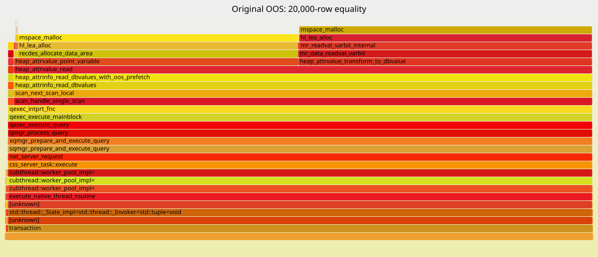
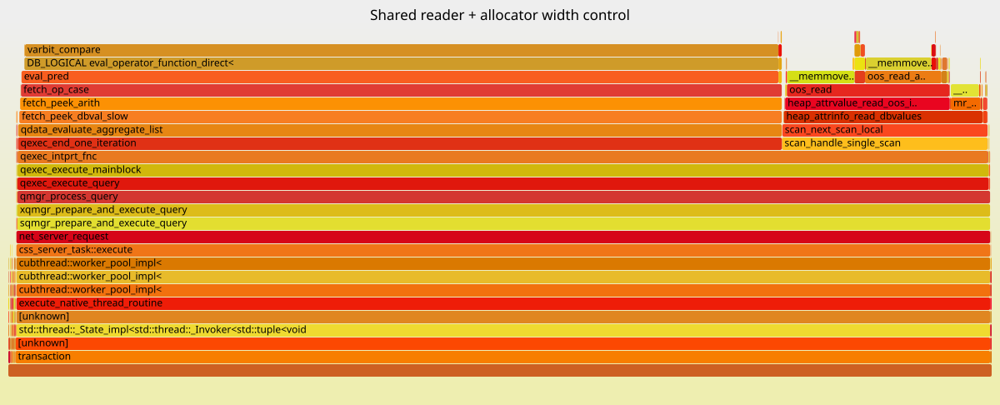

# CBRD-27785: 공통 읽기 경로를 유지하는 성능 개선 조사

작성일: 2026-10-28, Asia/Seoul. 독자: 일반 heap과 OOS의 읽기 경로를 검토하는 엔진 개발자.
관련 이슈: [CBRD-27785](https://jira.cubrid.org/browse/CBRD-27785).
기존 구현: [PR #8299](https://github.com/CUBRID/cubrid/pull/8299), OOS 통합: [PR #7990](https://github.com/CUBRID/cubrid/pull/7990).

## 질문과 결론

후속 [리뷰어 재현 SQL 검증](CBRD-27785-reviewer-reproduction_dcbf09e_codex.md)은 일반 테이블의 세 작업과 잠정 +2% 기준을 별도로 다룬다. 아래 두 스캔의 통과 결과는 당시 입력에 한정하며, 새 UPDATE 기준의 통과를 뜻하지 않는다.

기존 개선은 일반 행이 OOS 준비 코드를 피하도록 했다. 이번 질문은 **일반 행과 OOS 행의
공통 디코더를 개선하고, 실제 OOS 읽기도 함께 빠르게 할 수 있는가**다.

가능성을 확인했다. 후속 production A/B/C 비교에서 일반 행의 CPU 명령 수 증가는 develop 대비
좁은 스캔 **1.36%**, 여러 컬럼 스캔 **0.80%**였다. 같은 공통 reader 후보에서 실제 5KB OOS 값
1개·2개를 읽는 명령 수도 원본보다 **4.35%·2.03%** 줄었다. 순서를 뒤집어도 같은 방향이었다.
이는 두 일반 스캔의 기존 +2% instructions 기준에 대한 결과다. 공유 호스트의 CPU 시간은
변동이 커서 develop과의 CPU 시간 동등성까지 입증하지 않는다.

32KB 값 조회의 더 큰 문제도 설명했다. private allocator의 free-tree 삽입 매크로가 32비트
크기 피연산자를 64비트 키에 필요한 폭만큼 shift했다. 해제한 큰 청크가 잘못된 자식 경로에
연결되어 재사용 탐색에서 빠졌고, 새 segment 연결을 위한 목록 순회가 CPU 대부분을 차지했다.
후속 SQL 수명 추적에서 대상 할당은 모두 같은 heap에서 해제됐다. 피연산자를 shift **전에**
`size_t`로 넓히는 한 줄 통제로 재현 프로그램과 SQL 양쪽의 공간 증가가 사라졌다.
계측을 제거한 20,000행 전체 내용 비교는 **약 63 CPU초 → 0.75 CPU초/실행**이었다.
기존 16KB scratch와 COPY를 유지한 결과다. 앞선 64KB scratch 통제의 61.16초 → 0.70초 결과도
아래에 당시 조건대로 보존했다.

따라서 일반 행 우회만으로 마무리하기보다 다음 두 작업을 권한다.

1. 공통 디코더·변환 함수와 반복문의 비용을 줄인다. 일반 행과 OOS 행 모두 같은 reader와 변환을 사용한다.
2. allocator의 tree-key 폭 결함을 별도 원인 수정으로 검토한다. 이후 남은 복사·임시 할당 비용에
   대해 소유자가 명확한 버퍼 재사용을 검토한다.

**이는 조사와 로컬 실험 결과다.** 공통 reader 패치와 allocator 폭 수정은 보존한 실험 후보이며
제품 브랜치에 반영하지 않았다. 64KB 스택 버퍼는 이전 단계의 통제 수단이다. 아래 앞선 실험은
그 당시 조건을 유지하며, 최종 production profile·수명·재현 결과는 후속 조사 절에서 구분한다.

## 비교 소스와 측정 범위

소스 저장소는 `CUBRID/CUBRID`다. 출발 체크아웃은 `CBRD-27785-oos-performance`이고,
이 브랜치에 연결된 PR은 없었다. 기존 PR #8299의 공개 head는 조회 시 `bcb900d`였다.

| 역할 | 정확한 revision |
| --- | --- |
| develop 계열 기준, 2026-10-26 | `4781495f01523a3ecc5891e3377ad62cf876a1cd` |
| 최초 회귀 재현 대조군 | `4408135c0833ec959da3590f12c14efa69610c7e` |
| 실험 원본 OOS 엔진 | `dcbf09e4f7fd02ff9c8fc6493ec8887fc2919d67` |
| 출발 브랜치 | `f1b99031c0402d521a785815f107be7a83b27717` |
| 기존 공개 개선 PR | `bcb900d1696756a120ec0a2b7885c212f71ebc07` |

원본 엔진의 `heap_file.c`를 복원하고, 그 위에 한 단계씩 실험했다. 최종 공통 경로 실험은
[common_loop.patch](shared-path-20261028/common_loop.patch)다. 이 patch는 `dcbf09e`를 기준으로 하며
기존 PR #8299를 합친 결과가 아니다. 출발 브랜치의 테스트 소스는 유지했다.

Linux x86_64, GCC 11.5.0, RelWithDebInfo, `-O2 -ggdb3 -DNDEBUG -finline-functions`를 사용했다.
SERVER_MODE와 SA_MODE를 빌드·설치했다. 기존 OOS 테스트가 활성화된 빌드를 사용했으며,
단계별 실험에서는 별도 할당 관찰 계측을 제거했다. 이후 모든 `UNIT_TESTS`·`UNIT_TEST_*` 옵션을
끄고, SERVER_MODE·SA_MODE compile command에서 `CUBRID_UNIT_TEST_ENABLED`가 없으며
`-O2 -DNDEBUG`가 유지되는 빌드로 최종 후보를 재측정했다. allocator 내부 관찰 실험은 계측 유무를 따로 기록한다.

설정은 `data_buffer_size=4G`, `log_buffer_size=16M`, `max_clients=20`, query cache entries/pages
각각 0이다. 서버는 physical core 16–19, CSQL은 core 12에 고정했다. 실행은 직렬이며 관계없는
서비스는 중단하지 않았다. 공유 호스트이므로 wall time보다 서버의 instructions·cycles·task-clock을
우선한다. `perf stat`의 hardware event running은 유효 표본에서 100%였다.

## 읽기 계약과 같은 경로의 의미

공통 reader는 representation에 맞는 attribute를 선택하고, inline bytes 또는 OOS에서 읽은
직렬화 bytes를 같은 `DB_VALUE` 변환 함수에 전달한다. 고정값·기본값·구 representation과
NULL 처리도 이 계약에 포함된다.

OOS에는 외부 page fetch와 임시 bytes의 소유권 관리가 필요하다. 이 물리적 차이는 조건부로
처리해야 한다. 이번 실험의 공통 경로란 **일반 값과 OOS 값을 서로 다른 scalar reader나
서로 다른 변환 구현으로 나누지 않는다**는 뜻이다. 원본에도 있던 HAS_OOS 확인과
OOS 요청 개수에 따른 scalar/grouped 저장 읽기 선택은 유지했다.

실험 패치는 다음 책임을 공유한다.

- [`heap_attrvalue_read`](https://github.com/CUBRID/cubrid/blob/dcbf09e4f7fd02ff9c8fc6493ec8887fc2919d67/src/storage/heap_file.c#L11540): 고정·기본값·inline 가변값·OOS 가변값을 모두 처리한다.
- [`heap_attrvalue_point_variable`](https://github.com/CUBRID/cubrid/blob/dcbf09e4f7fd02ff9c8fc6493ec8887fc2919d67/src/storage/heap_file.c#L11207): 같은 offset 해석으로 inline과 OOS를 구분한다.
- [`heap_attrvalue_transform_to_dbvalue`](https://github.com/CUBRID/cubrid/blob/dcbf09e4f7fd02ff9c8fc6493ec8887fc2919d67/src/storage/heap_file.c#L11278): 두 저장 형태에 같은 변환을 적용한다. OOS bytes는 기존처럼 COPY한다.
- `heap_attrinfo_read_dbvalues_individually`: 같은 반복문에서 첫 오류를 반환한다.

OOS identity stamp, stub 경계, chunk 길이 검사, page fix/unfix, pending owner 검사는 제거하지 않았다.
실험은 저장 형식·WAL·snapshot 가시성·demotion 정책을 변경하지 않는다. 규범은
`cubrid-oos-context/OOS-CONTEXT.md`의
Resolve·소유권 계약을 따랐다. 조사 당시 SHA-256은
`6300aa1fa6ffb54033b9c7f7ea959466e9d88f0530e1ab0d7178b4459d4fcf63`이다.

## 원인 1: 큰 버퍼 자체보다 공통 경로의 컴파일 결과와 중복 작업

원본 scalar reader의 release assembly는 stack을 `0x4088` bytes 예약한다. 이는 16KB 전체를
초기화한다는 뜻이 아니다. 일반 행에서는 OOS 버퍼 할당·복사 자체가 실행되지 않는다.

그런데 OOS 준비와 변환을 포함한 함수들이 분리되면서 공통 경로의 함수 호출, register 보관,
조건 분기와 offset 해석 비용이 늘었다. 다음은 같은 입력의 단계별 통제 결과다.

| 실험 | 좁은 스캔 / develop | 여러 컬럼 / develop | 해석 |
| --- | ---: | ---: | --- |
| 원본 OOS | 약 +5.13% | 약 +8.89% | 최초 회귀를 다시 재현 |
| [scalar reader만 강제 inline](shared-path-20261028/force_scalar.patch) | 약 +5.9% | 약 +7.8% | scalar 하나만 바꾸면 충분하지 않고 좁은 스캔은 더 비싸짐 |
| [scalar·호출 반복문·wrapper inline](shared-path-20261028/force_all.patch) | 약 +2.8% | 약 +6.3% | 호출 경계와 배치의 인과 영향 |
| [위 변경 + 두 offset을 함께 해석](shared-path-20261028/shared.patch) | 약 +2.8% | 약 +3.9% | 가변값의 중복 header/width dispatch 비용 |
| [위 변경 + 공통 변환·offset 디코더 inline](shared-path-20261028/full_inline.patch) | 약 +2.1% | 약 +1.3% | 같은 변환 함수에서도 최적화 가능 |
| [위 변경 + 공통 반복문의 즉시 오류 반환](shared-path-20261028/common_loop.patch) | **약 +1.63%** | **약 +0.90%** | 일반 행 별도 reader 없이 기존 2% 기준 통과 |

세부 명령 수·반복 편차·실행 파일 해시는 [측정 요약](shared-path-20261028/summary.json)에 보존한다.
초기 통제 실험은 각각 원본과 직전 단계에서 바뀐 부분을 확인한 것이며, 변화율을 더해
독립적인 원인별 기여율로 해석하지 않는다. 마지막 표본은 순서를 바꿔 다시 측정했다.

테스트 카운터를 끈 최종 확인에서도 일반 행의 증가율은 **+1.645880% / +0.903842%**였다.
기존 2% 기준을 충족한다. 직렬로 맞춘 원본 OOS와의 비교에서는 실제 5KB 값 1개·2개 읽기가
각각 **-4.333981% / -2.017078%**였다. 단계별 표와 아래 직렬 비교 표는 테스트가 활성화된
release 실험을 보존하며, 마지막 확인의 별도 원본은 `production_original/serial`,
`common_loop/production-serial`, `common_loop/production-auto`다.

16KB 스택 버퍼를 없애고 매번 heap에서 할당하는 실험도 했다. 일반 행 비용은 조금 줄었지만,
실제 5KB OOS 읽기는 원본보다 약 3.7% 비싸졌다. **일반 행의 이득을 OOS 할당 비용으로
옮기는 방식은 채택할 근거가 없다.** 실험 patch는
[shared_alloc.patch](shared-path-20261028/shared_alloc.patch)에 보존한다.

## 실제 저장 형태와 OOS 읽기

기존 입력 `n`은 `(id INTEGER PRIMARY KEY, v INTEGER, payload VARCHAR(80))` 200,000행이다.
추가 입력은 20,000행이며, 압축으로 저장 형태가 바뀌지 않도록 `BIT VARYING`을 사용했다.

| 입력 | 실제 값 | develop 저장 | 원본 OOS 저장 | 원본 OOS heap pages / OOS pages / chunks |
| --- | --- | --- | --- | ---: |
| `n` | 정수 2개, 80B 문자열 | heap, overflow 0 | heap, OOS 없음 | 1,653 / 0 / 0 |
| `sp_one` | 5,000B 값 1개 | heap, 평균 5,032B | heap 평균 48B + OOS | 85 / 6,668 / 20,000 |
| `sp_two` | 5,000B 값 2개 | heap, 평균 10,044B | heap 평균 72B + OOS | 117 / 20,001 / 40,000 |
| `sp_large` | 32,000B 값 1개 | 20,000행 모두 overflow | heap 평균 48B + OOS | 85 / 40,001 / 40,000 |

`SHOW HEAP CAPACITY`와 `SHOW HEAP OOS`로 확인했다. 따라서 `n`은 heap → heap,
5KB 두 입력은 heap → OOS, 32KB 입력은 overflow → OOS다. overflow의 SHOW 페이지 합계를
compact heap page 수로 해석하지 않는다.

길이 집계도 이 엔진에서는 실제 OOS fetch와 재조립·변환을 수행했다. trace의 OOS page fetch,
`oos_read`와 변환의 profile로 확인했다. 결과는 byte 내용 비교로 별도 검증했다. 5KB 비교에서는
`varbit_compare`가 CPU 표본 약 68%를 차지했으므로, reader 비용은 길이 집계와 분리했다.

기본 자동 병렬 조건에서 develop의 큰 heap은 worker 4개를 쓰지만 compact OOS heap은
직렬로 실행되는 경우가 있었다. [`scan_open_parallel_heap_scan`](https://github.com/CUBRID/cubrid/blob/dcbf09e4f7fd02ff9c8fc6493ec8887fc2919d67/src/query/parallel/px_scan/px_scan.cpp#L423)은 heap data page 수를
[`compute_parallel_degree`](https://github.com/CUBRID/cubrid/blob/dcbf09e4f7fd02ff9c8fc6493ec8887fc2919d67/src/query/parallel/px_parallel.cpp#L149)에 전달하고, 이 함수는 page threshold 미만이면 직렬을 선택한다. 이 revision의 기본 threshold는 256페이지다.
따라서 큰 값의 양이 같아도 heap 축소가 병렬도 선택에 영향을 줄 수 있다. reader 자체의 비교에는
`PARALLEL(0) NO_PARALLEL_HEAP_SCAN`을 양쪽에 적용한 별도 표본을 사용했다.

측정 표는 최종 직렬 대조 결과를 요약하며, 자동 병렬과 섞지 않는다. 32KB 길이 집계에는
`WHERE id <= 1000`이 있어 20,000행을 검사하되 1,000개의 큰 값만 요청한다.
develop의 overflow는 predicate의 id를 읽는 데도 큰 record fetch가 필요하므로,
이 경우의 이득을 scalar OOS reader만의 개선으로 해석하지 않는다.

| 직렬 스캔의 요청 | 원본 OOS / develop | 공통 경로 패치 / develop | 패치 / 원본 OOS |
| --- | ---: | ---: | ---: |
| 5KB 값 1개인 행의 작은 정수만 | -20.46% | -24.61% | -5.22% |
| 5KB 값 1개를 실제로 읽고 길이 집계 | +140.64% | +129.57% | -4.60% |
| 5KB 값 2개인 행의 작은 정수만 | -37.65% | -40.91% | -5.22% |
| 5KB 값 2개를 실제로 읽고 길이 집계 | +168.52% | +162.96% | -2.07% |
| 32KB 값인 행에서 작은 정수 predicate·집계 | -68.87% | -71.42% | -8.21% |
| 위 predicate로 고른 1,000개의 32KB 값 길이 집계 | -62.16% | -64.97% | -7.42% |

수치는 서버 **instructions** 변화율이다. 5KB 값을 모두 읽는 메모리 상주 조건은 개선 후에도
develop보다 비싸다. 공통 reader의 최적화만으로 OOS의 모든 비용이 사라지지는 않는다.
32KB 전체 내용 비교에서 발견한 allocator 문제는 아래의 별도 통제 실험으로 다룬다.
heap → OOS의 저장 정책에 따른 비용과, 불필요한 준비·복사·할당에 따른 구현 비용은 구분한다.
후자는 OOS 경로에서도 함께 줄여야 한다.

## 원인 2: OOS 재조립 할당이 allocator의 segment 순회를 폭증시킴

문제가 드러난 쿼리는 다음과 같다. `값_32000B`는 입력에 사용한 정확한 BIT literal이다.

```sql
SELECT SUM(CASE WHEN a = 값_32000B THEN 1 ELSE 0 END) FROM sp_large;
```

2만 행의 정답은 20,000이다. 원본 경로에서는 한 값마다 직렬화 bytes 32,008B를 재조립할
임시 영역을 할당하고, 변환에서 32,001B의 `DB_VALUE` 저장 영역을 다시 할당한다.
16KB scratch를 넘으므로 전자의 할당도 private heap으로 간다.

느린 실행의 cycles profile에서 `mspace_malloc`의 self 비중은 **97.18%**였다. caller tree는
재조립용 `recdes_allocate_data_area` 약 49.47%, `mr_readval_varbit_internal`의 복사용 할당
약 47.69%로 나뉘었다. BIT 비교 자체는 약 1.01%였다. 이 비율은 시간 표본이며 instructions의
비중으로 바꿔 해석하지 않는다.

`perf annotate`의 두 뜨거운 pointer load는 allocator [`sys_alloc`](https://github.com/CUBRID/cubrid/blob/dcbf09e4f7fd02ff9c8fc6493ec8887fc2919d67/src/heaplayers/malloc_2_8_3.c#L3680) 안에서 기존 segment와 새
segment를 합칠 수 있는지 찾는 두 목록 순회에 대응했다. allocator의 [기본 확장 단위](https://github.com/CUBRID/cubrid/blob/dcbf09e4f7fd02ff9c8fc6493ec8887fc2919d67/src/heaplayers/lea_heap.c#L59)는
32KiB다. 다음 단계에서 `hl_lea_alloc`의 큰 요청에만 드문 계측을 넣어 segment 수와 footprint를
관찰했다. prefix는 `[DEBUG-sp542]`였고 최종 엔진에서는 제거했다.

| 동일 코드의 통제 조건 | 서버 CPU 시간 | 관찰된 allocator 최대 segment 수 | 예약 footprint |
| --- | ---: | ---: | ---: |
| 16KiB scratch, 재조립 버퍼도 private heap 할당 | 61.1574초 | 40,000 | 1,310,851,024B |
| 64KiB scratch, 32KB 재조립 임시 할당 회피 | 0.70428초 | 3 | 229,328B |

두 조건은 같은 공통 decoder·grouped 개선·COPY 계약·계측을 사용하며 scratch 크기만 다르다.
실행 순서상 앞선 할당 관찰 계측을 끈 실험도 같은 방향이었다. 최대 footprint는 allocator가 확보한 예약량이고
살아 있는 사용자 값이나 프로세스 RSS를 뜻하지 않는다.

별도 할당 관찰 계측을 끈 단일 표본에서는 develop의 같은 전체 내용 비교가 0.6026 CPU초,
64KiB scratch OOS가 0.60047 CPU초였다. instructions는 각각 6,532,857,321과
6,567,966,146으로 OOS가 약 +0.54%였다. 이 입력에서 develop에 가까워질 가능성을 보여 주지만,
이는 반복 인증 결과가 아니며 paired 계측 표본과 합쳐 평균내지 않는다.
이 OOS 빌드에는 테스트용 counter 코드가 남아 있지만, 이 입력의 scalar `oos_read`는
`oos_read_many`의 atomic counter 경로를 실행하지 않는다.
이때 양쪽 모두 BIT 비교 연산이 CPU 표본의 약 84–85%였다. 따라서 이 비슷한 총시간을
OOS storage reader 자체의 비용이 develop과 같다는 뜻으로 해석해서도 안 된다.

계측에서는 이 쿼리의 segment 수가 큰 요청 횟수와 함께 증가했다. 새 segment마다 기존 목록을
순회하므로 이 입력에서 비용이 비선형으로 커진다는 설명은 source·sampling·통제 결과가
같은 방향으로 뒷받침했다. **이전 단계에서는 왜 해당 표현식의 segment 재사용이 실패하는지
설명하지 못했다.** 아래 후속 수명 추적과 실제 allocator 재현이 이 질문을 해소한다.

버퍼를 재사용해 해당 임시 할당을 피할 수 있다는 인과 검증은 성립한다. 64KB를 모든 reader의
스택에 추가하는 방식은 큰 값과 중첩 호출에서의 한계가 있으므로 최종 제품 변경으로 제안하지 않는다.

## 앞선 단계의 버퍼 제안과 남은 비용

공통 reader 개선은 [실험 patch](shared-path-20261028/common_loop.patch)를 출발점으로 삼되,
컴파일러 강제 inline 지시와 코드 크기 증가는 제품 리뷰에서 다시 평가한다. 저장 형태별로
별도 기본 reader를 복제할 필요는 이번 두 스캔에서 입증되지 않았다.

OOS 재조립 버퍼는 scan 또는 attribute reader context가 소유하는 growable buffer로 검토한다.
첫 필요 시 확보하고, 더 큰 값에만 확장하며, 반복 읽기에 재사용하고 context 종료 때 해제한다.
이번 실험은 기존 COPY를 유지했으므로 첫 구현에서도 `DB_VALUE`의 수명을 바꾸지 않고 임시
재조립 할당부터 줄일 수 있다. 잘못된 stub, pending value, 오류·취소, schema 변경과 중첩 읽기에서
버퍼 소유자가 명확해야 한다. 단일 TLS 버퍼로 재진입을 덮는 방안은 검증하지 않았다.
grouped 읽기에서는 여러 payload를 변환이 끝날 때까지 함께 보관해야 한다. 같은 context가
요청 metadata와 payload별 공간을 재사용하는 방향도 검토하되, 공간 확장으로 기존 payload
pointer가 무효화되는 경우를 막아야 한다. scalar 버퍼 하나만 재사용했다고 grouped 전체를
고쳤다고 판단하지 않는다.

grouped Resolve에서는 요청 attribute가 하나뿐이면 집계를 위한 선행 탐색이 불필요하다.
작은 요청 묶음의 완료 flag도 작은 지역 배열로 처리하고, 큰 묶음에는 기존 heap fallback을 둘 수 있다.
실험은 8개 이하에 지역 배열을 쓰며 큰 묶음은 vector를 사용했다. 이 변경으로 page grouping이나
identity 검사를 생략하지 않는다.

복사와 page fix 비용은 남는다. 5KB materialization의 profile에서는 memcpy/memmove가
약 39–43%였다. 기존 직렬화 bytes → 재조립 버퍼 → 소유한 `DB_VALUE`의 두 복사가 원인 후보다.
두 번째 복사를 없애려면 type별 소유권·정렬·해제 계약을 새로 검증해야 하며, 임시 버퍼를 해제한 뒤
그 bytes를 PEEK하도록 바꾸어서는 안 된다. 작은 컬럼 조회의 I/O 이득과, 큰 값을 전부 읽는 warm
조건의 비용은 별도로 판단한다. heap → OOS 전체에 일반 행의 2% 기준을 적용하지 않는다.

## 정확성·재현과 제한

최종 검증 결과와 원본 artifact의 fingerprint는 [기계 요약](shared-path-20261028/summary.json)에
기록했다. 공통 경로 패치에서 집중 CTest **15/15**, **135.71초**가 통과했다. 선택 범위는
native OOS, identity/header/stub 오류, SERVER_MODE, SQL CRUD·DDL·transaction·boundary·bigone·
visible version·workspace bytes·deferred write와 fixture setup/cleanup이다.

추가 SQL 검사는 5KB OOS 값 **8개·9개**의 전체 내용과 **32KB 값 2개**의 전체 내용을 확인했다.
각 20행에서 각각 160·180·40개 값이 모두 일치했고, 실제 OOS chunk 수는 160·180·80이었다.
이는 작은 완료 flag 배열의 경계·heap fallback과 다중 chunk 조립을 각각 검증한다.
실행 도구는 [validate_groups.py](shared-path-20261028/validate_groups.py)다.

실험용 엔진 patch·할당 계측은 조사 후 출발 소스로 복구했고, 출발 HEAD를 다시 빌드·설치했다.
원래 preset symlink와 설정도 복구했고, 소스 체크아웃은 깨끗하다. 작업 소유 native process는
남아 있지 않다. 기존 DB와 원본 결과는 보존했다. source PR이나 JIRA의 원격 내용을 바꾸는 작업은 이번 조사에 포함하지 않았다.

재현은 같은 compiler와 옵션으로 develop 기준과 `dcbf09e`를 독립 빌드하고, 원본과
`common_loop.patch` 적용본에 동일 fixture를 각각 만든 뒤 진행한다. 일반 행은 기존
`contrib/benchmarks/oos-performance/bench.py`를 사용한다. 실제 OOS와 allocator 통제에 사용한
SQL·명령·프로파일·구성·DSO 해시는
[원본 실험 디렉터리](https://dev2.baboon-rudd.ts.net:8443/mnt/nvme/data-5/tmp/CBRD-27785-shared-20261028/)에 보존한다.

공유한 [measure_shared_reads.py](shared-path-20261028/measure_shared_reads.py)와
[probe_large.py](shared-path-20261028/probe_large.py)는 선택한 native 환경에서 실행한다.
준비한 설치마다 별도의 registry·configuration·port·TMP와 작업 소유 DB `oos27785`가 필요하다.
registry에 다른 DB가 있거나 benchmark server가 이미 실행 중이면 측정 도구는 거부한다.
먼저 기존 `bench.py fixture`로 새 DB에 `n`을 적재한다. 그 후 사용 예시는 다음과 같다.

```sh
# 선택한 설치의 native 환경에서 실행한다. EVIDENCE와 BENCH는 절대 경로다.
export CBRD_SP_OUTPUT="$EVIDENCE"
export CBRD_SP_HARNESS="$BENCH"
python3 -B measure_shared_reads.py --label base --name first --setup --length-only --serial --runs 5
```

OOS 설치는 `--label original` 또는 `--label common_loop`를 사용한다. `--setup`은 각 DB에서
한 번만 실행한다. 일반 행의 자동 병렬 비교는 `--ordinary --length-only`로 실행하고 `--serial`은
빼서 기존 기준과 맞춘다. 각 `--name`은 새 결과 디렉터리여야 한다. 도구가 서버를 시작하고 끝나면
작업 소유 서버·master를 중단한다. DB와 fixture는 남긴다.

큰 값 통제는 같은 fixture에서 `probe_large.py`를 실행한다. 원본 16KiB 조건과
`scratch64.patch` 조건을 독립 빌드하며 `SP_PROBE_NAME`으로 결과 디렉터리를 구분한다.
정확히 한 변수인 역방향 비교에는 [optimized.patch](shared-path-20261028/optimized.patch)와 [scratch64.patch](shared-path-20261028/scratch64.patch)를 각각 적용하고,
양쪽에 같은 [allocator-observation.patch](shared-path-20261028/allocator-observation.patch)를
적용한 뒤 `CBRD_SP542_ALLOC_TRACE=1`로 실행한다. 계측은 최종 성능 측정 전에 제거한다.
`scratch64.patch`는 추가 통제 실험용이며 제품 patch로 합치지 않는다.

9개의 실험 patch는 모두 `dcbf09e`에 적용 가능함을 검사했다. 측정 도구도 현재 설치에서
직접 실행해 결과 검사를 통과했다. 원본 로컬 `matrix.py`·`campaign.py`는 보존된 workenv를
선택하는 실행 기록용 도구이며, 공유한 도구는 출력·하네스 경로를 환경으로 받는다.
unified diff의 context 공백을 보존하도록 해당 디렉터리의 patch 파일만 whitespace 검사를
별도로 취급했다. 실제 추가 source 행은 9개 patch 모두 `git apply --check --whitespace=error-all`을 통과했다.

이번 검증은 SELECT 읽기 경로와 선택한 값 크기에 한정한다. INSERT·UPDATE·DELETE 전체,
대용량 cold I/O, 전체 회사 CI, ASAN, HA·복구 인증과 모든 compiler의 성능을 주장하지 않는다.
관련 [CBRD-27791 분석](../CBRD-27791/README.md)의 cold read 순서 문제와도 별개다.

## 후속 production A/B/C profile과 allocator 수명 조사

2026-10-28의 같은 Work Item 542에서 위 실험을 이어 갔다. 질문은 최종 테스트 옵션 OFF
빌드의 호출 경로와, 큰 값의 할당을 해제해도 공간이 재사용되지 않은 이유다.
[후속 측정 요약](perf-lifetime-20261028/results.json),
[allocator 폭 통제 patch](perf-lifetime-20261028/allocator-width.patch),
[실제 allocator 재현 프로그램](perf-lifetime-20261028/allocator-replay.cpp)을 함께 보존한다.

### 비교 조건과 수집 품질

| 비교군 | 실제 엔진 source | production DSO build ID |
| --- | --- | --- |
| A | develop `4781495f01523a3ecc5891e3377ad62cf876a1cd` | `1e6bf5483d3df5a1a55527320f7596f658a64bda` |
| B | 원본 OOS `dcbf09e4f7fd02ff9c8fc6493ec8887fc2919d67` | `6fc742a092073810d6ad23d96fee87bac9dd55eb` |
| C | B + 기존 `common_loop.patch` | `32716ffa8cb947f477454ca7165d630db44f010e` |
| D | C + allocator 폭 통제 한 줄 | `955bf290fca695f7dca9dc8690fae99cfcfbf7a2` |

source checkout의 HEAD는 계속 `f1b9903`였다. B는 `src` 전체가 `dcbf09e`와 같음을 diff로
검사했고, C는 해당 기준 위의 patch를 역적용 검사했다. D의 추가 차이는 allocator 한 줄이다.
소스·DSO SHA-256과 실제 compile command를 표본별로 보존했다.

모든 성능 표본에서 GCC 11.5.0, `-O2`, `NDEBUG`, frame pointer, 16KB page 조건을 확인했고,
`UNIT_TESTS` 및 모든 `UNIT_TEST_*` 옵션을 OFF로 구성했다. SERVER_MODE·SA_MODE 명령에
`CUBRID_UNIT_TEST_ENABLED`가 없는지도 확인했다. 정확성 검사를 위한 테스트 ON 빌드는
성능 표본에 포함하지 않았다. source별 독립 DB와 동일 생성 입력을 재사용했다.

각 SQL은 `PARALLEL(0) NO_PARALLEL_HEAP_SCAN`으로 직렬화했다. 서버는 CPU 16–19,
CSQL은 CPU 12에 고정했다. buffer·cache 설정은 앞선 절과 같고, 매번 결과·trace·실제 저장
형태를 확인했다. 일반 행은 200,000행, 5KB 값은 20,000행이다. 큰 값의 부분 조회는 20,000행
heap에서 `id <= 1000`인 값만 실제로 읽는다. 전체 내용 비교는 별도로 20,000개 값을 읽는다.

A/B/C 정방향은 20회 쿼리 묶음을 5번 실행해 첫 묶음을 warmup으로 제외했다. C/B/A 역방향은
3번 중 첫 묶음을 제외했다. 중간에 전체 내용 비교와 원인 분리 실험이 있으므로 시간상 바로
인접한 쌍만으로 구성된 실험은 아니다. 각 쿼리별 절대 작업량은 같으며 아래 수치는 실행당
명령 수의 중앙값이다. 서로 다른 predicate의 총량을 무조건 값 하나당 비용으로 환산하지 않는다.

서버 PID의 전체 thread를 `perf stat`으로 세고, stack sampling은 별도 실행했다.
counting에는 `instructions:u,cycles:u,task-clock,context-switches,cpu-migrations,page-faults`를
사용했다. 주 hardware counter의 running 비율은 유효 표본에서 100%였다. `pidstat`·`iostat`도
같은 구간에 보존했다. A/B/C 각각 8개 workload의 `cycles:u` call graph를 FP·499Hz로 수집했고,
대부분 workload당 약 6 CPU초를 목표로 반복 수를 늘려 수천 표본을 얻었다. report의 lost sample은
모두 0이었다. 소수의 unresolved frame은 남으므로 작은 함수의 1% 차이를 sample 비중만으로
확정하지 않는다. libc 내부 frame-pointer 복원의 한계와 inlining은 source·assembly로 보완했다.

`perf report`의 self/inclusive tree, `perf diff`, allocator assembly를 확인했다.
수집 ON/OFF의 같은 쿼리 묶음도 B/C에서 비교했다. collector 시작·종료까지 포함한 경과시간은
ON에서 대략 10–20% 길었다. 그 시간을 성능 판정 수치로 사용하지 않았다. sample 비중은
호출 횟수가 아니며, 아래 할당 횟수는 별도 포인터 수명 계측에서 얻었다.

### 공통 reader의 정방향·역방향 결과

| workload와 비교 기준 | 정방향 instructions | 역방향 instructions |
| --- | ---: | ---: |
| 원본 B 일반 좁은 스캔 / A | +4.505% | +4.506% |
| 원본 B 일반 여러 컬럼 스캔 / A | +8.451% | +8.454% |
| 공통 reader C 일반 좁은 스캔 / A | **+1.364%** | **+1.363%** |
| 공통 reader C 일반 여러 컬럼 스캔 / A | **+0.801%** | **+0.803%** |
| C 실제 5KB 값 1개 길이 집계 / B | **−4.349%** | **−4.337%** |
| C 실제 5KB 값 2개 길이 집계 / B | **−2.026%** | **−2.026%** |

역방향은 해당 순서에서 얻은 A/B/C 중앙값끼리 비교했다. 정방향 한 스캔의 명령 수는
A/B/C가 좁은 조회 약 382.22M / 399.43M / 387.43M, 여러 컬럼 조회
674.54M / 731.55M / 679.94M이었다. 두 일반 스캔의 +2% 기준은 instructions에 한정한다.

일반 조회의 stack은 scan·aggregate·공통 decode 경로에 남았다. C에서는 inline된 decoder와
변환 비용이 `heap_attrinfo_read_dbvalues` 등의 caller에 합쳐진다. reader symbol 하나가 작아진
것을 전체 decode 비용의 감소량으로 계산하지 않았다. source의 paired offset 해석·공통 변환·
즉시 오류 반환 통제와, 실행당 전체 명령 수의 감소를 함께 근거로 삼았다.
5KB materialization은 재조립·COPY 및 page/slot 접근 비용이 남는다. 일반 행만 별도 reader로
우회하거나 OOS의 COPY·identity 검사를 생략한 결과가 아니다.

CPU 시간은 별도로 판단한다. 좁은 스캔 한 번의 A는 정방향 52.64–59.10ms,
역방향 47.71–48.91ms였고, C는 정방향 55.83–64.21ms, 역방향 53.23–55.49ms였다.
명령 수의 일관성과 달리 cycles·CPU 시간은 실험 순서에 따라 변했다. 이 자료로 CPU 시간
동등성이나 1–2% 수준의 실제 시간 개선을 인증하지 않는다. 해당 판단에는 호스트 간섭과
실행 core 조건을 더 좁힌 반복이 필요하다. D의 자동 병렬 조건도 별도 실행해 결과를 확인했으며,
직렬 표의 분모와 섞지 않았다.

### 큰 값: 해제 누락과 공간 재사용을 구분한 결과

C의 전체 내용 비교도 62.858 CPU초였다. 공통 decoder 변경만으로 allocator 병목이 사라지지는
않았다. B의 profile에서는 `mspace_malloc` self가 97.50%, C에서는 98.01%였다.
B의 caller tree는 재조립용 `recdes_allocate_data_area` 약 47.69%와 DB_VALUE 복사용
`mr_readval_varbit_internal` 약 49.80%로 나뉘었다. annotation에서는 기존 segment 목록을
따르는 두 지점에 약 46.30%·46.77%의 표본이 모였다.

진단 빌드에서 `hl_lea_alloc/free/realloc` 및 heap clear를 따로 추적했다. 요청 크기·pointer·
heap·thread·순서를 연결하고, allocator의 top/dv/tree map·예약량·드문 segment snapshot을
남겼다. 성능 시간은 이 빌드에서 취하지 않았다. pointer 연결로 본 대상 버퍼 결과는 다음과 같다.

| 1,000행 조건 | 큰 할당 / 해제 | 큰 payload 최대 생존량 | allocator 최대 예약량 |
| --- | --- | ---: | ---: |
| 길이 집계, 원본 allocator | 32,008B 1,000회 + 32,001B 1,000회, 모두 해제 | 64,009B, 2개 | 98,256B |
| 전체 내용 비교, 원본 allocator | 32,008B 1,000회 + 32,001B 1,001회, 모두 해제 | 96,010B, 3개 | **65,732,560B** |
| 전체 내용 비교, 폭 통제 | 위와 같은 크기·횟수, 모두 해제 | **동일한 96,010B, 3개** | **262,096B** |

추가 32,001B는 비교 literal의 저장 공간이다. 대상의 할당과 해제는 같은 heap에서 연결됐고,
명시적 해제 없이 heap clear에만 의존한 대상 버퍼는 없었다. 생존 payload와 allocator 예약량은
다른 값이다. 원본의 전체 내용 비교 예약량은 10행 851,920B, 100행 6,750,160B,
1,000행 65,732,560B로 증가했다. 폭 통제에서는 세 조건 모두 262,096B였다.

### 원인: free-tree 삽입 시 shift 피연산자의 폭

원본 allocator에서 [`bindex_t`는 unsigned int](https://github.com/CUBRID/cubrid/blob/dcbf09e4f7fd02ff9c8fc6493ec8887fc2919d67/src/heaplayers/malloc_2_8_3.c#L1679)다.
[`mspace_free`의 insert_chunk 호출](https://github.com/CUBRID/cubrid/blob/dcbf09e4f7fd02ff9c8fc6493ec8887fc2919d67/src/heaplayers/malloc_2_8_3.c#L5046)은
크기를 `(bindex_t) psize`로 넘긴다. 이어
[`insert_large_chunk`의 키 계산](https://github.com/CUBRID/cubrid/blob/dcbf09e4f7fd02ff9c8fc6493ec8887fc2919d67/src/heaplayers/malloc_2_8_3.c#L3102)은
다음과 같다.

```c
size_t K = S << leftshift_for_tree_index(I);
```

이 호스트에서 unsigned int는 32비트, size_t는 64비트다. 26–32KB 청크가 속하는 tree bin 13의
shift는 51이다. 대입 대상 K가 size_t여도 왼쪽 피연산자 S는 먼저 32비트로 평가된다.
32비트 값에 대한 이 shift는 정의 범위를 벗어난다. 관찰한 binary에서는 삽입의 처음 자식 선택에
필요한 상위 비트가 보존되지 않는다. 반면 [`tmalloc_large`의 탐색 키](https://github.com/CUBRID/cubrid/blob/dcbf09e4f7fd02ff9c8fc6493ec8887fc2919d67/src/heaplayers/malloc_2_8_3.c#L3865)는
size_t인 nb를 shift한다. 삽입과 탐색이 서로 다른 경로를 사용하게 된다.

같은 bin의 작은 free 청크가 root에 먼저 있는 경우가 핵심이다. 뒤에 해제한 큰 청크가
잘못된 자식 경로에 연결되면, 큰 요청을 위한 탐색이 그 청크를 찾지 못하고 sys_alloc으로 간다.
실제 DSO를 로드한 GDB 확인에서도 26,008B root 아래의 해제된 32,696B 청크가 원본에서는
child[0], 폭 통제에서는 child[1]에 연결됐다. 같은 큰 요청의 탐색이 따르는 쪽은 child[1]이다.
system malloc에서 얻는 segment들이 서로 인접하지 않아 기존 segment와 합쳐지지 않는 조건에서
목록이 길어지고, 새 segment마다 그 목록을 반복 순회한다. 해제 호출을 추가할 문제가 아니라
이미 해제한 청크를 찾을 수 있도록 tree key를 일치시킬 문제다.

통제는 다음 한 줄이다. 자료의 다른 매크로나 allocation/COPY 수명은 바꾸지 않았다.

```c
size_t K = (size_t)(S) << leftshift_for_tree_index(I);
```

이 allocator 파일은 A와 B에서 Git blob `d0a3bc85ff53cb3e687cb2539873b79de8d57bf0`으로
동일했다. 따라서 해당 폭 문제는 두 비교 revision에 공통으로 존재하며, OOS의 이번 할당 패턴이
큰 비용을 드러냈다고 해석한다. 결함이 처음 도입된 commit이나 모든 compiler에서의 발현은
이 조사에서 확정하지 않았다.

### 실제 allocator로 재현·반증

처음에는 32,008B 임시 버퍼와 32,001B 이전/새 값의 교대 할당만 재생했다. 초기 공간만 쓰거나
몇 개 segment에서 안정돼 실제 SQL 문제를 재현하지 못했다. 이어 관찰한 free-tree 조건을
분리했다. 재현 프로그램은 26,000B를 할당하고 작은 guard와 literal을 유지한 뒤 그 26,000B를
먼저 해제한다. 그 상태에서 같은 두 큰 버퍼의 할당·해제를 반복한다. 실제 CUBRID DSO의
`hl_register_lea_heap`, `hl_lea_alloc/free`, `mspace_footprint`를 사용한다.

| 반복 수 | 원본 최대 예약량 | 폭 통제 최대 예약량 | 원본 / 통제 경과시간, 단일 진단 실행 |
| --- | ---: | ---: | ---: |
| 100 | 6,619,088B | 131,024B | 0.001025s / 0.000014s |
| 1,000 | 65,601,488B | 131,024B | 0.054145s / 0.000088s |
| 5,000 | 327,745,488B | 131,024B | 2.724818s / 0.000363s |

1MiB 예약량 상한을 검사하게 실행하면 원본은 exit 2, 통제는 exit 0이다. 이 상한은 원래 SQL의
해제 후 공간 증가를 잡는 재현 기준이다. 위 microbenchmark의 시간 비율을 DB 전체 배율로
일반화하지 않는다. SQL의 같은 수명·횟수 통제와 재현 프로그램이 같은 원인 설명을 지지한다.

### 계측을 제거한 전체 내용 비교

| 비교군 | instructions / 실행 | CPU초 / 실행 | 결과 |
| --- | ---: | ---: | --- |
| A, develop | 6.5349G | 0.7036 | 20,000 |
| B, 원본 OOS | 17.9776G | 62.6071 | 20,000 |
| C, 공통 reader | 17.9720G | 62.8577 | 20,000 |
| D, 공통 reader + allocator 폭 통제 | **6.5802G** | **0.7512** | **20,000** |

A/D는 10회 쿼리 묶음의 계수를 10으로 나눴고 B/C는 1회다. counting과 profile은 각각 별도
실행했다. 이는 큰 병목을 확인한 진단 비교이며, 균형 잡힌 반복 전체로 인증한 시간 기준선이
아니다. 첫 전체 조회의 buffer warming 영향도 완전히 제거하지 않았으므로 작은 A/D 시간
차이를 단정하지 않는다. D의 instructions는 A 대비 약 +0.69%지만 CPU 시간은 약 +6.76%였다.
이 비율을 일반 heap의 +2% 기준에 대입하지 않는다.

D는 기존 16KB scratch와 두 버퍼의 할당·COPY·해제를 유지했다. profile의 주요 비용은
value 비교 약 76.59%, memmove 약 16.16%로 바뀌었다. 남은 복사와 OOS page/slot 접근 비용은
후속 최적화 대상으로 구분한다.





두 그림은 각 실행 안에서 정규화한 CPU sample 폭이다. 원본 99Hz·1회, 통제 499Hz·10회의
서로 다른 총 표본량을 사용했으므로 그림 전체 폭을 절대 시간으로 비교하지 않는다.

### 재현 기록과 범위

새 allocator 통제가 공통 reader와 함께 적용된 상태에서 집중 CTest **15/15**, **184.54초**를
통과했다. 범위는 앞선 동일 선택과 같고, native/identity/SERVER_MODE 및 SQL CRUD·DDL·경계·
transaction·bigone·deferred write·visible version·workspace bytes·record flags·오류 검사를
포함한다. 테스트 옵션 ON 빌드의 결과이며 성능 계수와 구분한다. 보존한 fixture를 새로 만들지
않고 읽어서 8개·9개 5KB 값의 160·180개 내용 일치와 2개 32KB 값의 40개 내용 일치도 확인했다.
OOS chunk 수는 각각 160·180·80이었다. source 변경을 되돌린 뒤 실행한 검사가 아니다.

원본 artifact root는 다음과 같다.

```text
/mnt/nvme/data-5/tmp/CBRD-27785-perf-lifetime-20261028
```

`<variant>/build.json`, `source.patch`, `compile-commands.json`, `binaries/`에 실제 source·flags·
DSO·symbol을 보존했다. `base|original|common_loop/forward/`의 `.data`, `*-self.stdout`,
`*-callers.stdout`와 `visuals/*.diff`가 matched profile이다. `original_repeat/reverse/`와
`base|common_loop/reverse/`가 역방향이다. `diagnostic|allocator_wide_trace/lifetime/`에는
크기·포인터·heap별 원본 trace가 있고, `lifetime-summary.json`이 연결 결과다.
`allocator_wide/forward|auto|equal-all/`가 계측 없는 통제다.

표본 수집의 핵심 명령은 다음과 같다. 실제 PID·SQL 경로·수집 횟수는 각 summary에 있다.

```bash
perf stat -x ';' -e instructions:u,cycles:u,task-clock,context-switches,cpu-migrations,page-faults \
  -p "$DBPID" -o counters.perf -- taskset -c 12 csql -C -u dba --no-pager -t -N -i queries.sql oos27785
perf record -e cycles:u -F 499 --call-graph fp -p "$DBPID" -o cpu.data -- \
  taskset -c 12 csql -C -u dba --no-pager -t -N -i profile-queries.sql oos27785
perf report --stdio --no-inline --children --call-graph graph,0.5,caller -i cpu.data
perf annotate --stdio --symbol=mspace_malloc -i cpu.data
perf diff baseline.data candidate.data
```

독립 재현은 선택한 DSO를 링크하고 로더가 같은 DSO를 읽게 해야 한다. 아래에서 `LIBDIR`은
원본 또는 통제의 보존한 library 디렉터리다. `ldd` 해석도 보존했다.

```bash
g++ -O2 -g allocator-replay.cpp "$LIBDIR/libcubrid.so.11.5" \
  -Wl,-rpath,"$LIBDIR" -o allocator-replay
LD_LIBRARY_PATH="$LIBDIR:$LD_LIBRARY_PATH" ./allocator-replay 1000 tree 0 1048576
```

제외한 build 시도 두 가지도 원본에 기록했다. source 복구 시 보존한 옛 mtime 때문에 Ninja가
계측 DSO를 재사용한 시도는 DSO hash로 발견해 시간 수집 전에 제외·재빌드했다. 독립 재현의
첫 실행은 상속한 LD_LIBRARY_PATH가 RUNPATH보다 앞서 다른 DSO를 선택해 필수 red 판정에
실패했다. variant별 library 경로를 명시하고 ldd로 확인한 뒤 재실행한 결과만 표에 썼다.

현재 결론은 공통 reader의 instructions 개선과, 해당 allocator tree-key 결함의 원인 확인 및
로컬 통제 검증이다. 공통 reader와 allocator 수정은 각각 검토할 수 있는 변경으로 보존한다.
새 source PR·JIRA 게시·CI 실행·제품 브랜치 통합은 이 조사에 포함하지 않는다.

조사 후 source checkout은 시작 HEAD `f1b9903`, baseline checkout은 `4781495`의 clean 상태로
복구하고 다시 빌드·설치했다. 원래 preset symlink와 테스트 옵션 선택을 복구했으며 공유 preset
파일은 바뀌지 않았다. baseline 복구 중 compiler 경로 변화로 Debug cache가 생성된 경우는
재구성·재빌드한 뒤 `-O2 -DNDEBUG`·frame pointer를 확인했다. 해당 복구 중간 빌드는 어떤
측정에도 쓰지 않았다. task-owned DB daemon은 모두 종료했고 DB·원본 결과·정확한 profiling
DSO는 보존했다. 현재 설치는 allocator 폭 통제 후보가 아니다.
