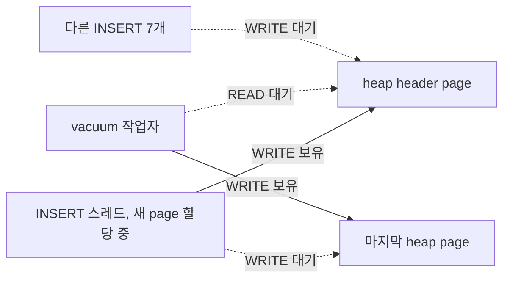

# 동시 INSERT CTest가 debug에서 멈추는 이유

PR #8330에 추가한 `test_oos_concurrent_insert` CTest는 release에서는 통과하지만 debug에서는 가끔 멈춥니다. 이 문서는 그 정지가 PR #8330 때문인지 가린 결과를 정리합니다. 독자는 PR #8330과 PR #8350의 리뷰어입니다.

## 결론

정지는 PR #8330이 만든 문제가 아닙니다. CBRD-27860 / [PR #8350](https://github.com/CUBRID/cubrid/pull/8350)이 고치는 기존 page latch 순환입니다.

- PR #8330 엔진에서 CTest를 10회 돌리면 4회 멈췄습니다. 멈춘 4회 모두 서버를 직접 읽어 같은 순환을 확인했습니다.
- PR #8350의 수정을 더하면 10회 모두 통과했습니다.
- 순환을 이루는 코드는 PR #8330 전후가 같습니다.

따라서 이 CTest가 debug에서 안정적으로 통과하려면 PR #8350이 먼저 들어가야 합니다.

## 무엇이 서로를 막는가

새 heap page를 할당하는 INSERT와 vacuum이 두 page를 서로 반대 순서로 잡습니다. page latch에는 교착 감지가 없어서 양쪽 모두 latch timeout까지 기다립니다.



1. INSERT가 새 page를 할당하려고 [`heap_alloc_new_pages`](https://github.com/CUBRID/cubrid/blob/4db11c5f12f9c67134aad7f547df8704d1e5c591/src/storage/heap_file.c#L28589)에서 heap header를 WRITE로 잡습니다. 그다음 [`heap_get_last_page`](https://github.com/CUBRID/cubrid/blob/4db11c5f12f9c67134aad7f547df8704d1e5c591/src/storage/heap_file.c#L2716)에서 header가 가리키는 마지막 page를 WRITE로 요청합니다.
2. vacuum은 [`vacuum_heap_page`](https://github.com/CUBRID/cubrid/blob/4db11c5f12f9c67134aad7f547df8704d1e5c591/src/query/vacuum.c#L1728)에서 그 마지막 page를 WRITE로 잡습니다. OOS 값이 있는 행을 만나면 [`vacuum_oos_find_vfid_for_heap_record`](https://github.com/CUBRID/cubrid/blob/4db11c5f12f9c67134aad7f547df8704d1e5c591/src/query/vacuum.c#L2256)를 거쳐 OOS 파일 ID를 찾습니다. 이때 page를 놓지 않은 채 [`heap_oos_find_vfid`](https://github.com/CUBRID/cubrid/blob/4db11c5f12f9c67134aad7f547df8704d1e5c591/src/storage/heap_file.c#L13262)에서 header를 READ로 요청합니다.
3. 두 스레드가 서로의 page를 기다리므로 둘 다 멈춥니다. 같은 header를 원하는 나머지 INSERT도 모두 그 뒤에 줄을 섭니다.

## PR #8330 탓이 아닌 근거

PR #8330의 엔진 변경은 [`oos_stats_find_page_in_bestspace`](https://github.com/CUBRID/cubrid/blob/3c39a813ae1a40651e50286920c507f06ed94471/src/storage/oos_file.cpp#L582)에서 무대기 설정과 복원 7줄을 지운 것뿐입니다. 이 함수는 위 두 대기 경로에 없습니다. 부모 커밋 `3c39a813a`와 PR 커밋 `4db11c5f1` 사이에 `heap_file.c`, `vacuum.c`, `vacuum_oos.cpp`, `page_buffer.c`는 바뀌지 않았습니다.

PR #8350의 재현 테스트 `VacuumWaitsForHeapHeaderWithoutHoldingLastPage`도 같은 결과를 냅니다. 이 테스트는 header를 잡은 채 vacuum이 header에서 기다리게 만든 뒤, 마지막 page가 비어 있는지 확인합니다.

| 엔진 | 결과 |
| --- | --- |
| PR #8330 이전 (`3c39a813a`) | 실패, [`test_oos_real_vacuum_server.cpp:971`](https://github.com/CUBRID/cubrid/blob/1ef6ed6125eb6028c06b0e05282dc0041bde3f48/unit_tests/oos/test_oos_real_vacuum_server.cpp#L971) |
| PR #8330 (`4db11c5f1`) | 실패, 같은 줄 |
| PR #8330 + PR #8350 수정 | 통과 |

그러면 왜 이제야 보이는가? 이 부분은 측정이 아니라 추론입니다. PR #8330 이전 debug 빌드는 동시 INSERT 첫 라운드에서 [`file_manager.c:6924`](https://github.com/CUBRID/cubrid/blob/3c39a813ae1a40651e50286920c507f06ed94471/src/storage/file_manager.c#L6924) assertion으로 먼저 중단됩니다. PR #8330이 그 조기 실패를 없애자 INSERT가 새 page 할당까지 진행해 기존 순환에 닿게 된 것으로 봅니다.

## 실험

모든 실험은 2026-11-04(Asia/Seoul)에 `debug_gcc` 빌드로 같은 설치본과 같은 설정에서 실행했습니다. 엔진 변형마다 실제로 로드된 `libcubrid.so`의 digest와 디스어셈블리로 의도한 코드인지 확인했습니다.

### 동시 INSERT CTest 반복

등록된 CTest를 그대로 10회씩 실행했습니다. 한 번은 세션 8개가 1,500행씩 3라운드를 INSERT합니다.

```bash
ctest -R '^test_oos_concurrent_insert$' --output-on-failure
```

| 엔진 | 멈춘 실행 |
| --- | --- |
| PR #8330 | 4 / 10 |
| PR #8330 + PR #8350 수정 | 0 / 10 |

멈춘 실행은 세션이 120초 라운드 제한을 넘겨 실패했고, 서버는 살아 있었으며 core는 없었습니다.

### 멈춘 서버에서 읽은 page 소유 관계

client 출력이 15초간 멈추면 GDB로 `cub_server`에 붙어 메모리만 읽었습니다. 엔진 함수는 호출하지 않았습니다. 각 대기 스레드의 holder 목록(`m_holder_anchor->thrd_hold_list`), 기다리는 BCB, 두 page의 latch 상태를 읽었습니다. 그다음 할당과 vacuum 프레임에서 VPID를 읽었습니다.

| 실행 | header page | 마지막 page | header를 쥔 INSERT | 마지막 page를 쥔 vacuum |
| --- | --- | --- | --- | --- |
| 2 | 1\|12993 | 1\|13046 | 4332 | 4340 |
| 7 | 1\|705 | 1\|734 | 4329 | 4340 |
| 8 | 1\|6849 | 1\|6866 | 4331 | 4340 |
| 9 | 1\|705 | 1\|742 | 4333 | 4340 |

네 번 모두 아래가 동시에 성립했습니다.

- 두 page 모두 latch 모드가 WRITE이고, 각 page의 holder fix count가 1입니다.
- 할당 스레드가 기다리는 page는 header의 `last_vpid`와 같습니다.
- 그 page는 vacuum의 `home_vpid`와도 같습니다. 레코드 종류는 REC_HOME입니다.
- 나머지 INSERT 7개는 header에서 WRITE로 기다립니다.
- client 출력이 멈춘 지 31~58초 뒤 두 스레드를 다시 읽었을 때도 같은 함수에서 같은 page를 기다리고 있었습니다. 느린 진행이 아니라 교착입니다.

## 한계

- PR #8330 이전 엔진에서는 이 CTest가 먼저 abort하므로, 그 엔진에서 순환을 실시간으로 잡지는 못했습니다. 이전 엔진에 대한 근거는 재현 테스트 실패와 동일한 소스입니다.
- 10회 표본입니다. 정지 빈도 40%는 대략적인 값입니다.
- 두 10회 묶음은 번갈아 돌리지 않고 차례로 돌렸습니다.
- release에서 정지가 없었던 이유는 확인하지 않았습니다. release 동시 INSERT 실행은 두 번뿐입니다.

## 다음 단계

PR #8350을 먼저 병합하고, PR #8330을 새 base로 rebase한 뒤 debug에서 이 CTest를 다시 반복 실행해 정지가 없는지 확인합니다.
