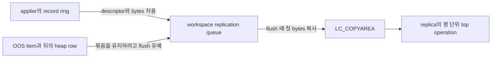

# PR #7990 구조 리팩토링 심층 조사

목표는 OOS 유지보수자가 실제 개발 과제로 고를 구조 개선을 근거와 함께 제시하는 것이다. 작은 helper의 개수보다 책임, 상태, 소유권, 호출자 의무가 줄어드는지를 판단한다. 엔진 구현과 JIRA sub-task 생성은 범위에 없다.

2026-11-11 14:44부터 16:00까지 조사하고 해당 시각의 선정과 집계를 확정했다. 정적 소스 확인, 설계 제안, 실행으로 확인하지 못한 가설을 구분한다. 마감 뒤에는 문서 검사·로컬 commit·조사 checkout 정리만 수행한다.

## 선택할 개발 과제

조사 판단으로는 R-54의 scalar 수명과 #8434 이후 R-43의 unknown-lap 계약부터 설계하는 순서가 타당하다. 효과가 클 수 있는 R-61은 먼저 운영 경계의 trace를 검증한 뒤 buffer 수명과 행 묶음 변경을 분리한다. 마지막 최소 인터페이스 비교에서 R-47은 우선 후보에서 보조 정리로 내렸다. 아래 제안은 모두 구현에서 동작 보존을 입증해야 하며 엔진 변경 승인이 아니다.

| 분류 | 후보 | 구체적인 선택 범위 | 변경 범위와 주요 위험 |
| --- | --- | --- | --- |
| 우선 검토 | [R-54](#r-54) | attribute와 index의 scalar Resolve에서 COPY·임시 bytes 해제 의무를 모은다. | 중간. #8299 실제 코드에서 두 decoder의 오류 결과와 scratch 경계를 유지한다. |
| 작은 보조 정리 | [R-47](#r-47) | received/converted storage만 묶는 최소 안을 현재 helper와 비교한다. | 작음. 한 번의 호출을 위한 full holder는 우선 선정하지 않는다. 기존 유지안도 강하다. |
| 회수 쪽 다음 선택 | [R-43](#r-43) | 같은 파일·mutex에서 unknown-lap과 candidate snapshot 전이를 소유한다. | 중간, 동시성 위험 큼. #8434의 성장 claim과 recovery 원자성을 유지한다. |
| 효과가 큰 조건부 후보 | [R-61](#r-61) | buffer를 packer 복사 때까지 안정되게 보유하는 계약을 만든다. | 넓음. HA 도달성 검증과 필요 시 동작 수리를 분리한다. stable pool/spill부터 lease·행 envelope와 비교한다. |
| 제한된 조건부 후보 | [R-33](#r-33) | FK 부모 continuation의 전체 참조와 FIFO 소비 위치를 한 번에 보존한다. | 좁은 안은 작지만 이득도 한 구역이다. 전체 owner 이전은 actor·수명 증명이 남았다. |
| 선정 보류에 가까운 조건부 | [R-58](#r-58) | cache의 embedded-key/list/hash와 shutdown 소유를 닫는다. | 단독 TU 이동은 미선정. 기존 helper보다 줄어드는 의무와 오류 계약을 먼저 증명한다. |
| 작은 보조 후보 | [N-20261111-03](#n-20261111-03) | #8434 이후 raw redo-only delete를 운영 인터페이스에서 숨긴다. | 작음. test linkage를 보존하며 finality 증명이라는 주장은 하지 않는다. |

기존 후보의 실질적인 구체화는 **6개 ID**인 R-33·R-43·R-47·R-54·R-58·R-61이다. 순수 신규는 **1개**인 N-20261111-03이다. R-48·R-44는 관련 제약으로 연결하며 따로 더하지 않는다. R-18·R-25의 기존 좁은 결론을 재확인한 것은 새 성과로 세지 않는다. 운영 검증 가설과 이미 구현된 R-16도 후보 수에 더하지 않는다. 누적 catalog는 기존 70기록과 신규 1기록으로 71개이며, 모두 추천한다는 뜻은 아니다.

## 기준 revision과 확인 범위

| 구분 | 정확한 revision | 용도 |
| --- | --- | --- |
| 공개 PR #7990 | `50619ce53ef7b0e6bc8b468b2065ae7da4ef592f` | 주 조사 기준. `develop` 대상 `feature/oos-merge` |
| 공개 PR #7990 base | `2dd94e32ab86a756b0f1ea2123ad7d2ac913321b` | PR 변경 범위 기준 |
| 열린 #8299 | `cd24a212aa81e2a11d72d1ac57bb10113727a4d8` | 읽기 경로, planner와 임시 버퍼 계약의 변경 비교 |
| 열린 #8434 | `443073283d89e4511b2fa9a5b6a16898770f7e65` | ADR-0008/0010 회수 계약과 성장 상태 비교 |
| 열린 #8128 | `e3589ae42d42b04eb020e1ae43e165b01d31b12a` | 테스트와 복제 관련 기존 작업 비교 |
| 열린 #8348 | `225375922881fb0f61cc311458078264961eef79` | heap slot/undo 보호 작업과의 경계 |
| 열린 draft #8369 | `02d915e3d930cc842a00ace2cd693720d6316429` | R-08 LOB 복사 정리와의 중복 방지 |
| 시작 checkout | `0034bc2fbca55c90a86ad48f43412d4616f5dc5f` | 미게시 로컬 통합 상태. 공개 head와 구별한 참고 자료 |

공개 상태는 14:47 KST에 GitHub에서 읽었다. 15:53 KST에 #7990·#8299·#8434의 head/base와 Open 상태가 같은 것을 다시 확인했다. 이 조회는 탐색 성과로 세지 않는다. 처음 일부 탐색은 시작 checkout을 읽었으나, 공개 head와 다름을 확인한 뒤 agent 네 명 모두 핵심 코드와 실제 호출자를 공개 head에서 다시 읽었다. 시작 checkout은 현재 #8434의 ancestor도 아니다. 세 revision의 동작을 합쳐 하나의 구현처럼 설명하지 않는다.

사양은 `OOS-CONTEXT.md`의 SHA-256 `426f294420285381835a0e733b12bde9ed2ffa14dfdd6264db5e3c33894f533d`를 기준으로 읽었다. accepted 설계는 요구사항이고, 소스는 해당 revision의 구현이다. 공개 #7990의 undo 가능한 직접 삭제와 #8434의 확정 뒤 redo-only 회수는 다른 계약이다.

별도 읽기 전용 checkout에서 조사했다. 엔진 빌드, SQL, HA, crash/restart, 성능 측정은 실행하지 않았다. 소스 위치와 호출자 census는 실행한 Git 검색과 본문 읽기로 확인했다. 원문에서 추출한 함수를 독립 driver로 실행한 두 검증은 아래에서 엔진 실행과 구분한다. 제안 인터페이스의 컴파일 가능성, 실행 동등성, 성능 이득은 검증되지 않았다.

Throughput checkpoint: n/a, read-only investigation.

## 기존 조사와 결정 이력

조사 시작 전 [기존 후보 목록](refactoring-candidates.md)의 R 항목 68개와 N 항목 2개는 누적 이력이었다. 이미 구현된 것과 미선정 아이디어가 섞여 있으므로 당시 70개를 남은 할 일 수로 읽지 않는다. [이전 상세 조사](CBRD-27881-oos-refactoring-candidates_dcbf09e_claude.md)와 [11월 11일 보존 기록](survey-2026-11-11.md)은 수정하지 않는다.

| 구분 | 보존할 판단 |
| --- | --- |
| 이미 병합된 정리 | R-01, R-06/R-07, R-09, R-10, R-12, R-14. 기존 PR별 실행 근거는 기존 문서에 보존한다. 이번 조사가 다시 실행한 결과는 아니다. |
| 진행 중 구현 | R-08은 #8369. R-16은 별도 구현·공개 base 검증을 마쳤다. 15:53 KST에 [#8485](https://github.com/CUBRID/cubrid/pull/8485)의 Open·draft, base `50619ce`, head `b8d6d6d606daaf301d42269c67b0bc83b4bddcc7`를 확인했다. 초기 로컬 `f1f5e0cb`의 검증과 새 base 검증은 별도 작업의 기록이며 이번 조사가 재실행한 결과가 아니다. 새 조사 후보로 중복 집계하지 않는다. |
| 결정된 별도 작업 | R-34는 CBRD-27213 재설계에서 legacy 구조와 함께 제거하는 방향. R-39 진단 문자열은 CBRD-28023. DF-04는 CBRD-28017. |
| 확정된 회수 설계 | DF-03/CBRD-27237은 commit 후 postpone 알림 A'. CBRD-27781은 확정 뒤 redo-only 회수. #8347의 과거 보류 해제와 이후 미병합 종료를 모두 보존한다. |
| 유지할 기각 근거 | R-02 전방 선언은 관례, R-03은 의도한 fallthrough, R-04는 대칭 로그 함수군, R-52는 callback signature. R-11/R-15의 시험 결과는 추가 함수나 guard가 독자의 부담을 늘렸다는 근거다. |

이번에는 기존의 "크다", "HA 검증이 어렵다", "래치와 WAL을 건드린다"를 자동 기각 사유로 쓰지 않는다. 책임이 실제로 모이는지, 호출자가 덜 알아도 되는지, 보존할 순서를 검증할 수 있는지로 재평가한다.

## 구조를 읽는 기준

1. 저장 정책을 결정하는 단계와 실제 값을 직렬화하는 단계는 입력이 다르다. 받은 레코드의 보수적 준비 gate와 DB_VALUE 기반의 정확한 demotion 선택을 하나로 합치면 작은 inline 행도 먼저 decode해야 한다.
2. 같은 OOS 참조라도 디스크 stub, pending owner의 메모리 토큰, replica-local 참조는 허용 조건이 다르다. 바이트 배치 공유와 정책 통합은 다른 제안이다.
3. 메모리 정리와 데이터베이스 rollback은 다른 책임이다. publication container를 비워도 이미 삽입한 chunk가 rollback되는 것은 아니다.
4. OOS chain identity 확인은 회수 자격을 증명하지 않는다. commit/visibility를 확인한 경로와 물리적인 삭제 primitive를 구분해야 한다.
5. 힌트의 동기화와 디스크 페이지의 latch는 구분한다. registry의 클래스를 만드는 것만으로 latch 순서나 파일 성장의 직렬화가 단순해지지는 않는다.

## 설계 비교의 범위

아래는 확정된 구현 지시가 아니다. 각 제안은 실제 호출자와 유지안을 비교하고, 독립 반박을 반영한 뒤 선정한다.

| 기존 ID 또는 새 질문 | 비교할 책임 변화 | 이번 조사에서 새로 확인한 점 |
| --- | --- | --- |
| R-33, R-48 | 행 단위 publication의 reset과 중첩 FK suspension을 하나의 소유 계약으로 묶는다. | thread 참조 vector와 tdes FIFO의 consumed head를 함께 보존해야 한다. replica apply의 수명은 별도다. |
| R-47 범위 구체화 | 받은 행의 owner와 변환된 RECDES view를 force 호출의 한 수명으로 묶는다. | copy-area와 workspace flag가 실제 운영 호출에서 둘 다 true다. 배타적인 두 source variant로 바꾸면 잘못된 모델이다. |
| R-54 | 임시 OOS bytes의 Resolve와 DB_VALUE COPY 및 해제를 같은 책임 안에 둔다. | #8299가 이미 attribute 쪽 noinline 함수를 도입했다. index decode에 남은 책임을 기준으로 다시 판단한다. |
| R-43, R-44 | 성장 gate의 unknown lap 시작·불완전 복원·재무장·cursor 처리를 모은다. | #8434 이후 emptied set과 성장 claim이 바뀌었다. 공유 mutex의 recovery fallback 원자성을 보존해야 한다. |
| R-58 | sql.log cache의 list 소유와 hash의 최신 OID mapping을 하나의 메모리 수명으로 묶는다. | 기존 bridge 테스트 4개가 있다. cache는 LRU가 아니며 행 retry와 SYSOP_END가 보존 여부를 결정한다. |
| R-61 | queue admission부터 packer의 첫 복사까지 record-buffer 수명을 명시한다. | 성공 queue count와 ring 획득 수가 다르며, OOS 묶음은 threshold flush를 유예한다. |
| R-25 | 24바이트 배치만 공유하고 디스크/pending 검증을 유지한다. | 이미 기존 조사에서 좁혀진 범위다. 이번에 같은 결론을 얻은 것만으로 새 후보나 구체화 성과를 늘리지 않는다. |
| raw reclaimer 공개 범위 | #8434 이후 외부 운영 호출이 없는 물리 삭제를 내부화한다. | 운영 직접 호출은 같은 `.cpp` 두 곳이다. visibility 제한은 finality 증명이 아니므로 보조 후보로 평가한다. |

## 조사 회차와 판단 변화

운영 작업은 아래 성과에서 제외한다. 시각 확인, PR 상태 읽기, 문서 검사와 commit은 탐색 회차가 아니다.

| 회차 | 수행한 조사 | 달라진 판단 |
| --- | --- | --- |
| 1 | 책임·타입·소유권·소비자 계약을 나눈 네 agent가 소스와 호출자를 읽었다. 공개 head에서 planner, stub, page handoff, raw fetch를 재확인했다. | 단순한 universal plan, universal buffer owner, read/delete 공통 walker는 서로 다른 계약을 지우지 못했다. 작은 helper의 반복만으로 선정하지 않기로 했다. |
| 2 | 행 publication, Resolve 소유, growth 상태, sql.log cache를 경쟁 인터페이스로 다시 비교했다. | 기존 REPORT-ONLY/DEFERRED 이유를 유지하되, R-33/R-43/R-47/R-54/R-58을 더 깊은 책임 변화로 검토할 여지가 생겼다. 크기와 검증 부담을 조건으로 기록한다. |
| 3 | 독립 agent가 finality 공개 범위, row-source 조합, scalar 수명, growth 전이와 cache를 반박했다. | raw delete 은닉은 finality 증명이 아니었다. received+owner 조합과 mutable descriptor, lap 완료 이후 오류를 보존해야 한다는 조건이 생겼다. |
| 4 | 파일 association·TDE, lazy scan, replica transport를 새 질문으로 읽었다. | association은 이미 생성·TDE·VFID 게시를 모았다. lazy state는 develop에서 온 구조다. physical-header prefix는 두 endpoint만 해석해 단독 파일 분리 이득은 입증되지 않았다. |
| 5 | queue·ring·packer·receiver의 실제 차용 수명과 오류 경로를 추적하고 원문 함수 두 계약을 native로 검사했다. | R-61을 prologue 공유에서 buffer 수명으로 구체화했다. MHT NULL 반환이 언제나 미삽입을 뜻하지 않음을 확인했다. 전체 HA 결함으로 확대하지 않았다. |
| 6 | row/cardinality, cache의 live key 수, publication actor와 apply barrier를 새로 추적했다. | 한 행에 201 OOS 값을 둘 layout 입력을 구체화했다. 정상 단일 행만으로 MHT rehash를 설명할 수 없었다. shared transaction 존재와 OOS 동시 쓰기는 구별했다. 오류 뒤 미완성 묶음의 강제 flush 조건을 찾았다. |
| 7 | R-54와 R-47의 정확한 실패·alias·test seam을 다시 읽고, R-47에서 현재 함수·storage aggregate·bound holder를 비교했다. | scalar와 grouped COPY를 분리하고 escaping test view의 수명 조건을 추가했다. R-47 full holder는 추가 binding 상태에 비해 제거하는 의무가 작아 우선순위를 내렸다. |
| 8 | 마지막으로 R-53의 replica VOT switch와 정상 writer의 offset 재계산·bigone guard를 비교했다. | 관찰한 정상 OOS writer는 작은 VOT 폭으로 다시 계산하지만 이것이 replica의 모든 입력을 증명하지는 않는다. 공용 accessor로 바꿔 현재 INT 거부·오류 계약까지 바꾸는 안은 기존 보류 판단을 유지했다. |
| 9 | ring 재할당 뒤 다음 획득의 정리 순서를 원문 함수에서 다시 확인했다. | 이전에 page보다 커진 backing area는 다음 획득에서 먼저 해제되고 기본 area로 돌아간다. 안정된 수명 계약은 descriptor뿐 아니라 교체된 bytes까지 포함해야 한다. 기존 R-61의 보존 조건이며 새 후보로 세지 않는다. |

## 아직 실행으로 검증하지 않은 관찰

다음은 리팩토링 효과로 계산하지 않는다. 별도 원인 분석이나 소스 변경이 필요한 검증 가설이다.

- #8434의 growth-state map 할당 실패 시 unclaimed 상태로 할당을 계속하는 경로가 accepted reuse-before-growth 요구를 만족하는지 미확인이다. 이번에 결함을 재현한 것은 아니다.
- conditional page fix 뒤의 ambient error를 읽는 bestspace 경로가 이전 오류에 영향받을 수 있는지 미확인이다. #8434의 reclaim fix는 자체 error stack을 분리하는 수정을 포함한다. 다른 호출자가 같은 정책인지 먼저 증명해야 한다.
- MHT rehash 실패의 NULL-after-insert 자체는 아래 원문 함수 probe로 확인했다. 실제 sql.log cache의 live-key·OID 분포·오류 누적이 그 실패까지 이르는지와 이후 영향은 미확인이다. 낮은 계층의 검증을 HA 재현으로 부르지 않는다.

## 후보별 구조 변화와 반박

아래 판단은 구현 승인이 아니다. 후보의 구체적인 선정 조건이다. 새 버그 수리나 accepted 동작 구현을 리팩토링 완료 조건처럼 섞지 않는다.

<a id="r-54"></a>

### R-54. scalar Resolve의 임시 bytes 수명과 값 변환 책임을 모은다

**유지보수 문제.** `oos_owned_buffer`는 malloc 소유 여부가 아니라 DB_VALUE가 bytes를 COPY해야 한다는 뜻이다. 해제 여부는 여기에 scratch 주소 비교를 더해야 알 수 있다. attribute와 index reader가 이 조합을 각각 알고 있어야 한다. 새 실패 exit나 Resolve 전략을 추가하면 두 소비자의 COPY와 해제를 함께 검토해야 한다. 누수나 잘못된 값이 실행에서 관찰됐다는 주장은 아니다.

공개 `50619ce`의 실제 소비자는 [heap_attrvalue_read](https://github.com/CUBRID/cubrid/blob/50619ce53ef7b0e6bc8b468b2065ae7da4ef592f/src/storage/heap_file.c#L11959)와 [heap_midxkey_get_value](https://github.com/CUBRID/cubrid/blob/50619ce53ef7b0e6bc8b468b2065ae7da4ef592f/src/storage/heap_file.c#L12146)다. 후자는 `heap_midxkey_key_get`과 `heap_midxkey_key_generate`가 호출한다. scalar와 grouped Resolve의 할당은 `recdes_allocate_data_area`의 private allocator다. serializer/pending의 malloc 수명과 합치지 않는다.

`#8299@cd24a212`의 [heap_attrvalue_read_oos](https://github.com/CUBRID/cubrid/blob/cd24a212aa81e2a11d72d1ac57bb10113727a4d8/src/storage/heap_file.c#L11967)는 이미 attribute 쪽 Resolve·scratch·변환·해제를 한 noinline 함수에 두었다. index reader에는 같은 수명 판단이 남는다. 따라서 목표는 새로운 범용 payload owner가 아니라 이 남은 scalar 계약이다.

| 대안 | 줄어드는 의무와 남는 비용 | 판단 |
| --- | --- | --- |
| 현재 유지 | 추가 호출과 타입이 없다. 두 decoder가 COPY와 scratch/private 해제를 각각 이해한다. | 실제 변경이 아래 이득을 못 얻으면 유지한다. |
| provenance 결과 | `{RECDES, borrowed/scratch/private}`에서 COPY와 release를 도출한다. 주소 비교는 사라지지만 소비자의 명시적인 release 의무는 남는다. | 유효한 경쟁안. engine C에 메모리 RAII를 추가하지 않는다. |
| bytes를 소유한 범위 안에서 decode | 동기적인 decoder를 호출한 뒤 명시적으로 해제하고 결과값만 반환한다. 소비자에서 OOS COPY와 성공 후 해제 판단을 없앤다. | 우선 비교할 안. template/callback의 비용과 noinline 경계는 실제 구현에서 확인한다. |

구조적 선정 조건은 **scalar Resolve에 한해** 두 소비자가 transient flag와 scratch 주소를 조합하지 않고, COPY를 각각 선택하지 않는 것이다. attribute 함수에는 group-owned prefetched payload의 COPY가 남아야 한다. attribute의 decode-plan recache는 scalar read 전에 실행되므로 read 실패 때 새 plan과 기존 값이 남을 수 있다. index는 read 전에 NULL을 초기화하지만 conversion 실패가 바꾼 DB_VALUE를 wrapper가 다시 NULL로 만들거나 정리하면 안 된다. cached plan·기존 slot 정리와 직접 `data_readval`의 오류 결과를 보존한다. `#8299@cd24a212`의 777행 전방 선언에는 실제 `__attribute__((noinline))`가 있다. 공유 helper에서도 scratch를 소유하는 함수의 이 경계를 유지하고 최적화 빌드의 code/stack을 확인한다. grouped는 다중 destination과 부분 할당 수명을 유지하며, 이미 한 지점인 cleanup을 다시 일반 owner로 감쌀 근거는 없다.

검증은 SA/SERVER의 실제 attribute 값과 index key를 비교한다. scratch 경계의 아래·같음·위 크기, pending/disk, NULL/default/representation 변경, 다중 chunk, read/할당/변환 실패와 scratch frame 종료 후 값 생존을 확인한다. allocator 쌍과 기본 오류를 보존한다. 이 구현·검증은 미실행이다. 기존 R-54의 범용 owner 기각 이력을 유지하면서, #8299가 이미 만든 수명 경계를 index 소비자까지 평가하는 것으로 구체화했다. **조건부 개발 후보**다.

<a id="r-47"></a>

### R-47. force 호출이 받은 행의 변환 owner와 RECDES view를 한 수명으로 묶는다

**유지보수 문제.** [locator_finalize_oos_record](https://github.com/CUBRID/cubrid/blob/50619ce53ef7b0e6bc8b468b2065ae7da4ef592f/src/transaction/locator_sr.c#L5404)는 입력 RECDES, provenance flag 두 개, 기존 pending owner, 받은 행용 owner, 변환 descriptor와 교체할 포인터를 조율한다. insert와 update가 각각 `received`와 `converted`를 따로 선언해 수명을 맞춘다. 알고리즘 중복보다 owner와 그 bytes를 빌린 view의 짝을 호출자가 유지하는 것이 문제다.

기준은 `50619ce`다. 직접 adapter 호출은 insert 5579행과 update 6596행이다. 운영 force 호출 census는 insert 10곳, update 4곳, move 1곳이다. workspace 단일·다중 호출은 copy-area와 workspace flag를 모두 true로 전달한다. loader와 서버 attr-info는 pending owner를 전달하고, replica와 bulk의 최종 disk view는 이를 전달하지 않는 경로가 있다.

| 대안 | 책임 변화 | 판단 |
| --- | --- | --- |
| 현재 유지 | 두 caller의 인접한 scratch 쌍과 명시적 adapter를 유지한다. | 이득을 비교할 기준이다. 결함은 입증하지 않았다. |
| 최소 storage 묶음 | `{heap_pending_record received, RECDES converted}`만 같은 수명으로 두고 기존 helper에 전달한다. 준비 정책은 flag의 OR 값 한 인자로 전달한다. | 대부분의 storage-pair 이득을 적은 추가 상태로 얻는 작은 경쟁안이다. mutable pointer protocol은 명시적으로 남는다. |
| 함수 내부의 변환 holder | force 호출의 로컬 `RECDES *`에 bind하고 policy와 borrowed owner를 저장해 한 번의 `finalize(destination)`를 실행한다. | pointer-to-pointer 문법은 감추지만, 다른 소비자가 active pointer를 계속 사용하므로 실제 alias 수명 의무는 남는다. 우선 선정하지 않는다. |
| 넓은 source contract | `{mutable view, preparation policy, optional owner}`를 force/move에 하나로 전달한다. | 더 넓은 조건부 안. provenance transport는 줄지만 모든 생산자와 alias를 분류해야 한다. |

독립 반박에서 `received/prepared/disk`를 배타적인 세 상태로 보는 안을 버렸다. received 정책과 owner는 독립적이다. 받은 작은 inline 행에 matching finalized owner가 있으면 received 경로는 publication을 reset하고, 일반 finalized-owner 경로는 reset하지 않는다. 현재 성공·실패·오류 순서를 축소된 variant로 바꾸면 동작이 달라진다. 이는 소스 제어 흐름으로 확인했고 엔진 실행으로 비교한 결과는 아니다.

holder도 최초 RECDES 사본을 영구적인 정본으로 삼으면 안 된다. UPDATE의 reevaluation은 finalize 전에 descriptor를 바꿀 수 있다. partition은 representation을 임시로 바꾸고, FK 처리 뒤에는 active pointer가 다른 copy area를 가리킬 수 있다. holder는 자신의 변환 bytes만 소유하고 caller의 살아 있는 포인터를 따른다. constructor는 DB 작업을 하지 않고 destructor는 rollback·publication reset·재시도를 하지 않는다.

마지막 비교에서 현재 helper가 이미 effective owner 선택, view 대입, pointer replacement와 정책·오류 결정을 모았음을 확인했다. 각 force frame의 finalize는 한 번이다. full holder에 row binding·policy·borrowed owner를 저장하는 것보다 최소 storage 묶음을 현재 helper에 넘기는 안이 작다. source API 전반을 바꾸지 않으며, 묶음은 view를 게시한 뒤 이동하지 않아야 한다. flags는 force 함수에서 바뀌지 않는다. destination 선택 뒤 finalize, index/heap 순서, zero-copy bypass, LOB 효과, bulk의 page latch 전 finalize를 보존한다.

test bridge 안에서 local holder나 aggregate를 만든 뒤 같은 `RECDES **` 결과를 반환하는 안은 기각한다. 실제 preparation이 일어나면 반환 view와 bytes는 이미 파괴된 storage의 것이 된다. 현재 네 bridge 테스트는 bypass를 실행해 이를 놓칠 수 있다. test storage를 caller 수명에 두거나 storage가 살아 있는 범위에서 결과를 확인하는 seam이 필요하다. 기존 deferred-write의 목적지·실패·loader·partition·FK 검증과 received+owner 조합을 SA/SERVER에서 비교해야 한다. 미실행이다. 과거 R-47을 UPDATE·move·bulk의 실제 수명 문제로 구체화했으나, 새 class의 큰 이득은 입증되지 않아 **작은 보조 정리로 하향**했다. 현재 유지안도 타당하며 새 ID로 세지 않는다.

<a id="r-43"></a>

### R-43. 성장 sweep에서 unknown lap과 후보 snapshot의 상태 전이를 감춘다

**유지보수 문제.** `#8434@44307328`의 [oos_reclaim_sweep_step](https://github.com/CUBRID/cubrid/blob/443073283d89e4511b2fa9a5b6a16898770f7e65/src/storage/oos_file.cpp#L1928)은 네 map/mutex 구역과 unknown 복원 규칙을 직접 유지한다. [oos_reclaim_check_emptied](https://github.com/CUBRID/cubrid/blob/443073283d89e4511b2fa9a5b6a16898770f7e65/src/storage/oos_file.cpp#L1854)는 snapshot 도중의 부분 변경과 OOM-to-unknown을 안다. 반면 insert/delete/recovery/create/remove는 이미 의미 있는 add/drop/lifecycle helper를 사용한다. 전체 subsystem이 raw map을 만진다고 과장하지 않는다.

현재 유지는 추가 객체가 없고 page/latch 흐름이 직접 보인다는 장점이 있다. 경쟁안은 같은 파일·같은 mutex 안에서 후보 snapshot과 unknown-lap session만 소유하는 것이다. session은 VFID와 시작 cursor를 복사하고 짧은 transition마다 mutex를 다시 잡는다. map reference나 iterator를 잠금 밖으로 반환하지 않는다. sweep에서 map lookup, unknown 복원 lambda, 직접 cursor 대입과 mutex 조작이 사라져야 한다. get/set wrapper만 추가하면 채택하지 않는다.

독립 반박으로 다음 보존 조건이 구체화됐다.

- `lap_completed`는 마지막 후보 재검사 전에 true가 된다. 마지막 검사에서 오류가 나도 bitmap lap은 완료된 것이다. `finish(error)` 한 개로 바꾸면 기존 unknown 복원 동작이 달라진다.
- lap 시작 때 unknown을 내린 뒤, 종료 때 false를 다시 쓰지 않는다. 도중의 overflow·OOM·recovery가 올린 unknown을 보존해야 한다. 중간에 한 페이지를 회수하고 멈추면 다음 lap을 위해 unknown을 복원한다.
- recovery의 VPID cache 조회와 VFID fallback 재무장은 같은 bestspace mutex 구역이다. registry가 자체 lock을 다시 잡거나 조회 후 unlock하면 계약을 바꾼다. known-VFID recovery의 별도 순서도 유지한다.
- 현재 growth claim은 sweep을 넘어 `file_alloc`까지 유지된다. 별도 lease와 안정된 per-file 객체를 추가하면 erase·VFID 재사용·waiter 수명이라는 새 의무가 생긴다. 이 변경에는 필요하지 않다.

실제 호출 흐름은 [oos_alloc_page_with_reclaim](https://github.com/CUBRID/cubrid/blob/443073283d89e4511b2fa9a5b6a16898770f7e65/src/storage/oos_file.cpp#L2102)의 claim → sweep → raw allocation이다. vacuum의 empty-page fast path는 이 claim 없이 같은 page primitive를 쓰므로 claim을 모든 reclaimer의 직렬화로 해석하지 않는다. page latch와 두 단계 검증은 그대로다.

검증은 complete lap, early reclaim, bitmap 수집/순회 오류, 마지막 후보 검사 오류, lap 중 overflow·재무장, snapshot의 부분 실패와 busy page 재시도를 구분해야 한다. 실제 grower 둘을 reclaim과 `file_alloc` 사이에서 겹치게 해 claim을 검사한다. 기존 forced-waiter 테스트는 그 구간을 실행한 증거가 아니다. 이 검증은 미실행이다. #8434의 실제 통합 revision에서 선택할 **중간 규모·동시성 위험이 큰 조건부 후보**다. R-28 파일 분리와 R-44 복구 API 변경을 자동으로 묶지 않는다. 과거 "single-flight/condvar를 건드린다"는 위험만으로 기각하던 이유를 구체적인 상태 전이와 검증 계약으로 바꿨다.

<a id="r-33"></a>

### R-33. publication 전체 이전보다 부모 행의 중첩 보존 계약을 먼저 평가한다

**유지보수 문제.** `50619ce`의 [FK 재진입 구역](https://github.com/CUBRID/cubrid/blob/50619ce53ef7b0e6bc8b468b2065ae7da4ef592f/src/transaction/locator_sr.c#L9653)은 thread의 OID/stamp vector와 tdes의 LSA FIFO를 함께 바꾸고 복원한다. FIFO는 consumed head를 포함하므로 남은 원소만 복사하면 안 된다. 별도로 `repl_insert_lsa`도 보존한다. 읽는 사람은 두 container의 수명이 다른데도 이 구간에서는 하나의 부모 continuation이라는 사실을 알아야 한다.

생산자는 `oos_insert`/`oos_insert_many`, logger의 `RVOOS_INSERT` enqueue 두 곳이다. 소비자는 `replication.c`의 pop과 locator INSERT/UPDATE emitter 두 곳이다. multichunk는 dummy LSA·tail LSA·NULL ref·실제 head ref의 순서를 쓴다. nontracking과 replica insert는 LSA 없이 참조만 생길 수 있다. `vector<pair<OID,LSA>>`는 현재 상태를 표현하지 못한다.

독립 census는 FIFO push 4곳·pop 1곳·clear 4곳, ref push 2곳·clear 7곳을 찾았다. 이는 텍스트 mutation 위치이며 실행 횟수가 아니다. paired swap 네 연산은 FK 한 구역에 집중돼 있다. [heap_oos_begin_insert_publication](https://github.com/CUBRID/cubrid/blob/50619ce53ef7b0e6bc8b468b2065ae7da4ef592f/src/storage/heap_oos.cpp#L839)는 이미 paired reset을 모았다. reset을 새 helper로 감싸는 것만으로는 추가 이득이 없다.

| 대안 | 판단 |
| --- | --- |
| 현재 유지 | reset·request 종료·transaction 종료·replica group 정리를 각각 보존한다. 가장 작은 기준안이다. |
| 부모 continuation의 scoped 보존 | FK에 필요한 전체 container와 consumed head를 한 연산으로 보존·복원한다. 실제 paired ownership 의무를 감추는 최소 범위다. 한 호출 지점의 효과가 추가 타입보다 큰지 실제 diff로 판단한다. |
| role-aware 행 owner | master publication과 replica reference-only 수명을 표현하고 모든 reset/suspend를 이관한다. ownership 위치와 actor 공유를 먼저 증명할 넓은 조건부 설계다. |
| 삽입이 typed event sequence를 반환 | ambient FIFO association을 없앨 가능성이 크다. logger가 현재 void로 append하고 tdes tail LSA에 의존하므로 WAL capture·실패 시점·event 할당까지 바뀐다. 현 단계에서는 연구 가설이다. |

일반 `suppress_replication` 정수 설정과 OOS auto-enqueue suppression bool은 합치지 않는다. header creation과 multichunk가 이미 true인 OOS flag를 복원하는 방식도 서로 다르다. 이를 중첩 guard로 통일하는 것은 도달성 확인 전에는 동작 보존이라고 할 수 없다. 이미-finalized owner의 no-reset, 잘못된 입력의 cleanup 전 반환, request의 ref-only clear, transaction의 FIFO/flag clear도 보존한다.

추가 actor 조사에서는 [PX task guard](https://github.com/CUBRID/cubrid/blob/50619ce53ef7b0e6bc8b468b2065ae7da4ef592f/src/query/parallel/px_task_manager.hpp#L84)가 같은 transaction을 공유함을 확인했다. 반면 [parallel loader batch](https://github.com/CUBRID/cubrid/blob/50619ce53ef7b0e6bc8b468b2065ae7da4ef592f/src/loaddb/load_session.cpp#L120)는 자기 transaction index를 할당한다. PX의 DML·scan·SP callback guard가 여러 쓰기 경로를 막지만, 전체 OOS writer의 동시 실행 가능성이나 transaction당 단일 writer는 증명하지 못했다. request 종료의 ref-only clear와 descriptor의 FIFO/flag clear도 다르다. 따라서 thread 또는 tdes에 전체 owner를 배치하는 안은 아직 선정하지 않는다.

검증은 실 HA의 혼합 chunk/속성, INSERT/UPDATE, FK child 성공·실패, 부분 소비한 parent FIFO, partition·loader, suppression/no-logging, rollback·savepoint·restart를 포함한다. publication 정리가 chunk undo를 대신하지 않는지도 확인한다. R-48은 제약으로 포함하며 중복 후보로 세지 않는다. **큰 owner 이전은 검증 가설, 좁은 continuation은 조건부 후보**로 구분한다.

<a id="n-20261111-03"></a>

### N-20261111-03. 확정 뒤 물리 삭제 primitive를 운영 인터페이스에서 숨긴다

**새로 확인한 문제.** `#8434@44307328`의 [oos_delete 선언](https://github.com/CUBRID/cubrid/blob/443073283d89e4511b2fa9a5b6a16898770f7e65/src/storage/oos_file.hpp#L236)은 redo-only 삭제를 공개하면서, 이미 commit 또는 MVCC safety가 확보됐다는 전제를 caller에게 맡긴다. 실제 운영 직접 호출은 같은 `oos_file.cpp`의 postpone callback 4046행과 알림 consumer 4227행뿐이다. 외부 운영 모듈이 사용할 필요가 없는 위험한 계약이 보인다.

주 제안은 #8434 통합 뒤 raw primitive를 구현 내부로 제한하고, intent와 MVCC-safe 알림 진입점으로 운영 호출을 제한하는 것이다. 기존 source의 49개 테스트 호출 줄은 물리 삭제를 직접 실행해 abort 뒤에도 undo되지 않음을 확인하는 등 의도적인 우회가 필요하다. test-only 선언·linkage로 같은 이름을 유지하는 안과 내부 함수에 명시적인 test bridge를 두는 안을 비교한다. unit-test enabled/disabled SA/SERVER의 compile/link를 실제로 확인하기 전에는 하나를 확정하지 않는다.

현재 유지안은 추가 guard나 bridge와 빌드 분기를 만들지 않는다. 새 전용 token을 요구하는 대안은 기각했다. 진짜 commit/scheduler 근거를 만드는 factory가 없으면 token은 ceremonial flag일 뿐이다. 독립 반박은 공개 알림 consumer도 외부에서 전달한 payload를 신뢰하고, vacuum master가 별도로 MVCC gate를 적용함을 확인했다. **공개 범위 축소는 finality 증명이 아니다.** 새로 들어오는 외부 직접 호출을 컴파일 단계에서 막는 것이 이득이다.

disk/WAL bytes, identity/latch 검증, tail-first/head-last, stale no-op와 깨끗한 error stack, fail-stop·shutdown·lookup-defer 구분, callback 등록과 nested sink를 보존한다. 직접 reclaimer 테스트, commit/rollback, crash/restart, 반복 알림, slot 재사용과 서버 오류 경로를 검증해야 한다. 미실행이다. 공개 #7990에는 아직 외부 직접 삭제 호출이 있으므로 현재 head에 바로 적용하지 않는다.

R-05는 진단 probe의 공개 범위, R-45는 sysop guard, R-49는 head 검증 분리다. 이 제안은 #8434가 운영 진입점을 모은 뒤 생기는 물리 삭제 인터페이스 축소이며 해당 ID들과 구별된다. **작고 독립적인 보조 후보**이며 #7990 병합의 새 필수 조건으로 제안하지 않는다.

<a id="r-61"></a>

### R-61. apply queue가 복사 완료 전까지 record buffer의 수명을 소유하게 한다

**유지보수 문제.** 현재 안전 조건은 서로 다른 모듈의 숫자와 flag에 숨어 있다. applier는 ring에서 descriptor를 빌리고, workspace queue는 그 포인터를 보관한다. 첫 record-byte 복사는 나중의 copy-area packing에서 일어난다. ring은 차용자가 있는지 모른 채 다음 칸을 재사용한다. OOS item과 뒤의 heap row를 함께 보내기 위해 flush를 미루면, 메모리 수명과 행 묶음 정책을 caller가 동시에 맞춰야 한다.

`50619ce`에서 확인한 실제 흐름은 다음과 같다.

| 단계 | 소스와 계약 |
| --- | --- |
| acquire | [la_assign_recdes_from_pool](https://github.com/CUBRID/cubrid/blob/50619ce53ef7b0e6bc8b468b2065ae7da4ef592f/src/transaction/log_applier.c#L2430)는 길이를 0으로 만들고 200칸을 modulo로 재사용한다. 이전에 커진 backing area는 이때 해제할 수도 있다. |
| enqueue | [ws_add_to_repl_obj_list](https://github.com/CUBRID/cubrid/blob/50619ce53ef7b0e6bc8b468b2065ae7da4ef592f/src/object/work_space.c#L5544)는 key/prior value를 복사하지만 5588행에서 `recdes` 포인터는 그대로 보관한다. 운영 호출자는 `la_repl_add_object` 한 곳이다. |
| defer | [la_flush_repl_items](https://github.com/CUBRID/cubrid/blob/50619ce53ef7b0e6bc8b468b2065ae7da4ef592f/src/transaction/log_applier.c#L5638)는 `pending_oos_flush`이면 count 임계값 검사 전에 반환한다. OOS success가 이를 올리고 뒤의 heap success가 내린다. |
| consume | [locator_repl_mflush](https://github.com/CUBRID/cubrid/blob/50619ce53ef7b0e6bc8b468b2065ae7da4ef592f/src/transaction/locator_cl.c#L7028)가 queue에서 item을 꺼낸 뒤 7129행에서 처음 record bytes를 복사한다. 복제 queue flush의 운영 호출자는 applier 한 곳이다. |
| apply | 서버는 연속 OOS item과 종결 heap row를 한 top operation으로 처리하고 replica-local 참조를 고친다. 불완전한 묶음을 허용하지 않는다. |



**확인한 사실과 가설.** 원문 함수를 독립 native driver로 실행해 200회 할당 후 보존된 첫 descriptor가 201번째 할당에서 다시 반환되고 길이와 bytes가 바뀜을 확인했다. source trace에는 199개 일반 record → OOS item → heap row에서 threshold flush가 유예되고 첫 descriptor를 재사용하는 경로가 있다. outer dispatch, class flush, queue admission에서 이를 반박할 record copy나 replication queue drain은 찾지 못했다. 다만 실제 HA가 그 trace에 도달하고 잘못된 replica 값을 만드는지는 실행하지 않았다. **생산 환경 결함 재현으로 보고하지 않는다.**

또한 ring은 실패한 record acquisition에서도 전진하지만 `num_unflushed`는 성공한 queue 항목만 세고 delete도 포함한다. 따라서 임계값 숫자 하나만 맞추는 것이 수명 계약 전체의 증명은 아니다.

[다음 획득의 정리](https://github.com/CUBRID/cubrid/blob/50619ce53ef7b0e6bc8b468b2065ae7da4ef592f/src/transaction/log_applier.c#L2431)는 이전에 page보다 커진 backing area를 먼저 해제하고 기본 area로 돌린다. descriptor 주소만 안정시키는 안으로는 부족하며, packer가 복사할 때까지 현재 bytes의 교체·해제도 막아야 한다. 이 분기는 소스로 확인했고 위 native probe가 enlarged-area 수명까지 검증한 것은 아니다.

| 대안 | 책임 변화와 선택 조건 |
| --- | --- |
| 현재 ring과 group-aware capacity 처리 | 현 구조를 유지하며 묶음 전체에 필요한 공간 또는 spill을 보장한다. 결함이 재현되면 비교할 작은 수리안이다. fixed extra slot이나 단순 threshold 축소로 모든 속성 수와 실패 acquisition을 다뤘다고 가정하지 않는다. |
| queue가 record lease를 소유 | decode 전에 안정된 descriptor+bytes를 빌리고, enqueue 성공 시 queue로 이전한다. 실패한 시도는 반환한다. packer가 bytes를 복사한 뒤 또는 queue clear 때 반환한다. outstanding lease를 재사용하지 않는다. `num_unflushed`와 ring 위치의 암묵적 등식을 제거하는 첫 구조안이다. |
| enqueue 때 deep copy | 소유권 규칙은 단순하다. 기존 LC_COPYAREA 복사 앞에 복사와 할당이 추가되고 실패 시점이 달라진다. lease보다 먼저 비교할 대안이며 비용을 측정하지 않았으므로 느리다고 단정하지 않는다. |
| 완성된 행 묶음이 buffers를 소유 | OOS image들과 heap image가 모여야 enqueue하고 packer도 완성된 group을 받는다. applier와 packer의 pending flag 두 개를 없앨 가능성이 있다. SYSOP_END, retry, 필터·skip, 일부 OOS 이후 실패와 admission 시점이 달라져 넓은 조건부 설계다. |

독립 반박은 queue에서 꺼낸 뒤의 소유자도 필요함을 지적했다. packer는 7039행에서 먼저 pop하고, copy-area 확장·force 실패의 이른 반환은 기존 item 해제보다 앞에 있다. queue-owned lease를 도입하면서 queue clear만 추가해서는 detached item의 수명이 해결되지 않는다. queue와 packer가 소유권을 이전하는 계약까지 정의해야 한다. 행 admission, packet packing과 replica rollback도 하나의 정책으로 뭉개지 않는다.

추가 반박에서 전체 envelope는 per-item `committed_rep_lsa`와 counter 갱신, input item 해제 시점을 바꿀 수 있었다. 긴 transaction의 다음 항목은 모두 메모리에 있지 않고 WAL에서 읽으므로 group lookahead도 무료가 아니다. group을 미리 맞춰 이전 packet을 force하는 안은 receiver의 outer top operation 범위까지 달라질 수 있다. 따라서 안정된 pool/free-list/spill과 수명 이전을 먼저 비교하고, allocator를 workspace로 옮기는 것은 필수로 삼지 않는다.

barrier 추적에서는 정상 성공 trace가 `LOG_SYSOP_END`에서 OOS item과 heap item으로 갈리는지 증명하지 못했다. cut이 비교하는 것은 replication item의 LSA이지 target image의 LSA가 아니다. 한편 OOS admission 성공 뒤 heap UPDATE의 queue-node 할당이 OOM으로 실패하고 그 오류를 재시도하지 않는 설정이면, 미완성 OOS queue가 남아 나중의 timer-driven immediate commit에 전달되는 소스 조건부 경로는 있다. [UPDATE 오류 처리](https://github.com/CUBRID/cubrid/blob/50619ce53ef7b0e6bc8b468b2065ae7da4ef592f/src/transaction/log_applier.c#L6092), [재시도 분기](https://github.com/CUBRID/cubrid/blob/50619ce53ef7b0e6bc8b468b2065ae7da4ef592f/src/transaction/log_applier.c#L6974), [즉시 flush](https://github.com/CUBRID/cubrid/blob/50619ce53ef7b0e6bc8b468b2065ae7da4ef592f/src/transaction/log_applier.c#L7684)의 연결이다. 실제 실행 재현은 아니다. envelope가 불완전 group을 숨기거나 버리면 기존 오류·진행 정책이 바뀌므로 명시적인 동작 설계가 필요하다.

리팩토링과 수리는 분리한다. 실제 잘못된 데이터나 premature reset을 재현하면 먼저 동작 수정의 명세와 회귀를 정한다. 구조안은 유효한 trace의 operation/key/bytes/정렬과 OOS 순서, replica fixup, SQL logging 격리, partial failure와 재시도·종료를 보존한다. capacity 확장이나 새 할당으로 달라지는 OOM 시점은 명시적인 동작 차이로 다룬다. 한 group 중간의 flush를 새로 허용하지 않는다.

검증은 matched HA의 한 transaction에서 경계 직전의 일반 record와 OOS row를 만들고, 모든 source/replica key·전체 값을 비교한다. descriptor 주소와 generation, outstanding queue borrow, 실제 flush와 첫 복사 시점을 따로 확인한다. 여러 OOS 속성, multichunk, INSERT/UPDATE, retry 후 acquisition, OOM, packer 실패, reconnect·shutdown을 포함한다. 단독 pool 테스트만으로 이 검증을 대신하지 않는다.

기존 R-61은 `la_apply_*` prologue와 flush 묶음의 위험을 기록했다. 이번에는 queue/packer까지 실제 차용 수명을 추적해 책임을 바꿀 이유를 구체화했다. R-54의 scalar 임시 bytes, R-56의 WAL 재구성, R-33의 master publication과 수명이 다르다. 기존 ID의 범위 확장으로 집계한다. **큰 효과를 기대할 수 있는 조건부 구조 후보이며, 결함 trace의 운영 도달성은 별도 검증 가설**이다.

<a id="r-58"></a>

### R-58. sql.log cache의 소유권을 닫되 단독 파일 분리를 목표로 삼지 않는다

**유지보수 문제.** [cache entry](https://github.com/CUBRID/cubrid/blob/50619ce53ef7b0e6bc8b468b2065ae7da4ef592f/src/transaction/log_applier.c#L259)는 embedded OID key와 copied payload를 함께 소유한다. list가 할당을 보유하고 hash는 같은 OID의 최신 entry만 가리킨다. 소비한 entry를 지울 때 최신 hash mapping인지 검사해야 한다. 같은 값이 retry와 후속 attribute에서 사용될 수 있어 decode 성공 직후 해제할 수 없다.

기준은 `50619ce`다. store는 OOS WAL value 적용의 6338행, resolve는 `la_get_current`의 4181행에서 호출한다. retire는 row retry를 하지 않기로 정한 6997행, clear는 abort와 apply 종료의 6860·6876·7031행이다. shutdown 8215행 이후는 hash 자체를 destroy한다. cache는 LRU가 아니며 bounded eviction 정책도 없다.

기존 static helper는 이미 복사, replacement, COPY decoding과 retire를 숨긴다. [native cache 테스트](https://github.com/CUBRID/cubrid/blob/50619ce53ef7b0e6bc8b468b2065ae7da4ef592f/unit_tests/oos/test_oos_sql_log_cache.cpp#L85) 네 개는 DB/WAL 없이 bridge로 이를 검사한다. 따라서 "별도 파일로 옮겨 테스트 가능하게 한다"는 설명은 현재 코드에 맞지 않는다. class의 `set_transaction/store/resolve/retire/clear`가 같은 호출 시점 의무를 그대로 남기면 인터페이스 이득은 작다.

현재 유지안을 기준으로, 같은 파일의 한 owner가 list/hash/embedded-key 수명과 shutdown을 직접 소유하는 안을 비교한다. standalone module은 독립 instance와 production interface로 테스트하는 이득이 실제로 필요할 때만 선택한다. `la_oos_current_tranid`를 또 다른 mutable member로 옮기는 것보다 명시적인 transaction 입력으로 없앨 수 있는지도 검토한다. 이 argument가 SQL decode 경로 전체에 퍼지는 비용은 아직 검증하지 않았다. **동일 파일 owner와 현재 유지안이 우선 경쟁안이며, standalone TU는 선정 보류**다.

새로 얻은 오류 계약은 추출 전에 분리해야 한다. 원문 MHT 함수의 native probe에서 distinct key 삽입 뒤 rehash vector 할당이 실패하면 `mht_put`이 NULL을 반환해도 key/data가 hash에 남았다. hash entry 자체 할당 실패에서는 남지 않는다. 반면 cache store는 NULL이면 embedded key를 가진 entry를 해제한다. 낮은 계층의 실패 후 상태는 확인했지만, 현재 합법적인 applier 입력에서 rehash까지 도달하고 해제된 key를 읽는지는 아직 미확인이다. cache 자체와 allocator를 실행한 HA 재현으로 쓰지 않는다. 오류 계약 수리는 동작 보존 추출과 별도다.

보존할 동작은 동일 OID replacement의 이전 owner 보유, transaction filter, decode 성공 후 consumed 표시, row retry 전 보존, SYSOP_END의 unresolved 보존, SQL logging 오류가 row apply로 전파되지 않는 error-stack 격리, abort·shutdown cleanup이다. CBRD-27230의 shared-chain reuse는 remaining-consumer와 replica marker를 새로 정의해야 하므로 이 추출이 지원을 구현하는 것은 아니다. 기존 네 테스트 외에 실제 retry 위치, 오류 주입과 HA/sql.log 값 비교가 필요하다. **범위와 선행 오류 검증을 구체화한 기존 후보**이며 새 ID로 세지 않는다.

## 원문 함수로 확인한 두 낮은 계층 계약

[source-contract-probes.py](source-contract-probes.py)는 해당 Git commit의 blob에서 원문 함수·타입·macro를 추출하고 독립 C++17 driver를 컴파일한다. source checkout에는 쓰지 않으며 engine build나 DB를 시작하지 않는다. 원문 snippet, blob·harness hash, compiler·flags와 output을 새 출력 경로에 남긴다. coordinator도 따로 컴파일·실행했고 동일 결과를 얻었다.

```bash
python3 cbrd-27881/source-contract-probes.py \
  /path/to/cubrid-git-repository \
  /tmp/oos-source-contract-probes-new
```

Git에 `50619ce53ef7b0e6bc8b468b2065ae7da4ef592f`가 있어야 한다. Git, Python 3과 g++가 필요하다. 출력 경로는 기존에 없어야 하며 source worktree 밖이어야 한다. 실행한 compiler는 GCC 11.5.0, C++17, assertions enabled다.

| 검증 | 관찰한 결과 | 확인하지 않은 것 |
| --- | --- | --- |
| MHT 정상 rehash | 8번째 distinct colliding key가 삽입되고 11 bucket이 23으로 바뀐다. | 실제 applier의 live key 수와 분포. |
| rehash vector OOM | NULL 반환, 새 key/data mapping과 8 entry 유지. 별도의 같은 값 key로 lookup해 확인했다. | cache caller가 owner를 해제한 뒤의 접근, UAF/crash와 운영 도달성. |
| hash-entry OOM 대조군 | NULL 반환, 새 mapping 없음, 기존 7 entry 유지. | production allocator의 메모리 압박. |
| record ring | 200회 동안 보존된 첫 descriptor를 201번째에 재사용하고 length를 0으로 만든다. 새 bytes를 쓰면 기존 차용 view에서도 바뀐다. | WAL/queue/packet/server를 통과한 HA 값. |

MHT driver는 hash callback에 충돌 입력을 주고 fixed-heap 및 error-reporting 함수를 대체하며 rehash의 bucket-vector malloc만 실패시킨다. key owner는 확인이 끝날 때까지 살아 있다. ring driver는 원문의 assignment와 field shape를 사용하고 초기 200개 backing area를 직접 준비한다. 이러한 controlled substitute를 사용한 **낮은 계층 계약 검사**이며 전체 engine의 실행 동등성이나 production defect의 재현이 아니다.

## 입력 경계가 바꾼 검증 우선순위

16 KiB I/O page에서 integer key와 201개 `BIT VARYING(256) STORAGE FORCE_OUTLINE` 속성에 각각 24-byte 값을 쓰는 shape를 소스로 계산했다. [기존 boundary fixture](https://github.com/CUBRID/cubrid/blob/50619ce53ef7b0e6bc8b468b2065ae7da4ef592f/unit_tests/oos/sql/test_oos_sql_workspace_bytes.cpp#L374)는 24-byte bit 값이 28-byte serialized 값이 됨을 전제로 한다. 24-byte stub보다 커 강제 선택 대상이다. 최대 MVCC header 32 + 2-byte VOT 404 + fixed/bitmap 8 + stubs 4,824로 compact row는 5,268 bytes다. 통상 ABI의 usable page 16,344 bytes와 별도의 slotted limit에 들어간다. quarter-page는 선택 target이며 후보가 소진된 행의 hard limit이 아니다. 정확한 DDL·INSERT와 전체 schema 한계는 실행하지 않았으므로 **소스가 뒷받침하는 검증 입력**으로 남긴다. 201-column 생성 성공이나 HA 도달성을 확인한 결과는 아니다.

로컬 manual `develop@3b6ae97bfbdc664b010ffa933ded5a05b291ae03`의 한국어·영어 intro와 table definition, 관련 용어 검색에서 해당 schema의 최대 column 수를 확정할 문장을 찾지 못했다. 이를 "제한 없음"이라는 근거로 쓰지 않는다. 다음 실행 검증에서 실제 class 생성부터 확인한다.

반대로 sql.log MHT는 요청 크기 1,024를 1,039 bucket으로 올리고 첫 rehash에 728개 이상의 distinct live key와 최소 37 collision을 요구한다. 728개의 24-byte stub만으로도 최대 I/O page를 넘으므로, older unresolved entry가 없고 매 행 SQL decode·retire가 성공하는 trace에서는 단일 행만으로 이를 설명할 수 없다. decode 전에 template 생성이 실패하거나 일부 decode가 실패하면 미소비 entry가 남고 row apply는 계속하는 경로가 있다. 완전히 decode한 뒤 SQL 파일 쓰기만 실패하는 경우와는 다르다. 충분한 live key와 실제 OID collision이 유지된 전체 오류 trace, 목표 rehash 할당의 실패 및 이후 접근은 미검증이다. 따라서 MHT probe를 정상 HA workload의 확인된 결함으로 확대하지 않는다.

## 선택하지 않은 대안과 이유

| 실제 검토한 대안 | 기각 또는 유지 판단의 근거 |
| --- | --- |
| received gate와 정확한 planner를 universal plan 하나로 통합 | gate는 값 decode 전에 false positive를 허용하는 판정이다. 하나의 정확한 plan을 만들려면 작은 inline fast path도 먼저 decode해야 한다. #8299는 두 위치의 목표 함수를 이미 공유한다. |
| 모든 OOS payload의 owner와 allocator 통합 | private scratch·grouped allocation·malloc serializer·pending transfer·Expand vector·applier pool은 다른 수명이다. 같은 shape의 bytes라는 이유로 ownership과 release를 합치지 않는다. |
| 공통 read/delete/page-probe walker | 무조건 reference fix는 이미 공유한다. read의 corruption, reclaim의 stale no-op, conditional hint의 skip·interrupt 정책은 다르다. typed 결과가 추가로 줄이는 정책은 입증되지 않았다. |
| R-28 큰 파일 분리, broad registry class와 새 mutex | recovery의 cache lookup과 fallback 재무장 원자성은 남는다. 파일 이동과 get/set wrapper는 상태를 줄이지 못한다. 새 per-file lease는 erase·reuse·waiter 수명을 더한다. |
| 전체 finality token | commit/scheduler 사실을 만드는 factory 없이 token만 추가하면 물리 삭제 자격을 증명하지 못한다. N-20261111-03은 공개 범위만 좁힌다. |
| 행 source를 배타적 received/prepared/disk로 고정 | 현재 received+owner 성공·실패와 finalized-owner reset 차이를 잃는다. 기존 mutable alias도 보존해야 한다. |
| heap/OOS file association owner 추가 | 현재 `heap_oos_find_vfid_internal`이 heap header latch 아래 생성·TDE·VFID 게시·commit을 이미 소유한다. 두 운영 create caller는 여기에 위임한다. lookup/create bool을 나누는 것만으로 새 책임 감소가 없다. R-14는 이미 정리됐다. |
| lazy scan state의 전면 재설계 | 해당 state는 조사 diff에서 develop에서 온 구조다. borrowed record는 predicate 이후와 batch·reevaluation에도 쓰인다. 새 row context가 실제 release 경계를 없앤다는 근거가 부족하다. R-54와 혼합하지 않는다. |
| OOS transport의 physical prefix 제거 | 두 endpoint만 header 사실을 해석하고 중간 계층은 bytes를 나른다. prefix 제거는 network bytes를 바꾸므로 별도 프로토콜 설계다. 같은 bytes의 envelope도 호출자 의무를 줄였는지 먼저 보여야 한다. |
| receiver의 thin row-topop context | `xlocator_repl_force`는 이미 local한 idle/active 두 상태로 관리한다. 일반 row 오류와 fatal OOS/fixup/불완전 group의 rollback 단위가 다르다. thread ref 생산자까지 소유하지 않는 wrapper는 분기만 옮긴다. 현재 유지안을 선택한다. |
| R-53 VOT switch를 공용 accessor로 단순 교체 | 관찰한 writer는 demotion 뒤 header와 offset 폭을 재계산하고 OOS+bigone을 거부한다. 16 KiB 이하 결과는 `OR_MAX_SHORT=32767`보다 작지만, 이를 receiver의 모든 입력에 대한 증명으로 확대하지 않는다. 현재 INT 입력의 거부·오류를 바꾸지 않는 공통화 이득은 미입증이다. |
| R-18·R-25를 순수 신규로 집계 | 좁은 hash 제거와 stub 배치 공유는 여전히 유효한 기존 선택지다. 이번 동일 결론은 기존 판단의 재확인이므로 신규나 실질 구체화 수를 늘리지 않는다. |

기존 R-02/R-03/R-04/R-11/R-15/R-52의 기각 이력은 위 표와 별개로 보존한다. R-22/DF-04 수리, FORCE_INLINE·bigone 요구 반영, accepted UPDATE chain reuse와 ADR-0008/0010 구현은 동작 과제다. 새 helper나 타입을 도입하며 이들을 몰래 고치거나 구현 완료로 세지 않는다.

## 조사 운영과 검증 한계

agent는 책임·정책, 타입·bytes 수명, page/latch/finality, consumer 계약을 나눠 실제 source와 caller를 읽었다. 그 뒤의 agent는 특정 설계의 유지안과 경쟁안을 반박했다. 첫 pass가 helper 중심으로 수렴하자 행 단위 publication·buffer ownership·growth transition·cache로 질문을 바꿨다. 이후 입력 cardinality·actor·barrier와 우선 후보의 실제 실패 상태를 검증했다. coordinator만 통합 문서와 catalog를 수정했고 agent 출력과 native build는 서로 다른 임시 경로에 두었다. 독점 coordinator lock을 유지했으며 10분 종료·재개나 변경 감시 회차로 전환하지 않았다.

실제 적용한 원칙과 바꾼 선택은 다음과 같다.

- Minimize Reader Load는 class/helper 수 대신 사라지는 caller의 COPY·release·unknown 복원·차용 수명을 선정 기준으로 만들었다.
- Model the Domain은 row 수와 buffer 획득 수, 준비 정책과 owner, bitmap 완료와 전체 성공을 다른 상태로 모델링하게 했다.
- Laziness Protocol은 전면 owner·추가 mutex보다 현재 유지안, 함수 내부 holder, 동일 파일 transition과 stable pool/spill을 먼저 비교하게 했다.
- Separate Before Serializing Shared State는 agent별 출력과 coordinator 단일 통합을 분리하고, R-33 owner의 thread/transaction 배치를 actor 증명 없이 결정하지 않게 했다.
- Prove It Works는 source 가설을 원문 함수와 실패 대조군으로 확인하게 했고 낮은 계층 결과를 HA 재현으로 확대하지 않게 했다.
- Build the Lever는 두 native 검사를 revision-pinned 재실행 script로 남기게 했다.

내부 설계는 `gpt-6.1-terra`와 `gpt-6.1-sol`의 별도 agent로 교차 검토했다. 서로 다른 모델 계열의 검토는 이 환경에 없어 수행하지 못했다. 모든 source 해석과 제안은 coordinator가 통합했다. compile/link 및 실제 SQL·HA·crash/restart·성능 검증은 각 후보의 개발 단계에 남아 있다.

최종 source audit는 검토한 후보 경로에서 중대한 source-contract 오류를 보고하지 않았다. R-47의 마지막 최소 인터페이스 비교는 이후 별도 source 조사로 반영했다. 문서 checker가 임의의 extra ID를 허용하던 지적은 source inventory의 정확한 일치 검사로 고쳤으며 R-999를 넣은 음성 대조에서 거부를 확인했다. 결정 log의 부족한 evidence pointer와 빠진 R-61·실패 계약 결정은 원본 행을 남긴 채 추가 행으로 보강했다. 이 검토는 엔진 또는 HA 실행의 대체 증거가 아니다.

16:00 조사 마감 시 문서 검사는 71개 ID와 최초 기록일, 213개 내부 링크, 기존 분석 본문의 보존 hash를 확인했다. engine 소스, 기존 조사 원문과 unrelated `review.log`는 수정하지 않았다. 조사 결과는 별도 docs topic branch에 commit했고 조사 중 JIRA 수정·sub-task 생성·PR 댓글·원격 게시를 하지 않았다. 이후 사용자가 승인한 docs 통합에서는 `main`의 동시 변경을 보존하며 검사 범위를 다시 확인한다.
