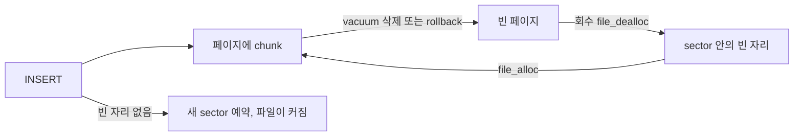
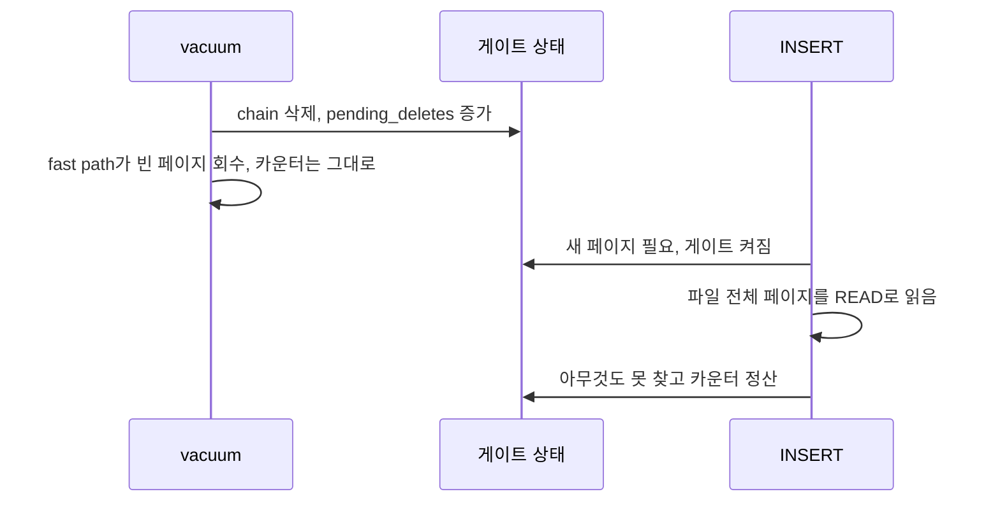
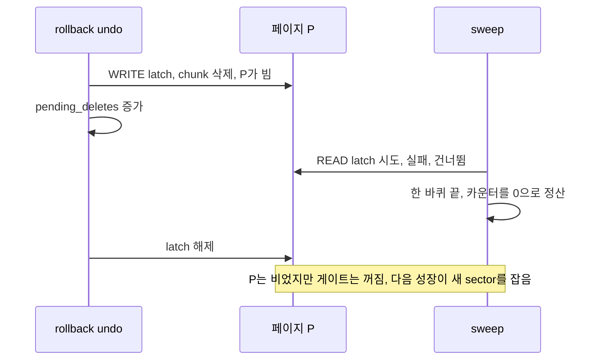

# OOS 성장 게이트 입문

2026-11-09, Asia/Seoul. 2026-11-10 개정. [CBRD-27925](https://jira.cubrid.org/browse/CBRD-27925) 작업(Work840)을 처음 보는 사람을 위한 설명서다. "성장 게이트"가 무엇인지, 옛 방식의 무엇이 문제였는지, 빈 페이지 후보 집합(ADR-0010)이 그것을 어떻게 고치는지, 그리고 다음 단계인 C안(재사용 우선)이 무엇이 다른지를 순서대로 설명한다.

기준 소스는 옛 방식이 `CBRD-27781-postpone-commit` `6a8d16da7`, 새 방식이 PR [#8434](https://github.com/CUBRID/cubrid/pull/8434) head `8e139f4db` 다. 새 방식은 commit 두 개다. `e01d8d576` 이 빈 페이지 후보 집합을 넣고, `8e139f4db` 가 동시 성장과 재확인을 보강한다(6절 끝). 함수 이름은 모두 `src/storage/oos_file.cpp` 의 것이다. ADR-0010은 2026-11-10 현재 accepted다.

## 1. 한 줄 요약

OOS 파일은 새 페이지가 필요할 때마다 "혹시 다시 쓸 수 있는 빈 페이지가 있나?"를 먼저 확인한다. 이 확인 단계가 **성장 게이트**다. 옛 게이트는 확인할 이유가 없을 때도 파일 전체를 읽었고, 반대로 rollback 중인 빈 페이지는 놓쳤다. 새 게이트는 실제로 비게 된 페이지의 번호만 모아 두고 그것만 확인한다.

## 2. 배경: OOS 파일은 어떻게 커지나

OOS(Out-of-row Overflow Storage)는 큰 컬럼 값을 heap 레코드 밖의 별도 파일에 둔다. 값 하나는 한 페이지 안의 chunk 하나이거나, 여러 페이지에 걸친 chunk chain이다.

알아야 할 단위는 세 가지다.

| 단위 | 뜻 |
| --- | --- |
| 페이지 | 16KB 등 고정 크기. chunk가 slotted page의 레코드로 들어간다. |
| sector | 페이지 64개 묶음. 파일은 디스크에서 sector 단위로 공간을 예약한다. |
| 파일 크기 | 예약한 sector 수. 영구 파일의 sector는 파일을 지울 때까지 돌려주지 않는다. |

새 페이지는 `file_alloc` 이 준다. 이미 예약한 sector 안에 빈 자리(할당되지 않은 페이지)가 있으면 그것을 주고, 없으면 **새 sector를 예약한다**. 이것이 파일이 커지는 순간이다.

페이지가 비는 경로도 있다.

- vacuum이 죽은 값의 chain을 지운다(`oos_delete_chain`).
- INSERT를 rollback하면 그 chunk가 지워진다(RVOOS_INSERT undo).

빈 페이지는 그대로 두면 계속 할당된 상태로 자리만 차지한다. `file_dealloc` 으로 파일 관리자에 돌려주면 그 자리가 다시 "sector 안의 빈 자리"가 되어 다음 `file_alloc` 이 재사용한다. 이 반환을 **회수(reclaim)**라고 부른다.

## 3. 규칙: 빈 페이지가 있으면 키우지 않는다

OOS 명세(ADR-0009)는 이렇게 정한다.

> OOS 파일은 회수할 수 있는 빈 페이지가 하나라도 있으면 새 sector를 예약하지 않는다.

목적은 같은 양의 데이터를 넣고 지우기를 반복해도 파일이 한없이 커지지 않게 하는 것이다. 빈 페이지가 있는데 새 sector를 잡으면, churn이 계속될수록 파일이 쓸데없이 커진다.

## 4. 성장 게이트란

OOS 파일에서 새 페이지를 받는 길은 하나뿐이다. `oos_alloc_page_with_reclaim` 이다. 이 함수는 `file_alloc` 을 부르기 직전에 회수 단계(`oos_reclaim_sweep_step`)를 한 번 돈다. 빈 페이지를 하나 찾아 회수하면, 바로 이어지는 `file_alloc` 이 그 자리를 받아 쓰므로 파일이 커지지 않는다.

이 "새 페이지를 받기 전에 반드시 지나는 검문소"가 **성장 게이트**다. 창고에 비유하면, 새 선반을 사기 전에 빈 선반이 있는지 확인하는 단계다.

게이트의 어려운 점은 "빈 페이지가 있는지 어떻게 아느냐"다. 모든 페이지를 매번 보면 정확하지만 느리다. 아무것도 안 보면 빠르지만 규칙을 어긴다. 이 균형이 이번 작업의 주제다.

## 5. 옛 방식: 삭제 카운터와 파일 전체 sweep

옛 엔진은 파일마다 메모리에 세 가지를 두었다.

| 필드 | 뜻 |
| --- | --- |
| `pending_deletes` | chain 삭제가 성공할 때마다 1 증가. 0보다 크면 게이트가 "켜진" 상태 |
| `swept_this_boot` | 재시작 뒤 한 바퀴 sweep을 마쳤는지 |
| `sweep_cursor` | 지난번 회수한 페이지. 다음 sweep이 그 뒤부터 시작 |

게이트가 켜져 있으면 성장 한 번이 다음을 했다.

1. 파일당 하나만 돌 수 있게 표시한다. 같은 파일에서 성장하려는 다른 INSERT는 기다린다.
2. 파일의 sector 표 전체를 모아 정렬한다.
3. cursor 뒤의 할당된 페이지를 하나씩 READ latch로 읽어 비었는지 본다. 버퍼에 없으면 디스크에서 읽는다.
4. 빈 페이지를 하나 회수하면 멈춘다. 한 바퀴를 다 돌아도 없으면 `pending_deletes` 를 0으로 정산한다.

### 문제 1. 할 필요 없는 일을 너무 많이 했다 (CBRD-27872)

`pending_deletes` 는 "삭제가 있었다"만 기록하고, "그 삭제가 페이지를 비웠는가"는 보지 않았다. 페이지에 다른 chunk가 남아 있어도 카운터는 올라갔다. 게다가 vacuum fast path가 빈 페이지를 이미 회수한 뒤에도 카운터는 줄지 않았다.

그래서 UPDATE·DELETE가 섞인 부하에서는 이런 일이 반복됐다.

큰 파일에서는 INSERT 하나가 파일 전체를 읽는다. 약 2만 페이지 파일에서 잰 값은 다음과 같다([측정 보고서](../cbrd-27872/growth-cost-measurement.md)).

| 상황 | 옛 방식 | 새 방식 |
| --- | --- | --- |
| 한 행 삭제·vacuum 뒤 새 페이지가 필요한 INSERT | 28.1 ms, 페이지 fetch 20,120회 | 3.4 ms, 42회 |
| 페이지를 비우지 않은 삭제 뒤 같은 INSERT | 82.6 ms, fetch 20,088회 | 3.5 ms, 42회 |

공용 80코어 서버에서 load average 6~67 아래 잰 값이다. 차이가 10배 이상이라 잡음보다 훨씬 크다.

### 문제 2. rollback이 비운 페이지를 잃어버렸다 (Work818)

INSERT를 rollback하면 undo가 그 chunk를 지운다. 이때 undo는 페이지의 WRITE latch를 쥐고 있다. 마침 그 순간 성장 게이트의 sweep이 그 페이지에 오면 이렇게 된다.

빈 페이지 P가 남아 있는데 게이트는 "확인 끝, 빈 페이지 없음"으로 판단한다. 다음 성장은 새 sector를 잡는다. 3절의 규칙 위반이다. P는 관련 없는 다른 삭제가 게이트를 다시 켤 때까지 방치된다.

두 문제의 뿌리는 같다. **게이트가 "어느 페이지가 비었는지"를 모르고 "삭제가 몇 번 있었는지"만 셌다.**

## 6. 새 방식: 빈 페이지 후보 집합 (ADR-0010)

카운터 대신 **실제로 비게 된 페이지 번호(VPID)의 집합**을 파일마다 둔다.

| 필드 | 뜻 |
| --- | --- |
| `emptied` | 비게 된 뒤 아직 회수되거나 다시 채워지지 않은 페이지들. 파일당 최대 4096개 |
| `unknown` | 집합이 빈 페이지를 놓쳤을 수 있다는 표시. 재시작, 메모리 부족, 상한 초과 때 켜짐 |
| `sweep_in_progress` | 파일당 성장 단계 하나만 돌게 하는 표시 (옛 방식과 같음) |
| `sweep_cursor` | `unknown` 일 때 도는 전체 lap의 시작 위치 (옛 방식과 같음) |

`pending_deletes` 와 `swept_this_boot` 는 지웠다.

### 넣기: 페이지가 비는 바로 그 자리에서

페이지를 비우는 모든 지점이 그 페이지 latch를 쥔 채로 집합에 넣는다.

| 지점 | 언제 |
| --- | --- |
| `oos_delete_chain` | vacuum이나 ADR-0008 reclaimer가 chain을 지워 페이지가 빌 때 |
| `oos_rv_undo_insert` | INSERT rollback(실행 중이든 재시작 중이든)이 페이지를 비울 때 |
| `oos_insert_within_page`, `oos_insert_single_page_batch` | 빈 페이지를 받아 놓고 insert에 실패했을 때 |
| `oos_rv_redo_delete` | 재시작 redo. 재시작 뒤에는 모든 파일이 `unknown` 이라 따로 넣지 않아도 된다 |

페이지를 비우지 않는 삭제는 아무것도 넣지 않는다. 문제 1의 헛된 무장이 여기서 사라진다.

### 성장: 집합에 든 페이지만 본다

성장 단계는 집합의 각 페이지에 기존 두 단계 회수(`oos_try_reclaim_page_internal`)를 시도한다. 결과는 세 가지다.

| 결과 | 뜻 | 집합 |
| --- | --- | --- |
| RECLAIMED | 비어 있어서 회수했다. 성장 단계를 끝낸다 | 뺀다 |
| BUSY | 다른 스레드가 latch를 쥐고 있어 확인하지 못했다 | **남긴다** |
| SKIPPED | 다시 채워졌거나, OOS 페이지가 아니거나, 헤더 페이지다 | 뺀다 |

집합이 비어 있고 `unknown` 도 꺼져 있으면 페이지를 하나도 읽지 않고 바로 `file_alloc` 으로 간다.

### 문제 2가 닫히는 이유

5절의 그림에서 sweep이 P의 READ latch를 못 잡는 순간을 다시 보자. 새 방식에서는 그 결과가 BUSY이고, P는 집합에 남는다. rollback이 latch를 놓은 뒤 다음 성장이 P를 다시 확인해 회수한다. "확인 못 함"을 "없음"으로 바꾸는 단계 자체가 없어졌다.

### 빼기 규칙: latch가 증명할 때만

집합에서 페이지를 빼는 일이 넣는 일보다 까다롭다. 잘못 빼면 그 페이지를 영영 잃기 때문이다. 그래서 규칙은 하나다.

> 페이지가 비어 있지 않다는 것을 latch로 확인하고 있을 때, 또는 그 페이지를 dealloc하는 WRITE latch를 쥐고 있을 때만 뺀다.

latch를 쥐고 있으면 그 사이에 누가 페이지를 다시 비울 수 없으므로, 뺀 뒤에 다시 비면 그 삭제가 다시 넣는다. 빈 페이지에 INSERT가 들어가 다시 채워질 때도 그 WRITE latch 아래에서 뺀다. 그래야 집합이 다시 채워진 페이지로 쌓이지 않는다.

이 규칙을 어길 뻔한 사례가 실제로 있었다. 독립 리뷰가 찾았다.

1. 성장 A가 집합에서 P를 복사해 둔다.
2. vacuum fast path가 P를 회수(dealloc)한다.
3. A가 P를 fix하려다 "이미 dealloc됨"을 보고, 잠시 멈춘다.
4. 다른 INSERT가 P를 새로 할당받아 쓰고 rollback한다. undo가 P를 집합에 다시 넣는다.
5. A가 깨어나 "dealloc된 페이지니까 뺀다"를 실행한다. 4의 항목이 지워진다.

3에서 A는 latch를 쥐고 있지 않았다. 그래서 지금 구현은 dealloc된 페이지를 집합에 남겨 둔다. 그 항목은 페이지가 다시 할당되고 채워진 뒤의 확인에서 빠진다.

### 집합을 믿을 수 없을 때: `unknown` 과 전체 lap

집합은 메모리에만 있다. 다음 경우에는 빈 페이지를 놓쳤을 수 있으므로 파일을 `unknown` 으로 표시한다.

- 재시작. 메모리 상태가 모두 사라진다. 상태가 없는 파일은 `unknown` 으로 읽는다.
- 집합에 넣다가 메모리가 부족했다.
- 집합이 4096개를 넘었다.

`unknown` 인 파일의 다음 성장은 옛 방식처럼 sector 표를 따라 파일 전체를 한 바퀴 돈다. 그 lap이 BUSY로 만난 페이지는 집합에 넣고, 아무것도 회수하지 못하고 끝까지 돌면 표시를 끈다. 즉 비싼 전체 lap은 재시작 뒤나 상한 초과 뒤 파일마다 한 번만 낸다.

lap 도중 집합이 다시 넘치면 표시가 다시 켜진 채로 남는다. 이번 성장은 그대로 할당하고, 다음 성장이 lap을 한 번 더 돈다. 넘쳐서 집합에 들어가지 못한 페이지가 그 lap에서 잡힌다.

### 로그 형식 변경: rollback이 파일 이름을 알아야 한다

rollback undo가 받는 정보(`LOG_RCV`)에는 페이지는 있지만 그 페이지가 어느 파일 것인지는 없다. 집합은 파일별이므로, 파일을 모르면 넣을 곳이 없다. 그래서 RVOOS_INSERT 로그의 undo 데이터에 OOS 파일 ID(VFID) 8바이트를 넣었다.

- redo 데이터는 그대로다. HA log applier는 redo만 읽는다.
- VFID가 없는 옛 레코드는 bestspace 힌트로 파일을 찾고, 그것도 없으면 알려진 모든 파일을 `unknown` 으로 표시한다.
- PR #7990 병합 전 변경이라 ADR-0006(ADR-0008 결정 6으로 개정)에 따라 storage format revision은 1로 둔다.

### 보강: 두 grower와 성장 도중 비는 페이지

첫 구현 뒤 TLA+ 모델(Work829 growth arena)이 반례 두 개를 찾았다. 둘 다 `8e139f4db` 에서 고쳤다.

1. **두 grower.** 회수 확인만 잠그고 `file_alloc` 전에 lock을 풀었다. 그래서 grower A가 확인을 마치고 할당하기 전에 grower B가 끼어들어 sector를 잡을 수 있었다. 이제 파일당 성장 lock을 확인부터 `file_alloc` 까지 쥔다. 대가로 같은 파일의 새 페이지 할당은 하나씩 차례로 돈다.
2. **성장 도중 비는 페이지.** 성장은 시작할 때 찍은 집합 사본만 확인했다. lap이 cursor 뒤에서 비게 된 페이지를 못 보고 끝나면, 그 페이지가 집합에 있어도 확인하지 않고 할당했다. 이제 성장은 도중에 들어온 항목까지 읽고, lap이 끝나면 집합을 한 번 더 확인한다. 한 페이지는 성장 한 번에 한 번만 확인한다.

빈 페이지가 없는 파일의 성장은 여전히 페이지를 하나도 읽지 않는다.

## 7. 옛 방식과 새 방식 비교

| 질문 | 옛 방식 | 새 방식 |
| --- | --- | --- |
| 무엇을 기록하나 | 삭제 횟수 | 비게 된 페이지 번호 |
| 페이지를 비우지 않은 삭제 뒤 성장 | 파일 전체 READ | 페이지 0개 확인 |
| latch에 걸린 빈 페이지 | 건너뛰고 잊음 | 집합에 남겨 다시 확인 |
| 전체 lap | 게이트가 켜질 때마다 | 재시작·상한 초과 뒤 파일당 한 번 |
| vacuum fast path | 빈 페이지 회수의 주 경로 | 최적화일 뿐. 없어도 다음 성장이 집합에서 찾음 |
| 로그 | 변경 없음 | RVOOS_INSERT undo에 VFID 8바이트 |

## 8. 검증한 것

- 단위 테스트 `test_oos_growth_sweep` 에 ADR-0010 결과 5의 네 경우를 넣었다.
  - rollback이 비운 페이지가 busy여도 후보로 남는다.
  - 페이지를 비우지 않은 삭제 뒤 성장은 페이지를 하나도 확인하지 않는다.
  - 재시작 뒤 lap이 busy 페이지를 집합에 넣고, 같은 성장이 lap 뒤 재확인으로 그 페이지를 재사용하며, 표시를 끈다.
  - 상한을 넘으면 lap 한 번으로 빈 페이지를 모두 재사용한다.
- 옛 동작을 되살리는 변형 네 가지(busy 페이지 버리기, 매번 lap, 넘침 무시, lap 뒤 재확인 빼기)에서 각 테스트가 실패하는 것을 확인했다. 테스트가 결함을 실제로 잡는다는 뜻이다.
- PR head `8e139f4db` 의 디버그 빌드에서 OOS ctest 54개가 모두 통과했다. 재시작 복구 테스트 두 개가 새 로그 형식을 지난다. load average 100 이상에서는 일부 테스트가 ctest 시간 제한을 넘겼고, 제한 없이 단독으로 돌리면 통과했다.
- 측정은 5절의 표와 같다.

## 9. 다음 단계: C안 (재사용 우선)

사용자는 2026-11-06에 성장 게이트 대안 비교(Work829 arena)를 보고 **C안**을 채택했다. 집합은 그대로 쓰고, 집합에서 찾은 빈 페이지를 처리하는 방식만 바꾼다.

| | 지금 구현 (반환형, `8e139f4db`) | C안 (재사용 우선) |
| --- | --- | --- |
| 빈 페이지를 찾으면 | `file_dealloc` 으로 돌려준 뒤 `file_alloc` 이 다시 받음 | 돌려주지 않고 그 자리에서 바로 씀 |
| 회수 sysop과 헤더 WRITE latch | INSERT 경로에서 냄 | 없음 |
| vacuum fast path | 남아 있음 | 없앰 |
| 파일 크기 판정 | 삭제 뒤 페이지 수 | sector 수와 cycle 사이 peak (페이지를 돌려주지 않으므로) |

C안에서 추가로 지킬 조건은 다음과 같다(arena c-reuse-first 보고).

- 다시 채워진 페이지는 그 자리에서 바로 집합에서 뺀다. 지금 구현이 이미 한다.
- INSERT rollback이 파일 ID를 알아야 한다. 지금 구현의 로그 변경이 이미 한다.
- 꺼낸 페이지는 조건부 WRITE latch 아래에서 OOS 페이지인지, 이 파일 것인지, 비었는지, 공간이 충분한지 다시 확인한다.
- 재시작 뒤 lap이 끝나면 집합을 한 번 더 확인한다. 지금 구현이 이미 한다(`8e139f4db`).

현재 상태는 이렇다. 반환형은 1단계로 PR #8434에 들어갔다. 측정(Work839)은 성장 lock과 재확인을 넣은 반환형(`e8e714dae`, `8e139f4db` 와 같은 patch)으로 다시 했고 ADR-0010 결정 7을 충족했다. 삭제와 vacuum 뒤 INSERT 중앙값은 51 ms에서 4.6 ms로, 동시에 성장하는 INSERT 8개 중 가장 느린 것은 69 ms에서 5.9 ms로 줄었고, churn 뒤 sector 수는 같았다(load average 68~132, ADR-0010 결정 7). C안은 2단계로, PR #8434 CI가 통과한 뒤 시작한다. C안 commit이 나오면 같은 harness로 다시 잰다. 체크포인트로 재시작 lap을 없애는 D안은 보류했다.

## 10. 용어

| 용어 | 뜻 |
| --- | --- |
| 성장 게이트 | 새 페이지를 받기 직전에 반드시 지나는 회수 확인 단계 (`oos_alloc_page_with_reclaim` → `oos_reclaim_sweep_step`) |
| 회수 | 빈 페이지를 `file_dealloc` 으로 파일 관리자에 돌려주는 것 |
| 두 단계 회수 | READ latch로 비었는지 먼저 보고, 헤더 WRITE latch 아래에서 WRITE latch로 다시 확인한 뒤 dealloc. 둘 다 기다리지 않는 조건부 latch |
| vacuum fast path | vacuum이 삭제 묶음이 비운 페이지 목록을 받아 바로 회수하는 경로 (`oos_reclaim_empty_pages`) |
| lap | sector 표를 따라 파일 전체의 할당된 페이지를 한 바퀴 도는 것 |
| 후보 집합 | 비게 된 페이지 번호의 파일별 메모리 집합 (`emptied`) |
| `unknown` | 집합이 빈 페이지를 놓쳤을 수 있다는 표시. 다음 성장이 lap을 돈다 |
| BUSY | 다른 스레드의 latch 때문에 확인하지 못한 결과. 집합에 남긴다 |

## 11. 스스로 점검

1. 페이지에 chunk가 두 개 있고 그중 하나를 지웠다. 옛 방식과 새 방식에서 다음 성장은 각각 무엇을 하나?
2. rollback이 페이지를 비우는 동안 성장이 그 페이지를 확인했다. 새 방식에서 그 페이지는 어떻게 되나? 왜 옛 방식에서는 잃어버렸나?
3. 집합에서 페이지를 뺄 때 latch를 쥐고 있어야 하는 이유는?
4. 재시작 직후 첫 성장은 왜 파일 전체를 도나? 두 번째 성장부터는 왜 안 도나?
5. RVOOS_INSERT undo에 VFID를 넣지 않으면 어떤 경우에 비용이 커지나?

답

1. 옛 방식은 삭제가 카운터를 올려 다음 성장이 파일 전체를 읽는다. 새 방식은 페이지가 비지 않았으니 아무것도 넣지 않고, 다음 성장은 페이지를 하나도 읽지 않는다.
2. 확인 결과가 BUSY라 집합에 남고, latch가 풀린 뒤 다음 성장이 회수한다. 옛 방식은 그 페이지를 건너뛴 뒤 한 바퀴를 마치며 카운터를 0으로 정산해, 빈 페이지가 있다는 기록 자체를 지웠다.
3. latch 없이 빼면, 확인한 시점과 빼는 시점 사이에 다른 스레드가 페이지를 다시 비우고 집합에 넣을 수 있다. 그러면 빼는 동작이 그 새 항목을 지워 빈 페이지를 잃는다.
4. 재시작하면 메모리의 집합이 사라져 모든 파일이 `unknown` 이 된다. 첫 lap이 아무것도 못 찾고 끝까지 돌면 표시를 끄고, 그 뒤로는 실행 중에 비는 페이지를 집합이 모두 잡는다.
5. rollback이 페이지를 비웠는데 bestspace 힌트에도 그 페이지가 없으면 파일을 알 수 없다. 그러면 알려진 모든 파일을 `unknown` 으로 표시해야 하고, 모든 파일의 다음 성장이 전체 lap을 돈다.

## 더 읽을거리

- [growth-bound-design.md](growth-bound-design.md): 옛 엔진의 비용 구조와 줄 번호, 다섯 설계의 TLA+ 비교, 후보 집합 권고 (Work821)
- [adr0008-claude-review.md](adr0008-claude-review.md): rollback READ 경합의 발견 (Work818)
- [growth-cost-measurement.md](../cbrd-27872/growth-cost-measurement.md): 전후 측정 (Work839)
- ADR-0010 `0010-arm-growth-reclaim-with-emptied-pages.md` (cubrid-oos-context main, accepted)
