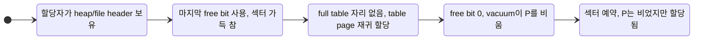

# CBRD-27945 재귀 예약 후보의 develop 결함 여부

[CBRD-27945](https://jira.cubrid.org/browse/CBRD-27945)는 OOS 파일의 메타데이터 재귀 할당이 회수 가능한 빈 페이지를 두고 섹터를 예약하는 후보를 조사한다. 이 문서는 같은 후보가 develop에서도 결함인지 판정한다. 독자는 CUBRID 스토리지(heap, vacuum, file manager) 담당자다.

- 기준 소스는 CUBRID develop [`2362424f25bcebd1bd9733bddd59a993e2852ac5`](https://github.com/CUBRID/cubrid/tree/2362424f25bcebd1bd9733bddd59a993e2852ac5)이다. 아래 소스 링크는 모두 이 commit에 고정한다.
- 분석일은 2026-11-05(Asia/Seoul)이다.
- 공통 할당 경로의 비교는 [CBRD-27945의 앞선 댓글](https://jira.cubrid.org/browse/CBRD-27945?focusedCommentId=4777947)에 있다. 이 문서는 그 뒤에 남은 질문, 즉 heap 소유자와 vacuum 경로에서 결함이 성립하는지를 다룬다.
- 엔진 코드는 바꾸지 않았다. 서버, DB, SQL 실행은 하지 않았다.

**판정: develop에는 결함으로 볼 근거가 없다. CBRD-27945는 OOS 조사 이슈로 유지하고, 이 후보로는 develop 이슈를 만들지 않을 것을 권고한다.** 결함이 없다는 증명은 아니다. 결함을 뒷받침하는 요구사항과 피해를 찾지 못했다는 뜻이다. 근거는 세 가지다.

1. develop heap에서 할당자가 섹터를 예약하는 동안 vacuum은 빈 페이지를 반환할 수 없다. 할당자가 batch 전체에서 heap header WRITE를 잡고 있고, vacuum의 unlink와 실제 반환도 같은 latch를 요구하기 때문이다. 이것은 소스에서 직접 읽은 latch 순서다.
2. "물리적으로 빈 페이지가 남은 채 예약"하는 상태는 develop에서 도달 가능하다. 그러나 메타데이터 재귀 없이 일반 사용자 페이지 할당에서도 똑같이 도달한다. 막 할당된 heap 페이지와 같은 batch의 다른 페이지도 비어 있는 채 할당된 상태다. 따라서 이 상태는 develop에서 평범하고, 재귀는 별도의 결함 경로가 아니다.
3. develop 소유자는 회수를 늦게 하도록 설계되어 있다. 예약 전에 빈 페이지를 회수해야 한다는 develop 요구사항이나, 이 상태로 생기는 피해를 기록한 문서는 찾지 못했다.

## 할당자가 보는 페이지 상태는 두 가지뿐이다

P는 vacuum이 마지막 레코드를 지워 비우려는 기존 heap 페이지다. 다음은 소스에서 직접 확인한 사실이다.

- `heap_alloc_new_pages`는 heap header를 WRITE로 고정하고 sysop을 시작한 뒤 `file_alloc_multiple`을 부른다. sysop을 commit한 다음에야 header를 놓는다([heap_file.c:27708-27812](https://github.com/CUBRID/cubrid/blob/2362424f25bcebd1bd9733bddd59a993e2852ac5/src/storage/heap_file.c#L27708-L27812)). 재귀 table page 할당과 `file_perm_expand`는 모두 이 구간 안에서 일어난다([file_manager.c:5190-5310](https://github.com/CUBRID/cubrid/blob/2362424f25bcebd1bd9733bddd59a993e2852ac5/src/storage/file_manager.c#L5190-L5310), [file_manager.c:5044-5062](https://github.com/CUBRID/cubrid/blob/2362424f25bcebd1bd9733bddd59a993e2852ac5/src/storage/file_manager.c#L5044-L5062)).
- vacuum의 `heap_remove_page_on_vacuum`은 P를 잡은 채 heap header를 ordered fix로 요청한다([heap_file.c:3384](https://github.com/CUBRID/cubrid/blob/2362424f25bcebd1bd9733bddd59a993e2852ac5/src/storage/heap_file.c#L3384)). 조건부 시도가 실패하면 zero-wait일 때는 포기한다. 그렇지 않으면 P를 놓고 header를 기다린 뒤 P를 다시 잡는다([page_buffer.c:12520-12935](https://github.com/CUBRID/cubrid/blob/2362424f25bcebd1bd9733bddd59a993e2852ac5/src/storage/page_buffer.c#L12520-L12935)). 다시 잡은 뒤에는 레코드 수, dealloc 방지 표시, 대기자를 재검사한다.
- unlink, `file_dealloc`, `log_sysop_commit`은 모두 heap header를 잡은 상태에서 실행된다. `log_sysop_commit`은 그 sysop의 postpone(`RVFL_DEALLOC`)을 반환 전에 실행한다([heap_file.c:3473-3600](https://github.com/CUBRID/cubrid/blob/2362424f25bcebd1bd9733bddd59a993e2852ac5/src/storage/heap_file.c#L3473-L3600), [log_manager.c:3973](https://github.com/CUBRID/cubrid/blob/2362424f25bcebd1bd9733bddd59a993e2852ac5/src/transaction/log_manager.c#L3973), [file_manager.c:6628-6652](https://github.com/CUBRID/cubrid/blob/2362424f25bcebd1bd9733bddd59a993e2852ac5/src/storage/file_manager.c#L6628-L6652)). 따라서 vacuum이 heap header를 놓는 시점에는 free bit 반영까지 끝나 있다.
- vacuum이 제거를 포기하면 `heap_add_bestpage`로 P를 삽입 후보에 돌려놓는다([vacuum.c:1853-1879](https://github.com/CUBRID/cubrid/blob/2362424f25bcebd1bd9733bddd59a993e2852ac5/src/query/vacuum.c#L1853-L1879)).

그래서 할당자가 batch를 시작할 때 P는 이미 free bit이거나, 아직 할당된 페이지다. 할당된 P는 비어 있을 수도 있다. batch 도중에 P가 free bit로 바뀌는 일은 없다. "unlink는 됐지만 반환은 안 된" 상태도 할당자에게 보이지 않는다.

## 모델 결과

[`develop-heap-reservation/`](develop-heap-reservation/README.md)의 TLA+ 모델은 heap batch 할당 1번과 vacuum worker 1개의 경합을 표현한다. 실행기 `run.py`는 위의 두 latch 사실과 batch 상한(`ALLOC_BATCH_SIZE = 4`)을 소스 텍스트에서 추출해 모델 상수로 넣는다. 8개 fixture에서 질문 8개와 구조 불변식 4개를 TLC로 검사했다. 모든 판정이 미리 적어 둔 기대값과 일치했다. 상태 수는 fixture마다 75개에서 227개다. 결과표와 실행 방법은 [모델 설명](develop-heap-reservation/README.md)에 있다.

| 질문 | 결과 | 뜻 |
| --- | --- | --- |
| 예약 순간 vacuum이 P를 지금 unlink할 수 있는가 | 모든 소스 fixture에서 불가 | heap header가 할당자에게 있다는 latch 사실을 다시 말한 것이다. header를 놓는 변형(M1)에서만 깨진다. |
| 예약 순간 P가 unlink됐지만 아직 free bit가 아닌가 | 모든 소스 fixture에서 불가 | postpone이 header를 놓기 전에 실행된다. 순서를 바꾼 변형(M1, M2)에서만 깨진다. |
| 예약 순간 P가 물리적으로 비어 있을 수 있는가 | 가능 (A1, A4, B1, B2, O1) | 재귀 경로와 외부 경로 모두 도달한다. 도달 가능성만 보이며, 결함의 근거는 아니다. |
| 재귀 없이도 위 상태에 도달하는가 | 가능 (O1) | free bit가 0일 때 일반 사용자 페이지 할당이 바로 확장한다. |
| P를 먼저 회수했다면 예약을 피했는가 | batch 1에서만 피함 (A1, B1, O1). batch 2 이상은 그래도 예약 (A4, B2) | 페이지 하나의 회수로는 batch 크기만큼의 수요를 대신하지 못한다. |

A1의 반례 경로는 7단계다. 할당자가 heap header와 file header를 잡는다. 사용자 페이지가 마지막 free bit를 쓰고 섹터가 가득 찬다. full table에 자리가 없어 table page를 재귀 할당한다. free bit가 0이다. 그 사이 vacuum이 P의 마지막 레코드를 지운다. 섹터가 예약된다. 이때 vacuum은 heap header를 얻지 못해 P를 unlink할 수 없다.

실행기의 `--self-test`는 소스 사본에 세 가지 변형을 넣는다. heap header를 batch 전에 놓기, vacuum이 commit 전에 header 놓기, sysop commit에서 postpone 호출 제거다. 세 변형 모두 해당 사실을 FALSE로 바꿨고, 검사가 불일치를 보고했다. `file_perm_expand` 호출을 지운 사본은 drift로 걸렸다. 따라서 이 검사는 소스의 latch 순서나 postpone 시점이 바뀌면 실패한다. 독립 검토자가 모델과 소스의 대응을 따로 확인했고, 8개 fixture의 기대 판정에 모두 동의했다.

## 결함으로 보지 않는 이유

결함이라고 하려면 develop 소유자의 요구사항 위반이나 독립적으로 입증된 피해가 필요하다. 둘 다 찾지 못했다.

**요구사항.** develop 소스, git 이력, 로컬 설계 문서와 이슈 초안, CUBRID 매뉴얼을 검색했다. "섹터 예약 전에 빈 페이지를 회수해야 한다"는 develop 문장은 없다. 반대로 회수를 늦게 해도 된다는 의도는 여러 곳에 있다.

| 소유자 | 내용 | 근거 |
| --- | --- | --- |
| heap, vacuum | 빈 페이지 제거는 "least intrusive"를 목표로 하고, 실패하면 포기한다. | [heap_file.c:3320-3324](https://github.com/CUBRID/cubrid/blob/2362424f25bcebd1bd9733bddd59a993e2852ac5/src/storage/heap_file.c#L3320-L3324) |
| heap, vacuum | 제거에 실패한 페이지는 bestspace에 여유 공간을 보고해 삽입에 재사용된다. | [heap_file.c:3634](https://github.com/CUBRID/cubrid/blob/2362424f25bcebd1bd9733bddd59a993e2852ac5/src/storage/heap_file.c#L3634), [vacuum.c:1879](https://github.com/CUBRID/cubrid/blob/2362424f25bcebd1bd9733bddd59a993e2852ac5/src/query/vacuum.c#L1879) |
| heap, bestspace | 재발견은 힌트일 뿐이고, 예산을 넘는 빈 페이지는 놓칠 수 있다고 적는다. | [bestspace.cpp:1714](https://github.com/CUBRID/cubrid/blob/2362424f25bcebd1bd9733bddd59a993e2852ac5/src/storage/bestspace.cpp#L1714), [bestspace.hpp:449-450](https://github.com/CUBRID/cubrid/blob/2362424f25bcebd1bd9733bddd59a993e2852ac5/src/storage/bestspace.hpp#L449-L450) |
| file manager | 영구 파일의 반환은 commit 뒤로 미룬다. 확실해지기 전에 재사용되지 않게 하려는 것이다. | [file_manager.c:6124-6126](https://github.com/CUBRID/cubrid/blob/2362424f25bcebd1bd9733bddd59a993e2852ac5/src/storage/file_manager.c#L6124-L6126) |
| file manager | 확장은 되돌리기 어렵고 곧 다시 필요할 가능성이 커서 영구로 만든다. | [file_manager.c:4678-4680](https://github.com/CUBRID/cubrid/blob/2362424f25bcebd1bd9733bddd59a993e2852ac5/src/storage/file_manager.c#L4678-L4680) |
| 매뉴얼 | VACUUM은 간섭을 최소로 해야 한다고 적는다. | CUBRID 매뉴얼 `en/sql/transaction.rst`의 VACUUM 절 |

develop의 회수 우선 규칙은 이미 free bit로 반환된 페이지에만 적용된다. `file_perm_alloc`은 `n_page_free == 0`일 때만 확장한다. heap 체인에 남은 빈 페이지는 이 개수에 들어가지 않는다.

**다른 반환 경로.** compactdb의 `xheap_reclaim_addresses`는 heap header를 잡은 채 sysop 없이 `file_dealloc`을 부른다. 그래서 free bit 반영이 트랜잭션 commit 때 일어난다([heap_file.c:5835](https://github.com/CUBRID/cubrid/blob/2362424f25bcebd1bd9733bddd59a993e2852ac5/src/storage/heap_file.c#L5835), [heap_file.c:5961](https://github.com/CUBRID/cubrid/blob/2362424f25bcebd1bd9733bddd59a993e2852ac5/src/storage/heap_file.c#L5961)). 이 경로는 클래스 배타 잠금을 요구하므로([heap_file.c:5800](https://github.com/CUBRID/cubrid/blob/2362424f25bcebd1bd9733bddd59a993e2852ac5/src/storage/heap_file.c#L5800)) 같은 heap에 대한 동시 삽입 batch와 겹치지 않는다고 판단했다. 이 판단은 주석에 근거한 추론이다. 위의 "unlink됐지만 아직 free bit가 아닌" 결과는 vacuum 경로에 대한 것이다.

**피해.** 예약된 섹터는 같은 파일의 이후 할당에 쓰인다. P는 batch가 끝난 뒤 vacuum이 반환하거나 bestspace를 통해 재사용된다. 따라서 영구 누수가 아니라 확장 시점이 앞당겨지는 것이다. 회수 경로는 모델에서 확인했고, 장기 재사용은 추론이다. 확장 크기는 파일 크기의 1%이며 최소 1섹터, 최대 1024섹터 또는 partial table 용량이다([file_manager.c:255-257](https://github.com/CUBRID/cubrid/blob/2362424f25bcebd1bd9733bddd59a993e2852ac5/src/storage/file_manager.c#L255-L257), [file_manager.c:4656-4663](https://github.com/CUBRID/cubrid/blob/2362424f25bcebd1bd9733bddd59a993e2852ac5/src/storage/file_manager.c#L4656-L4663)). 모델 범위 안에서는 잘못된 할당 실패나 손상으로 이어지는 경로가 나오지 않았다. 오류, abort, 복구 경로는 모델에 없으므로 이 문장은 그 경로들에 대한 주장이 아니다. 구조 불변식(free, user, table 페이지 수의 균형과 `n_page_free == 0`이면 partial 섹터 없음)은 모든 fixture에서 성립했다.

**OOS와 다른 점은 회수 주체다.** OOS는 할당하는 쪽이 성장 전에 직접 회수 sweep을 돌고, "지금 안전하게 회수 가능한 빈 페이지가 있으면 예약하지 않는다"는 규칙을 둔다. 재귀 예약은 그 sweep 이후에 안전해진 페이지를 놓친다. develop heap에는 그런 sweep이 없다. 회수는 vacuum의 몫이고, vacuum은 할당자가 heap header를 잡고 있는 동안 회수할 수 없다.

## 한계

- 모델 범위는 heap 파일 1개, batch 1번, vacuum worker 1개, 후보 페이지 P 1개다. 확장은 섹터 1개를 더하는 것으로 표현했다. full table page 병합, partial table 공간 부족, header로 partial 섹터 이동, 오류와 abort와 복구 경로, 비재사용 heap(`FILE_HEAP`)은 제외했다.
- bestspace 탐색은 P를 놓친다고 가정했다. 탐색은 제한적이고 재검증 가능한 힌트다.
- vacuum이 활성 sysop 없이 `vacuum_heap`에 들어온다는 조건은 debug assert로만 확인된다([vacuum.c:3560-3596](https://github.com/CUBRID/cubrid/blob/2362424f25bcebd1bd9733bddd59a993e2852ac5/src/query/vacuum.c#L3560-L3596)). standalone 모드의 vacuum 진입점은 확인하지 않았다.
- vacuum worker의 대기 모드(zero-wait 여부)는 확인하지 않았다. 모델은 포기와 대기를 모두 허용하므로 두 경우를 다 덮는다.
- postpone이 vacuum 자신의 sysop에 붙는다는 점은 실행기가 텍스트로만 확인한다. 의미는 독립 검토자가 손으로 확인했다. `log_append_postpone`은 가장 안쪽 sysop에 기록되고, `heap_remove_page_on_vacuum`은 `log_sysop_attach_to_outer`를 부르지 않는다. 소스 변형 self-test는 A1 fixture에서만 돈다.
- 요구사항 검색은 소스, git 이력, 로컬 문서, 매뉴얼, 이슈 초안까지다. JIRA 댓글과 GitHub 리뷰 스레드는 검색하지 않았다.
- native DB 재현은 팀장 승인 전이라 하지 않았다. 이번 판정은 native 재현 없이도 내릴 수 있다. 재현으로 확인할 수 있는 것은 이미 도달 가능하다고 인정한 상태뿐이기 때문이다.

## 범위 밖의 단서

검토 중에 이번 질문과 별개인 단서가 하나 나왔다. vacuum은 P를 unlink한 뒤 P를 놓고([heap_file.c:3577](https://github.com/CUBRID/cubrid/blob/2362424f25bcebd1bd9733bddd59a993e2852ac5/src/storage/heap_file.c#L3577)), 같은 스레드에서 commit과 postpone으로 P를 반환한다([file_manager.c:6566](https://github.com/CUBRID/cubrid/blob/2362424f25bcebd1bd9733bddd59a993e2852ac5/src/storage/file_manager.c#L6566)). 그 사이에 bestspace에 남은 P의 힌트로 다른 삽입이 P를 잡을 수 있는지는 확인하지 않았다. bestspace는 이미 반환된 페이지를 `OLD_PAGE_MAYBE_DEALLOCATED`와 page type 검사로 거르지만([bestspace.cpp:961-977](https://github.com/CUBRID/cubrid/blob/2362424f25bcebd1bd9733bddd59a993e2852ac5/src/storage/bestspace.cpp#L961-L977)), 이 구간의 P는 아직 heap page다. 이 구간을 막는 장치가 있는지는 이번에 읽은 범위에서 확인하지 못했다. 결함 주장이 아니며, 별도 소스 확인이 필요한 미검증 단서다.

## 권고

- CBRD-27945는 OOS 조사 이슈로 유지한다. 이 후보로는 develop 이슈를 만들지 않는다.
- 위 "범위 밖의 단서"는 이 판정과 별개다. 결함이면 데이터 손실 문제이므로 별도 소스 확인을 먼저 권고한다.
- develop에서 이 판정을 뒤집으려면 두 가지 중 하나가 필요하다. heap 이외의 develop 소유자(B-tree, overflow)가 할당자와 같은 latch 범위 밖에서 빈 페이지를 반환하는 경로, 또는 예약 시점의 빈 페이지 때문에 생기는 측정된 피해다. 지금은 둘 다 근거가 없다.
- 이 모델은 heap batch 할당이나 vacuum 페이지 제거의 latch 순서를 바꾸는 변경을 검토할 때 다시 돌릴 수 있다.
