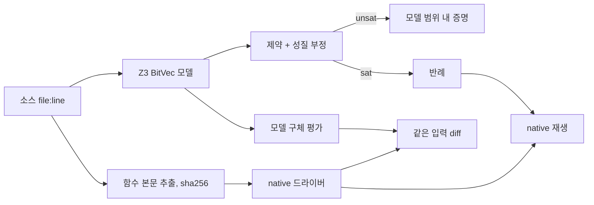

# Z3(SMT) 도입 검토: CUBRID 로컬 산술 3곳 spike와 판정

작성: 2026-11-17 (Asia/Seoul). Work item: work-tracker #991.

## 질문과 결론

**질문.** CUBRID 개발에 Z3(SMT solver)를 도입할 가치가 있는가? 동시성이 없는 순수 산술·비트 연산의 경계 버그를 잡는 데 CBMC(Work #830)나 TLA+(`cubrid-verify-*` 스킬)보다 나은가?

**독자.** CUBRID storage 코드 리뷰어와, 검증 도구를 PR 리뷰 절차에 넣을지 정하는 사람.

**판정: 조건부 go.** 적용 범위는 "page·record 레이아웃 산술과 비트 패킹을 바꾸는 PR"로 좁힌다. 조건은 두 가지다.

1. 모든 Z3 모델에 native 대조 harness를 함께 둔다. 실제 함수 본문을 추출해 실행하고, 같은 입력으로 결과를 diff하고, 반례와 mutant를 재생한다.
2. 루프와 나눗셈은 bounded 증명이나 보조정리로 분리하고, 실행당 30 s / 512 MiB 안에 끝나도록 설계한다.

이번 spike에서 엔진 버그는 나오지 않았다. 대신 Z3는 세 대상 모두에서 코드가 기대는 **암묵적 전제**를 반례로 드러냈다. 대상마다 핵심 반례 하나(T1 P5b, T2 G1-general, T3 B2/B4-chain)는 native에서 그대로 재현했다. 나머지 반례는 정보성이라 native로 재생하지 않았다. 각 반례의 도달 가능성은 호출자 조사로 따로 판단했다.

## 실험 기준

| 항목 | 값 |
|---|---|
| CUBRID 소스 | `CUBRID/cubrid` [`e64a04a79a`](https://github.com/CUBRID/cubrid/tree/e64a04a79a5842827a124b3f8313516d0da2594c). CBMC #830과 같은 revision. 엔진 수정 없음 |
| spike 코드 | 로컬 worktree `z3-spike-20261117`의 `formal/z3/`, commit `61ba99476464` (push 안 함) |
| 도구 | z3-solver 4.15.4.0 (Python, uv lock 고정), g++ 11.5.0, SERVER_MODE debug(assert 활성) |
| 생성 헤더 | 같은 revision의 release 빌드 `config.h` (sha256 `9b07f27f3e22…`) |
| 채택 실행 | `formal/z3/logs/run-001`: `overall=PASS`, 65개 질의, 명령 하나로 70 s, 한도 초과 0 |
| 자원 한도 | solver·모델·드라이버 실행은 직렬, 각 30 s / 512 MiB. g++는 512 MiB에서 실패해 컴파일만 768 MiB |

## 방법

- 모델은 C 폭 그대로 `BitVec`으로 썼다. `int`는 32 bit, `size_t`·`ssize_t`는 64 bit이고, INT16 승격, unsigned short 승격, signed bitfield도 옮겼다. 부호 overflow는 별도 질의로 검사했다.
- 모델의 각 줄에는 `# src: FILE:LINE [token]` 주석을 달고, 실행할 때마다 63개 주석의 token이 해당 소스 줄에 실제로 있는지 검사한다. 소스가 바뀌면 이 검사가 먼저 깨지므로 모델을 다시 봐야 한다는 신호가 된다.
- 질의는 세 종류다. 증명은 unsat을 기대한다. 반례 질의는 sat을 기대하며 발견 사항이 된다. mutant 질의는 소스 산술 한 곳을 바꾼 모델이 sat이 되는지 보는 공허성(vacuity) 대조다.
- 드라이버가 `sizeof`, `offsetof`, mask, lookup table을 출력하고, gate가 이를 모델 상수와 비교한다.

## 대상별 결과

| 대상 | 판정 | 핵심 증명 | 반례 (native 재생) | 충실도 근거 |
|---|---|---|---|---|
| T1 slotted page 공간·정렬 | `UNSAT_PROVED_IN_MODEL` | `spage_max_space_for_new_record`의 범위·정렬·slot 비용·단조성 / "`1 ≤ L ≤ C`면 insert 성공" (saving 포함) / slot 14-bit field 적합 / 초기화 | 4건. P5b는 native 재생, 나머지 3건은 정보성(미재생). 도달 불가 또는 무해 | 실제 함수 21개. diff 2,340 입력 불일치 0. 실제 insert/delete 시퀀스 3,240 상태 불일치 0. mutant 3개 일치 |
| T2 overflow page 수·부분 읽기 | `UNSAT_PROVED_IN_MODEL` | `overflow_insert` page 수가 정확하고 빈 페이지가 없음 / overflow 없음 / `overflow_get_nbytes` 창과 복사 루프(3페이지 이하) | 2건. G1-general은 native 재생, G2(음수 start의 UB)는 미재생. 현재 호출자 기준 잠재 | 실제 insert 243·get 700 불일치 0, 내용 검사 통과. mutant 2개 native 확인 |
| T3 MVCC header word | 실제 도메인에서 `UNSAT_PROVED_IN_MODEL`, 마스크 도메인에서 `COUNTEREXAMPLE` | repid < 2^23에서 encode→decode→struct→re-encode 왕복 / lookup table과 offset 식 일치 | 4건. B2/B4-chain은 native 재생, B4-any와 what-if W는 정보성. 도달 불가에 가까움 | 실제 encoder·매크로·`MVCC_REC_HEADER`로 688 입력 불일치 0 |

### T1. 빈 공간 계약은 "slot 재사용 불변식"에 기댄다

`extendible_hash.c:1900`과 `btree_load.c:1874`는 `length ≤ spage_max_space_for_new_record()`이면 insert가 성공한다고 믿는다. Z3는 이 계약을 전체 범위에서 증명했다. 범위는 anchor 4종, alignment 1/2/4/8, page 4K/8K/16K, INT16 전 범위의 slot 수, saved space S이다. CBMC #830의 scalar 범위(ANCHORED, 4K, slot ≤ 2)도 같은 성질로 다시 증명했다.

증명에는 전제가 하나 필요하다. "ANCHORED이고 `num_slots > num_records`이면 `REC_DELETED_WILL_REUSE` slot이 있다." 이 전제를 빼면 반례가 나온다. 예: 8K page, `REC_MARKDELETED` slot 1개, `total_free = 4105`이면 C = 4105인데 [`spage_find_empty_slot`](https://github.com/CUBRID/cubrid/blob/e64a04a79a5842827a124b3f8313516d0da2594c/src/storage/slotted_page.c#L1367)은 `SP_DOESNT_FIT`을 반환한다. native에서도 같다.

이 전제를 깰 수 있는 경로는 [`spage_vacuum_slot`의 `reusable=false`](https://github.com/CUBRID/cubrid/blob/e64a04a79a5842827a124b3f8313516d0da2594c/src/storage/slotted_page.c#L4847) 하나다. 그런데 `ANCHORED`로 페이지를 초기화하는 호출자가 엔진에 없다. heap·catalog는 `ANCHORED_DONT_REUSE_SLOTS`([heap_file.c:1087](https://github.com/CUBRID/cubrid/blob/e64a04a79a5842827a124b3f8313516d0da2594c/src/storage/heap_file.c#L1087))이고, 나머지는 `UNANCHORED_KEEP_SEQUENCE`이다. **현재는 도달 불가**이며, ANCHORED 페이지를 새로 도입할 때 지켜야 할 조건으로 기록한다.

나머지 반례는 무해하다. C = 0은 "공간 없음"이라는 sentinel이고, C는 최대값이 아니라 보수적인 값이며, 32K IO page를 가정하면 14-bit slot field가 넘친다(`IO_MAX_PAGE_SIZE`는 16K). 부수적으로 native 시퀀스 실행에서 0바이트 레코드 삭제가 debug assert([slotted_page.c:2016](https://github.com/CUBRID/cubrid/blob/e64a04a79a5842827a124b3f8313516d0da2594c/src/storage/slotted_page.c#L2016))를 깨는 경로를 찾았다. release에서는 상태가 손상되지 않고, 실제 호출자가 0바이트 레코드를 넣는지는 확인하지 않았다.

### T2. page 수 계산은 정확하고, 부분 읽기의 `remaining_length` 의미는 `start_offset = 0`에서만 맞다

[`overflow_insert`](https://github.com/CUBRID/cubrid/blob/e64a04a79a5842827a124b3f8313516d0da2594c/src/storage/overflow_file.c#L112)의 `1 + CEIL_PTVDIV(L − (P − 12), P − 8)`는 0 ≤ L ≤ INT_MAX 전 범위에서 정확하다. 모든 바이트가 들어가고, 빈 마지막 페이지가 없고, overflow가 없다. 바닥 나눗셈 mutant의 반례 L = 46,781,437을 native mutant에 넣으면 `assert (length == 0)`으로 abort한다.

[`overflow_get_nbytes`](https://github.com/CUBRID/cubrid/blob/e64a04a79a5842827a124b3f8313516d0da2594c/src/storage/overflow_file.c#L794)는 `start_offset > 0`일 때 `*remaining_length = length − n`을 돌려준다. `length − start − n`이 아니다. 유일한 호출자([heap_file.c:6340](https://github.com/CUBRID/cubrid/blob/e64a04a79a5842827a124b3f8313516d0da2594c/src/storage/heap_file.c#L6340))는 0을 넘기므로 **잠재**다. 복사 루프는 3페이지 이하 레코드에서 page 끝과 header를 넘지 않고 정확한 바이트를 읽는다는 것을 증명했고, 그보다 긴 레코드는 native diff로만 확인했다.

### T3. repid 24-bit 마스크와 signed 24-bit bitfield가 어긋난다

`OR_MVCC_REPID_MASK`는 repid로 24 bit를 허용하지만 [`MVCC_REC_HEADER.repid`](https://github.com/CUBRID/cubrid/blob/e64a04a79a5842827a124b3f8313516d0da2594c/src/transaction/mvcc.h#L41)는 `INT32 repid:24`이다. repid ≥ 2^23이면 header의 repid가 음수가 된다. [`or_mvcc_set_repid_and_flags`](https://github.com/CUBRID/cubrid/blob/e64a04a79a5842827a124b3f8313516d0da2594c/src/object/object_representation.c#L428)는 repid를 마스킹하지 않으므로, 이 값을 다시 인코딩하면 bit 24~31이 모두 1이 된다. 그 결과 flag = 31이 되고 `mvcc_header_size_lookup[8]`의 범위 밖을 읽는다. Z3가 두 단계를 합성해 찾은 반례이고 native에서 그대로 재현됐다(word2 = 0xFF800000).

도달하려면 클래스 하나의 representation id가 8,388,608 이상이어야 한다. **현실적으로 도달하지 않는다.** 같은 일을 하는 다른 writer인 `or_set_rep_id`(object_representation.c:335)는 마스킹하므로 두 writer의 방어 수준이 다르다는 점만 기록한다.

## Z3 vs CBMC vs TLA+

| 기준 | Z3 (이번 spike) | CBMC (#830, 같은 revision) | TLA+ (`cubrid-verify-*`) |
|---|---|---|---|
| 잘 맞는 문제 | 루프 없는 산술·비트 연산, 함수 간 산술 계약, "어떤 전제가 필요한가" 탐색 | 실제 C 코드의 scalar 성질 | 동시성, recovery 순서, latch/lock 프로토콜 |
| 이번 결과 | 3개 대상, 질의 65개(증명 44, 반례 11, mutant 10) 모두 예상대로. 핵심 반례 3개 native 재생, mutant 6개 native 확인 | scalar `PASS_BOUNDED`. `RECDES` layout을 C++ frontend가 잘못 모델링해(upstream [diffblue/cbmc#9397](https://github.com/diffblue/cbmc/issues/9397)) overall `UNSUPPORTED`. page-operation sequence는 메모리 부족으로 `NOT_RUN` | 대상 밖 |
| 든 시간 | 대상 3개를 측정 포함해 약 1시간(agent 작업 시간, 문서 제외) | 대상 1개에 약 80분과 중단 1회, layout 후속 조사(#836) | 모델 1개당 수 시간. 대신 스킬로 재사용 |
| 모델-소스 괴리 위험 | **높음**. 손으로 옮긴 모델이다. 줄 token 검사, native diff, mutant 재생으로 관리해야 한다 | 낮음. 실제 코드를 읽는다. 대신 frontend 버그(layout)가 괴리를 만든다 | 높음. 설계 수준 추상화라 소스 동기화 절차가 필요하다 |
| 자원 | 질의 대부분 0.1 s 미만. 32-bit 나눗셈 bit-blasting은 5~9 s. page 크기를 기호로 둔 첫 모델은 30 s 초과 | sequence는 4 GiB에서도 메모리 부족. 사용자가 작업을 멈춘 원인 | 상태 공간에 비례 |
| 재사용성 | Python 함수로 성질을 조합하기 쉽다. 소스가 바뀌면 손으로 고쳐야 한다 | harness와 adapter를 재사용하지만 frontend 호환성 검사가 계속 필요하다 | 스킬로 정착됨 |

정리하면 Z3는 CBMC가 막힌 지점(C++ layout, 메모리)을 피한다. 실제 코드가 아니라 손 모델을 검사하므로, native 대조 없이는 증명의 의미가 없다. 이번 spike에서는 diff 불일치가 한 번도 나오지 않았지만, 이것은 harness가 있었기 때문에 주장할 수 있는 결과다.

## 조건부 go의 다음 단계

1. **스킬 `cubrid-verify-layout-smt`(가칭)로 정착시킨다.** `formal/z3`의 세 대상과 harness를 옮기고, `run.py`의 gate(줄 token, layout 상수, diff 불일치 0, 반례 재생, mutant 일치)를 그대로 합격 조건으로 쓴다.
2. **PR 리뷰 적용 기준.** 다음을 바꾸는 diff에서 돌린다.
   - `slotted_page.c`의 공간 계산(`spage_max_space_for_new_record`, `spage_find_empty_slot`, `DB_WASTED_ALIGN` 사용처), `SPAGE_HEADER`/`SPAGE_SLOT` 선언.
   - `overflow_file.c`의 `offsetof`·`CEIL_PTVDIV` 계산, OOS chunk 오프셋(OOS가 들어간 revision에서 대상 추가).
   - `OR_MVCC_*`, `OR_OFFSET_SIZE_*`, `OR_BOUND_BIT_FLAG`, `MVCC_REC_HEADER` bitfield, `mvcc_header_size_lookup`.
   줄 token 검사가 실패하면 먼저 모델을 다시 보고, 그다음 결과를 해석한다.
3. **하지 않을 일.** page operation sequence, WAL, 동시성은 TLA+ 스킬에 둔다. 루프는 bounded로만 다루고, 그 이상은 native diff에 맡긴다.
4. **남은 확인.** 이 문서의 결론은 단일 agent가 실행한 결과다. 독립 리뷰는 아직 하지 않았다. 스킬화 전에 읽기 전용 리뷰를 한 번 받는다. T1의 0바이트 레코드 debug assert가 실제 호출자에서 가능한지도 별도로 확인한다.

## 한계

- 모든 증명은 모델 범위 안의 결과다. T1은 compaction 성공과 saving backend를 기호값으로 가정했다. T2 복사 루프 증명은 3페이지 이하 레코드만 다룬다. N1/N2는 BV를 LIA로 옮긴 논증(64-bit 곱이 wrap하지 않고 overflow가 없음)에 기댄다.
- native 드라이버는 SERVER_MODE debug 빌드에서 I/O·로그·할당자를 stub으로 바꾼 것이다. release 최적화 빌드에서 실행한 것은 아니다.
- 시간 비교는 서로 다른 agent와 세션에서 잰 값이라 대략적인 비교다.
