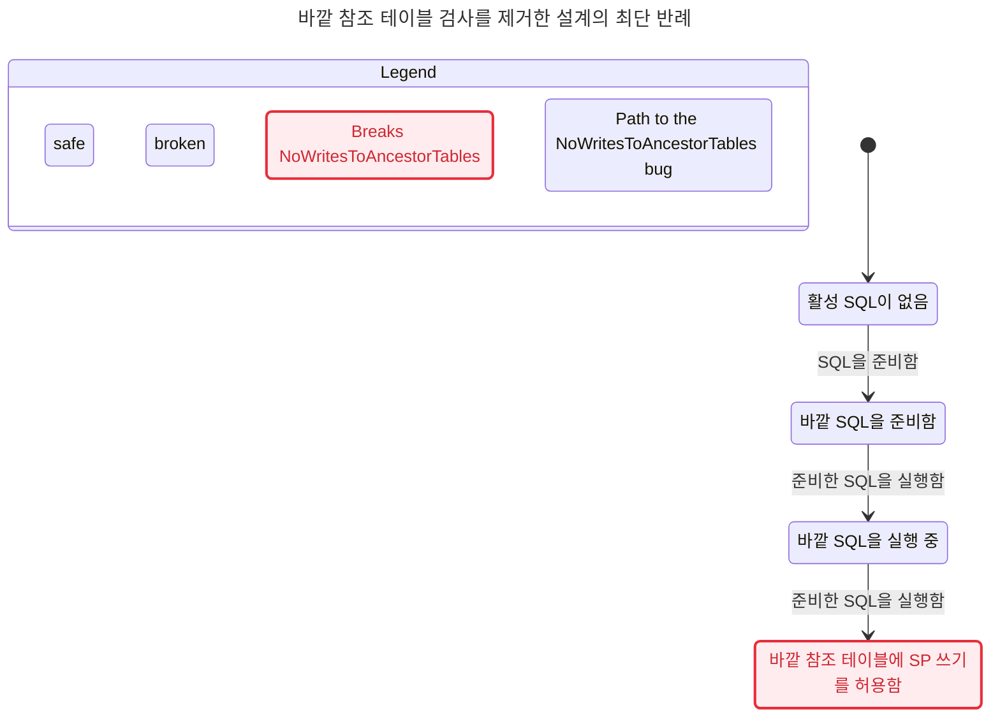

# 바깥 테이블 검사를 생략한 설계의 반례

이 그림은 현재 엔진 버그 재현이 아니라 제안 알고리즘의 잘못된 변형을 검사한 결과다.

# SpDmlGuard

TLC reached 17,169 states, more than the chart budget of 500, so the chart draws only the bug paths: 4 states and 3 arrows.

## NoWritesToAncestorTables breaks
The shortest path has 3 steps:
0. 활성 SQL이 없음
1. SQL을 준비함: 바깥 SQL을 준비함
2. 준비한 SQL을 실행함: 바깥 SQL을 실행 중
3. 준비한 SQL을 실행함: 바깥 참조 테이블에 SP 쓰기를 허용함

## Rules that hold
TypeOK, NoDeadlock

500개 상태의 그림 예산을 넘겨 위반으로 가는 최단 경로만 그렸다. 반례 경로의 전이는 생략하지 않았다. 준비한 쓰기 문장을 바깥 DML로 실행한 뒤 같은 준비 결과를 중첩 SP에서 재실행하면 테이블 충돌을 놓친다. 준비와 실행을 구분하고 매 실행에서 조상을 다시 검사해야 한다.
