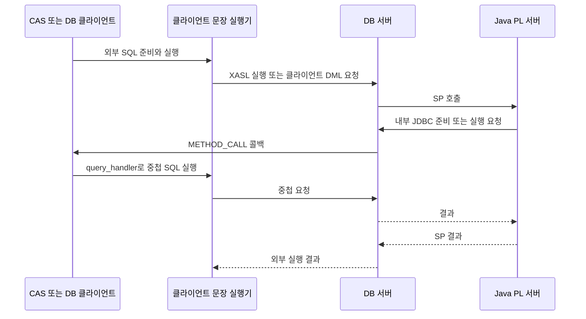

# CUBRID SP 중첩 DML 제한의 적용 가능성과 조건부 모델 검증

## 초록

현재 CAS에 보이는 XASL 타입, OID 목록, lock 정보만으로 SP 중첩 DML 제한을 모든 실행 경로에 정확히 적용하는 원안은 불충분하다. 캐시 적중 시 클라이언트에 접근 목록이 전달되지 않는 경로가 있고, 의미상 DML이 SELECT XASL이나 로컬 쓰기로 실행되기도 한다. 또한 prepare 때의 판정은 실제 실행 시점의 활성 조상을 보장하지 못한다. 이 판단은 아래의 소스 분석 결과다. 보강한 추상 알고리즘의 모델 검사 결과와는 평가 대상이 다르다.

| 평가 대상 | 확인한 결과 | 결론의 범위 |
| --- | --- | --- |
| 기존 CAS 가시 XASL 정보만 사용하는 원안 | 소스에서 정보 전달, 문장 분류, 실행 수명의 공백을 확인했다. | 전체 경로를 지원하기에 불충분하다. |
| 의미상 종류·정확한 접근 집합·활성 스택을 결합한 보강 알고리즘 | 유한 TLA+ 모델의 정상 사례에서 다섯 불변식 위반을 찾지 못했다. | 정확한 입력과 실행 경계를 가정한 조건부 결과다. |
| 의도적으로 잘못 만든 보강 모델의 여덟 변형 | 여덟 경우 모두 예상한 불변식 위반을 검출했다. | 검사 절차가 지정한 결함을 잡았다는 결과다. 원안의 통과를 뜻하지 않는다. |

최소 보완안은 의미상 SQL 종류, 실행할 계획에 대응하며 접근 정보를 복사해 보관하는 스냅샷, 호출별 활성 프레임 스택이다. 이 문서는 그 알고리즘을 제안한다. CUBRID가 모든 경로에서 정확한 스냅샷과 실행 경계를 제공한다는 점은 입증하지 않았다. 엔진 구현, 엔진 빌드, 실제 DB에서의 SQL 재현은 수행하지 않았다.

분석일은 2026-11-11, 시간대는 Asia/Seoul이다. 소스 저장소는 `CUBRID/CUBRID`, 분석 리비전은 `e64a04a79a5842827a124b3f8313516d0da2594c`다. 로컬 분석 경로는 `/home/vimkim/gh/cb/SP-dml-tcl-poc`이다. 이 문서의 소스 판단은 이 리비전에 한정한다.

## 1. 문제와 범위

이 보고서는 SP 중첩 SQL 제한을 설계하는 개발자와 검토자를 대상으로 한다. 검토할 정책은 다음과 같다.

1. 사용자 SELECT가 활성 조상 문장이면 중첩 쓰기를 거절한다.
2. 활성 외부 DML이 직접 읽거나 쓰는 테이블에는 중첩 DML이 쓰지 못하게 한다.
3. 중첩 읽기는 허용한다. 외부 DML과 충돌하지 않는 다른 테이블의 쓰기도 다른 금지 조상이 없으면 허용한다.

DDL과 TCL은 범위에서 제외한다. Oracle과의 동작 비교도 수행하지 않는다. 관심 대상은 SP SQL의 의미상 실행 관계이며, 엔진 내부 scan을 각각 독립된 사용자 SQL로 세지 않는다.

| 개념 | 이 문서에서의 의미 |
| --- | --- |
| 의미상 문장 | 사용자가 실행하거나 SP가 JDBC로 실행한 SELECT, INSERT, UPDATE, DELETE, MERGE, CALL이다. |
| 내부 실행계획 | 의미상 문장을 처리하기 위한 XASL이다. UPDATE를 위한 내부 SELECT도 포함한다. |
| `Ref(S)` | 문장 S가 직접 읽거나 쓰는 테이블 식별자 집합이다. 소스와 쓰기 대상을 모두 포함한다. |
| `Write(S)` | 문장 S의 쓰기 대상 테이블 집합이다. |
| 활성 프레임 | 아직 실행이 끝나지 않은 의미상 문장 호출 하나다. 준비된 핸들과 수명이 다르다. |

위 집합과 프레임은 보강 설계의 용어다. 기존 `class_oid_list`와 같다고 가정하지 않는다. `XASL_NODE`는 `type`, `class_oid_list`, `class_locks`를 갖지만 목록에는 serial OID도 들어간다. `PROC_TYPE`은 SQL 원문 종류가 아니라 실행계획 노드 종류다. [XASL 타입](https://github.com/CUBRID/CUBRID/blob/e64a04a79a5842827a124b3f8313516d0da2594c/src/query/xasl.h#L189), [XASL 노드](https://github.com/CUBRID/CUBRID/blob/e64a04a79a5842827a124b3f8313516d0da2594c/src/query/xasl.h#L1274), [캐시 관련 목록](https://github.com/CUBRID/CUBRID/blob/e64a04a79a5842827a124b3f8313516d0da2594c/src/query/xasl.h#L1367).

## 2. 연구 질문과 판정 기준

첫째 질문은 기존 CAS 가시 XASL 정보만으로 위 정책에 필요한 문장 종류, 접근 집합, 활성 조상을 얻을 수 있는가이다. 이 원안의 충분성은 캐시 적중과 클라이언트 DML을 포함한 실행 경로에서 필요한 정보가 유지되어야 성립한다. 4절의 소스 관찰은 그 전제가 충족되지 않음을 보여 준다.

둘째 질문은 정확한 의미상 종류와 접근 집합, 올바른 활성 스택을 이미 갖는다면 보강한 판정식이 정책을 지키는가이다. 5절의 유한 모델 검사는 이 조건부 질문을 다룬다. 실제 CUBRID가 그 입력과 수명 계약을 만족하는가는 모델의 가정이다.

셋째 질문은 검사 절차가 판정식, 메타데이터, 수명의 대표 결함을 검출하는가이다. 이를 위해 한 요소씩 잘못 바꾼 여덟 변형에서 예상 불변식 위반을 찾는다. 정상 모델의 안전성 결과와 변형의 검출 결과는 구분해서 해석한다.

## 3. 방법과 증거의 구분

소스 분석은 CAS 실행, 클라이언트 콜백, PL 요청 전달, 문장 실행, XASL 목록 생성과 캐시 응답을 추적했다. 본문의 소스 링크는 모두 위 리비전에 고정되어 있다. 소스에서 확인한 분기와 자료 구조는 관찰로 기술하고, 그 관찰에서 도출한 충분성 판단은 해석으로 기술한다.

형식 검사는 [SpDmlGuard.tla](SpDmlGuard.tla)의 전이와 [check.py](check.py)의 정상 설정 및 변형 설정을 사용했다. `active`는 의미상 실제 실행 조상이며, `frames`는 검사기가 관측한 메타데이터 스택이다. `prepared`는 재사용 가능한 준비 결과다. 실제 조상을 기준으로 한 정책과 관측 자료에 따른 허용 결정을 분리해 입력 또는 수명 오류를 드러낸다.

| 검사 범위 | 설정과 가정 |
| --- | --- |
| 테이블과 문장 | 테이블 식별자 3개, 대표 문장 10개다. SELECT, DML, CALL과 SELECT 계획을 쓰는 DML을 포함한다. |
| 실행 관계 | 최대 활성 깊이 3, 한 클라이언트의 동기 재진입 체인, 준비 결과 1개다. |
| 전이 | 준비, 실행 또는 거절, 정상 복귀, 임의 깊이 오류 복귀를 검사한다. 준비 자체는 활성 SQL 프레임을 만들지 않는다. |
| 정상 입력 계약 | 매 실행의 의미상 종류, `refs`, `writes`가 정확하며 계획 세대와 일치한다고 가정한다. |
| 정상 경계 계약 | 진입과 복귀가 제한 대상의 전체 평가를 감싸고 쓰기 효과 전에 검사한다고 가정한다. |

INSERT, UPDATE, DELETE, MERGE가 같은 접근 집합을 갖는 경우 같은 모델 문장으로 추상화한다. 행, 래치, MVCC, 실제 데이터 변경은 모델에 없다. 따라서 이 검사는 엔진 동작 재현이나 SQL 적합성 시험이 아니다.

## 4. 소스 분석 결과와 원안의 한계

### 4.1. 최초 클라이언트로의 재진입과 CAS 밖의 경로



관찰된 CAS 경로는 `db_execute_and_keep_statement`를 호출한다. 서버 응답을 기다리는 클라이언트 통신 코드는 `METHOD_CALL`을 받으면 `method_dispatch`를 실행한다. 따라서 SP 내부 JDBC 요청은 최초 클라이언트의 미완료 요청 안으로 재진입한다. 다른 CAS에 새 SQL 요청을 보내는 모델로 보면 실행 조상을 잃는다. [CAS 실행](https://github.com/CUBRID/CUBRID/blob/e64a04a79a5842827a124b3f8313516d0da2594c/src/broker/cas_execute.c#L1195), [콜백 수신](https://github.com/CUBRID/CUBRID/blob/e64a04a79a5842827a124b3f8313516d0da2594c/src/communication/network_cl.c#L1376).

PL 실행기는 내부 JDBC 준비와 실행 요청을 각각 클라이언트로 전달한다. 클라이언트 `query_handler`는 자체 DB 세션을 열어 컴파일하고 나중에 실행한다. 이 경로는 일반 CAS의 `ux_execute`만 통과한다고 볼 수 없다. standalone과 직접 PL 호출도 별도 확인 대상이다. [PL 요청 전달](https://github.com/CUBRID/CUBRID/blob/e64a04a79a5842827a124b3f8313516d0da2594c/src/sp/pl_executor.cpp#L672), [콜백 디스패치](https://github.com/CUBRID/CUBRID/blob/e64a04a79a5842827a124b3f8313516d0da2594c/src/method/query_method.cpp#L203), [콜백 준비](https://github.com/CUBRID/CUBRID/blob/e64a04a79a5842827a124b3f8313516d0da2594c/src/method/method_query_handler.cpp#L792), [콜백 실행](https://github.com/CUBRID/CUBRID/blob/e64a04a79a5842827a124b3f8313516d0da2594c/src/method/method_query_handler.cpp#L690), [standalone 경로](https://github.com/CUBRID/CUBRID/blob/e64a04a79a5842827a124b3f8313516d0da2594c/src/method/query_method.cpp#L157), [직접 PL 호출](https://github.com/CUBRID/CUBRID/blob/e64a04a79a5842827a124b3f8313516d0da2594c/src/communication/network_interface_cl.c#L11552).

### 4.2. 기존 목록과 정확한 접근 집합의 차이

관찰된 일반 클래스 목록 생성기는 해석된 `flat_entity_list`에서 클래스 OID를 수집한다. UPDATE와 DELETE 대상 spec에는 `IX_LOCK`, 그 외에는 `IS_LOCK`을 적용하고 중복 OID의 lock을 합친다. view의 가상 클래스 OID와 serial도 별도로 추가한다. 따라서 이 목록은 유용한 의존성 자료지만 그대로 정확한 읽기 집합이나 쓰기 집합은 아니다. [클래스와 lock 수집](https://github.com/CUBRID/CUBRID/blob/e64a04a79a5842827a124b3f8313516d0da2594c/src/parser/xasl_generation.c#L21989), [view 추가](https://github.com/CUBRID/CUBRID/blob/e64a04a79a5842827a124b3f8313516d0da2594c/src/parser/xasl_generation.c#L22100), [serial 추가](https://github.com/CUBRID/CUBRID/blob/e64a04a79a5842827a124b3f8313516d0da2594c/src/parser/xasl_generation.c#L22165).

INSERT는 대상 클래스를 목록 앞에 넣고 소스 SELECT의 목록을 뒤에 붙인다. UPDATE와 DELETE는 내부 SELECT의 목록을 넘겨받는다. MERGE 루트는 UPDATE 자식이 있으면 그 자식의 목록을 사용하고, 없으면 INSERT 자식의 목록을 사용한다. 두 자식의 합집합이라는 보장은 코드에 없다. 다만 이 사실만으로 특정 MERGE의 참조가 실제로 누락된다고 단정할 수는 없다. INSERT에만 있는 의존성이 UPDATE 목록에 빠지는 구체 사례는 검증하지 않았다. [INSERT 목록](https://github.com/CUBRID/CUBRID/blob/e64a04a79a5842827a124b3f8313516d0da2594c/src/parser/xasl_generation.c#L23914), [DELETE 목록](https://github.com/CUBRID/CUBRID/blob/e64a04a79a5842827a124b3f8313516d0da2594c/src/parser/xasl_generation.c#L25912), [UPDATE 목록](https://github.com/CUBRID/CUBRID/blob/e64a04a79a5842827a124b3f8313516d0da2594c/src/parser/xasl_generation.c#L26863), [MERGE 목록 선택](https://github.com/CUBRID/CUBRID/blob/e64a04a79a5842827a124b3f8313516d0da2594c/src/parser/xasl_generation.c#L31200).

관찰된 서버 DML 계획에는 더 직접적인 쓰기 대상 필드가 있다. UPDATE와 DELETE는 클래스 및 subclass 배열을, INSERT는 대상 `class_oid`를 갖는다. MERGE는 UPDATE와 INSERT 자식 계획을 갖는다. 이 필드들을 쓰기 대상 추출의 입력으로 사용하는 편이 lock만 해석하는 것보다 근거가 강하다. 그러나 partition pruning, 상속, view 변환까지 정확한 충돌 식별자를 제공한다는 계약은 별도 검증이 필요하다. [클래스 정보](https://github.com/CUBRID/CUBRID/blob/e64a04a79a5842827a124b3f8313516d0da2594c/src/query/xasl.h#L240), [UPDATE와 DELETE](https://github.com/CUBRID/CUBRID/blob/e64a04a79a5842827a124b3f8313516d0da2594c/src/query/xasl.h#L423), [INSERT](https://github.com/CUBRID/CUBRID/blob/e64a04a79a5842827a124b3f8313516d0da2594c/src/query/xasl.h#L483), [MERGE](https://github.com/CUBRID/CUBRID/blob/e64a04a79a5842827a124b3f8313516d0da2594c/src/query/xasl.h#L517).

관찰된 DBLINK DML은 로컬 SELECT 의존성을 수집하지만 원격 쓰기 대상은 로컬 클래스 OID가 아니다. 모든 테이블을 로컬 OID 집합으로 표현하는 전제는 이 경로에서 성립하지 않는다. 원격 대상을 지원하려면 별도의 식별 및 동등성 정책이 필요하다. [원격 대상의 로컬 identity 부재](https://github.com/CUBRID/CUBRID/blob/e64a04a79a5842827a124b3f8313516d0da2594c/src/parser/xasl_generation.c#L22692), [로컬 입력 목록 수집](https://github.com/CUBRID/CUBRID/blob/e64a04a79a5842827a124b3f8313516d0da2594c/src/parser/xasl_generation.c#L22734).

### 4.3. 캐시 적중과 재컴파일에서의 정보 공백

캐시 조회부터 새 XASL 생성까지의 함수 순서와 관측할 필드는 부록 A.1에 정리했다.

관찰된 prepare는 서버의 계획 캐시를 먼저 조회한다. 적중하면 로컬 XASL을 새로 만들지 않고 반환된 `XASL_ID`를 사용할 수 있다. 서버 응답의 `XASL_NODE_HEADER`에는 flag와 id만 있으며 테이블 목록과 SQL 문장 종류는 없다. 서버 캐시에 메타데이터가 있다는 사실과 CAS가 그 메타데이터를 받는다는 주장은 다르다. [UPDATE 캐시 조회](https://github.com/CUBRID/CUBRID/blob/e64a04a79a5842827a124b3f8313516d0da2594c/src/query/execute_statement.c#L10022), [SELECT 캐시 조회](https://github.com/CUBRID/CUBRID/blob/e64a04a79a5842827a124b3f8313516d0da2594c/src/query/execute_statement.c#L15455), [응답 구성](https://github.com/CUBRID/CUBRID/blob/e64a04a79a5842827a124b3f8313516d0da2594c/src/communication/network_interface_sr.cpp#L5596), [헤더 정의](https://github.com/CUBRID/CUBRID/blob/e64a04a79a5842827a124b3f8313516d0da2594c/src/query/xasl.h#L69).

관찰된 콜백 실행은 invalid XASL 오류가 나면 다시 prepare하고 실행한다. CAS에도 실행 시 재컴파일 경로가 있다. 그러므로 최초 prepare에서 얻은 포인터나 메타데이터를 재실행 때 그대로 쓰는 설계는 충분하지 않다. [콜백 재시도](https://github.com/CUBRID/CUBRID/blob/e64a04a79a5842827a124b3f8313516d0da2594c/src/method/method_callback.cpp#L347), [CAS 실행 시 컴파일](https://github.com/CUBRID/CUBRID/blob/e64a04a79a5842827a124b3f8313516d0da2594c/src/broker/cas_execute.c#L1139), [세션 교체](https://github.com/CUBRID/CUBRID/blob/e64a04a79a5842827a124b3f8313516d0da2594c/src/broker/cas_execute.c#L10691).

### 4.4. 의미상 DML과 SELECT 계획의 불일치

UPDATE의 내부 SELECT 생성과 후속 객체 수정 경로는 부록 A.2에, 원래 SQL 종류를 유지하는 위치는 부록 A.3에 정리했다.

관찰된 UPDATE는 trigger, virtual class 등의 조건에 따라 내부 SELECT를 준비하고 그 XASL ID를 UPDATE 문장에 보관한다. 실행 시 그 결과의 OID를 사용해 클라이언트에서 객체를 수정한다. DELETE에도 같은 계열의 경로가 있다. 이 SELECT를 독립적인 읽기 전용 조상으로 push하면 관계없는 테이블에 대한 중첩 쓰기까지 잘못 거절한다. 반대로 SELECT 정보만 보관하면 외부 UPDATE의 쓰기 대상을 잃는다. [UPDATE 경로 선택](https://github.com/CUBRID/CUBRID/blob/e64a04a79a5842827a124b3f8313516d0da2594c/src/query/execute_statement.c#L9965), [UPDATE 내부 SELECT 준비](https://github.com/CUBRID/CUBRID/blob/e64a04a79a5842827a124b3f8313516d0da2594c/src/query/execute_statement.c#L10177), [UPDATE 객체 수정](https://github.com/CUBRID/CUBRID/blob/e64a04a79a5842827a124b3f8313516d0da2594c/src/query/execute_statement.c#L10404), [DELETE 내부 SELECT](https://github.com/CUBRID/CUBRID/blob/e64a04a79a5842827a124b3f8313516d0da2594c/src/query/execute_statement.c#L11541).

관찰된 INSERT는 서버 실행에 적합하지 않으면 로컬 INSERT로 실행한다. MERGE도 trigger나 view가 있으면 서버에는 SELECT만 보내고 클라이언트 force로 변경할 수 있다. 따라서 서버 쓰기 XASL의 진입점만 검사하면 쓰기 경로를 모두 포괄하지 못한다. [INSERT 서버 실행 조건](https://github.com/CUBRID/CUBRID/blob/e64a04a79a5842827a124b3f8313516d0da2594c/src/query/execute_statement.c#L12445), [로컬 INSERT fallback](https://github.com/CUBRID/CUBRID/blob/e64a04a79a5842827a124b3f8313516d0da2594c/src/query/execute_statement.c#L14773), [클라이언트 MERGE 설명](https://github.com/CUBRID/CUBRID/blob/e64a04a79a5842827a124b3f8313516d0da2594c/src/query/query_executor.c#L33531).

## 5. 보강 알고리즘의 유한 모델 검사 결과

### 5.1. 정상 사례와 검사 절차의 성공 의미

[기록된 원래 실행 결과](evidence/results.json)에서 `complete`는 145,720개 상태를 생성하고 서로 다른 상태 6,092개를 탐색했다. TLC 종료 코드는 0이며 아래 다섯 불변식 위반을 찾지 못했다. 정상 사례는 정확한 메타데이터와 실행 스택을 전제로 한다.

| 불변식 | 확인하는 모델 속성 |
| --- | --- |
| `TypeOK` | 활성 문장의 자료형, 최대 깊이, 판정 기록의 형식이 유지된다. |
| `NoWritesUnderSelect` | 실제 SELECT 조상 아래에서 쓰기를 허용하지 않는다. |
| `NoWritesToAncestorTables` | 실제 DML 조상의 참조 테이블에 중첩 쓰기를 허용하지 않는다. |
| `DecisionsMatchRules` | 허용과 거절이 정의한 정책과 일치한다. 불필요한 거절도 검출한다. |
| `FramesFollowExecution` | 관측 프레임 수와 실제 활성 문장 수가 일치한다. |

정상 사례와 변형 여덟 개를 포함한 원래 실행의 총 기록 시간은 29.057초다. 이 값은 모델 검사 시간이며 엔진 성능 측정이 아니다. 검사기는 전체 300초 제한을 적용한다. 사용한 도구는 TLA+ tools 릴리스 1.7.4 jar에 포함된 TLC 2.19다. 설정은 worker 1개, seed 1, fingerprint 0이다.

`check.py`의 `PASS`는 예상 결과와 관측 결과가 일치한다는 뜻이다. 정상 사례는 종료 코드 0과 오류 없는 완료가 필요하다. 변형은 종료 코드 12와 지정한 불변식 위반이 필요하다. 따라서 변형의 `PASS`는 잘못된 설계에서 위반을 검출했다는 뜻이다.

### 5.2. 변형별 예상 위반과 관측 위반

아래 결과는 모두 [results.json](evidence/results.json)의 `expected_violation`, `found_violation`, `exit_code`에 대응한다. 각 변형은 `TypeOK`와 지정한 불변식을 검사한다. 정상 사례처럼 다섯 불변식 전체의 성립을 검사하는 설정은 아니다.

| 변형 | 의도한 결함 | 예상 위반 | 관측 위반 | TLC 종료 코드 |
| --- | --- | --- | --- | --- |
| `no-select-check` | SELECT 조상 검사를 제거한다. | `NoWritesUnderSelect` | `NoWritesUnderSelect` | 12 |
| `no-overlap-check` | DML 조상 테이블 검사를 제거한다. | `NoWritesToAncestorTables` | `NoWritesToAncestorTables` | 12 |
| `top-only` | 직전 부모만 검사한다. | `NoWritesToAncestorTables` | `NoWritesToAncestorTables` | 12 |
| `cache-empty` | 캐시 적중의 참조를 빈 집합으로 취급한다. | `NoWritesToAncestorTables` | `NoWritesToAncestorTables` | 12 |
| `xasl-type-only` | 계획 종류로 의미상 종류와 쓰기를 분류한다. | `NoWritesUnderSelect` | `NoWritesUnderSelect` | 12 |
| `prepare-only` | 준비 때의 허용 결정을 재사용한다. | `NoWritesToAncestorTables` | `NoWritesToAncestorTables` | 12 |
| `error-frame-leak` | 오류 복귀 후 프레임을 남긴다. | `FramesFollowExecution` | `FramesFollowExecution` | 12 |
| `deny-all-writes` | 모든 쓰기를 거절한다. | `DecisionsMatchRules` | `DecisionsMatchRules` | 12 |

여덟 변형 모두 예상 위반을 검출했다. `top-only`는 더 위의 DML 조상을 놓치는 문제를, `deny-all-writes`는 안전성만 지키고 허용해야 할 쓰기까지 막는 문제를 구분해 드러낸다. 변형은 대표 결함을 모델링한 것이며 현재 엔진에서 해당 SQL 결함을 재현한 실험은 아니다.

### 5.3. 짧은 반례와 모델 자체의 오류 교정

[보존한 statechart](evidence/statechart.md)는 `no-overlap-check`에서 최단 3전이를 보여 준다. 활성 SQL이 없는 상태에서 쓰기 문장을 준비한다. 그 문장을 외부 DML로 실행한 뒤, 같은 준비 결과를 SP 중첩 실행으로 다시 실행한다. 두 실행의 테이블이 겹치지만 조상 테이블 검사를 제거했으므로 두 번째 쓰기를 허용하고 `NoWritesToAncestorTables`를 위반한다.

그림은 상태 예산 500개를 넘어 전체 상태 대신 반례 경로의 4개 상태와 3개 화살표를 표시한다. 반례의 전이를 생략한 것은 아니다. 그림 생성 실행의 탐색 수와 5.1절 정상 사례의 6,092개 상태는 서로 다른 실행의 값이다.

초기 모델의 변형 검사에서는 잘못된 변형까지 통과했다. 위반을 기록하는 상태 갱신식의 괄호 누락이 위반 전이를 오히려 배제하고 있었다. 식을 교정한 뒤 정상 사례와 여덟 변형을 검사해 위 표의 결과를 얻었다. 교정 전 모델의 통과는 이 보고서의 안전성 근거로 사용하지 않는다.

## 6. 논의와 최소 보완 설계

### 6.1. 모든 활성 조상에 대한 실행 시 판정

다음은 제안이며 구현된 기능이 아니다. 쓰기 문장 C를 실행하기 직전, 현재 활성 조상 A 전부를 검사한다.

1. A가 사용자 SELECT이면 C를 거절한다.
2. A가 쓰기 DML이고 `Write(C)`와 `Ref(A)`가 겹치면 C를 거절한다.
3. 그 외에는 C를 허용한다. 읽기 문장은 이 두 규칙으로 거절하지 않는다.

즉시 부모만 검사하면 `SELECT → SP → CALL → SP → UPDATE` 같은 호출에서 SELECT 조상을 놓친다. CALL 자체는 SELECT가 아니다. CALL 내부에서 실행한 사용자 SELECT는 그 SELECT가 실행 중인 동안 새 프레임이 된다. 내부 DML scan SELECT는 외부 DML 프레임의 일부다. 이 구분은 제안한 정책의 해석이다. 실제 CAS는 원래 CALL 문장과 일반 문장 종류를 별도로 식별한다. [CALL 분류](https://github.com/CUBRID/CUBRID/blob/e64a04a79a5842827a124b3f8313516d0da2594c/src/broker/cas_execute.c#L739), [일반 문장 분류](https://github.com/CUBRID/CUBRID/blob/e64a04a79a5842827a124b3f8313516d0da2594c/src/broker/cas_execute.c#L845).

### 6.2. 소유한 접근 스냅샷과 호출별 프레임

제안하는 `StatementAccessSnapshot`은 아래 값을 소유한다. parser와 XASL 내부 포인터를 보관하지 않는다.

| 필드 | 제안한 계약 |
| --- | --- |
| `kind` | 원래 의미상 문장의 `Select`, `WriteDml`, `Call`을 구분한다. WriteDml은 INSERT, UPDATE, DELETE, MERGE를 포함한다. |
| `refs` | 현재 문장 자체의 소스 및 쓰기 대상 식별자 집합이다. 내부 SELECT와 하위 쿼리의 참조도 포함한다. SP가 나중에 실행할 동적 SQL은 그 SQL의 새 프레임에서 처리한다. |
| `writes` | 현재 문장의 모든 쓰기 대상 식별자 집합이다. `writes`는 `refs`에 포함된다. SELECT와 CALL 자체의 집합은 비어 있다. |
| `coverage` | 해당 문장과 경로에서 추출이 완전한 `Complete`인지 아직 보장할 수 없는 `Unknown`인지 구분한다. 빈 집합을 추출 실패의 대용으로 쓰지 않는다. |
| `binding` | 세션과 준비된 문장, 실제 실행할 계획 또는 준비 세대를 연결한다. 재컴파일과 관련 스키마 변경 후 옛 스냅샷을 재사용하지 않는다. |

위 표에서 SELECT의 `writes`는 비어 있다. SELECT의 `refs`는 보유할 수 있지만 SELECT 조상에 의한 거절에는 필요하지 않다. CALL의 직접 참조가 없다면 `refs`도 비어 있다. CALL이 실행하는 자식 SQL의 참조는 자식 프레임에 속한다.

제안하는 식별자 정규화는 별도 계약이다. 로컬 OID를 사용하더라도 DB 구분, view와 기반 클래스, 상속, partition 사이의 충돌을 같은 기준으로 판단해야 한다. 원격 대상은 현재 로컬 OID 방식으로 표현할 수 없다. 정규화가 보수적으로 과다 수집하면 안전성은 지킬 수 있어도 서로 다른 테이블에 대한 허용을 과하게 막을 수 있다. 따라서 정확한 허용까지 주장하려면 추출 완전성과 과다 충돌 여부를 모두 검증해야 한다.

제안하는 `StatementFrame`은 실행 호출 식별자와 해당 실행의 불변 스냅샷을 참조한다. 스택은 준비된 핸들별 전역 목록이 아니라 현재 재진입 실행 체인에 속한다. 캐시된 핸들을 실행할 때마다 새 프레임을 만든다. 재컴파일로 실행 계획이 교체되면 쓰기 효과가 생기기 전에 스냅샷도 교체하고 검사한다. 내부 계획은 별도 의미상 문장 프레임을 만들지 않는다.

최소 판정에 꼭 필요한 값은 외부 DML의 `refs`, 새 쓰기 문장의 `writes`, 모든 조상의 `kind`다. 읽기와 쓰기를 구분한 두 집합을 모든 조상에 별도로 유지할 필요는 없다. `Unknown`인 쓰기 대상이나 외부 DML 참조에 대해 중첩 쓰기를 허용하면 안전성을 증명할 수 없다. 이를 거절하는 방식은 안전한 fallback 제안이지만 정확한 전체 기능 구현의 대안은 아니다.

| 방안 | 판정 | 이유 |
| --- | --- | --- |
| CAS에서 현재 XASL의 type과 OID 목록만 검사 | 불충분 | 캐시 적중, 클라이언트 DML, 의미상 SELECT 구분, 실행 조상을 해결하지 못한다. |
| 의미상 종류와 정확한 접근 스냅샷, 활성 프레임을 결합 | 조건부로 가능한 설계 | 규칙을 직접 표현한다. 추출 및 실행 경계 계약을 엔진 경로별로 입증해야 한다. |
| 현재 CAS에 보이는 자료만으로 모든 경로를 지원한다고 선언 | 근거 없음 | 누락된 메타데이터를 얻는 방법과 재진입 수명 보장이 없다. |

이번 검토에서는 엔진을 수정하지 않았다. 후속 구현에서 스냅샷을 어디서 만들고 캐시 적중 시 어떻게 제공할지는 아직 해결할 작업이다. 기존 XASL 목록을 재사용하는 것만으로 이 계약이 충족된다고 볼 수 없다.

추가 parse-tree 순회가 반드시 필요하다는 결론은 아니다. 기존 컴파일·이름 해석·목록 생성 지점에서 자료를 함께 수집하는 방법도 있다. 다만 캐시 적중과 클라이언트 DML을 포함해 같은 스냅샷을 제공하고 소유하는 설계가 필요하다. 판단식은 작게 유지할 수 있지만 입력을 완전하게 만드는 작업은 별도다.

### 6.3. 정책 적용 예시

아래는 제안 정책의 예시이며 실제 DB에서 실행한 결과가 아니다. `t1`, `t2`, `t3`는 정규화 후에도 서로 다른 테이블이라고 가정한다.

| 활성 외부 문장과 중첩 동작 | 기대 결과 |
| --- | --- |
| `INSERT INTO t1 SELECT ..., sp() FROM t2`에서 SP가 `UPDATE t1` | 거절한다. 외부 DML이 쓰는 테이블이다. |
| 같은 INSERT에서 SP가 `UPDATE t2` | 거절한다. 외부 DML이 읽는 테이블이다. |
| 같은 INSERT에서 SP가 `UPDATE t3` | 다른 SELECT 조상이 없다면 허용한다. |
| 같은 INSERT에서 SP가 `SELECT ... FROM t1` 또는 `t2` | 읽기이므로 허용한다. |
| `SELECT sp()`에서 SP가 서로 다른 테이블에 INSERT | 사용자 SELECT 조상이 있으므로 거절한다. |
| `CALL p()`가 사용자 `SELECT f()`를 실행하고 f가 UPDATE | 활성 SELECT 조상 때문에 거절한다. |
| `CALL p()`가 UPDATE를 직접 실행하고 조상 테이블과 충돌하지 않음 | 허용한다. CALL 자체는 읽기 전용 조상이 아니다. |
| 클라이언트 UPDATE의 내부 SELECT 평가 중 SP가 `UPDATE t3` | 다른 금지 조상과 테이블 충돌이 없다면 허용한다. 내부 scan을 사용자 SELECT로 세지 않는다. |

### 6.4. 준비·실행·trigger·cursor의 수명 경계

관찰된 prepared handler는 SQL, transaction, 사용자 조건에 따라 재사용된다. 따라서 준비할 때 한 번 검사하는 방식은 다른 조상 아래의 후속 실행을 보호하지 못한다. [핸들 재사용](https://github.com/CUBRID/CUBRID/blob/e64a04a79a5842827a124b3f8313516d0da2594c/src/method/method_callback.cpp#L269).

제안한 프레임은 중첩 SQL이 발생할 수 있는 최초 평가 전에 활성화하고 성공, 오류, 재시도, unwind에서 정확히 제거해야 한다. 일반 DB API의 실행 경계는 후보지만 완전한 단일 hook으로 확정하지 않았다. 실행 API는 내부 컴파일과 replan을 할 수 있으므로 `db_execute_and_keep_statement` 직전 push만으로 모든 prepare 평가까지 포괄한다고 단정할 수 없다. [실행 중 컴파일](https://github.com/CUBRID/CUBRID/blob/e64a04a79a5842827a124b3f8313516d0da2594c/src/compat/db_vdb.c#L3194), [binding 후 replan](https://github.com/CUBRID/CUBRID/blob/e64a04a79a5842827a124b3f8313516d0da2594c/src/compat/db_vdb.c#L3393).

관찰된 parser 코드는 일부 method 호출을 즉시 평가하며 XASL 생성기에도 method와 SP를 나누는 분기가 있다. 이것은 모든 Java SP가 prepare 중 실행된다는 증거가 아니다. 반대로 prepare가 항상 부작용이 없다는 보장도 주지 않는다. 최종 스냅샷이 나오기 전에 제한 대상 SP가 실행될 수 있는지 추가 추적이 필요하다. 가능하다면 조기 의미상 프레임과 미완성 메타데이터 정책이 필요하다. 미완성 상태에서 중첩 쓰기를 거절하는 방법은 보수적 제안이다. [상수 평가](https://github.com/CUBRID/CUBRID/blob/e64a04a79a5842827a124b3f8313516d0da2594c/src/parser/parse_evaluate.c#L1372), [method와 SP 생성 분기](https://github.com/CUBRID/CUBRID/blob/e64a04a79a5842827a124b3f8313516d0da2594c/src/parser/xasl_generation.c#L9802).

관찰된 trigger wrapper는 DML 본체 전후에 BEFORE STATEMENT와 AFTER 활동을 실행한다. trigger 활동은 parser의 문장 실행 경로로 들어갈 수 있다. 그러므로 외부 DML 프레임은 서버 XASL 요청보다 넓게 잡아 trigger 활동까지 감싸야 한다. 다만 모든 trigger의 SP 진입과 deferred trigger 수명은 이번 추적으로 완결하지 못했다. trigger가 있다는 이유로 전부 허용하거나 전부 거절하는 정책을 도출할 수는 없다. [trigger 전후 실행](https://github.com/CUBRID/CUBRID/blob/e64a04a79a5842827a124b3f8313516d0da2594c/src/query/execute_statement.c#L6741), [trigger activity 실행](https://github.com/CUBRID/CUBRID/blob/e64a04a79a5842827a124b3f8313516d0da2594c/src/object/trigger_manager.c#L5156), [trigger 문장 실행](https://github.com/CUBRID/CUBRID/blob/e64a04a79a5842827a124b3f8313516d0da2594c/src/parser/compile.c#L1694).

관찰된 SELECT 결과는 execute 이후 열린 cursor로 남을 수 있다. fetch와 활성 평가의 수명은 구분해야 한다. 준비된 핸들이나 cursor가 열려 있다는 이유만으로 SELECT 프레임을 계속 유지하면 후속 쓰기를 과하게 막는다. 반대로 fetch가 추가 평가를 하지 않는다는 전체 보장 없이 execute 반환 시 무조건 pop한다고 확정할 수도 없다. 추적된 list-page fetch는 일반 요청이지만 모든 cursor 경로의 증명은 아니다. [cursor 등록과 fetch](https://github.com/CUBRID/CUBRID/blob/e64a04a79a5842827a124b3f8313516d0da2594c/src/sp/pl_executor.cpp#L722), [일반 list-page fetch](https://github.com/CUBRID/CUBRID/blob/e64a04a79a5842827a124b3f8313516d0da2594c/src/communication/network_interface_cl.c#L7280).

## 7. 적용 범위와 타당성의 한계

유한 모델에서 반례를 찾지 못한 결과는 테이블 3개, 대표 문장 10개, 깊이 3이라는 경계에 한정한다. 무한 재귀, 여러 클라이언트의 비동기 실행, 시간 속성에 관한 증명이 아니다. 단일 준비 결과의 재사용은 검사하지만 실제 핸들 관리 전체를 모델링하지 않는다.

의미상 분류, 메타데이터 정확성, 식별자 정규화, 실행 경계 포괄은 모델이 검증한 사실이 아니라 정상 사례의 가정이다. 캐시와 재컴파일, view, 상속, partition, DBLINK, trigger 부수 쓰기, 준비 시 평가, fetch 중 추가 실행이 이 가정을 만족하는지는 엔진 경로별 검증이 필요하다.

`FramesFollowExecution`은 모델에서 스택 길이 일치를 검사한다. 실제 엔진의 호출 식별자, 예외 안전성, 자원 수명 전체를 검증하지 않는다. 변형 검사는 지정한 여덟 결함에 대한 검출력을 보여 주지만 모델이나 엔진에 다른 결함이 없다는 뜻은 아니다.

후속 구현 검토에서 확인할 주요 책임은 다음과 같다.

| 위치 | 확인할 책임 |
| --- | --- |
| [cas_execute.c](https://github.com/CUBRID/CUBRID/blob/e64a04a79a5842827a124b3f8313516d0da2594c/src/broker/cas_execute.c#L642) | 최초 SQL 종류, prepare 및 execute, 재컴파일 경계를 연결한다. |
| [method_query_handler.cpp](https://github.com/CUBRID/CUBRID/blob/e64a04a79a5842827a124b3f8313516d0da2594c/src/method/method_query_handler.cpp#L690) | SP 내부 SQL의 별도 준비와 실행, 핸들 재사용을 연결한다. |
| [db_vdb.c](https://github.com/CUBRID/CUBRID/blob/e64a04a79a5842827a124b3f8313516d0da2594c/src/compat/db_vdb.c#L3194) | DB API의 컴파일, replan, 실행 경계를 확인한다. |
| [execute_statement.c](https://github.com/CUBRID/CUBRID/blob/e64a04a79a5842827a124b3f8313516d0da2594c/src/query/execute_statement.c#L4481) | 의미상 DML, 내부 SELECT, 클라이언트 변경, trigger wrapper를 구분한다. |
| [xasl_generation.c](https://github.com/CUBRID/CUBRID/blob/e64a04a79a5842827a124b3f8313516d0da2594c/src/parser/xasl_generation.c#L21989) | 기존 클래스 자료와 정확한 `refs`, `writes` 계약의 차이를 검증한다. |
| [network_interface_sr.cpp](https://github.com/CUBRID/CUBRID/blob/e64a04a79a5842827a124b3f8313516d0da2594c/src/communication/network_interface_sr.cpp#L5596) | 캐시 적중 시 필요한 메타데이터를 클라이언트가 받는지 확인한다. |

미증명 계약은 명확하다. 캐시 적중과 재컴파일 후에도 같은 의미의 정확한 스냅샷을 얻어야 한다. client DML, MERGE 양쪽 분기, view, 상속, partition, 원격 테이블의 접근을 정규화해야 한다. CAS, callback, 직접 DB API, standalone, trigger, 준비 시 평가와 결과 fetch에서 실행 체인을 잃지 않아야 한다. 이 계약을 만족한 추상 스택의 안전성 증명과 실제 CUBRID가 계약을 만족한다는 증명은 별개의 작업이다.

## 8. 결론

기존 CAS 가시 XASL 타입·OID·lock만으로 전체 경로의 SP 중첩 DML 제한을 구현할 수 있다는 원안은 소스 근거상 불충분하다. 캐시의 정보 전달 공백, 의미상 SQL과 내부 계획의 불일치, 준비와 활성 실행 수명의 차이가 그 판단을 결정한다.

정확한 의미상 종류와 접근 스냅샷을 실행에 결합하고 모든 활성 조상을 검사하는 보강 알고리즘은 명시한 유한 모델에서 조건부로 정책과 일치했다. 여덟 변형의 예상 위반 검출은 검사 절차의 결과다. 어느 결과도 기존 원안의 성공이나 실제 CUBRID 구현의 완전성을 입증하지 않는다.

후속 작업에서는 모든 지원 경로에서 정확한 입력을 얻고 소유하는 계약을 구현하고 확인해야 한다. 중첩 실행이 가능한 평가 전체를 프레임 수명 안에 넣는지도 검증해야 한다.

## 9. 근거 자료와 재현

코드 근거는 본문의 리비전 고정 링크에서 확인할 수 있다. 모델과 검사 입력은 [SpDmlGuard.tla](SpDmlGuard.tla)와 [check.py](check.py), 원래 실행의 해시와 수치는 [results.json](evidence/results.json), 반례 설명은 [statechart](evidence/statechart.md)에 있다. 원문 로그는 로컬 `.scratch/tlc-original.txt`에 보존하며 배포 문서의 필수 읽기 자료로 삼지 않는다.

TLA+ 도구 준비는 [README](README.md)의 절차를 따른다. `my-cubrid-docs` 저장소 루트에서 아래 명령으로 정상 사례와 여덟 변형을 함께 재실행한다.

```sh
python3 code-analysis/sp-dml-guard/check.py
```

검사기는 고정 jar의 SHA-256을 확인한다. 결과를 새 디렉터리에 남기려면 다음 명령을 사용한다. 기존 디렉터리는 덮어쓰지 않는다.

```sh
python3 code-analysis/sp-dml-guard/check.py --out /tmp/sp-dml-check-review
```

실행 환경에 따라 소요 시간은 달라진다. 비교할 값은 정상 사례의 오류 없는 완료, 변형별 예상 위반과 종료 코드, 모델 및 검사기 해시다. 엔진 구현, 빌드, 실제 SQL 검증은 이 명령에 포함되지 않는다.

## 부록 A. 코드 추적 안내

아래 경로와 줄 번호는 본문과 같은 CUBRID 리비전 `e64a04a79a5842827a124b3f8313516d0da2594c`를 기준으로 한다. 함수 호출과 분기는 소스에서 확인한 사실이다. 그 정보를 불완전하게 사용하는 가드의 허용·거절 사례는 설계상 가능한 오류를 설명하며, 현재 엔진에 해당 가드를 구현해 재현한 결과는 아니다.

### A.1. 캐시 적중 시 새 XASL 생성과 테이블 수집을 건너뛰는 경로

출발점은 `execute_statement.c`의 [do_prepare_select()](https://github.com/CUBRID/CUBRID/blob/e64a04a79a5842827a124b3f8313516d0da2594c/src/query/execute_statement.c#L15382)다. 이 함수는 먼저 서버에 기존 계획을 조회한다.

```text
클라이언트 do_prepare_select()
  → prepare_query()
    → qmgr_prepare_query()
      → 서버 sqmgr_prepare_query()
        → xqmgr_prepare_query()
          → xcache_find_sha1()
```

클라이언트의 호출은 [prepare_query() 진입](https://github.com/CUBRID/CUBRID/blob/e64a04a79a5842827a124b3f8313516d0da2594c/src/query/execute_statement.c#L15462), [query_cl.c의 전달](https://github.com/CUBRID/CUBRID/blob/e64a04a79a5842827a124b3f8313516d0da2594c/src/query/query_cl.c#L53), [qmgr_prepare_query()의 네트워크 요청](https://github.com/CUBRID/CUBRID/blob/e64a04a79a5842827a124b3f8313516d0da2594c/src/communication/network_interface_cl.c#L7394)을 통해 이어진다. 서버는 [xcache_find_sha1()](https://github.com/CUBRID/CUBRID/blob/e64a04a79a5842827a124b3f8313516d0da2594c/src/query/query_manager.c#L1037)로 캐시를 조회한다. 재컴파일이 필요 없는 적중에서는 [기존 XASL_ID를 복사](https://github.com/CUBRID/CUBRID/blob/e64a04a79a5842827a124b3f8313516d0da2594c/src/query/query_manager.c#L1057)하고 반환한다.

캐시에서 찾지 못하면 클라이언트 [prepare_query()가 stream->xasl_id를 비운다](https://github.com/CUBRID/CUBRID/blob/e64a04a79a5842827a124b3f8313516d0da2594c/src/query/query_cl.c#L82). `do_prepare_select()`의 새 계획 생성은 다음 조건 안에 있다. 중간 코드는 생략했다. [조건 검사](https://github.com/CUBRID/CUBRID/blob/e64a04a79a5842827a124b3f8313516d0da2594c/src/query/execute_statement.c#L15513), [parser_generate_xasl() 호출](https://github.com/CUBRID/CUBRID/blob/e64a04a79a5842827a124b3f8313516d0da2594c/src/query/execute_statement.c#L15522).

```c
if (stream.xasl_id == NULL && err == NO_ERROR)
	{
		/* 중간 코드 생략 */
		contextp->xasl = parser_generate_xasl (parser, statement);
	}
```

따라서 테이블 수집을 `parser_generate_xasl()` 안에만 추가하면 재컴파일 없는 캐시 적중에서 그 수집은 실행되지 않는다. 이 차이는 `stream.xasl_id`, `contextp->recompile_xasl`, `contextp->xasl`을 함께 보면 확인할 수 있다.

캐시 응답이 테이블 목록을 제공하는지도 구분해야 한다. 서버는 [작은 헤더를 포장](https://github.com/CUBRID/CUBRID/blob/e64a04a79a5842827a124b3f8313516d0da2594c/src/communication/network_interface_sr.cpp#L5623)하고 [XASL_ID를 포장](https://github.com/CUBRID/CUBRID/blob/e64a04a79a5842827a124b3f8313516d0da2594c/src/communication/network_interface_sr.cpp#L5636)한다. 이때의 [XASL_NODE_HEADER](https://github.com/CUBRID/CUBRID/blob/e64a04a79a5842827a124b3f8313516d0da2594c/src/query/xasl.h#L75)는 다음 두 필드다.

```c
struct xasl_node_header
{
	int xasl_flag;
	int id;
};
```

전체 XASL이 갖는 [class_oid_list와 class_locks](https://github.com/CUBRID/CUBRID/blob/e64a04a79a5842827a124b3f8313516d0da2594c/src/query/xasl.h#L1367)는 이 헤더에 없다. 즉, 캐시 응답만으로는 기존 계획의 클래스 목록을 얻지 못한다.

정책 예시는 `INSERT INTO t1 SELECT f() FROM t2`에서 `f()`가 `t2`를 수정하는 경우다. 이 쓰기는 외부 DML이 읽는 테이블에 대한 쓰기이므로 거절해야 한다. 그러나 새 XASL 생성 때만 수집하고 캐시 적중 시 누락된 목록을 빈 참조 집합으로 취급한다면 충돌을 놓칠 수 있다. 캐시 재사용에서도 접근 정보를 얻는 별도 경로가 필요하다. CAS에 원래 SQL의 파스 트리가 없다는 결론은 아니며, 그 트리나 별도로 보관한 자료를 활용하는 설계도 가능하다.

### A.2. 사용자 UPDATE가 내부 SELECT의 XASL_ID를 사용하는 경로

출발점은 [do_prepare_update()](https://github.com/CUBRID/CUBRID/blob/e64a04a79a5842827a124b3f8313516d0da2594c/src/query/execute_statement.c#L9842)다. [server_update 결정](https://github.com/CUBRID/CUBRID/blob/e64a04a79a5842827a124b3f8313516d0da2594c/src/query/execute_statement.c#L9966)은 다음과 같다.

```c
server_update = (!has_trigger && !has_virt
		&& !update_check_having_meta_attr (parser, statement->info.update.assignment));
```

아래는 `server_update`가 거짓인 경우 중 수정할 행의 OID를 먼저 조회하는 분기다. 클래스 속성 수정처럼 별도 처리하는 경우까지 모두 내부 SELECT를 만든다는 뜻은 아니다. `has_trigger`는 [TR_EVENT_UPDATE 검사](https://github.com/CUBRID/CUBRID/blob/e64a04a79a5842827a124b3f8313516d0da2594c/src/query/execute_statement.c#L9914)의 결과다. [문장 단위 UPDATE 트리거](https://github.com/CUBRID/CUBRID/blob/e64a04a79a5842827a124b3f8313516d0da2594c/src/query/execute_statement.c#L9925)를 확인하는 `has_any_update_trigger`와 구분하므로 모든 트리거가 같은 조건을 만든다고 해석하면 안 된다.

준비와 실행을 연결하면 아래 순서다.

```text
do_prepare_update()
  → pt_to_upd_del_query(..., S_UPDATE)로 내부 SELECT 생성
  → do_prepare_select(select_statement)
  → 내부 SELECT의 XASL_ID를 원래 UPDATE의 statement->xasl_id에 저장

do_execute_update()
  → execute_query(statement->xasl_id, ...)로 대상 행 조회
  → update_objs_for_list_file(...)로 선택된 객체 수정
```

| 소스 위치 | 확인할 동작 |
| --- | --- |
| [내부 SELECT 생성](https://github.com/CUBRID/CUBRID/blob/e64a04a79a5842827a124b3f8313516d0da2594c/src/query/execute_statement.c#L10208) | UPDATE 대상과 조건을 `pt_to_upd_del_query()`에 전달한다. |
| [내부 SELECT 준비](https://github.com/CUBRID/CUBRID/blob/e64a04a79a5842827a124b3f8313516d0da2594c/src/query/execute_statement.c#L10237) | `do_prepare_select()`로 얻은 ID를 `stream.xasl_id`로 옮긴다. |
| [원래 UPDATE에 ID 저장](https://github.com/CUBRID/CUBRID/blob/e64a04a79a5842827a124b3f8313516d0da2594c/src/query/execute_statement.c#L10252) | 원래 문장은 UPDATE인 채 내부 SELECT의 ID를 사용한다. |
| [계획 실행](https://github.com/CUBRID/CUBRID/blob/e64a04a79a5842827a124b3f8313516d0da2594c/src/query/execute_statement.c#L10405) | 조회 결과를 `list_id`로 받는다. |
| [클라이언트 객체 수정](https://github.com/CUBRID/CUBRID/blob/e64a04a79a5842827a124b3f8313516d0da2594c/src/query/execute_statement.c#L10444) | `server_update`가 거짓인 경로에서 조회한 객체를 수정한다. |

원래 `statement`와 `statement->info.update`는 UPDATE 정보를 유지하지만, 해당 `xasl_id`는 내부 SELECT의 계획을 가리킬 수 있다. 그러므로 `XASL_NODE.type`만 원래 문장 종류의 대용으로 사용하면 이 UPDATE를 읽기 전용 조상으로 잘못 분류할 수 있다.

예를 들어 외부 UPDATE가 `t1`만 참조하고, 그 평가 중 SP가 `t3`을 수정한다고 가정한다. 다른 금지 조상도 없다면 정책상 허용할 수 있다. 그런데 내부 조회 계획을 사용자 SELECT 조상으로 기록하면 SELECT 아래 쓰기 금지 규칙을 잘못 적용해 `t3` 쓰기까지 거절하게 된다. 이는 원래 SQL 종류와 내부 계획 종류를 분리해야 하는 이유다.

### A.3. 원래 SQL 종류를 유지하는 위치와 구현 검토 범위

CAS는 [db_get_statement_type()](https://github.com/CUBRID/CUBRID/blob/e64a04a79a5842827a124b3f8313516d0da2594c/src/broker/cas_execute.c#L848)으로 원래 문장 종류를 얻는다. 공통 문장 실행기의 [PT_UPDATE 분기](https://github.com/CUBRID/CUBRID/blob/e64a04a79a5842827a124b3f8313516d0da2594c/src/query/execute_statement.c#L4487)도 원래 UPDATE임을 알고 `do_check_update_trigger()`로 들어간다. 따라서 현재 코드에 원래 SQL 종류를 얻을 위치가 없다는 뜻은 아니다.

보완 구현의 후보는 원래 문장 종류를 아는 범위에서 접근 정보를 유지하고, 내부 SELECT 조회와 후속 객체 수정을 하나의 UPDATE 실행으로 감싸는 방식이다. 트리거 래퍼는 [tr_before()](https://github.com/CUBRID/CUBRID/blob/e64a04a79a5842827a124b3f8313516d0da2594c/src/query/execute_statement.c#L6742), DML 본체, [tr_after()](https://github.com/CUBRID/CUBRID/blob/e64a04a79a5842827a124b3f8313516d0da2594c/src/query/execute_statement.c#L6758)를 차례로 실행한다. 서버 계획 요청만 감싸는 범위는 이 전후 활동을 놓칠 수 있다.

소스 추적이나 중단점 설정의 시작 위치는 다음과 같다.

| 실행 위치 | 시작할 함수와 관측할 값 |
| --- | --- |
| CAS 등 클라이언트 라이브러리 | `do_prepare_select()`의 `stream.xasl_id`, `contextp->recompile_xasl`, 새 XASL 생성 여부 |
| DB 서버 | `sqmgr_prepare_query()`와 `xqmgr_prepare_query()`의 캐시 적중 및 응답 구성 |
| CAS 등 클라이언트 라이브러리 | `do_prepare_update()`와 `do_execute_update()`의 원래 문장 종류, `server_update`, `statement->xasl_id`, `list_id` |

이 위치들은 구현 검토의 출발점이다. 모든 prepare 평가, 트리거, 오류 복귀, cursor 경로를 포괄하는 단일 가드 위치로 검증한 것은 아니다. 완전한 접근 정보 추출과 실행 경계 포괄은 본문 7절의 미증명 계약으로 남는다.
