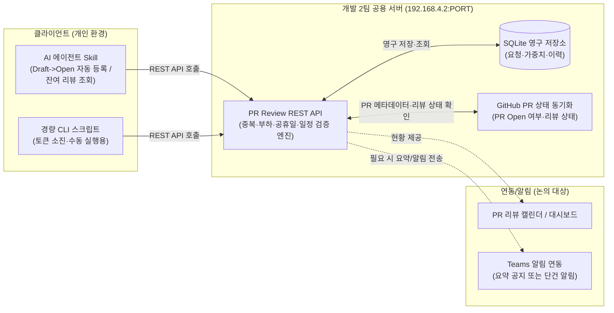
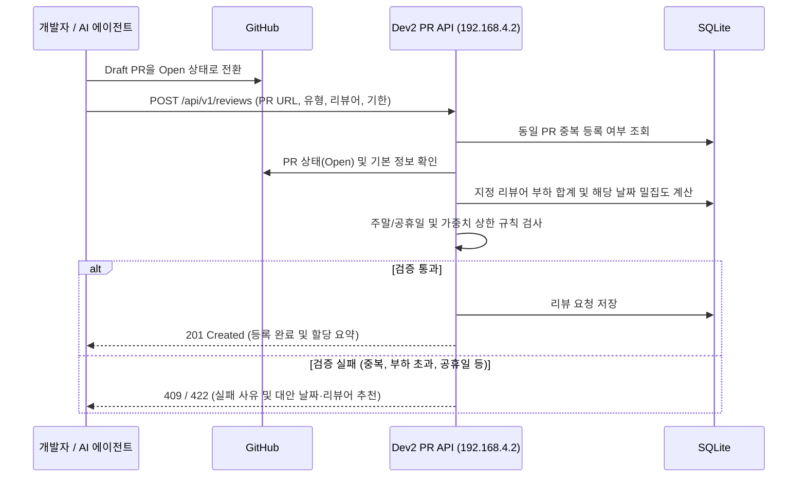

# 개발 2팀 PR 리뷰 요청·조회 자동화 제안서

- **작성일**: 2026-11-25 (Asia/Seoul)
- **대상**: CUBRID 개발 2팀
- **목적**: PR 리뷰 요청·조회 자동화 시스템(공용 서버 REST API + SQLite + AI 스킬 + 경량 CLI 스크립트) 도입 제안 및 월례회의(2026-11-26) 논의용 사전 의견 수렴
- **상태**: 제안서 초안 (팀 내 의견 수렴 중)

---

## 1. 요약 (TL;DR)

최근 AI 에이전트 활용으로 구현 및 PR 생성 사이클이 크게 빨라지면서, 기존 **Teams 댓글 기반 PR 리뷰 요청·조회 방식**이 등록자와 리뷰어 모두에게 병목이 되고 있습니다.

이를 해결하기 위해 개발 2팀 공용 개발 서버(`192.168.4.2`, 지정 포트)에 **PR 리뷰 관리 REST API + SQLite 영구 저장소**를 두고, 아래 두 가지 클라이언트를 함께 배포하는 방안을 제안합니다.

1. **AI 에이전트용 Skill 배포**: Draft PR을 Open으로 전환할 때 중복·부하·공휴일 검증을 거쳐 자동 등록하고, `cubrid-dev2-my-remaining-pr-review` 등으로 내게 남은 PR 리뷰를 최소 토큰으로 즉시 조회합니다.
2. **토큰 소진 / 비-AI 환경용 경량 CLI 스크립트 배포**: AI 토큰이 소진되었거나 터미널에서 직접 처리하고 싶은 팀원도 동일한 API로 손쉽게 리뷰를 등록하고 조회할 수 있습니다.

---

## 2. 배경 및 현재 문제점 (As-Is)

현재 개발 2팀은 Microsoft Teams 채널의 주간 공지 글에 **수동으로 댓글을 달아 PR 리뷰를 요청**하고 있습니다. AI 에이전트 도입 이전에는 감당할 수 있었으나, 최근 PR 발행 빈도가 높아지면서 다음 두 가지 문제가 두드러지고 있습니다.

### 2.1 등록 측 부담: 반복적인 수동 확인과 누락 위험

Draft PR을 Open 상태로 전환할 때마다 요청자가 다음 항목을 매번 직접 확인한 뒤 Teams 댓글을 작성해야 합니다.

- **중복 등록 여부**: 이미 해당 PR에 대한 리뷰 요청 댓글이 달려 있는지 확인
- **개인별 리뷰 부하**: 특정 팀원에게 리뷰가 과도하게 몰려 있는지 확인
- **일자별 PR 집중도**: 같은 날에 너무 많은 PR 리뷰 기한이 겹쳐 있는지 확인
- **공휴일/주말 여부**: 지정하려는 리뷰 기한이 주말이나 대한민국 공휴일(대체공휴일 포함)이 아닌지 확인

이 과정을 각자 수동으로 수행하다 보니 누락·중복이 발생하기 쉽고, 기준도 사람마다 미묘하게 달라질 수 있습니다.

### 2.2 조회 측 부담: Teams 크롤링 + GitHub 전수 조회로 인한 토큰 낭비

팀원이 자신에게 남은 PR 리뷰를 확인하려면 매번 다음 과정을 거쳐야 합니다.

- Teams 채널의 스레드·댓글을 긁어와 본인에게 할당된 PR 목록을 파싱
- 각 PR의 GitHub 상태(Open/Merged/Closed, 본인 리뷰 제출 여부, 재요청 이후 커밋/리뷰 이력)를 일일이 확인

특히 AI 에이전트에게 "나에게 남은 PR 리뷰 확인해 줘"라고 요청할 때마다 **Teams 메시지 수집·파싱과 다수의 GitHub API 조회가 반복되어 불필요한 LLM 토큰이 크게 소모**됩니다.

---

## 3. 제안 아키텍처 (To-Be)

모든 규칙 검증과 상태 관리를 **개발 2팀 공용 개발 서버(`192.168.4.2`)의 중앙 REST API**로 일원화하고, AI 에이전트와 일반 CLI 스크립트가 동일한 API를 호출하도록 구성합니다.



### 구성 요소별 역할

| 구성 요소 | 위치 | 역할 및 책임 |
| :--- | :--- | :--- |
| **PR Review REST API** | 공용 서버 (`192.168.4.2`, 지정 포트) | 요청 유효성 검사, 중복 등록 방지, 유형별 리뷰 부하·일일 밀집도·공휴일 규칙 검증 후 SQLite에 기록 |
| **SQLite 영구 저장소** | 공용 서버 로컬 디스크 | PR 리뷰 요청, 지정 리뷰어, 유형별 부하 가중치, 기한, 처리 상태 및 변경 이력을 영구 보관 |
| **AI 에이전트 Skill** | 개인 개발 환경 (배포) | Draft PR → Open 전환 시 자동 등록 수행, `cubrid-dev2-my-remaining-pr-review` 등 스킬로 잔여 리뷰 1회 조회 |
| **경량 CLI 스크립트** | 개인 개발 환경 (배포) | LLM 토큰이 떨어졌거나 AI 에이전트를 쓰지 않는 상황에서도 터미널에서 동일하게 등록·조회 수행 |

---

## 4. 핵심 검증 및 리뷰 부하 분산 규칙 (초안)

서버 API는 등록 요청을 받을 때 아래 규칙을 일관되게 검사하여, 개인이나 특정 날짜에 리뷰 부담이 과도하게 쏠리지 않도록 제어합니다.

### 4.1 요청 유효성 및 중복 검사

- **GitHub PR 검증**: 유효한 저장소/PR 번호인지, 현재 Open 상태인지(Draft 상태가 아닌지) 확인
- **중복 등록 방지**: 이미 등록된 활성 리뷰 요청이 있는 PR이면 중복 등록을 거부하고 기존 등록 정보(요청일, 리뷰어, 기한)를 반환
  - 리뷰어 추가·변경이나 기한 재요청이 필요한 경우 별도의 재요청/수정 경로로 명시적 처리

### 4.2 유형별 리뷰 부하(가중치) 모델 (팀장님 요청 로직 반영)

모든 PR을 동일하게 `1건`으로 세지 않고, **팀장님께서 요청하신 기준에 따라 리뷰 유형별 부하 가중치**를 부여하여 개인별 부하를 산정합니다.

| 리뷰 유형 | 기본 부하 (가중치) | 비고 (예시) |
| :--- | :---: | :--- |
| **일반 PR 리뷰** | `1.0` | 일반적인 기능 추가·버그 수정 PR |
| **리팩토링** | `0.5` | 구조 정리, 단순 코드 개선 등 상대적으로 부담이 적은 변경 |
| **타팀 리뷰** | `2.0` | 타팀 요청 코드/인터페이스 리뷰 등 컨텍스트 파악 비용이 큰 건 |
| **설계 리뷰** | `2.0` | 아키텍처·스펙·대규모 변경에 대한 사전/심층 설계 검토 |

> **검증 방식 (예시)**: 특정 팀원의 미완료(Pending) 리뷰 가중치 합계 또는 지정 주간/일자의 누적 부하가 임계치를 넘으면 경고를 반환하거나 등록을 제한하고, 상대적으로 여유가 있는 날짜 또는 리뷰어 후보를 함께 안내합니다.

### 4.3 일정 및 공휴일 검증

- **일일 팀 전체 PR 과밀 방지**: 동일 기한(날짜)에 몰린 PR 건수 또는 총 부하 합계가 기준치를 초과하면 경고/차단하고 여유 날짜를 제안
- **주말 및 대한민국 공휴일 차단**: 토·일요일 및 대한민국 공휴일(대체공휴일 포함)을 기한으로 지정할 수 없도록 차단하고 가장 가까운 다음 영업일을 추천

---

## 5. 예상 REST API 및 자동화 흐름 (초안)

### 5.1 주요 엔드포인트 (안)

서버 주소는 사내망 `http://192.168.4.2:<port>`를 기준으로 합니다. (구체적인 포트 번호 및 경로는 구현 시 확정)

| Method & Endpoint | 용도 | 주요 입력 / 출력 |
| :--- | :--- | :--- |
| `POST /api/v1/reviews` | 신규 PR 리뷰 등록 (검증 포함) | 입력: PR URL, 유형(`normal`/`refactor`/`cross-team`/`design`), 리뷰어, 기한, force 여부<br>출력: 등록 성공 결과 또는 위반 규칙(중복, 부하 초과, 공휴일 등) 상세 사유 + 대안 추천 |
| `GET /api/v1/reviews/pending` | 개인별 남은 PR 리뷰 조회 | 입력: `reviewer=<github_id>`<br>출력: 기한 초과·예정 목록, 유형·부하, GitHub 링크 (1회 JSON 응답으로 즉시 반환) |
| `GET /api/v1/schedule` | 일자별·팀원별 부하 현황 조회 | 입력: 기간(`from`, `to`)<br>출력: 날짜별 PR 건수, 팀원별 누적 부하 가중치, 공휴일 정보 |
| `PATCH /api/v1/reviews/{id}` | 기한 연장·리뷰어 변경·재요청 | 입력: 변경할 리뷰어·기한 및 사유 |

### 5.2 Draft PR → Open 전환 시 자동 등록 흐름



### 5.3 배포 방식: AI Skill + 경량 CLI 스크립트

1. **AI 에이전트 Skill 배포**
   - **PR Open 자동 등록 스킬**: 개발자가 Draft PR을 Ready for Review(Open)로 전환할 때 에이전트가 자동으로 PR 유형·리뷰어·희망 기한을 정리해 `POST /api/v1/reviews`를 호출합니다. 규칙 위반(예: 공휴일, 특정 리뷰어 과부하)이 반환되면 사용자에게 이유와 추천 대안을 바로 안내합니다.
   - **잔여 리뷰 조회 스킬 (`cubrid-dev2-my-remaining-pr-review` 등)**: Teams 크롤링이나 다건의 GitHub 조회 없이 `GET /api/v1/reviews/pending`을 1회 호출해 내게 남은 리뷰 목록만 깔끔하게 출력합니다.

2. **경량 CLI 스크립트 배포 (토큰 없이도 동작)**
   - 토큰을 모두 소진했거나 AI 에이전트를 쓰지 않는 팀원도 동일한 REST API를 바로 호출할 수 있도록 쉘/파이썬 기반 단일 스크립트를 함께 배포합니다.

```bash
# 예시 1: 남은 내 PR 리뷰 조회 (토큰 소모 0)
cubrid-dev2-pr pending

# 예시 2: 리뷰 등록 (사전 검증 포함)
cubrid-dev2-pr register \
  --pr https://github.com/CUBRID/cubrid/pull/1234 \
  --type normal \
  --reviewers user1,user2 \
  --due 2026-11-30
```

---

## 6. 기대 효과 (As-Is vs To-Be)

| 구분 | 현재 (As-Is) | 제안 후 (To-Be) |
| :--- | :--- | :--- |
| **리뷰 등록 및 검증** | Teams 댓글 수동 작성 + 중복·부하·공휴일 여부를 각자 기억에 의존해 확인 | REST API가 SQLite·GitHub·공휴일 데이터 기반으로 자동 검증 및 대안 제시 |
| **잔여 리뷰 조회** | Teams 채널 크롤링 + PR별 GitHub 상태 개별 확인 (느리고 토큰 소모 큼) | `GET /api/v1/reviews/pending` 단건 조회로 즉시 확인 (LLM 토큰 대폭 절감) |
| **부하 분산 및 규칙 일관성** | 유형별 난이도 차이나 특정 인원 집중을 정량적으로 파악하기 어려움 | 유형별 가중치(`1.0` / `0.5` / `2.0`)와 상한선으로 팀 전체 부하 균형 유지 |
| **데이터 영속성 및 확장성** | Teams 댓글 텍스트 파싱에 의존 (포맷 불일치, 누락 가능) | SQLite 정규화 저장으로 통계, 캘린더, 알림 연동이 용이 |
| **토큰 소진 / 비-AI 대응** | 에이전트 없이는 여러 창을 오가며 수작업 필요 | 동일 API를 쓰는 경량 CLI 스크립트로 누구나 즉시 등록·조회 가능 |

---

## 7. 단계별 도입 계획 (안)

1. **1단계 — 정책 및 규칙 합의 (내일 11/26 월례회의)**: 유형별 가중치, 개인/일일 상한치, 예외 처리 및 Teams 알림 연동 범위 확정
2. **2단계 — 공용 서버 API + SQLite 구축 (`192.168.4.2`)**: 검증 엔진, SQLite 스키마, GitHub 상태 동기화, REST API 구현 및 서비스 구동
3. **3단계 — Skill 및 경량 CLI 스크립트 배포**: 팀원 대상 스킬(`draft→open` 자동 등록, `cubrid-dev2-my-remaining-pr-review` 등)과 독립 CLI 스크립트 배포
4. **4단계 — 운영 안정화 및 연동 고도화**: 기존 PR 캘린더/대시보드 연동, Teams 요약 알림(선택) 반영 및 실사용 피드백 개선

---

## 8. 월례회의(2026-11-26) 논의 및 피드백 요청 항목

내일 월례회의에서 원활하게 방향을 확정할 수 있도록, 아래 항목에 대한 의견을 **Teams 답글로 미리 남겨주시거나 회의 중 말씀**해 주시면 감사하겠습니다.

1. **리뷰 부하 가중치 및 상한 기준**
   - 일반 PR(`1.0`), 리팩토링(`0.5`), 타팀·설계 리뷰(`2.0`) 외에 추가/조정이 필요한 유형이 있을까요?
   - **개인별 동시/주간 부하 상한**(예: 미완료 부하 합계 N 이하)과 **하루 팀 전체 PR 최대 건수/부하**는 어느 정도가 적절할까요?
2. **기존 Teams `3. PR 공지` 채널과의 관계**
   - API 등록으로 일원화한 뒤 Teams에는 자동 요약/알림만 남길지, 초기에는 기존 Teams 댓글과 병행 운영할지?
3. **검증 실패 시 강제성 (Hard Block vs Soft Warning)**
   - 부하 초과·과밀 날짜에 대해 **등록 자체를 차단(다음 여유 날짜 강제)**할지, 아니면 **경고 후 긴급 사유 입력 시 예외 허용(`--force`)**을 둘지?
4. **리뷰어 선정 방식**
   - 요청자가 리뷰어를 지정하면 서버가 부하 초과 여부만 검증할지, 아님 현재 부하가 가장 적은 리뷰어를 서버가 함께 추천해 줄지?
5. **휴가·부재 일정 반영 여부**
   - 리뷰어 부하 및 가능 날짜 계산 시 팀원 휴가/부재 정보를 함께 관리·반영할지?
6. **스킬 및 CLI 스크립트에 추가하고 싶은 기능**
   - "이런 조회 옵션이나 자동 알림이 있으면 좋겠다" 하는 현장 아이디어를 자유롭게 제안해 주세요.
