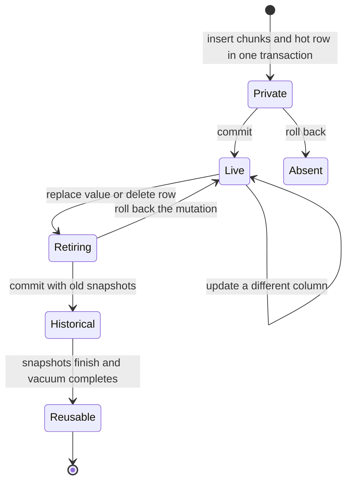

# Sidecar design for approval

The user wants large columns outside the hot row, smaller small-column scans,
and at most 5% throughput loss when the feature is unused. Recovery,
replication, HA, and database correctness remain requirements.

This proposal is for the storage designer and POC reviewer. Analysis date is
2026-11-04, Asia/Seoul. Source is CUBRID/CUBRID at
`e64a04a79a5842827a124b3f8313516d0da2594c`, branch `sidecar-codex`.
No engine implementation or performance measurement has run. Approval of this
design and the [POC plan](poc-plan.md) is required before engine work.

The recommendation is a hidden ordinary MVCC chunk relation with logical
value IDs. One row column owns each value. Changes to that column retire its
old chunks transactionally. Complete logical WAL images serve replication and
historical consumers. This replaces private physical-chain ownership with
existing tuple visibility and deletion machinery, plus an explicit atomic
mutation boundary. It does not assume that ordinary heap code is already safe
under every recovery schedule.

## The existing engine sets three constraints

[Grounding](grounding.md) supplies the source evidence and revision limits.

1. `heap_ovf_get` normally fetches a whole overflow record before attribute
   decoding. Deferring conversion alone cannot save those page reads.
2. Old row versions can come from WAL undo images. A pointer in an old image
   does not itself protect its target or prove when that target can be deleted.
3. HA reconstructs source record bytes from a target LSA. CDC and flashback
   decode historical WAL images. None can rely on a current live-heap lookup
   after vacuum has removed the value.

The handoff's premise is only partly supported. A value can share its owner's
transactional changes and snapshot context. It still needs an explicit
retirement rule. This design uses an ordinary MVCC DELETE for that rule.

The associated-table shape has a precedent in
[PostgreSQL TOAST](https://www.postgresql.org/docs/current/storage-toast.html).
That documentation describes indexed chunk rows and preservation of unchanged
external values. It does not prove this CUBRID design's visibility or recovery
semantics.

## Callers use rows and values

These are proposed signatures and call sites. No engine stubs are installed.

```text
scan_manager:
    row = heap_read_visible(cursor, snapshot)
    id = row.attribute(id_attid)
    body = row.attribute(body_attid) only if requested

locator mutation, under the existing parent row lock:
    heap_mutate_row(transaction, target, assigned_values)

locator object fetch:
    row = heap_read_visible(target, snapshot)
    copy_area.append(row.materialize_object())
```

`VisibleRow` owns a complete compact row image and a registered snapshot lease.
Its bytes cannot point into an unfixed page. It resolves only requested
external attributes. A `NormalRecord` contains ordinary complete value bytes
and is the only record type allowed into existing client decoders.

The view is scoped to one storage operation. Materialize the requested
attribute set before any reentrant user callback or mutation by the same
transaction. Do not retain lazy references across either boundary. The
baseline visibility probe shows that an own DELETE can hide a chunk under
the same snapshot, so a snapshot lease alone cannot promise stable own-write
reads. Abort, statement cancellation, and rollback invalidate the lazy view
without materialization or allocation. Copied `DB_VALUE` results own the bytes
needed after the view closes.
Small-column-only queries still request no cold values. Predicate-based
deferral across user callbacks is outside the initial optimization.

For a row whose hot remainder is itself `REC_BIGONE`, reading that compact
remainder can still fetch its whole overflow chain. The large values in the
separate chunk relation remain independent. This proposal does not promise
projection within that residual overflow chain.

`heap_mutate_row` owns chunk changes, parent changes, index maintenance, and
the statement rollback boundary. Callers pass SQL assignments. They cannot
allocate, publish, or retire storage references themselves.

## Durable data and module ownership

The private data shapes are:

```text
ValueId = relation generation + nonrecycled local sequence
Chunk key = value ID + ordinal
Chunk payload = serialized attribute bytes
ColumnStorage = Inline(bytes) | External(value ID, byte length, chunk count)
LogicalChange = operation identity + schema representation
                + complete before row + complete after row
```

Each parent class owns one hidden ordinary MVCC heap and its unique chunk
index. The hidden class must be MVCC-enabled rather than an MVCC-exempt
catalog class. Chunks do not recursively use Sidecar. Their size must include
the ordinary record and MVCC overhead.

Value IDs have no page or slot address. WAL-reserved counter ranges survive
restart. Abort leaves gaps. Counter exhaustion is an error. Relation
generation separates recreate, truncate, and rewrite domains. Backup and
restore preserve a consistent generation and counter. A replica allocates its
own IDs. Global UUIDs and cross-database uniqueness are unnecessary while
references remain private and every external consumer receives values.

Storage owns the private format and chunk operations, proposed in
`src/storage/sidecar_value.cpp`. Heap and locator own the atomic row mutation
and typed row reader. A shared historical decoder, proposed in
`src/transaction/sidecar_history.cpp`, owns logical WAL images. Catalog and TDE
code own all parent-associated files. These are module proposals, not existing
files.

Disk parsing checks tags, representation, checked lengths, ordinal continuity,
and exact chunk count. Missing or malformed visible chunks are errors. They
never become NULL or partial SQL values.

## One owner defines retirement

A value belongs to exactly one row column. Consecutive versions of that column
can reuse its ID while the value is unchanged. Cross-row sharing and
deduplication are excluded from the proposed design.

| Mutation | Chunk action in the same user transaction and statement scope |
| --- | --- |
| New external value | Insert all chunks and publish the hot reference. |
| Update another column | Preserve the reference and its chunks. |
| Replace the value | Insert a fresh ID, MVCC-delete old chunks, and publish the replacement. |
| Change to inline or NULL | MVCC-delete old chunks and publish the inline value. |
| Delete the row | MVCC-delete every currently owned value and the row. |
| Roll back | Undo the matching hot, chunk, index, and history changes together. |

The invariant is that every snapshot-visible hot reference has all its chunks
visible under the same effective MVCC context. An older snapshot selects the
old parent image and sees old chunk rows because their DELETE is too new for
that snapshot. Vacuum retires those rows after the ordinary visibility
horizon. No cleanup follows raw parent undo images.

The shared context includes own writes, repeated updates, nested trigger
statements, savepoints, rollback-to-savepoint, isolation levels, and standalone
operation. The POC must prove the actual CUBRID identity mapping. Merely using
one transaction ID is insufficient evidence.

Materialize values required for index keys and history before deleting old
chunks. Otherwise the transaction's own DELETE can hide a value that the
mutation still needs. User changes cannot be independently committed system
operations. On any error, roll back the complete statement scope.



This is a proposed lifecycle, not an executed engine statechart.

## Physical undo is a prerequisite

Ordinary MVCC does not remove physical allocation obligations. Even an
immutable small chunk can relocate when DELETE adds MVCC metadata and its page
has insufficient space. Source evidence is
`src/storage/heap_file.c:23317` through `23417` at the stated revision.

The [legacy formal result](verification.md) finds a conditional conflict in ordinary
relocation vacuum. It does not establish allocator reachability or reproduce
an engine failure. Before Sidecar relies on this path, force the complete
schedule against the real allocator and restart logic. A demonstrated failure
requires a separately reviewed shared-heap fix. The current task changes no
engine code.

Any fix must protect the undo destination's slot, bytes, and page lifetime.
Retaining ordered page latches until the sysop end is appended is one
candidate. No additional blocking latch acquisition is permitted while that
set is held. A durable reservation is another candidate if latches cannot obey
the engine's ordering rules. The model checks only slots and does not choose
between these repairs.

An extra forced log flush while holding page latches is not a design
requirement. If the sysop end precedes a competing insert in the ordered WAL,
that insert's commit flush covers the sysop end. The unsafe model schedule
lets the competing commit occur before the sysop end append.

Sidecar copies the parent record under its page latch, then releases that
latch before child heap or index access. The logical parent write lock remains
held for mutation. Retries reread the header and context. They restart the
whole statement with fresh IDs rather than replay half a mutation.

## Historical values are independent of live chunks

Physical WAL recovers local hot rows, chunk tuples, and indexes. Every Sidecar
row mutation also emits complete logical before and after values as
applicable, including unchanged large values. This deliberately increases WAL
and materialization cost for enabled tables.

Images use bounded fragments and a final descriptor with lengths, checksums,
schema representation, and operation identity. Publication and commit require
a complete image. Failure to append it fails the write. A manifest must name
every fragment and its earliest required LSA.
Pin dependencies from the first fragment's append until durable dependency
metadata takes over. Exercise restart and every archive-deletion path during
construction as well as after publication.

Transaction commit alone does not validate a statement that was rolled back
to a savepoint. History publication must use the existing rollback-aware
replication bookkeeping or explicit operation cancellation. The POC must
implement and exercise one mechanism. A committed but cancelled operation
cannot produce an HA or CDC event.

HA metadata points to the logical descriptor. The applier reads retained WAL
without contacting the source heap, decodes complete values, and applies them
through replica-local row mutation. Internal chunk writes have physical WAL
but no independent user-table replication event. Apply position and local
commit must be atomic or have a proven equivalent deduplication protocol.
Stage every surviving operation of the source transaction, then publish the
entire local transaction with its durable apply progress. A valid operation
prefix alone must not become visible. Crash discards unpublished staging.

CDC, flashback, and optional applier SQL logging use the same decoder. Archive
retention protects the full transaction dependency interval, including the
cancellation and commit records, until all registered consumers pass it.
Retaining image fragments while deleting their cancellation metadata can
reintroduce a rolled-back operation. Logical DML LSA alone cannot be an
archive-deletion watermark when a required fragment is earlier. Expired history produces the established
unavailable-history behavior, never a fabricated value.

## Other supported paths enter the same contracts

Index creation and maintenance receive logical values, including old keys,
prefixes, function inputs, and composite or unique keys. Full-value evaluation
comes first. Prefix-only I/O is a later optimization.

Both loader paths enter the mutation boundary. The initial enabled loader can
use per-row force while ordinary tables retain their current multi-insert
path. Unload and client object fetch receive complete ordinary records.
Compaction and schema rewrite create and retire IDs through the same mutation
boundary. Drop and truncate enlist hidden files transactionally. Failed DDL
must undo their association and allocation.

Hidden heap and B-tree files inherit the parent TDE algorithm before data
allocation. Encryption changes include all associated files. Page-less WAL
images need an explicit encryption context because existing WAL encryption
uses page metadata and recovery-index classification. Exercise encrypted
restart, archives, backup, restore, temporary materialization, and index build.
A marker scan alone is not cryptographic proof.

The proposed POC uses new disposable databases with an incompatible existing
disk-compatibility value and versioned record and WAL formats. The exact
baseline binary must refuse writable open before any recovery or page
mutation. Older log readers need their own compatibility rejection. Existing
production-database upgrade and mixed-version HA are separate delivery work.
The POC must not imply support for either.

## Keep the unused path direct

For a class without Sidecar policy, select the current reader and writer at
class or scan setup. Keep its record bytes and WAL unchanged. It creates no
hidden relation, history image, resolver object, or per-attribute lookup.
Whether the cached dispatch costs less than the 5% budget remains unmeasured.
The plan separately measures never-enabled tables and enabled tables whose
values remain inline.

## Alternatives and synthesis

The two independent candidates both prefer transactional logical chunks. The
Astra candidate is the base for local IDs, materialization before retirement,
and explicit rollback-filtered history. The Terra candidate contributes the
comparison with ordinary whole-row overflow rather than a new extent queue.
Neither candidate supplies engine proof.

| Shape | Benefit | Reason it is not the selected base |
| --- | --- | --- |
| A. Logical MVCC chunks | Existing tuple visibility and retirement, dense hot records, keyed values. | Selected. Adds child indexes and complete-history WAL. |
| B. Shared-version hot and cold records | One grouped cold fetch and compact hot data. | Shared MVCC identity alone does not define final ownership after unchanged updates. Copying the group increases writes. |
| C. Projection-aware whole-row overflow | Whole-row ownership and full undo bytes avoid child tuple lifetime. A typed range reader can fetch a hot prefix. | Linked overflow still traverses preceding pages. It does not improve density for values that fit inline. Arbitrary projected columns and old WAL versions need a new fetch contract. |

Candidate selection scored source-contract coverage on six axes, each out of
two. These are review judgments, not measured correctness scores.

| Candidate | Version lifetime | Reclamation | Portable history | Projection | Unused path | Bounded POC | Total |
| --- | --- | --- | --- | --- | --- | --- | --- |
| Astra A | 2 | 2 | 2 | 2 | 2 | 1 | 11 |
| Terra A | 2 | 1 | 2 | 2 | 2 | 1 | 10 |

Terra's required force flush under page latches and global UUID identities
were rejected. Neither is necessary for the stated private-ID and WAL-order
contract. Both plans lacked executable tools for all acceptance predicates;
the final plan specifies those as work to build, not commands already run.
No cross-vendor arena judge was available in the configured model pool. The
review package uses independent Astra and Terra adversaries and records that
limitation.

## Approval scope

The proposed defaults are per-column opt-in, VARCHAR and VARBIT first, a
provisional 2 KiB threshold, new databases, full client materialization, and
complete history support. Threshold tuning and enabled-feature write cost
remain empirical questions. The POC exercises HA, CDC, flashback, TDE, and the
utilities rather than treating them as deferred correctness exceptions.

Approval authorizes the phased [POC plan](poc-plan.md). It does not authorize
deployment, publication, production migration, or a claim that performance and
regressions have passed.

## Design-level protocol checks

The [expanded formal report](formal-verification.md) checks the proposed
lifetime, history, undo-resource, and integration protocols. The shared
history predicates are imported into the integration model. These finite
searches do not establish action refinement of the detailed lifetime and
undo models or conformance of future engine code. In particular, completed
crash abort and completed savepoint cancellation must account for every
represented inserted chunk, rather than merely label recovery complete.
The POC must re-establish these contracts against actual storage and recovery.
