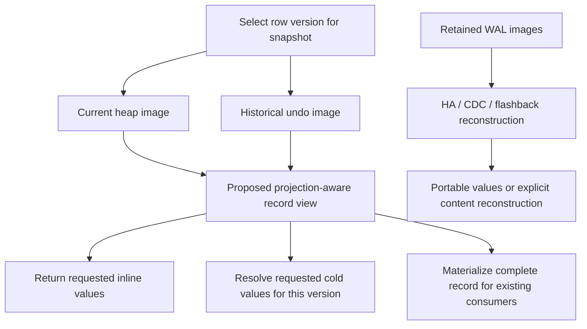

# Sidecar engine grounding

Analysis date is 2026-11-04, Asia/Seoul. The intended reader is the storage designer and POC reviewer.

## Overview

CUBRID can select a row version, recover physical changes, and reclaim whole-row overflow storage. Those mechanisms provide useful building blocks for Sidecar; they do not already provide ownership of arbitrary large-column objects. The design must distinguish **which row version is visible**, **which external value that version names**, and **when the value can be reclaimed**. Reusing the first decision is possible. Deriving the other two from ordinary row deletion alone is not established.

Two boundaries determine whether the design achieves its purpose. First, scans currently fetch a complete record before decoding requested attributes; deferred conversion alone cannot reduce overflow-page reads. Second, HA, client object fetch, CDC and flashback consume record images outside the ordinary live-row fetch path. A storage reference that works during a server scan is insufficient for those consumers. These are source-grounded constraints, not a selected implementation.

Evidence is the checkout at `e64a04a79a5842827a124b3f8313516d0da2594c` in CUBRID/CUBRID. Source citations below are relative to `/home/vimkim/gh/cb/sidecar-codex`. This baseline contains no OOS implementation. Historical OOS findings concern other revisions. No engine reproduction, HA run, benchmark, or proof of Sidecar correctness was performed. Design and POC approval remain required by `HANDOFF.md`.

## Key concepts

| Concept | What matters for Sidecar |
|---|---|
| `RECDES` | Descriptor for record bytes consumed by heap, attribute readers, locator and log readers. Existing readers expect usable record contents, not an implicitly incomplete image. |
| `HEAP_CACHE_ATTRINFO` | Selected attributes, representation metadata and decoded/lazy values. Its existing laziness operates after record fetch. |
| Row MVCC header | Determines visibility and links to an earlier version through a previous-version LSA. Earlier versions can live in WAL undo images. |
| `REC_BIGONE` | Whole-row overflow. Its exclusive page chain provides an ownership precedent, not per-column lifecycle machinery. |
| System operation | Groups physical actions with recovery semantics. It does not independently prove that released slots, bytes or pages cannot be reused before an abort restores them. |
| `LC_COPYAREA` | Carries record images between server and client, and into replica force paths. |
| Replication target LSA | Identifies WAL data from which the applier reconstructs an insert/update image; replication metadata is not a self-contained logical row. |

## How it works

### 1. Visibility selects a version before a value can be resolved

`heap_get_visible_version_internal` reads the MVCC header and, when the current version is too new, calls `heap_get_visible_version_from_log`. The latter follows previous-version LSAs, reconstructs each undo image, and tests its header against the reader's snapshot. A Sidecar reference must consequently resolve the value belonging to that selected version, whether the reference came from a heap page or WAL. Looking up only the latest value for the row would break an older snapshot. (`src/storage/heap_file.c:26979`, `:27036`, `:26724`, `:26748`.)

The write path also matters. `heap_attrinfo_transform_to_disk_internal` fills uninitialized attributes from the old record before sizing and serializing the new record. An UPDATE of a small column therefore currently depends on reconstructing the logical row. Preserving an unchanged external value without reading its bytes needs an explicit representation/update contract; it does not follow from altering SELECT. (`src/storage/heap_file.c:13628`, `:13646`, `:13659`, `:13694`.)

### 2. Ordinary row lifecycle can supply visibility, but ownership needs a rule

Vacuum rereads the current header while holding the required pages and calls `mvcc_satisfies_vacuum`. The result can retain the row, remove obsolete MVCC metadata and its previous-version pointer, or remove the row. The threshold protects older snapshots. Transaction commit alone is not the reclamation boundary. (`src/query/vacuum.c:1725`, `:1761`; `src/transaction/mvcc.c:321`.)

For whole-row overflow, `vacuum_heap_record` starts a system operation, removes the home slot, logs undo, unfixes the first overflow page, deletes the chain, and commits; deletion failure aborts the operation. Overflow pages are exclusive to their value. This works as an ownership model because the relationship is already defined and the whole-row overflow machinery participates in it. (`src/query/vacuum.c:2374`, `:2451`, `:2463`; `src/storage/overflow_file.c:297`, `:303`, `:657`.)

**Design inference:** an external immutable value could share the parent row version's visibility instead of owning a second independent MVCC identity, provided every surviving version's reference remains valid. That condition includes old undo images, statement and transaction rollback, and recovery. If successive versions reuse unchanged large values, deciding that one version is dead does not prove the value is dead: another version may still reference it. The design must name the durable ownership/reclamation event and show how rollback reverses it. A raw update undo record, or a pointer disappearing from the current row, is not by itself that proof.

A separate ordinary heap for large values is another possible reuse boundary: it supplies the child records' own MVCC/WAL machinery. It still requires atomic parent/child updates, snapshot-consistent resolution, retention and deletion rules, and measured lookup cost. Neither arrangement is automatically safe merely because both use ordinary heap code. Avoiding shared values can simplify ownership, at a storage and write-amplification cost that must be evaluated.

Physical reuse is a separate obligation. `spage_vacuum_slot` releases bytes and marks the slot according to its reuse argument. Ordinary deletion can save space for recovery, but `spage_save_space` explicitly exempts vacuum workers. Vacuum undo restores the logged slot through `heap_rv_redo_insert`; recovery insertion requires that slot to be empty and sufficient space to remain. Slot identity, free bytes, and page allocation lifetime therefore need separate protection whenever restoration remains possible. (`src/storage/slotted_page.c:4808`, `:502`, `:2117`, `:1933`; `src/query/vacuum.c:7563`; `src/storage/heap_file.c:17286`.)

The relocation branch unfixes its forward page before system-operation commit and advertises it as a best-space candidate. This is a concrete boundary to investigate, not an established baseline defect. The explorer's abstract replay assumes a competing committed insert can occur in that window; neither the replay nor the source anchors establish that complete engine execution. (`src/query/vacuum.c:2431`, `:2439`, `:2442`.)

### 3. Page savings require a fetch contract, not only lazy decoding

Heap scans call `heap_next`, then evaluate predicates and read remaining requested attributes. For a current `REC_BIGONE`, heap fetch calls `heap_get_bigone_content` and `heap_ovf_get`; apart from a change-number header optimization, the latter calls whole-record `overflow_get`. The cold bytes have already been fetched when attribute decoding decides not to use them. (`src/query/scan_manager.c:5446`, `:5491`, `:5691`; `src/storage/heap_file.c:7512`, `:20640`, `:6321`, `:6340`.)

The existing lazy predicate path postpones `DB_VALUE` conversion and may disable itself after calibration. It is not a page-skipping implementation. (`src/storage/heap_file.c:11825`, `:12236`.)

Two structurally distinct directions remain open. A hot record plus independently addressable cold values can keep small-column scans inside dense heap pages. Prefix-aware whole-row overflow can read less of an existing chain when the required header, offsets and selected values all lie in the fetched region. `overflow_get_nbytes` supports ranges, but seeking walks preceding linked pages; range support is not random page access. Prefix reading also does not improve density for records that currently fit inline. (`src/storage/overflow_file.c:751`, `:830`, `:847`, `:929`.)

A possible interface split is a typed projection-aware record view for scans, with full materialization for existing whole-record consumers. This is a proposal. A truncated `RECDES` passed as complete would violate the current decoding contract. The chosen interface must handle old WAL versions, representation changes, defaults, buffer lifetime, predicates, and cold indexed values. Index updates need old and new logical values; function indexes and prefix truncation do not remove that requirement. (`src/storage/heap_file.c:11589`, `:11597`, `:14725`, `:14805`; `src/transaction/locator_sr.c:8539`, `:8544`.)

The lower path deliberately does not depend on the live projection resolver: its availability and retention requirements differ.

### 4. Full-row transport and historical reconstruction are explicit boundaries

Client object fetch fills copy-area record buffers through heap/locator calls, and `locator_cache_object_instance` invokes `tf_disk_to_mem` on the received image. Existing clients cannot interpret newly introduced source-private storage references as normal string/value bytes. Either expand records before this boundary or explicitly extend the protocol and decoders. Unload and compact also consume copy areas, so SQL projection is not the complete read surface. (`src/transaction/locator_sr.c:2910`, `:2916`, `:2334`; `src/transaction/locator_cl.c:3433`; `src/executables/unload_object.c:1538`; `src/executables/compactdb.c:429`.)

HA is hybrid: replication metadata packs class name and primary key; the applier takes its target LSA, reconstructs the insert/update record from WAL, validates its recovery index, and queues the image. Delete uses the key without a record. On the replica, update/delete locate the target by primary key, adjust local representation/change information, and force the incoming record. Source-local physical Sidecar addresses cannot simply become replica-local addresses. (`src/transaction/replication.c:422`; `src/transaction/log_applier.c:3192`, `:3200`, `:5196`, `:5207`, `:5221`, `:5097`; `src/transaction/locator_sr.c:6940`, `:6977`, `:7112`, `:7157`.)

A design must therefore provide portable complete values at this boundary or specify a content-transfer/reconstruction protocol that creates local references atomically and supports retry/restart. A new recovery record may also need applier support before it reaches replica force. Optional SQL logging reads record fields itself, adding a decoder outside the ordinary fetch path. (`src/transaction/log_applier.c:3704`, `:3857`, `:5110`.)

CDC reconstructs historical undo/redo images and decodes their attributes. Flashback uses the same machinery. **Inference:** a live Sidecar resolver is insufficient unless values remain available for the entire historical consumer window, which row MVCC vacuum retention alone does not establish. Self-contained logical content in WAL, or a separately proved log reconstruction and retention design, must close this gap. Physical crash redo/undo correctness is not evidence of this historical availability. (`src/transaction/log_manager.c:11726`, `:13242`, `:13345`, `:13406`; `src/transaction/flashback.c:1112`, `:1127`, `:1189`, `:1215`.)

## Where things live

| Boundary | Starting points |
|---|---|
| Record representation and projection | `heap_file.c`: attribute read/transform, visible-version retrieval; `scan_manager.c`: heap/index scans |
| Value allocation and page access | `overflow_file.c`, `slotted_page.c`, `file_manager.c`, `page_buffer.c` |
| Version removal and recovery | `vacuum.c`, `mvcc.c`, `log_recovery.c`, `log_manager.c` |
| Client and HA transport | `locator_sr.c`, `locator_cl.c`, `replication.c`, `log_applier.c` |
| Historical consumers | `log_manager.c`: CDC; `flashback.c` |
| Bulk/maintenance entry points | `load_server_loader.cpp`, `unload_object.c`, `compactdb.c` |

## Gotchas and design checks

- TDE follows file/page flags and WAL recovery-index classification. A new file or log image is not encrypted merely because it belongs logically to an encrypted table. Trace encryption alteration, backup and temporary paths for the selected design. (`src/storage/file_manager.c:5491`; `src/storage/page_buffer.c:10979`; `src/transaction/log_manager.c:2248`.)
- Bulk load uses per-record force under HA and multi-insert otherwise. Both must participate in external-value creation and rollback. (`src/loaddb/load_server_loader.cpp:763`, `:767`, `:776`, `:805`.)
- TRACE `fetch`/`ioread` are operation/physical-read counters, not distinct data-page counts. Warm-cache zero reads cannot establish skipped pages. Acceptance needs attributable heap/overflow/Sidecar accesses, with index and background traffic distinguished. (`src/query/scan_manager.c:5151`, `:5245`, `:8910`.)
- The unused-feature budget remains unmeasured. Test release-build INSERT/SELECT/UPDATE/DELETE throughput against the same base with interleaved runs, equal results/plans, and spread below the proposed 5% effect. Existing scan/UPDATE harnesses do not cover the whole budget.
- Before selecting a candidate, require explicit answers for ownership across rollback, reclamation after snapshots, recovery before physical reuse, portable HA content, archived history, and the projection/full-record interface. The source probes and abstract replay validate investigative assumptions only; real-engine crash, long-snapshot/vacuum, replica and regression runs belong to the approved POC.
