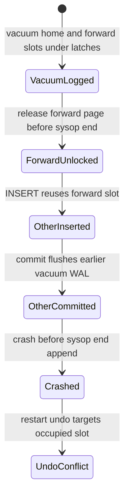

# Relocation vacuum verification result

The question is whether physical undo can find a slot already occupied by a
competing committed INSERT. The intended reader is the Sidecar designer and
the engineer changing heap vacuum. Analysis date is 2026-11-04, Asia/Seoul.
The code is CUBRID/CUBRID at
`e64a04a79a5842827a124b3f8313516d0da2594c`.

The bounded model finds a forward-slot conflict under an assumed allocation
schedule. The home-slot model passes. This is not a reproduced engine bug.
The check does not prove Sidecar, which has no implementation yet.

## Run the project skill

The project skill is `.agents/skills/verify-heap-vacuum-reuse/SKILL.md` in the
CUBRID checkout. From that checkout root run:

```sh
python3 .agents/skills/verify-heap-vacuum-reuse/scripts/check.py
python3 .agents/skills/verify-heap-vacuum-reuse/scripts/check.py --self-test
```

The checker uses TLA+ tools 1.7.4 with a pinned SHA-256, Python 3, Java, and
`cc`. TLC is appropriate because the question concerns event ordering, not
arithmetic over all C inputs. Source inspection derives release positions and
rejects other unsupported covered-code changes. A separate replay compiles
the actual extracted `vacuum_heap_record` with mocked dependencies.

The coordinator ran both commands. Baseline exit was 1, because the forward
property fails in the model. Self-test exit was 0. The observed matrix is:

| Real source shape in an isolated mirror | Home model | Forward model | Replay |
| --- | --- | --- | --- |
| Pinned baseline | PASS | MODEL FINDING | Forward release admits the injected competitor. |
| Home `DONT_FREE` changed to `FREE` | MODEL FINDING | MODEL FINDING | Both release points admit injected competitors. |
| Home edit restored | PASS | MODEL FINDING | Original result returns. |
| Forward release moved after sysop end append | PASS | PASS | Neither release permits a pre-commit injection. |
| Early forward release forced with home held | PASS | MODEL FINDING | The independent forward control remains sensitive after a corrected input. |

The final self-test derives the input's expected result from its release
positions. It repeats the unsafe controls and restoration even when the
input already has a corrected forward release. It does not require a known
finding to remain in current source.

The existing forward finding cannot hide a new home finding because the
properties run independently. The scratch edits are actual C source edits in
a temporary mirror. The source checkout remains unchanged.

The first coordinator baseline explored 35 distinct home states without a
violation and found a forward violation at depth 11. State counts describe
this small model only. They are not a correctness or performance metric.
The checker prints a new artifact directory on every run with source replay,
configurations, and TLC output.

An independent review verified malformed sync metadata reports `OUT OF SYNC`
with exit 2 rather than being confused with a finding. The actual forward
vacuum/log reordering in a scratch mirror also reports `OUT OF SYNC`. Missing
or incorrect tools remain tool errors. No unsupported change is a pass.

## Read the counterexample in engine terms

The property says that crash undo must preserve another transaction's
committed row and find its original target slot empty. The harm is a failed
recovery precondition or overwrite of that committed row.

The `/statechart` report gives the shortest forward violation in ten
transitions. The first five vacuum the home slot, retain its latch, log the
home change, vacuum the forward slot, and log that change. The remaining
transitions release the forward page, insert a competing row, commit and
flush that transaction, crash, and perform restart undo.

The chart condenses the first five transitions. It preserves every later step
on the reported failure path.



The model assumes an INSERT can select this page and slot with enough space.
The mock injects it at the actual C release callback. It does not run heap
selection, the real slotted page, WAL persistence, or restart recovery.
`heap_add_bestpage` advertises the page and `spage_find_free_slot` can select a
reusable slot, but those source facts do not establish the full execution.

If the sysop end is appended before the competing insert log, its later
commit flush also covers that end record. The safe-order model passes under
that rule. It requires no forced sysop log flush while page latches are held.

## Source correspondence and limits

| Model event | Source at the pinned revision |
| --- | --- |
| Remove home slot and keep latch | `src/query/vacuum.c:2397`, `:2409`. |
| Log home, remove and log forward | `src/query/vacuum.c:2423`, `:2428`, `:2436`. |
| Advertise and release forward page | `src/query/vacuum.c:2431`, `:2439`. |
| End sysop | `src/query/vacuum.c:2442`; `src/transaction/log_manager.c:3902`. |
| Reusable slot | `src/storage/slotted_page.c:1285`, `:4827`. |
| Restore original slot | `src/query/vacuum.c:7563`, `src/storage/heap_file.c:17286`, `src/storage/slotted_page.c:1933`. |

Bounds are one relocation sysop, distinct home and forward pages, a reusable
home slot, one competing INSERT, and one crash/restart. The invariant focuses
on a committed competitor. Losing-insert undo ordering, byte reservations,
page deallocation, multiple workers, other record types, and HA are excluded.
Covered-file guards are conservative and do not discover every transitive
dependency. A pass covers these assumptions and bounds only.

The replay's page storage is static so `longjmp` does not read changed
non-volatile automatic page objects. Dependencies and crash behavior remain
mocked. That avoids an observation bug without making the replay an engine
test.

The generated skill records the sync revision and covered code. Read every
result through `/statechart`. Use `/maintain-formal-verification-skill` when
the implementation changes outside a rechecked run. Advance the sync record
only after confirming source correspondence and repeating the unsafe
mutation, restoration, and safe-order checks.
