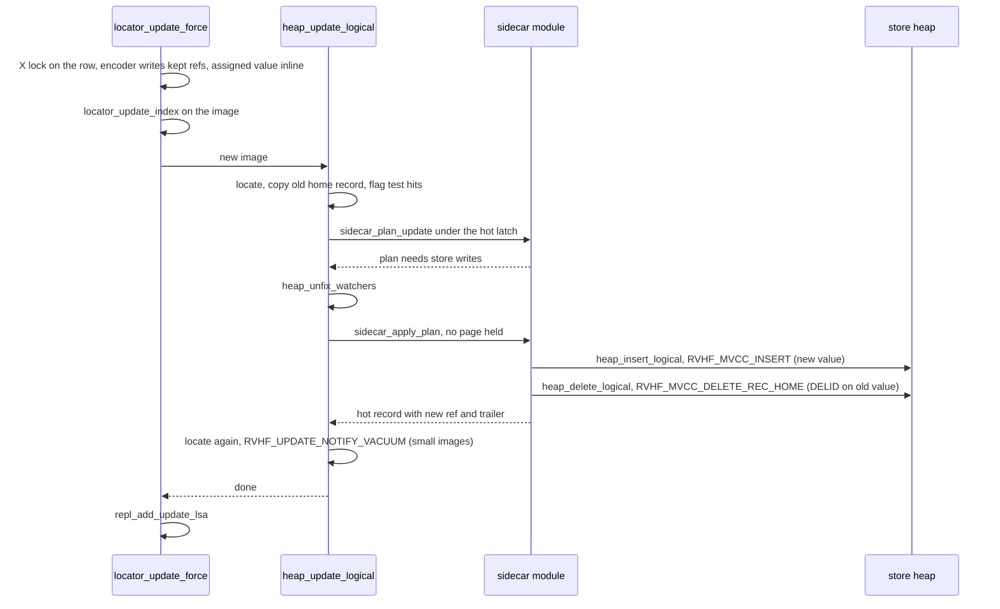

# Sidecar design and POC plan

The goal is to replace CUBRID OOS with a design built from first principles that stores large column values outside the heap record, and then to prove it with a POC. The hard requirements are no more than about 5% slowdown on tables that never use the feature, fewer page reads for scans that read only small columns, and working recovery, MVCC, vacuum, HA replication, TDE and regression suites. This document describes the engine at CUBRID `develop` `e64a04a79` (worktree `/home/vimkim/gh/cb/sidecar`, branch `sidecar`, no associated PR). It is dated 2026-11-04. The user approved it at Gate 1 on 2026-11-04 (section 18). Engine code is on branch `sidecar` (local), with P0 and P1 accepted at `407ecead8`; sections that describe built behavior carry the slice decisions that changed them.

Revised 2026-11-04 after interrogation (`interrogate.md`).
Revised 2026-11-04 after TLA+ design verification (`model/lifecycle`, `model/recovery`).

Conventions. Every `path:line` is under `src/` at `e64a04a79` unless the path says otherwise. I re-read every line this design depends on where the synthesis changes the base candidate, and the revision re-read every code fact it added. Other citations come from the reconciled grounding (`/home/vimkim/gh/my-cubrid-docs/sidecar/grounding.md`). Every number carries one label. "Derived" means computed from code constants and stated assumptions. "Measured" means taken from a run whose artifact is named. "Guess" means an estimate.

## 1. Summary

Sidecar keeps each row's small columns in its ordinary heap record, the **hot record**, and moves each large variable-length value into its own **store record** in a per-heap **store** file. The store is a stock `FILE_HEAP`, and a store record is an ordinary MVCC heap record. Vacuum leaves a removed store slot `REC_MARKDELETED`, so a store OID names one value for the life of the store. The hot record keeps a 16-byte **ref** in the value's own variable slot, a short **trailer** at the record end that names the slots that hold refs, and MVCC flag bit `0x08`. Inserts, deletes, undo, redo and vacuum of store records run the existing heap code. Sidecar adds one recovery index, `RVHF_SIDECAR_LINK`, for the 12 link bytes of a heap header, and no page type, no file type and no vacuum logic. Its write hooks sit inside `heap_insert_logical`, `heap_update_logical` and `heap_delete_logical`, so every producer of rows reaches them. Its read hooks sit at the exits of the heap fetch functions. A caller that ignores Sidecar still gets correct values, because every fetch returns an inline record unless the caller opted in and is protected.

**Lifecycle rule.** A store value is inserted by the row's own transaction before the hot record that names it, is stamped with DELID by the transaction that writes the first hot version that stops naming it, and is removed only by stock vacuum from its own header.

**Acceptance numbers.**

| Number | Prediction | Label |
|---|---|---|
| A1, cost when unused (all rows inline) | At most about 0.5% more instructions per scanned row and under 0.1% per written row. Gate at 2% median instructions and 5% median wall time. | Derived from the check count in section 8. Layout effects are a guess until P0. |
| A2, narrow `SUM(id)` scan, 100,000 rows | 10.7x / 46x / 418x / 836x fewer page fetches than `develop` at 1 KB (`STORAGE EXTERNAL`) / 4 KB / 16 KB / 64 KB. Sidecar reads the same 717-page hot heap at every size. | Derived from measured page counts (section 9). A2 passes on ratios to `develop` measured in the same run. |
| A2, OS bytes with the file cache evicted | At least 2.0x / 8.8x / 53x / 132x fewer bytes read, worst case under 4 MiB readahead | Derived from hypothesis H1 (section 9) |

## 2. Problem

The shape is not obvious because every simple shape breaks one constraint of this engine. Grounding fixes these constraints.

- **Readers get whole records.** `heap_next` and `heap_get_visible_version` return a full `RECDES` before any column is chosen (`query/scan_manager.c:5441-5447`). The only way to read fewer pages is to make the record smaller, so a large value must leave the slot and live at a second address.
- **Raw record bytes leave the server.** Copy areas carry records unchanged (`transaction/locator_sr.c:2174`), and clients decode them with `tf_disk_to_mem` (`object/transform_cl.c:1312`). `unloaddb`, `loaddb -S` and SA `compactdb` have their own decoders. Any reference format that leaves the server must be decoded in many places.
- **Writers reach the heap from many places.** `qexec` DML, client flushes through `xlocator_force`, server `loaddb`, the HA applier, SA `compactdb` (`executables/compactdb.c:701-703`) and partition moves (`transaction/locator_sr.c:5932-5933`) all end in `heap_insert_logical`, `heap_update_logical` or `heap_delete_logical`. They share no locator function, so a hook above the heap misses some of them.
- **The applier ships raw redo images.** `la_get_recdes` rebuilds a whole record from the master's heap and overflow redo (`transaction/log_applier.c:4673`). The replica stamps its own repid and finds its own OID by primary key (`transaction/locator_sr.c:6932`, `:6947`). A master address means nothing on a replica.
- **Old versions live in the log.** A snapshot that finds the current version too new follows `prev_version_lsa` into undo records (`storage/heap_file.c:26693`). Any reference inside an old image must stay resolvable until vacuum clears that row's history, or the reader must notice that it is gone.
- **The heap's slot rules are what keep undo safe.** Heap pages are `ANCHORED_DONT_REUSE_SLOTS` (`storage/heap_file.c:1083-1087`). A freed slot becomes reusable only through vacuum of a reuse heap or of a forward slot, insert undo, `compactdb`'s address reclaim or a postponed `RVHF_MARK_REUSABLE_SLOT`. Vacuum's REL and BIG removal is one system operation with same-slot undo, which is safe only while its pages stay latched. The OOS defects came from a value lifecycle outside these rules.
- **TDE encrypts only a closed list.** A log record is encrypted only if its rcvindex is in `LOG_MAY_CONTAIN_USER_DATA` (`storage/tde.h:107-137`) and its page carries the TDE flag.
- **The page batch decodes bytes directly.** `heap_page_collect_visible` (`storage/heap_file.c:8297`), `heap_attrinfo_raw_locator` (`:11124`) and the cell decoders of `query/expr_batch.c` (`:734`, `:757`, `:1370`, `:3556`) read variable values straight from record bytes. The batch is the fastest scan path, so a per-row check there costs the most.
- **The budget is tight.** OOS cost ordinary scans 7 to 9% before fixes, mostly from code layout and one stack frame, not from instruction count (grounding, "What OOS learned").

The obvious shapes each fail one of these. A TOAST-style keyed store needs a B-tree per table and makes 1 KB wide scans about 25 times worse (derived, section 14). A column-aware `REC_BIGONE` gains nothing below 16 KB. Cold pages inside the heap file are read by every component that enumerates a heap file's pages (G9, section 11). Giving the value its own lifecycle protocol, as OOS did, produced the OOS defect classes. The design problem is to give the value its own address without giving it its own lifecycle.

## 3. Premise verdict

**Hypothesis.** Most OOS machinery follows from giving each large value its own address and its own lifecycle. Large-column storage can share the row's lifecycle instead.

**Test.** Can every lifecycle event of a stored value be an event of a protocol the heap already runs, done by the same transaction that changes the row? I checked create, version, unlink, undo, redo, vacuum, drop and TDE against the code.

**Verdict.** Supported, with three parts that cannot share the row's lifecycle and one condition on the heap itself.

The evidence for sharing is this.

- `REC_BIGONE` already stores a large value at its own address with the row's lifecycle. The chain is written first, and the home slot then holds only its OID (`storage/heap_file.c:21865`). An MVCC delete stamps DELID in the chain header. Vacuum removes the chain in one system operation that keeps the home page latched from `log_sysop_start` (`query/vacuum.c:2387`) to `log_sysop_commit` (`:2474`). BIGONE has none of the OOS lifecycle defects.
- An MVCC heap record already has every lifecycle event a stored value needs. A store record is born by `RVHF_MVCC_INSERT`, dies by an MVCC delete that adds DELID, is undone by the existing undo functions, and is removed by vacuum when `mvcc_satisfies_vacuum` (`transaction/mvcc.c:321`) finds its own DELID older than the threshold. Vacuum finds store work through the same MVCC-operation log records (`transaction/mvcc.h:249-255`).
- The OOS defect classes map to rules that this test removes. CBRD-27858 and CBRD-27781 need space reused before the freeing action is final. CBRD-27237 needs a delete decided from uncommitted information. CBRD-26950 needs an address assumed to name one value (grounding, OOS table, TLA+ U1 summary). Store records never take any of these three shortcuts.

Three parts cannot share the row's lifecycle.

| Part | Why it cannot share the row's lifecycle | What Sidecar does instead |
|---|---|---|
| The address | The IO requirement forbids keeping the bytes in the row's page. | A 16-byte ref to a store OID that is never given to another value. Its use is argued per reader class in section 5.6. |
| One-to-one version ownership | After a small-column UPDATE, several hot versions name the same store record. The record must live as long as the union of its referrers. | Nothing tracks referrers. The transaction that writes the first version that stops naming the record stamps its DELID, and MVCC visibility does the rest. |
| The replica and log consumers | A replica cannot use a master address. CDC and flashback read the log after vacuum may have removed store records (CBRD-26939). | Values travel by log position. A column that did not change travels as KEEP. Log consumers never dereference a ref. |

**The condition on the heap.** "Inherit the heap's protections" holds only if those protections are sound. A TLA+ check of the heap's own slot undo on `develop` (`/home/vimkim/gh/my-cubrid-formal-verification-skills/cubrid-verify-heap-slot-undo`, `known_findings.json`) found two crash windows. Vacuum's REC_RELOCATION branch releases the forward page (`query/vacuum.c:2439`) before `log_sysop_commit` (`:2442`), so an INSERT can take the freed forward slot or its bytes and commit, and restart undo of `RVVAC_HEAP_RECORD_VACUUM` then overwrites the committed row or finds no room. `log_commit_local` frees saved page space (`transaction/log_manager.c:5278`) before it appends the commit record (`:5296`, `:5300`), so restart undo of a loser's delete can find no room. A probe also confirmed that `RVVAC_HEAP_RECORD_VACUUM` writes a relocated row of a TDE table in plaintext. Store records can be relocated when their DELID does not fit, so Sidecar inherits these windows on that path. An UPDATE that moves an inline value out shrinks the hot record, so Sidecar also inherits the commit window on a common path (12A). Section 15 states exactly which store paths inherit which window and lists the fixes as prerequisites.

## 4. Usage (caller's view)

This section comes before the shapes, because the interface is derived from it. Outside `storage/sidecar.cpp`, the engine calls Sidecar from these places only.

```c
/* (1) Writers. Inside storage/heap_file.c only, so every producer of rows reaches them.
 *     heap_insert_logical (:24649), before heap_insert_adjust_recdes_header (:24697), no page held. */
if (unlikely (sidecar_insert_needs_plan (context)))
  {
    rc = sidecar_plan_insert (thread_p, context);              /* policy; a ref in an INSERT image is an error */
    if (rc == NO_ERROR)
      rc = sidecar_apply_plan (thread_p, context);             /* store writes, then context->recdes_p = hot record */
  }
/*     heap_update_logical (:25087) and heap_delete_logical (:24880), after the old home record is copied
 *     (:25213-25218, :24985-24991). A REC_RELOCATION record is tested where its forward record is read. */
if (unlikely (sidecar_update_needs_plan (context)))            /* old flag, new length, new flag */
  {
    rc = sidecar_plan_update (thread_p, context, &context->home_recdes);   /* under the hot latch, reads only */
    if (rc == NO_ERROR && sidecar_plan_writes_store (context))
      {
        heap_unfix_watchers (thread_p, context);                /* :21234 */
        rc = sidecar_apply_plan (thread_p, context);           /* stamps and inserts with no data page held */
        goto relocate;                                         /* repeat heap_get_record_location */
      }
  }
sidecar_op_end (thread_p, context, rc);                         /* every exit of the three functions */

/* (2) The one producer whose image carries refs into another heap. transaction/locator_sr.c,
 *     locator_move_record (:5271), before its locator_insert_force calls (:5298, :5315). */
error = sidecar_inline_kept (thread_p, old_hfid, obj_oid, recdes, &inline_recdes);

/* (3) Multi-row insert. A record that needs the policy takes the per-row path (transaction/locator_sr.c:14176). */
if (heap_is_big_length (local_record.length) || sidecar_record_needs_policy (class_oid, &local_record))

/* (4) Scans that decode only through the attribute layer opt in once, at scan start. query/scan_manager.c,
 *     scan_start_scan, right after heap_scancache_start, so parallel scan workers opt in by the same call.
 *     HEAP_SIDECAR_LAZY_SCAN for a heap scan, HEAP_SIDECAR_LAZY_INDEX_SCAN for an index scan. No scan opts in while
 *     the statement calls a routine (THREAD_ENTRY.sidecar_no_lazy, read from the leader thread, 5.6 a). */
heap_scancache_allow_lazy_sidecar (&scan_id->s.hsid.scan_cache, HEAP_SIDECAR_LAZY_SCAN);

/* (5) Replica server. transaction/locator_sr.c, locator_repl_prepare_force (:6904). */
error_code = sidecar_localize_replicated (thread_p, hfid, class_oid, recdes, old_recdes, &local_recdes);

/* (6) Client applier. transaction/log_applier.c, la_apply_insert_log (:5381) and la_apply_update_log (:5180).
 *     A pure byte codec from base/sidecar_format.h. It never parses a ref. */
error = sidecar_transport_splice (&hot_recdes, item->n_fresh, item->fresh, &ship_recdes);

/* (7) Page batch. query/scan_manager.c:7795 tells the collector whether the plan decodes a variable column. */
heap_page_collect_visible (..., repids, n_repids, &unknown_repid, expr_batch_plan_reads_variable (plan));

/* (8) Lock fallback. transaction/locator_sr.c, xlocator_fetch, after its heap fetch with LC_FETCH_COMMITTED_VERSION.
 *     The expander exhausted its retry bound (5.6 c). Re-read as a row-lock holder, with no retry. */
if (scan == S_SIDECAR_LOCK_NEEDED)
  scan = sidecar_fetch_locked (thread_p, oid, class_oid, &scan_cache, &recdes);   /* S_LOCK, heap_get_last_version */

/* (9) File lifecycle and checks. */
sidecar_store_drop (thread_p, hfid, class_oid);             /* only from heap_drop_dependent_files (heap_file.c) */
sidecar_store_apply_tde (thread_p, &hfid, tde_algo);        /* xfile_apply_tde_to_class_files, storage/file_manager.c:12438 */
sidecar_verify_class (thread_p, class_oid);                 /* checkdb and every test scenario */
```

Inside `storage/heap_file.c`, the read hooks sit at the `REC_HOME` scan shortcut, the exits of `heap_get_visible_version_internal`, `heap_get_last_version` and `heap_get_record_info`, the variable-attribute pointer, `heap_midxkey_get_value`, the page-batch collector and `heap_prefetch`. They are listed with their cost in section 8. They are heap internals, not callers.

The table shows what a caller that ignores Sidecar gets.

| The caller does | It gets | Why |
|---|---|---|
| `heap_get_visible_version`, `heap_next`, `heap_get_last_version` without opting in | An ordinary inline record, as on `develop` | The fetch exits expand a flagged record after the heap path and after the log path, unless the scan cache opted in and the reader is protected (rule I-6) |
| PEEK without opting in | An expanded COPY in the scan-cache area | BIGONE already returns a copy for PEEK, so callers handle it (grounding, BIGONE read) |
| `heap_attrinfo_read_dbvalues` on any record | Correct values | The attribute layer resolves refs |
| A copy-area fetch (client, `unloaddb`, CAS, `xlocator_fetch_all`) | Inline records only | Copy areas never opt in, so the fetch exits expand; the copy-area fills assert no flag |
| An INSERT, UPDATE or DELETE from any producer | The policy and the stamps run | The write hooks sit in the three logical heap functions |
| An UPDATE image with no kept-ref information (client flush, `compactdb`) | Unchanged values keep their refs; changed values are rewritten | The UPDATE hook compares equal-length values with the old stored bytes |
| An INSERT of a record with refs, or a move without `sidecar_inline_kept` | `ER_SIDECAR_BAD_REF` | Rule I-3 |

Forgetting to opt in costs speed, never data. That is the main guard against the next contributor, who copies the nearest example.

## 5. Shape

### 5.1 Data shapes

**Hot record.** The layout is the `develop` layout with three changes. The MVCC flag field gains bit `0x08`. A ref-holding attribute's variable slot holds a 16-byte ref instead of the value and its length prefix. A trailer sits at the record end.

```c
/* base/object_representation_constants.h, next to :165-171. Header size is unchanged. */
#define OR_MVCC_FLAG_HAS_SIDECAR  0x08

/* object/object_representation.c:71 and storage/heap_file.h:397. 8 entries become 32.
 * Entry i equals entry (i & 0x07). The 23 existing indexed uses need no edit. +96 bytes of static data. */
int mvcc_header_size_lookup[32];
```

```text
[repid word: bound bit | offset size | MVCC flags incl. 0x08 | repid][CHN][INSID?][DELID?][PREV_LSA?]
[variable offset table: unchanged meaning, entry[n_var] still ends the variable area]
[fixed area][bound bits]
[variable area: a ref-holding slot holds a 16-byte SIDECAR_REF]
[trailer: last bytes of the record]
```

```c
/* base/sidecar_format.h (new). Compiled into the server and the client applier. */
typedef struct sidecar_ref SIDECAR_REF;   /* 16 bytes, unaligned in the record, read with OR_GET_* */
struct sidecar_ref
{
  INT32  pageid;        /* 4  store record OID: page */
  INT16  volid;         /* 2  store record OID: volume */
  INT16  slotid;        /* 2  store record OID: slot (home slot when the store record is REC_BIGONE) */
  INT32  length;        /* 4  bytes of the value as it would sit inline, its disk encoding with prefix */
  UINT16 flags;         /* 2  SIDECAR_REF_BIGONE; spare bits for a compression id */
  UINT16 attrid_check;  /* 2  low 16 bits of the attribute id: a tripwire, never protocol */
};

/* Trailer, read backwards from recdes->length. It needs no class representation.
 *   UINT16 ref_location[n_pad];  OR_ATTRIBUTE.location of each ref slot, ascending,
 *                                n_pad = n_refs rounded up to odd (n_refs | 1), padding 0xFFFF
 *   UINT16 n_variable;           variable attributes of the representation the record was
 *                                written with: the offset table has n_variable + 1 entries
 *   UINT16 n_refs;               1 .. n_variable
 *   UINT16 magic;                0x5343
 * Size = 2 * n_pad + 6, a multiple of 4: 8 bytes for one ref, 12 for two or three,
 * 16 for four or five. */
#define SIDECAR_TRAILER_MAGIC 0x5343
```

**Why the trailer carries `n_variable`.** Expansion rewrites the variable offset table, and trailing NULL values make `entry[n_variable]` impossible to find by scanning. The count in the trailer keeps three things true. The P4 splice stays a pure codec with no server state. Expansion fixes only the hot page and one store page at a time, because a `heap_classrepr_get` miss would fix catalog or class pages under the hot latch, an edge that I-7 does not cover. I-9 holds for expansion too. The count stays right across `ADD COLUMN` and `DROP COLUMN`, because a record's offset table has as many entries as the representation it was written with. The cost is 0 to 4 B per flagged record. P1a measured this layout (`ab1d549c8`, P1a decision D1). The verifier checks the count against the record's representation, and the attribute layer asserts it when P1c gives it a reader.

**Headroom rule.** A hot record that holds a ref is at most `heap_Maxslotted_reclength - OR_MVCC_MAX_HEADER_SIZE`, which is 16,236 - 32 = 16,204 B (derived from `storage/heap_file.c:3752-3754` and `base/object_representation_constants.h:142`). The stock code grows a stored record only by its MVCC header. An UPDATE adds INSID and PREV_LSA (`heap_update_adjust_recdes_header`, `storage/heap_file.c:21725`), and a DELETE adds DELID (`heap_delete_home`, `:23310-23356`, and `heap_delete_relocation`, `:22826-22832`). Every other change is a new image, which passes through the write hook again. The header never exceeds 32 B, so a ref-holding record never crosses `heap_is_big_length` and never becomes `REC_BIGONE`. If externalizing every eligible value still leaves the record above 16,204 B, the hook externalizes nothing and inlines every kept ref, and the row takes the `develop` path as a `REC_BIGONE` record with no refs. The interrogation probe found the `develop` boundary at a 16,203 B value, a 16,236 B record, and saw that record turn `REC_BIGONE` after an UPDATE of another column and after an uncommitted DELETE (measured, `adv-1/bigone_probe.py`).

**Store record.**

```c
/* An ordinary heap record of the store file:
 *   [MVCC header written by the stock heap code: repid SIDECAR_STORE_REPID (0x007FFFFF), CHN, INSID, DELID?]
 * MVCC_REC_HEADER.repid is a signed 24-bit bitfield (transaction/mvcc.h:41). 0x00FFFFFF reads back as -1, and a
 * header rewrite through the struct then sets every flag bit, 0x08 among them (measured in P1a, decision D2).
 *   [SIDECAR_VALUE_HEADER]
 *   [value bytes: exactly ref.length bytes, the attribute's own disk encoding]
 * 8 + 8 + length bytes after vacuum clears INSID; 16 + 8 + length at insert.
 * A store record above heap_Maxslotted_reclength is REC_BIGONE in the store's own overflow file. */
typedef struct sidecar_value_header SIDECAR_VALUE_HEADER;   /* 8 bytes */
struct sidecar_value_header
{
  INT32 attrid;         /* 4  owning attribute: tripwire and verifier */
  INT16 format;         /* 2  1 today */
  INT16 reserved;       /* 2 */
};
```

The store record never carries `0x08`. It is written once and never updated. Its value bytes contain no record-relative offset, so they can be spliced back into a record as they are. A store record within 8 B of `heap_Maxslotted_reclength` becomes `REC_BIGONE` when its DELID is stamped, which logs its value once more. The window is 8 B wide, and the POC only counts it.

**Store file and per-table state.**

```c
/* storage/heap_file.c:220-222, HEAP_HDR_STATS. reserve0..2 are zero in every existing database,
 * because heap_create_internal zeroes the header (:4916) and no code writes them. */
/* in the hot heap header  */  HFID  sidecar_hfid;                 /* 12  NULL_HFID (hpgid 0) = no store */
/* in the store heap header */ VFID  owner_vfid;  INT32 magic;      /* 12  back-pointer, SIDECAR_STORE_MAGIC */

/* storage/sidecar.cpp: lock-free map from hot VFID to store state. Filled on first need, with no data
 * page latched (rule I-7). Dropped by heap_drop_dependent_files. About 48 bytes per entry. */
struct sidecar_store_entry
{
  VFID  hot_vfid;       /*  8  key */
  HFID  store_hfid;     /* 12  NULL until created */
  VFID  store_ovf_vfid; /*  8  NULL until the first REC_BIGONE store record */
  OID   class_oid;      /*  8 */
  INT32 tde_algorithm;  /*  4 */
};
```

The store is one `FILE_HEAP` file per hot heap, so one per partition. It is created by `heap_create_internal (thread_p, &store_hfid, class_oid, false)` (`storage/heap_file.c:4796`). A store never takes the reuse path of that call (`:4829-4855`). `heap_reuse` (`:5140`) sets the page flags of a dropped file's pages to 0 before the store's magic exists, so its pages would not say that they belong to a store (P1b1 decision B2). `heap_create_internal` takes `may_reuse_file = false` for a store, and it applies the class TDE algorithm (`:4983-4992`). Its `unfill_space` is 512 B instead of 10% of the page (`:4925`), because store records never grow except by the 8-byte DELID. At the 256 B minimum value a page holds at most 57 store records, and 57 x 8 = 456 B (derived). Vacuum passes `reusable` only for `FILE_HEAP_REUSE_SLOTS` (`query/vacuum.c:2568`), so a vacuumed store slot becomes `REC_MARKDELETED` (`storage/slotted_page.c:4853-4860`), and an insert reuses only `REC_DELETED_WILL_REUSE` slots (`:1286`). Empty store pages stay in the file (`query/vacuum.c:1853`). Section 13 states the space cost. Its overflow file is created lazily by the existing `heap_ovf_find_vfid` (`storage/heap_file.c:6062`), which inherits TDE from the class (`:6119-6133`).

**Store page identity.** A store page carries the hot class OID in its heap page header, so `develop` code that goes from a page to its class and from the class to its HFID reaches the hot heap. P1a measured the harm. Undoing a store insert offered the store page to the hot heap's bestspace, the next hot INSERT went into it, and a heap scan missed the row (P1a decision D3). P1b1 fixed the cause with a page flag, `HEAP_PAGE_FLAG_SIDECAR_STORE` (`0x4` in `HEAP_CHAIN.flags`). `heap_vpid_alloc` and `heap_alloc_new_pages` set it on every data page they allocate for a store, the store's header page says it through its magic, and `heap_page_is_sidecar_store` reads either. `heap_rv_undo_insert` asks it before it offers a page to bestspace, `heap_get_file_type` returns `FILE_HEAP` for a store operation, and debug asserts check that the page kind matches the operation kind (P1b1 decision B1, after a census of every page-to-class-to-HFID caller).

**Per-column state.**

```c
/* storage/storage_common.h, after SM_ATTFLAG_INVISIBLE_COLUMN = 2048 (:1106). Read only by the write policy. */
SM_ATTFLAG_STORAGE_INLINE   = 4096,   /* never externalize */
SM_ATTFLAG_STORAGE_EXTERNAL = 8192,   /* externalize every value of at least sidecar_min_value_size */
/* neither bit: AUTO. OR_ATTRIBUTE gains `unsigned storage:2`, filled where
 * SM_ATTFLAG_INVISIBLE_COLUMN is (base/object_representation_sr.c:2486-2488). */
```

Reads never consult these bits, because every record says which of its slots hold refs. So `ALTER ... STORAGE` needs no new representation and no rewrite, and old representations need no flags. System parameters are `sidecar_inline_target` (default 4,060 B, the four-record target at 16 KB pages), `sidecar_min_value_size` (default 256 B) and the debug parameter `sidecar_force_external` (externalize every eligible variable value of at least 64 B).

Eligible values are variable-length attributes other than BLOB, CLOB and collections, in MVCC-enabled user classes. In the POC, nothing is externalized while `supplemental_log > 0`, and an insert whose image already carries a DELID (partition redistribution) is never externalized.

**Policy (AUTO).** If `length <= sidecar_inline_target` and no attribute is `EXTERNAL`, the image passes through. Otherwise `EXTERNAL` attributes go first, then the other eligible attributes largest first, each at least `sidecar_min_value_size`, until the estimated hot record is at most the target. Each step subtracts the value and adds 16 B. If the result still exceeds the 16,204 B headroom limit, nothing is externalized.

**Existing types that change.**

| Type | File | Change | Size |
|---|---|---|---|
| `mvcc_header_size_lookup` | `object/object_representation.c:71`, `storage/heap_file.h:397` | 8 to 32 entries | +96 B static |
| `MVCC_CLEAR_ALL_FLAG_BITS` | `transaction/mvcc.h:102` | deleted; `MVCC_CLEAR_VERSION_FLAG_BITS` and `MVCC_SET_VERSION_FLAG_BITS` replace it (5.5) | none |
| `HEAP_REC_LAYOUT` | `query/heap_attrinfo.h` | `const char *trailer`, NULL unless flagged | +8 B, on the stack |
| `HEAP_ATTRVALUE_STATE` | `query/heap_attrinfo.h` | new value `HEAP_KEPT_REF_ATTRVALUE` | none |
| `HEAP_ATTRVALUE` | `query/heap_attrinfo.h` | unchanged on purpose, because it is walked per attribute per row | 0 |
| `HEAP_CACHE_ATTRINFO` | `query/heap_attrinfo.h` | `struct sidecar_attr_state *sc`, NULL until a flagged record is decoded; holds kept refs and resolve buffers. The buffers are per attribute id, the last value read and the one before it, each with its store OID, so a lazy scan holds at most two values per decoded attribute (P1c decision E4) | +8 B |
| `HEAP_SCANCACHE` | `storage/heap_file.h:141-181` | `unsigned char sidecar_lazy`, one of `HEAP_SIDECAR_EXPAND`, `HEAP_SIDECAR_LAZY_LOCKED`, `HEAP_SIDECAR_LAZY_SCAN` and `HEAP_SIDECAR_LAZY_INDEX_SCAN` (P1c decisions E2, E17). The store cursor is not here (E3) | +1 B, in padding |
| `THREAD_ENTRY` | `thread/thread_entry.hpp` | `char *sidecar_cursor_page` and `const void *sidecar_cursor_owner`, the store cursor (E3); `std::atomic<bool> sidecar_no_lazy`, the statement's routine mark (E22, E28) | +17 B per thread |
| `XASL_NODE.flag`, `XASL_UNPACK_INFO` | `query/xasl.h`, `xasl/xasl_unpack_info.hpp` | `XASL_HAS_ROUTINE_CALL` (bit 29), set on the root by `stx_map_stream_to_xasl` from `has_routine_call` (E23) | none |
| `HEAP_GET_CONTEXT` | `storage/heap_file.h` | `bool last_version`, set by `heap_get_last_version` | +1 B, in padding |
| `HEAP_OPERATION_CONTEXT` | `storage/heap_file.h:277` | `struct sidecar_plan *sc_plan`, NULL on the fast exit; `bool sidecar_store_op`, set on the module's own store writes | +8 B, +1 B in padding |
| `heap_page_collect_visible` | `storage/heap_file.c:8297` | parameter `bool stop_at_refs` | none |
| `LOG_TDES`, `LOG_REPL_RECORD` | `transaction/log_impl.h:527-528`, `transaction/replication.c` | fresh-value list pointer next to `repl_insert_lsa` and `repl_update_lsa` (P4) | +8 B each |
| `LOG_REPLICATION_DATA` payload | `transaction/replication.c:294`, `transaction/log_manager.c:4632` | optional trailing list `{INT32 magic; INT32 n; n x {INT32 attrid; LOG_LSA lsa}}` | 8 + 12n B |
| `LOG_RCVINDEX` | `transaction/recovery.h` | `RVREPL_DATA_INSERT_SC`, `RVREPL_DATA_UPDATE_SC`, appended | none |
| `LA_ITEM` | `transaction/log_applier.c` | parsed fresh-value list | per item |

### 5.2 Files that change

| File | Change |
|---|---|
| `storage/sidecar.cpp`, `storage/sidecar.hpp` (new) | All policy, store, plan, resolve, expand, retry, localize, verify and cursor code. Every body is `noinline`. |
| `base/sidecar_format.h`, `base/sidecar_format.c` (new) | Ref and trailer codec, `sidecar_transport_splice`. Server and client. |
| `base/object_representation_constants.h`, `object/object_representation.c`, `storage/heap_file.h` | Flag bit and the 32-entry table |
| `transaction/mvcc.h` | The two version-flag macros; `MVCC_CLEAR_ALL_FLAG_BITS` deleted |
| `storage/heap_file.c` | The three write hooks with the release-and-relocate step, the read hooks and the retry loop, the G8 fixes, kept refs in `heap_attrinfo_set_uninitialized` (`:12958`) and the column writer (`:13549`), the header field, `heap_drop_dependent_files`, the NULL-link assert in `heap_reuse`, the lazy opt-in, `stop_at_refs` |
| `query/heap_attrinfo.h` | Layout field, state value, attr-info pointer |
| `query/expr_batch.c` | `expr_batch_plan_reads_variable`, and a debug guard in `eb_layout_rows` (`:4197-4234`) |
| `transaction/locator_sr.c` | `sidecar_inline_kept` in `locator_move_record`, the multi-insert test, `sidecar_localize_replicated`, copy-area asserts, modify-cache opt-in |
| `query/scan_manager.c`, `query/parallel/px_scan/*`, `query/parallel/px_query_execute/px_query_task.cpp`, `query/parallel/px_task_manager.hpp` | Opt-in at scan start; `stop_at_refs` at the collector call (`:7795`); cursor releases when a scan opens, starts, resets or steps, and when a parallel task ends (E17, E24) |
| `query/query_executor.c`, `query/stream_to_xasl.c`, `query/xasl.h`, `xasl/xasl_stream.cpp`, `xasl/xasl_unpack_info.hpp` | The routine mark, computed at unpack and set on the thread for the statement's run (E22, E23) |
| `storage/page_buffer.c`, `transaction/lock_manager.c`, `communication/network_sr.c`, `sp/pl_executor.cpp`, `thread/thread_entry.hpp` | Store cursor releases at every permanent page fix, every lock request, request end and every routine call; the cursor fields (E3, E17, E18, E26) |
| `parser/csql_grammar.y`, `parser/csql_lexer.l`, `parser/keyword.c`, `parser/show_meta.c`, `query/show_scan.c` | `SHOW HEAP SIDECAR OF t` (E9) |
| `transaction/replication.c`, `transaction/log_impl.h`, `transaction/log_manager.c`, `transaction/recovery.h`, `transaction/log_applier.c` | Fresh-value list carried with the target LSA, new sub-types, applier splice |
| `storage/tde.h` | Add the two sub-types, and `RVVAC_HEAP_RECORD_VACUUM` (item 774) |
| `storage/file_manager.c` | `xfile_apply_tde_to_class_files` covers the store and its overflow file |
| `query/vacuum.c` | No Sidecar logic. Item 775 moves one unfix after the commit. |
| `storage/storage_common.h`, `base/object_representation_sr.c`, `base/system_parameter.c`, `base/perf_monitor.*`, `base/error_code.h` | Flag bits, parameters, counters, errors |
| `transaction/log_manager.c` (log header), `base/release_string.c` | Compatibility level (Gate 1 Q3) |
| `transaction/log_manager.c` (`log_commit_local`) | Item 776 frees saved spaces after the commit record. No Sidecar logic. |
| After the POC, the grammar, `query/execute_schema.c`, `object/object_printer.cpp` | `STORAGE INLINE` / `STORAGE EXTERNAL` clause |

### 5.3 Module interface

The interface follows from section 4.

```cpp
/* storage/sidecar.hpp */
/* write: storage/heap_file.c only, inside the three logical functions */
bool sidecar_insert_needs_plan (const HEAP_OPERATION_CONTEXT *);      /* inline: store-op flag, length, force, flag */
bool sidecar_update_needs_plan (const HEAP_OPERATION_CONTEXT *);      /* inline: adds the old record's flag */
int  sidecar_plan_insert (THREAD_ENTRY *, HEAP_OPERATION_CONTEXT *);                         /* no page held */
int  sidecar_plan_update (THREAD_ENTRY *, HEAP_OPERATION_CONTEXT *, const RECDES *old_stored); /* hot latch held */
int  sidecar_plan_delete (THREAD_ENTRY *, HEAP_OPERATION_CONTEXT *, const RECDES *old_stored); /* hot latch held */
bool sidecar_plan_writes_store (const HEAP_OPERATION_CONTEXT *);
int  sidecar_apply_plan  (THREAD_ENTRY *, HEAP_OPERATION_CONTEXT *);   /* no page held: store writes, hot image */
void sidecar_op_end      (THREAD_ENTRY *, HEAP_OPERATION_CONTEXT *, int rc);  /* frees, hands the fresh list on */

/* write: the one producer that moves a row with kept refs into another heap */
int  sidecar_inline_kept (THREAD_ENTRY *, const HFID *src_hot, const OID *src_oid, const RECDES *image, RECDES *out);
bool sidecar_record_needs_policy (const OID *class_oid, const RECDES *image);   /* multi-row insert */

/* read: heap_file.c fetch exits and the attribute layer */
SCAN_CODE sidecar_on_fetch (THREAD_ENTRY *, HEAP_SCANCACHE *, RECDES *rec, bool *retry); /* expand or keep lazy */
int  sidecar_read_value  (THREAD_ENTRY *, HEAP_CACHE_ATTRINFO *, HEAP_SCANCACHE *, const char *ref, int location,
                          RECDES *value_out);
void heap_scancache_allow_lazy_sidecar (HEAP_SCANCACHE *, HEAP_SIDECAR_LAZY);   /* declared in heap_file.h */
void sidecar_cursor_release (THREAD_ENTRY *);   /* unfix the kept store page (I-7) */
void sidecar_request_end (THREAD_ENTRY *);      /* release the cursor and forget the lazy keep, at request and
                                                   parallel task end */
SCAN_CODE sidecar_fetch_locked (THREAD_ENTRY *, const OID *oid, const OID *class_oid, HEAP_SCANCACHE *,
                                RECDES *out);   /* lock fallback: S_LOCK, last version, resolve as class (b) */

/* replication */
int  sidecar_localize_replicated (THREAD_ENTRY *, const HFID *hot, const OID *class_oid, const RECDES *incoming,
                                  const RECDES *replica_current /* NULL for INSERT */, RECDES *out);

/* lifecycle and checks */
int  sidecar_store_drop      (THREAD_ENTRY *, const HFID *hot, const OID *class_oid);   /* one caller */
int  sidecar_store_apply_tde (THREAD_ENTRY *, const HFID *hot, TDE_ALGORITHM);
int  sidecar_verify_class    (THREAD_ENTRY *, const OID *class_oid);   /* both directions, section 16 A3 */

/* base/sidecar_format.h: pure functions, no server state */
bool sidecar_record_has_refs  (const RECDES *);
int  sidecar_transport_splice (const RECDES *hot, int n, const SIDECAR_FRESH_VALUE *fresh, RECDES *out);
int  sidecar_trailer_find     (const RECDES *, int location);   /* index of the ref for a slot, or -1 */
```

`sidecar_plan_update` reads, compares and decides under the hot latch. It may read store pages there, hot then store, one store page at a time, as readers do (I-7). It never writes the store. A small-column UPDATE needs no store write, so it never releases the hot page. `sidecar_on_fetch` returns `S_SUCCESS`, `S_DOESNT_FIT` with `-needed`, `S_DOESNT_EXIST` or `S_ERROR`, and sets `*retry` when the caller must read the row's current version again (5.6 c). When the retry bound is exhausted it returns the new status `S_SIDECAR_LOCK_NEEDED`, which only a locator-level caller handles (5.6 c).

### 5.4 What never leaves the module

- The ref and trailer byte layout. Only `sidecar.cpp` and `sidecar_format.c` parse them.
- The store record format, its repid, its value header and its tripwires.
- The store file, with its creation, the HFID cache, TDE, drop, the overflow file and `unfill_space`.
- The policy, with its target, minimum size, largest-first order, `STORAGE` bits and headroom rule.
- The plan, with the write order, the saving and restoring of replication LSAs around store writes, the kept-ref check, the equal-length compare and the dropped-ref computation.
- The resolve protocol, with reader classification, the retry rule, the lock fallback, the store cursor and the lazy keep's transaction check. The cursor's release sites outside the module only call into it (`sidecar_cursor_release`, `sidecar_cursor_before_hot_fix`, `sidecar_request_end`).
- The KEEP meaning on the replica.

### 5.5 Invariants and contributor rules

This list merges candidate 2's I-1 to I-8, candidate 1's R1 to R7, the grafts and the interrogation fixes. Each invariant names its one enforcement point.

| # | Invariant | Sources | Enforced at |
|---|---|---|---|
| I-1 | **One value, one record, written once.** Each externalized value is its own store record. Only INSERT, one MVCC delete, INSID cleanup by vacuum, and vacuum removal touch it. A DELID that does not fit may relocate it, which keeps its OID and content. | c2 I-1, G2 | `sidecar_apply_plan` writes the store only through `heap_insert_logical` and `heap_delete_logical`, with `sidecar_store_op` set |
| I-2 | **One owner.** A live store record is named by exactly one (row, attribute) in the current version, plus older versions of the same row in the log. This holds for the non-reuse store only. In the deferred reuse store (13), old log versions can name a slot that now holds another row's value, so adopting that store needs I-2 restated to count only versions a reader can still reach (12A, lifecycle finding 4). | c1 R2, c2 I-2 | `sidecar_verify_class` |
| I-3 | **Refs come only from the module.** A ref in an INSERT image is an error. A kept ref in an UPDATE image must equal the current version's ref for the same attribute. No ref crosses heaps, so a row that moves to another heap is made inline first by `sidecar_inline_kept`. | c1 R1, c3 R6, c2 rail 4, finding 1c | `sidecar_plan_insert`, `sidecar_plan_update`, `sidecar_inline_kept` |
| I-4 | **Unlink by stamp, before the hot write.** The transaction that writes the first hot version that no longer names a store record (an UPDATE that drops it, or a DELETE) stamps its DELID in the same transaction, before it writes the hot record. The stamp is what keeps reader safety and vacuum correct. The order is a convention, not a safety rule. Neither model needs it, because the row X lock keeps other writers out and vacuum waits for the stamper's commit either way (12A, lifecycle finding 3). The convention lets the plan read the old version's refs once, under the hot latch, and stamp them before the hot write replaces that version. Section 7.1 also assumes the hot write is the last replication capture (inferred, not checked). The insert half of I-7, new store records before the hot write, is different. It still protects dirty and no-snapshot readers, which could otherwise read a hot version whose store record does not exist yet. The lifecycle model always inserts first and has no variant that reverses the insert, so that protection is argued, not shown by a failing variant. | c2 I-3, G6 | `sidecar_apply_plan`, called inside `heap_update_logical` and `heap_delete_logical` |
| I-5 | **Stock removal, permanent address.** Only vacuum removes a store record, from its own DELID, and the slot then stays `REC_MARKDELETED`. Vacuum never reads a ref. No code reclaims store addresses. | c2 I-4, c1 R3, G6, finding 4a | `query/vacuum.c` has no Sidecar code; the store is `FILE_HEAP` (`query/vacuum.c:2568`); `xheap_reclaim_addresses` never receives a store HFID |
| I-6 | **Protected dereference or retry.** A lazy ref is dereferenced only by (a) a reader whose scan cache holds the transaction's registered snapshot, or (b) a row-lock holder reading a version that no other committed transaction deleted. Every other reader gets the record expanded at the fetch exit, which applies the retry rule when a store record is absent (c). An expander that exhausts its retry bound returns `S_SIDECAR_LOCK_NEEDED`, and its locator-level caller re-reads the row under an S lock as a lock holder (b). Log consumers never dereference. Two limits narrow (a) and (b). A statement that calls a stored procedure or method anywhere reads nothing lazily, on any thread. A lazy record may be dereferenced only by the transaction that fetched it (5.6 a). | G3, c1 R5, finding 4a, P1c E19, E22 to E24 | `sidecar_on_fetch` and `sidecar_read_value` classify the reader themselves. `scan_start_scan` opts no scan in while the routine mark is set. The attribute layer compares the lazy keep's transaction id before it reads a ref and fails with `ER_SIDECAR_LAZY_AFTER_TRAN_END` on a mismatch, as a backstop |
| I-7 | **Order and latches.** Store writes precede the hot write, and no data page latch is held while the store is written. The write hooks run with no permanent page held, except that the plan step reads store pages under the hot latch. Readers latch hot then store, with plain `pgbuf_fix` for store pages. A reader holds at most one store page at a time and releases it before it fixes another. The store cursor caches one store page only, per thread. It keeps that page between rows only for a fixed heap scan that holds its hot page and does not read through the local cache. The thread releases the kept page before it fixes any other permanent page, the scan's own next hot page included, before it waits for a lock and before it calls a routine (rule below). `sidecar_plan_update` follows the same rule when it compares kept values on two store pages. Nobody fixes a hot page while holding a store page. Nobody fixes a store header page while holding a store data page, except the stock stamp of a store record within 8 B of `heap_Maxslotted_reclength`, which calls `heap_ovf_insert` with the store home page held (`storage/heap_file.c:23435`). No model includes the store header page (12A). File ids come from the cache before any data page latch. The store is created in a committed sysop under the hot heap header X latch with no data page held. Multi-row insert keeps only records that need no policy in its latched batch page. | c2 I-7, c1 R4, c3 R7, G11, finding 1d | `sidecar.cpp`; debug assert `!pgbuf_has_perm_pages_fixed (thread_p)` (`storage/page_buffer.c:11883`) before every store write. In release builds an UPDATE or DELETE that would write the store with a page held fails with `ER_SIDECAR_NOT_SUPPORTED` before any store write, and an INSERT keeps its values inline (P1b2 decision C5; no caller is known to reach it, a nested PL/CSQL statement runs on its own worker). The cursor's release sites, listed under the rule below. `pgbuf_fix` releases a kept store page before any other permanent page fix in every build, and debug builds assert there first (P1c E17, E26) |
| I-8 | **Inline outside the server.** Stored form leaves the server only in the log. Copy areas, applier output and replicas get inline records or KEEP. | c2 I-8, c1 R6, c3 R5, finding 1a | fetch-exit expansion; asserts in `locator_return_object_assign` (`transaction/locator_sr.c:2174`) and after `heap_next` in `xlocator_fetch_all` (`:2916`) |
| I-9 | **Self-describing format.** A stored hot record has `0x08` exactly when it has a trailer. Every header rewrite keeps the bit. A ref-holding hot record is at most 16,204 B, so header growth never makes it `REC_BIGONE`. | G8, G5, c1, findings 2a, 3a | headroom rule in the policy; the G8 audit below; debug asserts after `heap_insert_physical`, `heap_update_physical` and every DELID write |
| I-10 | **One drop point.** The store, its cache entry and the hot header's link to it are dropped together, in `heap_drop_dependent_files`, on every drop path. `heap_reuse` never sees a link. | finding 5a | `heap_drop_dependent_files`; assert in `heap_reuse` |

Why I-7 uses plain fixes for store pages. `pgbuf_ordered_fix_release` (`storage/page_buffer.c:12444`) may unfix and refix any page the thread holds with a watcher when a conditional latch fails, which would invalidate a peeked hot record. Plain fixes are ignored by that logic (candidate 1, R4).

Why I-7 is deadlock free. The only cross-file wait edge is hot page to store page. Readers and the plan step take it to read. Store writers hold no hot page. Vacuum of the hot heap never touches the store, and vacuum of the store never touches the hot heap. No thread holds a store page while it waits for a hot page. Store vacuum of a relocated record keeps the home page while it waits for the forward page (`query/vacuum.c:1995-2003`). A reader that held one store page while it fixed another could close a cycle with it, and the recovery model's `latch-cursor-two-pages` variant deadlocks in exactly that way. The one-store-page rule removes the reader's half of that cycle (12A, recovery finding 2).

**The store cursor rule.** The argument above covers only the hot-to-store edge. A store page kept between a scan's rows would add edges that no model has. The executor would fix index pages of an inner index scan, pages of other heaps in a join and catalog pages under it. It would wait for row locks under it. A stored function in the select list or WHERE clause runs its SQL on another worker and waits for it, and that SQL's stamp would wait for the kept page's latch. That last case is a self-deadlock that the lock manager cannot see (P1c review R1, test `sp_keeps_no_store_page`, which hung before the fix and passed after, measured). `develop` holds a page across the processing of a row only in a fixed scan, so the cursor holds a store page no longer than that.

- **Keep.** `sidecar_lazy_note` lets the cursor keep its page only for a `HEAP_SIDECAR_LAZY_SCAN` scan cache with `cache_last_fix_page` set and a read mode other than `HEAP_SCAN_READ_LOCAL_CACHE`. The owner is that scan cache. A decode keeps the page only when the ref's slot lies in the owner's current lazy keep (E18, E20).
- **No keep.** Index scans (`HEAP_SIDECAR_LAZY_INDEX_SCAN`) stay lazy but keep no page, because each row's fetch fixes its hot page again and a parallel index worker fixes leaf pages directly. Non-fixed heap scans, the page batch's copies and every write-path decode release the page right after the decode (E17, E18).
- **Release before a fix.** `heap_scan_pb_latch_and_fetch`, `heap_prepare_object_page` when it fixes, `heap_get_bigone_content` before the overflow pages of a hot `REC_BIGONE` row, `scan_batch_next_page`, and the parallel heap worker's `get_next_vpid_with_fix`. `scan_manager.c` releases when any scan other than the owner opens, starts, resets its block or steps, which covers inner scans of joins and subqueries and the B-tree root fix of `scan_open_index_scan`. `pgbuf_fix` releases before any other permanent page fix in every build, at one load and one predicted branch per call, and debug builds assert there first and log the caller (E17, E21, E26).
- **Release before a wait or a call.** `lock_internal_perform_lock_object`, before every lock request. `cubpl::executor::execute`, before every stored procedure call (E17, E18).
- **Release at the end.** The owning scan's end, every store read and write of the module, `net_server_request` after the request's function, and the end of every parallel task, through `sidecar_request_end`. A worker releases before it signals the leader. A debug assert at request start checks that no page, owner or lazy keep is left (E20, E24, E25, E28).

Releasing never fails, because it only unfixes a page whose values were already copied out. The debug assert in `pgbuf_fix` found two missed sites in the regression corpus, the parallel heap worker's page step and an inner index scan's root fix at open (measured, P1c E17). `pgbuf_fix` became the release of last resort after review found further missed paths (R9).

**Contributor rules.** These guard the cost budget and the next agent.

1. Every Sidecar body is a `noinline` function in `sidecar.cpp`. A hot function only tests a value it already has and calls out, inside `unlikely`.
2. No existing hot function gains a local over 64 bytes. `HEAP_ATTRVALUE` gains no field.
3. A new raw-byte consumer inside the server either decodes through the attribute layer or calls `sidecar_record_has_refs` first. The default fetch already hands it an inline record.
4. A header rewrite uses `MVCC_SET_VERSION_FLAG_BITS` or `MVCC_CLEAR_VERSION_FLAG_BITS`, which touch only INSID, DELID and PREV. `MVCC_SET_FLAG` is kept only for sites that copy a whole logged flag byte. The audit below lists every flag write at `e64a04a79`.
5. A new producer of rows needs nothing, because it reaches the three logical heap functions. A new producer that moves a row to another heap calls `sidecar_inline_kept`, or the insert hook fails it.
6. Tests call `sidecar_verify_class` after every scenario. Focused suites also run with `sidecar_force_external=1` (G14) to find raw-byte consumers that missed expansion.

**G8 audit, every write of a heap record's flag byte.** The first draft listed only `MVCC_SET_FLAG`. Finding 2a showed that `MVCC_CLEAR_ALL_FLAG_BITS` clears all five bits (mask `0x1f`, `base/object_representation_constants.h:160`), and the coordinator's probe saw `0x09` become `0x00` with the trailer still in place (measured, `adv-2/probe_bulk_strip.out`).

| Site | Function | What it does to the flag byte | Fix |
|---|---|---|---|
| `storage/heap_file.c:21612` | `heap_insert_adjust_recdes_header`, fast path | ORs INSID into the word | none |
| `:21646` | same, slow path | `MVCC_SET_FLAG` assigns INSID alone, which erases `0x08` | `MVCC_SET_VERSION_FLAG_BITS (h, INSID)` |
| `:21658` | same, the strip branch taken in SA mode, with `is_bulk_op` (server `loaddb` under `BU_LOCK`, `transaction/locator_sr.c:5026`) and for MVCC-disabled classes (`:21651-21662`) | `MVCC_CLEAR_ALL_FLAG_BITS` clears every bit | `MVCC_CLEAR_VERSION_FLAG_BITS` |
| `:21670` | same | clears PREV | none |
| `:21759` | `heap_update_adjust_recdes_header`, fast path | ORs INSID and PREV | none |
| `:21800` | same, slow path | `MVCC_SET_FLAG` INSID | as `:21646` |
| `:21812` | same, the strip branch for SA mode and non-MVCC updates (`:21805-21816`) | `MVCC_CLEAR_ALL_FLAG_BITS` | as `:21658` |
| `:21825`, `:21835` | same | sets or clears PREV | none |
| `:22484`, `:22910`, `:23356` | `heap_delete_adjust_header`, `heap_delete_relocation`, `heap_delete_home` | set or OR DELID | none |
| `:132-148`, used at `:21675`, `:21841`, `:22490` | `HEAP_MVCC_SET_HEADER_MAXIMUM_SIZE` | sets bits | none |
| `:17465`, `:26522` | `heap_rv_mvcc_redo_insert`, `heap_rv_mvcc_redo_redistribute` | `MVCC_SET_FLAG` with the flag read from the logged word under mask `0x1f` (`:17447`, `:26506`) | none; the bit survives |
| `:17651`, `:17744` | `heap_rv_mvcc_undo_delete`, `heap_rv_mvcc_redo_delete_internal` | clear or set DELID | none |
| `:20613`, `:20620` | `heap_set_mvcc_rec_header_on_overflow` | set bits on a `REC_BIGONE` header, which never holds refs | none |
| `:13246`, `:13261` | `heap_attrinfo_transform_header_to_disk` | builds a new header from INSID and PREV | the column writer adds `0x08` when it writes a kept ref |
| `query/vacuum.c:2252`, `:2330`, `:2820-2822`, `:7742` | INSID and PREV cleanup, its redo and its undo check | clear INSID and PREV only | none |
| `transaction/locator_sr.c:5787-5812` | `locator_update_force`, `UPDATE_INPLACE_OLD_MVCCID` | copies INSID, DELID and PREV bit by bit | none |
| `transaction/log_applier.c:4764-4774` | `la_get_recdes` | sets INSID, clears DELID and PREV | none; the splice rebuilds the image (7.1) |
| `base/object_representation_sr.c:4553`, `object/object_representation.c:437` | `or_mvcc_set_flag`, `or_mvcc_set_repid_and_flags` | write the struct's flag under mask `0x1f` | none |
| `object/transform_cl.c:850`, `loaddb/load_object.c:526` | client encoders | build a header with INSID only | none; client images never hold refs |
| `storage/btree.h:536`, `storage/btree.c:33849-33861`, `storage/btree_load.h:230-235`, `storage/btree_load.c:4059-4064`, `:5880`, `:6176`, `storage/catalog_class.c:3245` | B-tree object headers, key-build copies, catalog records | not user heap records | none |

### 5.6 Proof of the key invariant

**Claim.** No reader returns a value other than the one its returned version names, and no reader reports a row as absent while the row has no committed delete.

**When vacuum may remove a store record.** Vacuum removes store record `s` only if `s` has DELID `T` and `T` precedes the threshold vacuum uses (`transaction/mvcc.c:321`). A block becomes a job only when its MVCCIDs are older than the oldest visible MVCCID (`query/vacuum.c:3129-3156`). The oldest visible MVCCID never exceeds the lowest visible MVCCID that any transaction has registered (`compute_oldest_visible_mvccid`, `transaction/mvcc_table.cpp:355`). A transaction registers it when it builds a snapshot (`transaction/mvcc_table.cpp:251-285`) and keeps it until the snapshot is released. A store record without DELID is never removed. By I-4, the only transactions that stamp `s` are the one that drops its ref from the row and, for a DELETE, the row's deleter. Both hold the row's X lock. A DELID whose writer is no longer active is committed, because an aborting transaction clears its DELIDs in `log_rollback` before `logtb_complete_mvcc` ends its MVCCID (`transaction/log_manager.c:5371`, `:5384`).

**Store identity.** A store OID names at most one value while the store exists. A vacuumed slot stays `REC_MARKDELETED` and is never reused (I-5). Empty store pages never leave the file, so no page is reallocated to another value. Two paths still free a store slot for reuse. Insert undo marks the slot reusable even in a non-reuse heap (`heap_rv_undo_insert`, `storage/heap_file.c:17508`, through `spage_delete_for_recovery`, `storage/slotted_page.c:2148-2172`). Vacuum of a relocated store record frees its `REC_NEWHOME` slot (`query/vacuum.c:2428`), which no ref names. `compactdb`'s address reclaim (`xheap_reclaim_addresses`, `storage/heap_file.c:5803`, called at `executables/compactdb.c:303` and `executables/compactdb_cl.c:1231`) would make `REC_MARKDELETED` slots reusable through `spage_reclaim` (`storage/slotted_page.c:2690`), so it never receives a store HFID. The store file itself is destroyed only at the commit of a DROP or TRUNCATE, which holds `SCH_M_LOCK` on the class (`au_fetch_class (..., AU_FETCH_WRITE, ...)`, `object/schema_manager.c:13709`, mapped at `transaction/locator_cl.c:2105-2108`). This paragraph is false for the deferred reuse store (13). There a vacuumed slot can take another row's value while an old log version of the first row still names it (lifecycle `later_reuse_pin_before_StoreIdentity`, 12A). That store's reader safety rests on the horizon pin taken before the visibility decision plus the dead-row rule, which the model showed are enough, and not on store identity.

**(a) Snapshot readers.** Snapshot `S` sees hot version `V`, which names `s`. If `V` is current, `s` has no DELID, or its DELID belongs to the transaction that is deleting the row or writing its next version. `S` sees `V`, so it cannot see that transaction, which is therefore not below `S`'s lowest active MVCCID. If `V` was replaced by `V'` from `T'`, and `V'` dropped the ref, then DELID(`s`) = `T'` by I-4. `S` sees `V` and not `V'`, so `T'` was active when `S` was built or started later. Then `T'` is not below `S`'s lowest active MVCCID, which `S`'s transaction has registered, so vacuum's threshold stays at or below it and `s` stays. If `V'` kept the ref, apply the same argument to the first later version that dropped it. This holds after the hot latch is released, for page copies in the parallel scan (`HEAP_SCAN_IS_LOCAL_CACHE_READ`, `storage/heap_file.c:164`), and for old versions read from the log. The test is that the scan cache's snapshot is the transaction's own registered snapshot, the one `logtb_get_mvcc_snapshot` returns, with `snapshot_fnc == mvcc_satisfies_snapshot` (`transaction/mvcc_table.cpp:332`). Comparing only the function pointer is not enough, because a local snapshot struct could carry the same function without registering anything. The dirty and committed snapshots of copy-area fetches (`transaction/locator_sr.c:2427`, `:2433`) are local and are not protected. A protected reader that still finds a store record absent stops with `ER_SIDECAR_DANGLING_REF`, which surfaces a bug instead of returning wrong bytes.

**Protection ends with the transaction.** The argument above needs the registered lowest visible MVCCID to stay in place from the fetch to the decode. It is reset only where a transaction completes (`reset_transaction_lowest_active`, `transaction/log_manager.c:5841`, `:6128`, `transaction/log_tran_table.c:4467`). A nested statement in READ COMMITTED rebuilds the snapshot but keeps it (`mvcctable::build_mvcc_info`). That is inferred from reading and closes P1c's open item E13. A routine can end the transaction mid-row, because PL/CSQL has transaction control. A COMMIT between the fetch of a row and the decode of its ref'd column moves the vacuum horizon, so vacuum may remove an old store record that the kept record names. `develop` would still return the value from the record it holds, so P1c treats an error there as a user-visible regression (P1c review R2). Two rules follow.

- **No lazy read in a statement that calls a routine.** The XASL unpacker sets `has_routine_call` when it restores a `TYPE_SP` regu variable or a `TARGET_METHOD` access spec anywhere in the stream, and `stx_map_stream_to_xasl` puts `XASL_HAS_ROUTINE_CALL` on the root. That covers every statement kind, any nesting and every XASL cache clone. A mark set in the parser missed INSERT ... SELECT, UPDATE, DELETE, MERGE and DO (review R5). `qexec_execute_query` sets `THREAD_ENTRY.sidecar_no_lazy` for the statement's run and restores it after, and `scan_start_scan` opts no scan in while it is set. Parallel workers read the leader's mark (`thread_get_main_thread`), because the leader may call a non-parallel routine while workers scan (review R6). Such a statement reads every ref of every row it fetches, as before P1c (E22 to E24).
- **A lazy keep is valid only within the transaction that fetched it.** Each keep records its range (the record, or the batch's page or copies), its scan and `LOG_TDES.trid`, which `log_complete` replaces at every commit and abort. The attribute layer compares the transaction id before it reads a ref in that range. On a mismatch it fails with `ER_SIDECAR_LAZY_AFTER_TRAN_END` (-1398) and reads nothing. That error is a backstop for a routine call the mark misses. Re-reading the row under an S lock was rejected, because the attribute layer may run with the hot page latched, and a lock wait with a page latched is what the cursor rule forbids (E19, E25).

Tests `commit_inside_function`, `routine_dml` and `routine_parallel` equal the Sidecar-off result (measured, P1c E19, E23, E24). Before the routine mark, `routine_dml`'s INSERT ... SELECT failed with -1398 (measured, E27).

**(b) Row-lock holders.** `heap_get_last_version` (`storage/heap_file.c:27197`) reads the last version without visibility. Its callers hold the row lock. They are `locator_get_settled_last_version` (`transaction/locator_sr.c:13116`), the in-place update path that asserts the X lock (`:7660`), the class-record read (`storage/heap_file.c:27444`), which never meets a flagged record, and the lock fallback of (c), `sidecar_fetch_locked`, which applies the same committed-DELID test. If the last version has no DELID, every store record it names is unstamped or stamped by the holder itself, because every stamp needs the X lock (I-4). An unstamped record is never removed. If another committed transaction deleted the version, the settle logic returns `S_DOESNT_EXIST` (`transaction/locator_sr.c:13206-13256`) and the holder decodes nothing. The context flag `last_version` tells the fetch exit that the lazy form is allowed.

**(c) Unprotected readers.** These are readers with a NULL, dirty or committed snapshot and no row lock. They include copy-area fetches with `LC_FETCH_CURRENT_VERSION`, `LC_FETCH_DIRTY_VERSION` or `LC_FETCH_COMMITTED_VERSION` (`transaction/locator_sr.c:2415-2440`), `xlocator_fetch_all` with a dirty or current snapshot (`:2845-2866`), `xlocator_upgrade_instances_domain`, `btree_load`, the record-info scan (`heap_get_record_info`, `storage/heap_file.c:20303`, from `query/scan_manager.c:5454`) and the replica's `xlocator_repl_force` (grounding 05, fact 30). An unprotected reader never keeps a lazy record. The fetch exit expands it with one rule.

**Retry rule.** `sidecar_on_fetch` reads every store record the version names. If all are present, it returns the inline record. If one is absent, and the version it read carries a DELID whose writer is no longer active, it returns `S_DOESNT_EXIST`. Otherwise it sets `*retry`, and `heap_get_visible_version_internal` releases its pages and reads the row's current version again from its start. After three retries (guess) the expander stops and returns `S_SIDECAR_LOCK_NEEDED` (lock fallback, below). Only flagged records take this rule, so `develop` behavior is unchanged for every other row.

**Lock fallback.** The bound of three can be exceeded on a live row. Each retry is paid for by a distinct transaction that stamped one of the row's store records and committed during the fetch, after which vacuum removed that record (lifecycle `RetryNeedsCommit`, 12A). Four such commits during one fetch exhaust the bound (`bound_3_four_commits`). Failing that fetch would report an error for a row that exists. So `heap_get_visible_version_internal` passes `S_SIDECAR_LOCK_NEEDED` up to its locator-level caller. The caller calls `sidecar_fetch_locked`, which takes `S_LOCK` on the row with `lock_object`, reads the last version with `heap_get_last_version`, and resolves it as a lock holder (b). That read needs no retry, because every stamp needs the row X lock (I-4), and the S lock waits until no writer holds it. The caller releases the lock when the fetch ends, unless the transaction held a lock on the row before. Only committed-snapshot readers can reach the fallback. Dirty and no-snapshot readers resolve under the hot latch and never retry (lifecycle `HeapPathNoRetry`). At `e64a04a79` the committed-snapshot heap fetch is `xlocator_fetch` with `LC_FETCH_COMMITTED_VERSION` (`transaction/locator_sr.c:2431-2435`), which `object/object_accessor.c:3866` requests for `OBJ_FIND_COMMITTED_READ`. A debug assert checks that no other caller receives the status. In release builds such a caller returns `ER_SIDECAR_RESOLVE_RETRY`. The fallback can wait for the row's writer, where `develop`'s committed fetch never waits. It runs only after three paid retries, so it should be rare (guess). `Num_sidecar_resolve_retry_exhausted` counts it. The lifecycle model does not contain the fallback (A7).

Why a present record is the right one. By store identity, a store OID that holds a live record of the expected attribute and length holds the value the version named, wherever the reader read the version from and whatever latch it holds. The one exception is a slot freed by insert undo. Only versions written by the aborting transaction name such a slot. Another transaction can return such a version only as a dirty or NULL reader of the current version, which is on the heap path. Those readers expand under the hot page latch. Undo runs in reverse LSA order, so the hot undo, which needs the X latch, comes before the store undo. While the reader holds the latch, the slot still holds the inserted value.

Why an absent record still gives a correct answer. There are two paths.

- **Heap path.** The reader holds the hot latch from the moment it reads the current version `V` to the moment it resolves. `V` names `s` and `s` is absent, so vacuum removed `s`, so its stamper `T` committed. By I-4, `T` wrote its hot change before it committed, and that change needs the X latch, so it cannot fall inside the reader's latch. If it came after, `T` has not committed and `s` is present. So it came before, and `V` already carried `T`'s change. `V` still names `s`, so that change is a DELID on `V`, not a new version. `V` has a DELID whose writer is committed, and the reader returns `S_DOESNT_EXIST`. The row's delete committed, and vacuum may remove the row at any moment, as on `develop`. No retry runs on this path.
- **Log path.** Only a committed-snapshot reader takes an unprotected version from the log, because `mvcc_satisfies_dirty` never returns `TOO_NEW_FOR_SNAPSHOT` (`transaction/mvcc.c:516-620`). It takes `V` from the undo log because the current version `V'` comes from an active writer `W` (`transaction/mvcc.c:642-650`, `storage/heap_file.c:27039-27047`), and the log walk may release the hot page (`:26774-26781`). `V` is committed and its log image has no DELID. If `s` is absent, its stamper committed. That stamper wrote a version after `V` that either dropped `s` (an UPDATE) or carries its DELID while it still names `s` (a DELETE, possibly after KEEP updates in the same transaction). Either version is committed. The retry reads the current version, which is at least that committed version. Either it does not name `s`, or it names `s` but carries the stamper's committed DELID. In the second case `mvcc_satisfies_committed` returns `TOO_OLD_FOR_SNAPSHOT`, and the reader reports the row absent, which is correct because its delete committed (lifecycle finding 2, 12A). Each further retry needs another writer to commit and another vacuum removal inside the retry window, and the lock fallback ends the loop.

This is the interrogation trace U0 U1 R0 U2 R1 V0 X0 R2 (`adv-1/pin_after_visibility.py`). In the non-reuse store, X0 cannot take slot `s`. R2 finds `s` absent, the log image of `V` has no DELID, and the retry returns `V'`, the latest committed version. A reader without a snapshot may return any version that was the latest committed one during its call, so this is correct.

Checked by exhaustive interleaving (measured, `/home/vimkim/gh/my-cubrid-docs/.scratch/sidecar/interrogate/revise/retry_rule.py`, output `retry_rule.out`). The model has one writer that updates or deletes, the committed, dirty and NULL readers, vacuum and a store inserter. The rule above has 0 violating end states. Without the retry, a committed reader reports a live row as absent. A reuse store returns a foreign value without a pin and with a pin after the visibility decision, and passes with a pin before it plus the first draft's dead-row rule, which matches `adv-1`. The lifecycle TLA+ model replaces this Python model and confirms each of these results (12A).

**(d) Log consumers.** The applier, CDC and flashback read values from the master log by LSA, or receive KEEP. They never follow a ref (I-8). On the replica, `sidecar_localize_replicated` replaces every master ref before the record reaches any heap.

**(e) Vacuum.** Vacuum reads no ref (I-5). The order in which it removes a dead row's hot record and its store records does not matter. Class (a) never sees a dead version, class (b) gets `S_DOESNT_EXIST`, and class (c) applies the retry rule.

Rollback keeps the claim. Undo runs in reverse order. The hot version is restored first, so for a moment the current version names store records whose DELID belongs to the aborting transaction. That transaction is still active, so the records stay. Its own inserted store records are removed last, after no version names them.

## 6. Flows

Notation. "Latch" is a page latch, "lock" is an object or class lock. Every flow names the log records it writes. No row flow uses a new recovery index. The store link in the heap header uses `RVHF_SIDECAR_LINK` (7.7). Only the first store creation of a heap starts a system operation.

### INSERT (one 4 KB value, AUTO)

1. `locator_insert_force` (`transaction/locator_sr.c:4913`) prunes partitions and calls `heap_insert_logical` (`:5040`), as on `develop`.
2. At the entry of `heap_insert_logical`, before `heap_insert_adjust_recdes_header` (`storage/heap_file.c:24697`), the hook tests the image. The fast exit tests the store-op flag, the length against the cached target, the force parameter and the image flag. The thread holds no permanent page here.
3. The policy picks the value. The row is 80 + 4,104 = 4,184 B against the 4,060 B target (derived, section 9).
4. The store HFID comes from the cache. On the first value of this heap, the module creates the store in a system operation that commits even if the transaction aborts, because other transactions may have stored values in it by then. A transaction that holds SCH_M on the class, such as one that created or truncated it in the same transaction, attaches the system operation to itself instead. Its abort then destroys the store and undoes the link, and until it ends it reads the link from the header and leaves the cache alone (P1a decision D18, found when `CREATE TABLE`, a large INSERT and ROLLBACK leaked a committed store). It X-latches the hot heap header with no data page held, calls `heap_create_internal (..., false)`, sets `unfill_space` to 512, writes the owner back-pointer and magic, writes the store HFID into the hot header (`RVHF_SIDECAR_LINK` undo and redo), updates the cache entry, raises the compatibility level (Gate 1 Q3), and commits. This is the `heap_ovf_find_vfid` pattern (`storage/heap_file.c:6091-6137`).
5. The module saves `tdes->repl_insert_lsa` and `repl_update_lsa`, as `locator_update_index` does around FK checks (`transaction/locator_sr.c:8885-8902`). It calls `heap_insert_logical` on the store with `sidecar_store_op` and `no_supplemental_log` set and with the hot context's `is_bulk_op`. Log `RVHF_MVCC_INSERT`, with empty undo and the store record as redo. A store record over 16,236 B logs `RVFL_ALLOC`, `LOG_DUMMY_OVF_RECORD`, one `RVOVF_NEWPAGE_INSERT` per page, then `RVHF_MVCC_INSERT` of the 8-byte map record (`storage/overflow_file.c:82-251`). The module records `(attrid, LSA of that RVHF_MVCC_INSERT)` and restores the replication LSAs. It latches one store page X at a time and releases it before the next step. A BIGONE store record also latches the store header page briefly.
6. The module builds the hot record in one pass, with the ref in the value's slot, the trailer and the flag, and sets `context->recdes_p` to it. The caller's `RECDES` still holds the inline image.
7. `heap_insert_logical` continues as on `develop`. Log `RVHF_MVCC_INSERT`, which sets `repl_insert_lsa` (`transaction/log_manager.c:2283-2286`). It latches the hot page X and takes the class IX lock and the MVCCID self-lock, with no row lock (`storage/heap_file.c:22111-22156`).
8. Index and FK code in `locator_insert_force` use the caller's inline image, so they need no store read. `repl_log_insert` (`transaction/locator_sr.c:8197`) takes `repl_insert_lsa` and, in P4, the fresh list.

The log holds the value once, plus about 130 B for the hot record (derived). `develop` logs the whole row once.

### UPDATE that assigns a large column



1. The executor holds the X lock (`locator_lock_and_get_object_with_evaluation`, `transaction/locator_sr.c:13451`). That lock serializes every store write for the row.
2. `heap_attrinfo_set_uninitialized` (`storage/heap_file.c:12958`) fills unassigned attributes from the old record. For a slot the trailer marks, it sets `HEAP_KEPT_REF_ATTRVALUE` and copies the 16 ref bytes. It reads no store page. The column writer (`:13549`) writes kept refs as 16-byte slots and appends the trailer and flag, so its output is always a valid stored-form record. The assigned value is written inline.
3. `locator_update_index` (`transaction/locator_sr.c:5950`) runs before the heap update, as on `develop`. It skips an index whose attributes are all unassigned only without MVCC, or for a primary key that foreign keys reference. An MVCC UPDATE builds the old and the new key of every index and compares them. So an index whose key holds a ref'd column costs the store reads of both keys on every UPDATE of the row, even of a column the index does not hold (P1b2 decision C3). P1b2 measured 4 reads for an UPDATE of `s` with an index on `(v, w)`. The kept value is resolved as a row-lock holder, by copy, with no page held.
4. `heap_update_logical` (`:6008`) locates the row and copies the old home record (`storage/heap_file.c:25191-25218`). The hook sees `0x08`. A `REC_RELOCATION` record is tested where `heap_update_relocation` reads the forward record. `sidecar_plan_update` checks that each kept ref equals the old ref for the same attribute (I-3), compares each inline value of a ref-holding attribute with the old value when the lengths match, lists dropped refs and picks values to externalize. It writes nothing.
5. The plan needs store writes, so `heap_update_logical` releases its pages with `heap_unfix_watchers` (`:21234`) and calls `sidecar_apply_plan`. That externalizes the new value as in INSERT step 5, then stamps each dropped value with `heap_delete_logical` on the store. Log `RVHF_MVCC_DELETE_REC_HOME`, which carries no value bytes. If the DELID does not fit, the stock code relocates the record and logs `RVHF_MVCC_DELETE_MODIFY_HOME` and `RVHF_INSERT_NEWHOME`. For a BIGONE store record it logs `RVHF_MVCC_DELETE_OVERFLOW` and `RVHF_MVCC_NO_MODIFY_HOME`. The replication LSAs are saved and restored around these writes.
6. `heap_update_logical` repeats the location step with the module's hot record. The row X lock keeps the row's content fixed while no latch is held. Vacuum may drop INSID and PREV meanwhile, and the repeated copy sees that. It logs `RVHF_UPDATE_NOTIFY_VACUUM` with the old and new hot images, both about 130 B. It sets `prev_version_lsa` as today (`storage/heap_file.c:27093`) and `repl_update_lsa`.
7. `locator_update_force` calls `repl_add_update_lsa` (`transaction/locator_sr.c:6035`).

The latches are hot X (released), store X for the insert, store X for the stamp, then hot X again, never two data pages at once. The repeated location costs one more hot page fix, a buffer hit. The locks are the existing X lock and the MVCCID self-lock. The log holds about one copy of the new value plus about 400 B (derived). `develop` logs about two copies of the row for `REC_HOME` and about three for `REC_BIGONE` (grounding, Update).

### UPDATE that assigns only small columns

1. Every ref is kept. The encoder copies them and reads no store page.
2. `sidecar_plan_update` finds nothing to externalize and nothing dropped, so the update keeps its latch and goes on.
3. `RVHF_UPDATE_NOTIFY_VACUUM` with two small images is the only write.

The UPDATE's write path fetches no store page and writes no store log record. It reads its old record in stored form. Only the last-version read under the row's X lock through `locator_attribute_info_force` keeps refs, and a debug window from that fetch to the end of `locator_update_force` is the only place the attribute layer accepts them. There, `sidecar_point_variable` and `sidecar_midxkey_point` read a ref'd value by copy as the row-lock holder, with at most the row's hot page fixed (P1b1 decisions B6 and B18). Since P1c the statement's snapshot read and lock re-read keep the row lazy too. A single-row UPDATE of `s` by primary key reads 0 store records for the whole statement and writes 0, with or without an index on `s` (measured, P1c harness `small_update_lazy`, 3 lazy records and 2 kept refs). An UPDATE of `s` by heap scan and a `SELECT ... FOR UPDATE` of `s` also read 0. P1b1 measured 2 + 2 store reads for the same row before (decision B19). An index whose key includes a ref'd column reads each such value for the old and the new key (measured 4 for two ref'd columns, in P1b2 and again in P1c). A statement that calls a routine reads expanded, so it pays the P1b1 reads (5.6 a). The replication record has no fresh list, so the replica keeps its value. The counter `Num_sidecar_keep` makes this testable. On `develop` this UPDATE reads and rewrites the whole row. In OOS it was the 73.7% regression case (grounding 05).

### UPDATE with a fully inline image (client flush, `compactdb`)

A client flush through `xlocator_force` (`transaction/locator_sr.c:7277`) and SA `compactdb` send images with every value inline and no kept-ref information. `sidecar_plan_update` compares each inline value of an attribute whose old version holds a ref. A length mismatch costs nothing. On equal length it reads the old store value under the hot latch, a store page fix for values up to 16,236 B and the map page plus overflow pages above that, and compares the bytes. Equal bytes keep the ref, and the attribute needs no store write. Rewriting instead would log the value once in server mode, twice in SA mode (`RVHF_INSERT` redo and `RVHF_DELETE` undo), and leave a dead store record for vacuum. So SA `compactdb`, which rewrites every row, pays one store read per value instead of about two copies of each value in the log (derived). A `qexec` UPDATE that assigns a value of the same length as the old one pays the same one read.

### DELETE

1. `locator_delete_force_internal` (`transaction/locator_sr.c:6264`) takes the X lock and calls `heap_delete_logical` (`:6420` or `:6506`).
2. After the location step and the copy of the old home record (`storage/heap_file.c:24970-24991`), the hook tests the flag. A `REC_RELOCATION` record is tested where `heap_delete_relocation` reads the forward record. A flagged row always needs stamps, so `heap_delete_logical` releases its pages, `sidecar_apply_plan` stamps every store record the version names, as in UPDATE step 5, and the delete repeats the location step.
3. `heap_delete_logical` logs `RVHF_MVCC_DELETE_REC_HOME`, as today.

No byte is removed. Removal is vacuum's job. In SA mode `is_mvcc_op` is false for all three functions (`storage/heap_file.c:153-158` for UPDATE), so the store delete is a physical `RVHF_DELETE` with the record as undo, as the hot delete is, and no other transaction can read the row.

### Write producers

Every producer of rows reaches the three logical heap functions. The table says how each one meets the hooks.

| Producer | Path | How Sidecar handles it |
|---|---|---|
| `qexec` INSERT, UPDATE, DELETE | `locator_insert_force`, `locator_update_force`, `locator_delete_force_internal`, then the heap functions | The hooks. UPDATE images carry kept refs from the encoder. |
| Client flush (CAS object API, triggers, updatable cursors, `loaddb -S`) | `xlocator_force` (`transaction/locator_sr.c:7277`), then the locator functions | The hooks. UPDATE images are fully inline, so the equal-length compare keeps unchanged values. |
| Server `loaddb` | `locator_insert_force`, `locator_multi_insert_force` (`:14144`) | The hooks. Records that need the policy leave the batch (multi-row insert flow). `BU_LOCK` sets `is_bulk_op` (`:5026`), and the strip keeps `0x08` after the G8 fix. A load worker that creates a store takes an MVCCID without the MVCCID self-lock, because load workers take no locks (P1b2 decision C11, `logtb_acquire_mvccid_self_lock`). |
| HA applier on the replica | `xlocator_repl_force` (`:7047`), `locator_repl_prepare_force` (`:6904`), then the locator functions | `sidecar_localize_replicated` replaces master refs first (7.1), then the hooks run with the replica's own policy. |
| SA `compactdb` | `heap_update_logical` directly with `UPDATE_INPLACE_CURRENT_MVCCID` (`executables/compactdb.c:701-703`), on an image built by `desc_obj_to_disk` from an expanded `locator_fetch_all` copy | The UPDATE hook. The compare keeps every unchanged value. Store writes are physical in SA mode. |
| CS `compactdb` | `storage/compactdb_sr.c:195-300` through the locator | The hooks. Read attributes come back inline, and the compare keeps them. |
| Partition move, including `ALTER ... PARTITION BY`, which runs `UPDATE t SET k=k` (`query/execute_schema.c:5841`) | `locator_update_force` calls `locator_move_record` (`transaction/locator_sr.c:5932-5933`), which inserts into the new heap (`:5298`, `:5315`) and deletes from the old one (`:5328`) | `sidecar_inline_kept` reads each kept value as the row-lock holder and returns an inline image before the insert. The source delete stamps the old values. An image that skips the call fails with `ER_SIDECAR_BAD_REF`. |
| `REORGANIZE`, `COALESCE`, `REMOVE PARTITIONING` | `redistribute_partition_data` (`:12853`), insert with `UPDATE_INPLACE_OLD_MVCCID` (`:13038-13040`) | It reads with `heap_get_visible_version (..., COPY)` (`:13025`), so the fetch exit expands. The insert runs with the source page latched in its scan cache, so the values stay inline (D8). An insert that carries a DELID is never externalized. The rows are correct, and a narrow scan reads their values in the hot heap until an UPDATE moves them out again (P1b2 decision C10, a known limitation). |
| `ADD PARTITION` of a hash table, `PARTITION BY` | `UPDATE t SET k=k` | The partition move of `sidecar_inline_kept`. |
| Domain change | `xlocator_upgrade_instances_domain` (`:12289`), `heap_object_upgrade_domain` (`storage/heap_file.c:19227`) with `UPDATE_INPLACE_OLD_MVCCID` under `XCH_M_LOCK` | The UPDATE hook. Unconverted attributes keep their refs, converted values are externalized again. |

### Multi-row insert and bulk load

1. `locator_multi_insert_force` (`transaction/locator_sr.c:14144`) fills a freshly allocated page that it keeps latched while it calls `locator_insert_force` for each batched record (`:14202-14250`).
2. A record that would take the policy, by the same predicate as the INSERT fast exit, goes down the per-row path next to `heap_is_big_length` records (`:14176-14189`), with `cache_last_fix_page` false and no page held. So the batch holds only records whose hook takes the fast exit, and no store write or store creation runs with a hot page latched (I-7).
3. The alternative, externalizing before the batch page is allocated, would hand `heap_insert_logical` refs without a plan and split each row's fresh list from its replication entry. It was not chosen.

The unused path pays the two compares of the predicate per record.

### Old-version snapshot read

1. A reader with snapshot `S` finds the current version too new. `heap_get_visible_version_from_log` (`storage/heap_file.c:26693`) returns the older hot image from the undo log, with its refs, and `heap_get_visible_version_internal` jumps to its exit (`:27039-27047`).
2. The scan opted in and holds a registered snapshot, so the exit keeps the record lazy. Only if the query decodes a ref'd column does `sidecar_read_value` fix the store page S with a plain fix, check the repid, record type, attribute id and length, copy the value, and unfix. A BIGONE store record is read with `overflow_get` from its map record.
3. The store record is present by I-6 (a).

No hot page need be latched, because the image comes from the log. One store page is latched S. No lock is taken.

### Copy-area read during an UPDATE (`unloaddb`)

1. `xlocator_fetch_all` (`transaction/locator_sr.c:2785`) reads with `heap_next (..., COPY)` straight into the copy area (`:2916`). With `LC_FETCH_MVCC_VERSION` the scan cache holds the registered snapshot (`:2845`).
2. An uncommitted UPDATE makes the current version too new, so the version comes from the log and the function jumps to its exit. This is the path finding 1a showed the first draft missed.
3. Copy-area scan caches never opt in, so the exit expands the record into the copy area. The reader is protected, so every store record is present. `S_DOESNT_FIT` with `-needed` grows the area (`:2588-2595`).
4. A committed-snapshot fetch (`xlocator_fetch`, `:2431-2435`) is unprotected and applies the retry rule (5.6 c). If the expander exhausts its bound, it returns `S_SIDECAR_LOCK_NEEDED`, and `xlocator_fetch` re-fetches the row under `S_LOCK` and resolves it as a lock holder, with no retry (5.6 c, lock fallback). Dirty and current-version fetches never retry, so they never reach the fallback.

### Narrow scan (`SELECT SUM(id) FROM t`)

1. The scan opts in. No requested column is a ref.
2. On the row path, the `REC_HOME` shortcut (`storage/heap_file.c:26882`) peeks a flagged record as stored when the scan is protected, instead of sending it to the full path, so the row costs what an unflagged one costs (P1c decision E2). `heap_rec_layout_init` sets `trailer`, and no decoded attribute hits it.
3. On the batch path, `scan_batch_collect_chunk` passes `stop_at_refs = expr_batch_plan_reads_variable (plan) || !sidecar_scan_is_protected (scan)`. A row kept in the batch has its predicate and rest columns read later through the attribute layer, which dereferences refs, so only a protected scan may keep it (I-6). Here the plan decodes no variable column and the scan is protected, so `stop_at_refs` is false and flagged rows stay in the batch. A kept flagged row still runs the snapshot test, because the flag sends it past the all-visible test. `sidecar_batch_keeps` counts each kept row in `Num_sidecar_batch_rows` (E5). The batch's filter copies kept rows out of the page (`scan_batch_copy_kept`), and those copies are part of the lazy keep (E14).
4. Only hot pages are fixed, one at a time, S. Fetches are in section 9, with P1c's measurement.

### Wide scan (`SELECT SUM(LENGTH(v)) FROM t`)

1. On the batch path, the collector ends the chunk before a flagged `REC_HOME` row because `stop_at_refs` is true, through its existing exception exit (`storage/heap_file.c:8435-8442`), and the row path takes the row (`query/scan_manager.c:5330-5346`). Unflagged rows stay in the batch. `query/expr_batch.c` never sees a flagged row, and `eb_layout_rows` asserts it in debug builds.
2. On the row path, the hot page is peeked and stays fixed. The attribute layer reads a `REC_HOME` store record through the thread's store cursor (`sidecar_cursor_read_value`), which fixes the store page S. The cursor caches one store page only. It keeps that page while the next value it reads lives on the same page, releases it before it fixes any other store page, and releases it before the scan fixes the next hot page (I-7). A relocated or `REC_BIGONE` store record is released from the cursor and read on its own. A cursor that fixed the next store page before it released the previous one deadlocks with store vacuum (recovery `latch-cursor-two-pages`, 12A). The cursor lives in the thread, not the scan cache, because in a join, a self-join or a correlated subquery another scan of the same thread fixes hot pages while the outer scan's cursor holds a store page (P1c decision E3). It keeps a page between rows only in a fixed heap scan (I-7, the store cursor rule).
3. An index scan stays lazy but keeps no store page between rows. Each row's fetch fixes its hot page again, and the cursor is released first, so a range scan of 61 rows on 5 store pages fixed 61 store pages, 55 of them re-fixes (measured, P1c decision E7). Keeping the page across an index scan's fetches would let a thread fix a hot page while it holds a store page, which I-7 forbids. That is open.
4. A BIGONE store value costs its map page (usually a cursor hit) plus one fix per overflow page. Page 0 is not fixed twice, unlike `develop`'s BIGONE read.

The scan latches the hot page S, then the store page S, and takes no lock.

### Vacuum

Two independent streams, and neither reads a ref.

- **Hot heap.** Unchanged. `MVCC_CLEAR_FLAG_BITS` keeps `0x08` (`query/vacuum.c:2820-2822`).
- **Store.** Vacuum finds store work through the store's own `RVHF_MVCC_INSERT` and `RVHF_MVCC_DELETE_*` records (`transaction/mvcc.h:249-255`), which carry the store VFID. REMOVE needs the store record's own DELID older than the threshold (`transaction/mvcc.c:321`).
  - `REC_HOME` store records go through the bulk path. `spage_vacuum_slot` with `reusable` false (`query/vacuum.c:2398`, set from the file type at `:2568`) makes the slot `REC_MARKDELETED` under redo-only `RVVAC_HEAP_PAGE_VACUUM`. No undo exists, and the slot is never reused.
  - Empty store pages stay in the file, because vacuum removes pages only from reuse heaps (`query/vacuum.c:1853`).
  - Relocated store records go through the REL sysop (`query/vacuum.c:2414-2447`). The home slot becomes `REC_MARKDELETED`, and the forward slot is always made reusable (`:2428`). They inherit item 775's window and item 774's plaintext undo until those land (section 15).
  - BIGONE store records go through the BIG sysop (`query/vacuum.c:2449-2479`), which keeps the home page latched to the commit and postpones page deallocation. Its undo image is the 8-byte forwarding record (`helper->forward_recdes`), not value bytes.
- **Dropped table.** `heap_drop_dependent_files` registers the store VFID with `vacuum_log_add_dropped_file`, so vacuum skips its records.

A failed removal leaves one dead store record. It never leaves a live ref without its target.

### Rollback

Undo runs in reverse LSA order with the existing functions and writes the usual compensation records.

1. The hot record is undone first, by the undo of `RVHF_MVCC_INSERT`, of `RVHF_UPDATE_NOTIFY_VACUUM` (old hot image, old refs), or of the hot DELID. When the UPDATE moved an inline value out, the old image is kilobytes larger, and its undo needs the bytes the shrink saved (section 15, item 776).
2. `heap_rv_mvcc_undo_delete` (`storage/heap_file.c:17625`) clears each store DELID stamp, with no image. A relocation by the stamp is undone by `RVHF_INSERT_NEWHOME` undo (slot delete) and `RVHF_MVCC_DELETE_MODIFY_HOME` undo, which writes the home record back in place and needs its bytes (section 15, item 776).
3. `heap_rv_undo_insert` (`storage/heap_file.c:17501`) deletes each new store record's slot and makes it reusable (`spage_delete_for_recovery`). Only the rolled-back hot version named it. New overflow pages go back through `RVFL_ALLOC` undo.

No undo of a delete writes a store record image into an empty slot in server mode, because store records are deleted there only by MVCC stamps.

### Statement rollback

`log_abort_partial` (`transaction/log_manager.c:5637`) undoes the same records back to the savepoint. Take the CBRD-27237 sequence. An UPDATE assigns `v`, so the old value gets DELID `T` and a new value is inserted. The statement rolls back and the transaction commits. After the rollback the old value has no DELID and the new value is gone. Vacuum of `T`'s block finds the old value live and does nothing, and the current row still names it. No commit filter and no notification exist. The cases to test are `INSERT ... ON DUPLICATE KEY UPDATE`, `REPLACE`, and an error injected after the store write and before the hot write.

### Crash recovery

Analysis, redo and undo are the stock ones (`transaction/log_recovery.c:2609`, `:3406`, `:4585`). The one recovery index added to `transaction/recovery.c` is `RVHF_SIDECAR_LINK`, for the heap header link (7.7).

| Crash point | Outcome |
|---|---|
| After store inserts, before the hot write | Loser. Undo removes the store records. |
| After stamps, before the hot write | Loser. Undo clears the DELIDs. |
| After the hot write, before commit | Loser. Undo restores the hot image, clears DELIDs, removes new store records. |
| After `log_commit_local` frees saved space, before `LOG_COMMIT` | Loser. Without the 776 fix, another transaction can take the freed bytes and commit, and the undo of a shrinking hot UPDATE or of a relocating stamp finds no room and stops restart (section 15). The fix closes this window. |
| After commit | Winner. Redo replays store records before the hot record, because they precede it in the log (I-7). Vacuum later removes dropped values from their own headers. |
| Inside the first store creation sysop | The sysop is undone. The hot header link and the file go together. |
| Inside a vacuum sysop on a relocated store record | The 775 window until it is fixed (section 15). |

`prev_version_lsa` is patched outside WAL (`storage/heap_file.c:27093`). No Sidecar rule depends on it after restart. Redo of `RVVAC_HEAP_PAGE_VACUUM` replays the logged `reusable` value (`query/vacuum.c:2751`, `:2796`), so vacuumed store slots stay `REC_MARKDELETED` across restart.

## 7. Replication, CDC and flashback, TDE, copy areas, tools, indexes, DDL and disk format

### 7.1 HA replication

**What the master logs.**

- The value bytes, once, in the store inserts (`RVHF_MVCC_INSERT`, plus overflow page redo for a BIGONE store record).
- The hot record redo, with master refs and the trailer.
- At commit, `LOG_REPLICATION_DATA` with the class name, the packed primary key and the target LSA, as today (`log_append_repl_info_internal`, `transaction/log_manager.c:4632`). A row operation that wrote fresh values adds a trailing list `{magic, n, n x (attrid, LSA of the store RVHF_MVCC_INSERT)}` and uses the new sub-type `RVREPL_DATA_INSERT_SC` or `RVREPL_DATA_UPDATE_SC`. An old applier stops on an unknown sub-type (`transaction/log_applier.c:5217-5225`). Failing loudly is the intent, because silent loss of values would be worse.
- `sidecar_op_end` leaves the fresh list in the transaction descriptor, next to `repl_insert_lsa` and `repl_update_lsa`. `repl_log_insert_internal` (`transaction/replication.c:448-452`) for an INSERT and `repl_add_update_lsa` (`:255-264`) for an UPDATE move it into the `LOG_REPL_RECORD` with the LSA, and every place that clears the LSAs clears it too (`:263-264`, `:317-318`, `:451-452`).
- DELETE is unchanged. It ships the key only, and the replica deletes by key.

**Why the target LSA is still the hot record's.** Two capture sites set the targets, `log_append_undoredo_crumbs` (`transaction/log_manager.c:2275-2288`) and `log_append_redo_crumbs` (`:2540-2551`). Store inserts log `RVHF_MVCC_INSERT`, or `RVHF_INSERT` in bulk and SA mode, which set `repl_insert_lsa`. A stamp that relocates a store record logs `RVHF_INSERT_NEWHOME`, which sets `repl_update_lsa` (`:2277-2280`). These writes now run inside the heap calls. The module saves both LSAs before its first store write and restores them after its last one, before the hot write. So inside each heap call the hot write is still the last capture, and the capture list does not change. The consumers read the LSAs after the heap call returns, at `repl_log_insert` (`transaction/locator_sr.c:8197`) after `heap_insert_logical` (`:5040`), and at `repl_add_update_lsa` (`:6035`) after `heap_update_logical` (`:6008`). For an UPDATE, `repl_log_insert` itself runs earlier, inside `locator_update_index` (`:8960`, `:8970`), and leaves the LSA empty for `repl_add_update_lsa` to fill (`transaction/replication.c:455-460`). The applier's own writes capture nothing (`LOG_CHECK_LOG_APPLIER`, `transaction/log_manager.c:2273`).

**What the applier reads.**

1. The item parser keeps the fresh list in `LA_ITEM`.
2. `la_get_recdes` (`transaction/log_applier.c:4673`) reads the hot image at the target LSA, as today.
3. For each list entry, `la_get_recdes` reads the store record at its LSA. A BIGONE store record is reassembled by the existing walk back to `LOG_DUMMY_OVF_RECORD` (`:4318-4455`). The bytes are copied into the item's own buffer, not left in the log page buffer. CBRD-27800 (applier buffer reuse) is exactly that mistake, so A5 runs a 300-row transaction.
4. `sidecar_transport_splice` strips the MVCC and value headers, puts each listed value's bytes into its slot, rebuilds the offset table and the trailer, and leaves every unlisted ref in place. It needs no class representation, because value bytes hold no record-relative offset.
5. The result goes through `ws_add_to_repl_obj_list` and `locator_repl_force` unchanged. SQL logging (`la_disk_to_obj`) prints `<sidecar>` for a slot that still holds a ref.

**How the replica ends with equal values.**

1. `xlocator_repl_force` (`transaction/locator_sr.c:7047`) reaches `locator_repl_prepare_force` (`:6904`). It stamps the replica's repid (`:6932`), finds the replica OID by primary key (`:6947`) and, for an UPDATE, reads the replica's current version.
2. `sidecar_localize_replicated` treats every ref still in the image as KEEP. For an INSERT that is an error (`ER_SIDECAR_REPL_MISSING_VALUE`). For an UPDATE the slot gets the replica's own current content for that attribute, which is its inline bytes or its own ref, found through the replica record's trailer.
3. `locator_insert_force` or `locator_update_force` then reaches the replica's own write hooks. The replica externalizes by its own policy into its own store, and I-3 checks its kept refs against its own current version. Placement may differ from the master. Values are equal, and `checksumdb` compares values through SQL.

```mermaid
flowchart LR
    A[master: store RVHF_MVCC_INSERT at LSA v] --> B[master: hot redo with refs]
    B --> C[commit: LOG_REPLICATION_DATA _SC with key, target LSA, list attrid and v]
    C --> D[copylogdb: same logical page ids]
    D --> E[applier: la_get_recdes target and v]
    E --> F[sidecar_transport_splice: listed refs become bytes, others stay as KEEP]
    F --> G[replica: locator_repl_prepare_force finds OID by key]
    G --> H[sidecar_localize_replicated: KEEP takes the replica's own value or ref]
    H --> I[replica write hooks place values in the replica's store]
```



**Why no master address becomes replica storage.** Master refs are the input of one function that discards each of them. The only master-local value that crosses is an LSA. It stays valid on the copy because copylogdb keeps logical page ids (`transaction/log_writer.c:196`), and it is used only to read bytes. If a master ref ever equaled the replica's current ref for the same attribute by chance, keeping it would still be right, because KEEP is exactly what the master meant.

**Unchanged limits.** A class without a primary key is not replicated (`transaction/locator_sr.c:8987-8991`). Long transactions whose items are read again from the log (`transaction/log_applier.c:3500-3517`) work, because the values are in the same transaction's log range. Master and replica must run the same build.

### 7.2 CDC and flashback

**POC.** Nothing is externalized while `supplemental_log > 0` (G15), so CDC and flashback see `develop` records. Gate 1 Q4 asks whether that deferral is accepted.

**Full design.**

- **Fresh values by LSA.** The supplemental record of a DML that wrote fresh values carries the same `(attrid, LSA)` list. `cdc_get_recdes` (`transaction/log_manager.c:11726`) reads each value by LSA and splices it with the same codec. No value is logged twice.
- **KEEP values by supplemental copy.** For an UPDATE with kept refs and for a DELETE, the writer holds the X lock while the old values are still live, so it writes the kept or deleted values into a supplemental record. `develop` already does this for BIGONE deletes (`storage/heap_file.c:22616`). CDC never reads the store, so vacuum timing cannot break it (CBRD-26939).
- **Cost.** Only with `supplemental_log > 0`, the log holds one more copy of each kept value per UPDATE and of each value per DELETE. `develop` logs whole rows for CDC anyway.
- **The log-retention limit.** CDC can rebuild a row only while the log still holds the store inserts its supplemental record names. They belong to the same transaction, so CDC's own archive retention covers them (`cdc_update_arv_num_to_keep`, `transaction/log_manager.c:14494`). A ref carries no LSA, so the design offers no mode that points a kept value back at its original insert.
- **TDE.** `log_append_supplemental_info` (`transaction/log_manager.c:4916`) never marks its record encrypted. Sidecar's CDC support passes the class TDE flag, which also fixes `develop`'s plaintext BIGONE-delete images.
- **Flashback** (`transaction/flashback.c:922`) uses the same `cdc_get_recdes` and decode, so it gets the same support.

### 7.3 TDE

- **Store pages.** The store is created with the class algorithm (`storage/heap_file.c:4983-4992`) inside the creation sysop, before its HFID is published. Its overflow file inherits the algorithm (`:6119-6133`). `xfile_apply_tde_to_class_files` (`storage/file_manager.c:12438`) calls `sidecar_store_apply_tde`, which applies the algorithm to the store and its overflow file when they exist (P1c decision E10). Today that function runs only right after a heap is created (`CREATE TABLE ... ENCRYPT`, a new partition), when no store exists yet, so the call covers a future `ALTER ... ENCRYPT`. P1c's `tde_store` test put two values of an `ENCRYPT=AES` table in the store, one of them `REC_BIGONE`, and found no 64-byte piece of either in any data volume or log file. The same search found a plain table's value in the data volume (measured). The log search proves less, because log records of that size are compressed and the plain control value was not found in the log either.
- **Store log records.** `RVHF_MVCC_INSERT`, `RVOVF_NEWPAGE_INSERT`, `RVHF_INSERT_NEWHOME` and `RVHF_MVCC_DELETE_MODIFY_HOME` are in `LOG_MAY_CONTAIN_USER_DATA` (`storage/tde.h:107-137`). They are appended against TDE-flagged store pages, so they are encrypted (`transaction/log_manager.c:2248-2258`). MVCC delete records carry no value bytes.
- **Vacuum.** Vacuum of a relocated store record logs its `REC_NEWHOME` image, which is the value, under `RVVAC_HEAP_RECORD_VACUUM`. That rcvindex is not in the list, so the value reaches the log in plaintext (item 774, measured on `develop` for hot rows). The undo of a BIGONE store record's removal is the 8-byte forwarding record, so it leaks no value bytes.
- **New sub-types.** `RVREPL_DATA_INSERT_SC` and `RVREPL_DATA_UPDATE_SC` join the list, as their non-Sidecar twins are.
- **Not fixed, not made worse.** `UNSTABLE_TDE_FOR_REPLICATION_LOG` is never defined, so HA log copies are plaintext on this tree (grounding, Gotcha 5). Sidecar adds no new plaintext channel.

### 7.4 Copy areas

- **Fetch.** Copy-area paths never opt in, so the fetch exits expand every flagged record, whether the version came from the heap or from the log. `xlocator_fetch_all` reaches the same exits through `heap_next` (`transaction/locator_sr.c:2916`). `S_DOESNT_FIT` with `-needed` drives the existing area growth (`:2588-2595`). `heap_prefetch` (`storage/heap_file.c:15392`) skips flagged neighbors, because each would cost store reads for data the client may never use. `locator_return_object_assign` (`transaction/locator_sr.c:2174`) and `xlocator_fetch_all` assert in debug builds and return `ER_SIDECAR_UNEXPANDED_RECORD` in release builds if a flagged record reaches a copy area.
- **Flush.** `LC_FORCE` brings full inline images. The UPDATE hook keeps the refs of values whose bytes did not change and rewrites the rest (section 6).

### 7.5 Tools

| Tool | Behavior |
|---|---|
| `unloaddb` | `xlocator_fetch_all` with `LC_FETCH_MVCC_VERSION`, expanded at the fetch exit, including versions read from the log (finding 1a). Schema output prints `STORAGE` after the POC (`object/object_printer.cpp`). |
| `loaddb` (CS) | Server loader, then `locator_insert_force` or `locator_multi_insert_force`. A record that needs the policy takes the per-row path. `BU_LOCK` strips INSID and keeps `0x08`. `--no-logging` applies to store inserts as to heap inserts. |
| `loaddb -S` | Client object API, `xlocator_force`, then the hooks, with non-MVCC heap writes as in every SA session. |
| `compactdb` (CS) | Reads through the attribute layer and rewrites through the locator (`storage/compactdb_sr.c:195-300`). The compare keeps every unchanged value. A value's bytes do not depend on the representation, so dropping old representations is safe. |
| `compactdb` (SA) | Expanded fetch, then `heap_update_logical` in place (`executables/compactdb.c:701-703`). The compare keeps every unchanged value. `heap_reclaim_addresses` (`:303`) receives only hot HFIDs. |
| `checkdb` | Heap checks run on the store as on any heap. `sidecar_verify_class` adds both directions of I-2. |
| `spacedb` | The store is a heap file of the owner class. The store magic lets spacedb label it. |
| `diagdb` | `heap_dump` dumps store records by their reserved repid without decoding them as rows. |
| `backupdb`, `restoredb`, `copydb` | Page level. The store lives in the volumes, unlike LOB files. |
| `checksumdb` | SQL. Values only, so it is the replica test. |
| `statdump` | Performance counters (`base/perf_monitor.c`), listed below. Each count goes to the global counters always, and to the transaction's statistics while it watches, so `SHOW EXEC STATISTICS`, `exec_stats` and `SET TRACE` see them as any other counter (P1c decision E1). |
| `SHOW HEAP SIDECAR OF t` | `SHOW [ALL] HEAP SIDECAR OF t`, built like `SHOW HEAP CAPACITY` with its class lock, one row per hot heap. `SIDECAR` is an unreserved keyword. The walk fixes one store page at a time and reads a forwarded record after the walk, as a reader does. `REC_MARKDELETED` is read from the slot, because `spage_get_record_type` reports such a slot as `REC_UNKNOWN` (P1c decision E9). |

The counters, as built.

| Counter | Counts |
|---|---|
| `Num_sidecar_store_reads` | store records read, by any reader |
| `Num_sidecar_store_page_fixes` | store heap pages fixed by readers, overflow pages aside |
| `Num_sidecar_externalize` | store records inserted |
| `Num_sidecar_drop` | store records stamped with a DELID (I-4) |
| `Num_sidecar_expand` | store records a fetch exit read to expand a record |
| `Num_sidecar_expand_last_version` | of those, by last-version reads |
| `Num_sidecar_lazy_records` | records with refs handed to the attribute layer in stored form |
| `Num_sidecar_resolve` | store records the attribute layer read through a ref |
| `Num_sidecar_resolve_page_held` | of those, with a data page fixed |
| `Num_sidecar_resolve_retry` | committed-snapshot fetches read again (5.6 c) |
| `Num_sidecar_resolve_retry_exhausted` | lock fallbacks |
| `Num_sidecar_cursor_hits` | attribute-layer reads served by the page the store cursor kept |
| `Num_sidecar_cursor_refix` | store pages the cursor fixed again after a hook released them, the one re-fix per hot page of section 9 |
| `Num_sidecar_batch_rows` | rows with refs the page batch kept for a plan that reads no variable column |
| `Num_sidecar_keep` | kept refs in UPDATE images |
| `Num_sidecar_compare_kept` | refs kept by the equal-length compare |

No counter counts stamp relocations. `SHOW HEAP SIDECAR` reports them as `Num_relocated_recs`.

`SHOW HEAP SIDECAR` columns are `Table_name`, `Class_oid`, the hot heap's `Volume_id`, `File_id` and `Header_page_id`, the store's `Store_volume_id`, `Store_file_id` and `Store_header_page_id` (-1 without a store), `Num_live_recs`, `Num_dead_recs` (a committed DELID that waits for vacuum), `Num_relocated_recs`, `Num_bigone_recs`, `Num_markdeleted_slots` and `Num_pages` (the store file's pages, header page included). A record that vacuum removes during the walk is not counted. The P1c harness compares its live, dead, relocated and `REC_BIGONE` counts with `sidecar_verify_class` for every heap after every checkdb, and its `REC_MARKDELETED` count was 30 before a `kill -9` and 30 after restart (measured, `show_after_restart`), the A3 non-reuse check.

### 7.6 Indexes on large columns

- **Key generation.** Single-column keys use `heap_attrinfo_read_dbvalues`, which resolves refs. Multi-column keys read bytes in `heap_midxkey_get_value` (`storage/heap_file.c:11652`), whose variable branch reads `OR_VAR_OFFSET` directly. That branch gets the flag test and calls `sidecar_read_value` for a ref'd slot.
- **INSERT.** Keys come from the caller's inline image, so no store read.
- **UPDATE.** An MVCC UPDATE builds the old and the new key of every index, so an index that holds a ref'd column reads its kept values from the store on every UPDATE of the row (6, UPDATE step 3). The values are resolved as a row-lock holder.
- **CREATE INDEX.** `btree_load` reads without a registered snapshot, so the fetch exit expands its records with the retry rule. It already skips dead rows by the same DELID comparison (`storage/btree_load.c:5872`).
- **Limits.** A prefix index reads the whole value and truncates, as today. Keys of `DB_PAGESIZE/8` or more go to B-tree overflow pages. An index-only scan never touches the store. An indexed large column costs a store read per key build on UPDATE and on `CREATE INDEX`.

### 7.7 DDL

| DDL | Behavior |
|---|---|
| `CREATE TABLE` | No store until a value is externalized. |
| `ADD COLUMN`, `DROP COLUMN` | No rewrite. A record's trailer is indexed by the record's own representation. A dropped column's store record lives until its row is rewritten, deleted or compacted, as `develop` leaves a dropped column's bytes in place. |
| Domain change | `xlocator_upgrade_instances_domain` reads without a snapshot, so records are expanded. It converts and rewrites through the UPDATE hook, and new values are externalized again. |
| `ALTER ... STORAGE` | Flag only. No new representation. Applies to later writes. |
| `TRUNCATE` | `sm_truncate_using_destroy_heap` destroys the old heap with `heap_destroy_newly_created (..., true)` (`object/schema_manager.c:16011`), which reaches `xheap_destroy`. In delete mode, each row is deleted through the hook and its store records are stamped. |
| `DROP TABLE` | `locator_remove_class` calls `heap_destroy_newly_created` (`transaction/locator_cl.c:5690`). A `FILE_HEAP` hot heap is marked deleted for reuse (`storage/heap_file.c:5515-5522`), and a reuse heap goes to `xheap_destroy` (`:5511`). |
| Both drop paths | Today `xheap_destroy` (`:5469-5479`) and the mark-deleted branch of `xheap_destroy_newly_created` (`:5515-5522`) each register the dropped file and postpone the overflow file's destroy. Sidecar moves that shared code into one helper, `heap_drop_dependent_files`, which also calls `sidecar_store_drop` once. That registers the store VFID as dropped, postpones the destroy of the store's overflow file and the store, clears the hot header's link with `RVHF_SIDECAR_LINK`, and drops the cache entry. That record undoes and redoes the 12 link bytes alone. `RVHF_STATS` would write the whole header back on undo, so a DROP that aborts would erase a committed change made in between, such as vacuum removing a page of a REUSE_OID heap (P1a decision D5). An abort undoes the link change and skips the postponed destroys. `heap_reuse` (`:5140`) does not reset `reserve0..2` (`:5315-5326`), so it asserts that the link is NULL. |
| Partitions | One store per partition heap. A row that moves to another partition goes through `sidecar_inline_kept` (section 6). `REORGANIZE` and `PROMOTE` read through the fetch exits, so refs never cross heaps (I-3). Rows that `REORGANIZE`, `COALESCE` or `REMOVE PARTITIONING` redistribute stay inline (6, C10). Partitioned tables externalize, one store per partition heap, keyed by the partition heap's VFID (P1a decision D10). |
| System and MVCC-disabled classes | Never externalize (`mvcc_is_mvcc_disabled_class`). |

### 7.8 Disk-format policy

- **What changes on disk.** Flag `0x08` and the trailer in hot records, the meaning of `reserve0..2` in heap headers, one `FILE_HEAP` store file per heap that has externalized a value, two appended replication sub-types, and one appended recovery index, `RVHF_SIDECAR_LINK`. No page type or file type is added.
- **Old databases** contain no flagged record and no store, so the new engine opens them unchanged and they gain a store lazily.
- **Older binaries must refuse a database that has Sidecar records.** The redo of a flagged insert copies the logged flag (`storage/heap_file.c:17465`), so an older binary would index the 8-entry table past its end during recovery, and its writes would treat refs as values. So the check must run before recovery. The log header compatibility check does (`transaction/log_manager.c:1303-1315`). The `sysmeta_version` check runs after recovery (`transaction/boot_sr.c:2611-2617`), which is too late.
- **Recommendation (Gate 1 Q3).** Raise a one-way compatibility level in the log header inside the first store-creation sysop, and flush the header before that sysop commits. New binaries accept both levels. Older binaries refuse with `ER_LOG_INCOMPATIBLE_DATABASE`. `logpb_copy_log_header` copies the level, so an older binary refuses a `copydb` copy (measured in P1a). The backup header is unchanged. A restored log header carries the raised level, so an older binary should refuse the restored database at boot (inferred, P1a decision D12). An older-binary `restoredb` of such a backup is not tested yet. OOS ADR-0006 stamps the volume header at `createdb` and makes new builds reject old databases. That is the other direction, and it does not stop an older binary, so its boot-before-recovery placement is kept and its direction is not.
- **OOS-branch databases** are not supported. Recreate them (ADR-0005).

## 8. Cost when unused

"Unused" means a table whose rows all stay inline, so no record carries `0x08` and no class has a store. Every new check reads a value the CPU already has.

| # | Path | Site | Check | Runs | Cost on an unflagged record (derived) |
|---|---|---|---|---|---|
| 1 | Row decode | `heap_rec_layout_init` (`storage/heap_file.c:11091`) | `trailer = (flags & 0x08) ? tail : NULL` | per decoded record | 2 instructions on the word already loaded for `OR_GET_OFFSET_SIZE` |
| 2 | Row decode | `heap_attrvalue_point_variable` (`:11262`) | `unlikely (layout->trailer != NULL)` | per decoded non-NULL variable attribute | 1 stack load, 1 predicted branch |
| 3 | Page batch | `heap_page_collect_visible`, `REC_HOME` branch, next to the representation test (`:8410-8433`) | `unlikely (mvcc_header.mvcc_flag & 0x08) && stop_at_refs` | per `REC_HOME` row | 1 AND and 1 branch on the header already decoded at `:8378` |
| 4 | Batch guard | `eb_layout_rows` (`query/expr_batch.c:4197-4234`) | debug assert that no flagged row reaches a plan that reads a variable column | per row, debug builds | 0 in release |
| 5 | Scan shortcut | `heap_scan_get_visible_version` `REC_HOME` shortcut (`:26882-26957`) | flag test before the PEEK return and the COPY | per visible row | 1 AND and 1 branch; the header is already decoded |
| 6 | Fetch exits | `exit:` of `heap_get_visible_version_internal` (`:27072`), the end of `heap_get_last_version` (`:27197`), `heap_get_record_info` (`:20303`) | `scan == S_SUCCESS`, data present, flag | per fetch that leaves the shortcut | about 3 instructions |
| 7 | Key build | `heap_midxkey_get_value` variable branch (`:11652`) | flag test | per indexed variable attribute per key | about 2 instructions |
| 8 | INSERT | `heap_insert_logical` entry, before `:24697` | store-op flag, `length > target`, force parameter, image flag | per row | 4 tests on cached values |
| 9 | UPDATE | `heap_update_logical` after the old home copy (`:25213-25218`); the forward record in `heap_update_relocation` | old flag, new length, new flag | per row | 3 tests |
| 10 | DELETE | `heap_delete_logical` after the old home copy (`:24985-24991`); the forward record in `heap_delete_relocation` | old flag | per row | 1 test |
| 11 | Multi-row insert | `locator_multi_insert_force`, next to `heap_is_big_length` (`transaction/locator_sr.c:14176`) | the INSERT predicate | per record | 2 compares |
| 12 | UPDATE encode | `heap_attrinfo_transform_columns_to_disk` (`storage/heap_file.c:13549`) | `state == HEAP_KEPT_REF_ATTRVALUE` | per variable attribute per write | 1 compare in the existing state test |
| 13 | Hot page fix | `heap_scan_pb_latch_and_fetch`, `heap_prepare_object_page`, `scan_batch_next_page` | `unlikely (thread_p->sidecar_cursor_page != NULL)` (P1c decision E3) | per hot page fix | 1 load, 1 branch |
| 13a | Every page fix | `pgbuf_fix` | the same test, after resolving a NULL thread entry only when the argument is NULL (E26, E28) | per `pgbuf_fix` call, on every workload | 1 load, 1 predicted branch. A1 run 2 measures it |
| 13b | Lock request, scan step, request end | `lock_internal_perform_lock_object`, `scan_manager.c` open, start, reset and next, `net_server_request` | the same test | per lock request, per scan step, per request | 1 load, 1 branch |
| 13c | Statement start | `qexec_execute_query`, `scan_start_scan` | the routine mark (E22) | per statement and per scan | 0 per row |
| 14 | Scan start | `heap_scancache_allow_lazy_sidecar` | 1 store | per scan | 0 per row |
| 15 | Flag macros | `:21646`, `:21658`, `:21800`, `:21812` | a different constant mask | per SA, bulk or slow-path write | 0 instructions |
| 16 | Vacuum | none | vacuum never reads refs | | 0 |
| 17 | Header parse | `mvcc_header_size_lookup` | none; entries 0 to 7 keep their place in the first cache line | | 0 instructions, +96 B static data |
| 18 | Memory | `HEAP_SCANCACHE` +1 B, `THREAD_ENTRY` +17 B per thread, `HEAP_REC_LAYOUT` +8 B on the stack, `HEAP_CACHE_ATTRINFO` +8 B, `HEAP_OPERATION_CONTEXT` +8 B | | per scan or write | negligible |

**Budget arithmetic.** OOS measured `develop`'s ordinary full scan at 250.883 M instructions for 200,000 rows, about 1,254 instructions per row, at `4781495f` before the page batch landed (grounding, measurement facts; derived, assuming `ordinary.py` runs one query per sample). The row path adds checks 1, 2 and 5, about 4 to 6 instructions per row with up to three variable attributes decoded, so 0.3 to 0.5% (derived). The batch path made batchable scans 0.31 to 0.66 of their earlier time (commit `309265e6d` message), so its per-row base is lower and unknown at this commit. Check 3 adds 1 to 2 instructions per row there. At a guessed base of 400 instructions per row that is up to 0.5%. An ordinary UPDATE costs about 32,000 instructions per row (6,472 M for 200,000 rows), and checks 9 and 12 add under 20, about 0.06% (derived). INSERT and DELETE are similar.

**If P0 finds the batch path over budget.** Check 3 folds into the collector's existing all-visible test, by adding `0x08` to the mask that already sends a row to the slow branch. An all-visible unflagged row then pays no new instruction. Check 5 can do the same with the shortcut's `MVCC_IS_HEADER_ALL_VISIBLE` test.

**The check in `pgbuf_fix`.** Check 13a is the only check that every workload pays, not only scans and writes of heap records, because it runs on every page fix of every thread (index, catalog and log readers included). P1c added it as the release of last resort after review found per-site releases kept missing paths (decision E26). On the hot path it adds 4 instructions per fix and leaves the frame unchanged (measured, `objdump`, A1 run 2 decision F9). Against the 1,429 heap pages of the ordinary scan table that is about 0.009% of a scan's instructions (inferred, F18).

**Code-layout risk.** Instructions are necessary, not sufficient. OOS lost 7 to 9% before its fixes to a 16 KB scratch buffer in the shared attribute reader (stack frame `0x4088` against `0x58`), a header decode per row and per-UPDATE planning. A separate measurement found up to 14% more cycles with the same instruction count after a pure code-layout change (`pr8299-quiet-20261103`, grounding 05). Sidecar keeps every body out of line (contributor rules 1 and 2). P0 measures instructions and wall time over alternating rounds, and diffs the frame sizes of `heap_attrvalue_read`, `heap_attrinfo_read_dbvalues`, `heap_scan_get_visible_version`, `heap_get_visible_version_internal`, `heap_page_collect_visible`, `heap_next_internal`, `heap_insert_logical`, `heap_update_logical` and `heap_delete_logical` with `objdump`. The P0 gate passes only if the frames are unchanged and A1 passes.

## 9. IO model

This section was recomputed after finding 7a. The first draft assumed a 100 B small part. The interrogation measured 76 B, and its page counts calibrate the model below.

**Assumptions.**

- `DB_PAGESIZE` is 16,344. A non-header heap page holds 16,268 B of records and slots, after the 32 B slotted-page header, the 40 B `HEAP_CHAIN` and its slot. A slot is 4 B (derived).
- A page takes a record only while its free space is at least the record plus `unfill_space` (`storage/bestspace.hpp:424-430`). The hot heap's `unfill_space` is 1,634 B (`storage/heap_file.c:4925`, factor 0.10). The store's is 512 B (derived).
- `heap_Maxslotted_reclength` is 16,236 B. Overflow pages carry 16,332 B on the first page and 16,336 B on later pages (`storage/overflow_file.h:37-50`). A BIGONE record's MVCC header is forced to 32 B (derived).
- The row is `t(id INT, a INT, s VARCHAR(40), v BIT VARYING)`, 100,000 rows. The small part is 68 B after vacuum clears INSID and 76 B at insert (measured, `adv-2/f2_layout.out`, the table with `v` NULL). It holds the 16 B insert header, a 4 B offset table, two integers, the bound bits and the 44 B string. A record over 255 B uses 2-byte offsets, which adds 4 B. The value `v` is `V` bytes plus a 5 B prefix, aligned to 4, so 1,032 B at 1 KB (derived, matching the measured 1,104 B average of the 1 KB table after INSID vacuum).
- A `develop` BIGONE read costs one fix of overflow page 0 to read the header (`storage/heap_file.c:7270-7300`) plus one fix per overflow page (`storage/overflow_file.c:770`). The scan-cache area grows once and is then reused (`heap_get_bigone_content`, `storage/heap_file.c:20640-20660`), so only the first 64 KB row pays one more fix.
- Every scan fixes the heap header page once first (`scan_batch_next_page`, `query/scan_manager.c:7858`).
- The hot record is 76 + 16 (ref) + 8 (trailer) = 100 B at insert. A table of the same shape, with a 24 B value in place of the ref and trailer, took 717 pages for 100,000 rows (measured, `adv-2/hot_capacity.out`), so 718 fixes with the header. The model gives 140 rows per page and 715 pages, within 0.3% of the measurement.
- The store record is 16 + 8 + the value encoding. At 1 KB it is 1,056 B, 14 per page, 7,143 pages. At 4 KB it is 4,128 B, 3 per page, 33,334 pages. At 16 KB and 64 KB it exceeds 16,236 B, so it is BIGONE in the store, with 12 B map records and slots, 1,313 per page, in 77 map pages. The overflow record is 32 + 8 + 16,392 = 16,432 B, 2 pages, at 16 KB and 32 + 8 + 65,544 = 65,584 B, 5 pages, at 64 KB (derived).
- The wide scan uses the store cursor. In insertion order, the 139.5 refs of one hot page cover 10 store pages at 1 KB and 46.5 at 4 KB, plus one re-fix where the cursor is released at the hot page boundary (derived). P1c measured 1.29 times this model on a small table, because consecutive refs did not always share a store page (P1c measurement, below).

**`develop` layout.**

- At 1 KB the row is 80 + 1,032 = 1,112 B, 1,116 B with its slot, 13 per page. The measured table took 7,693 pages (`adv-2/f2_layout.out`), the same as the model.
- At 4 KB the row is 4,184 B, 3 per page, 33,334 pages (derived).
- At 16 KB the row is 16,472 B, over 16,236 B, so BIGONE. Overflow record 16,488 B, 2 pages. Home map records 12 B, 1,219 per page, 83 pages. 3 fixes per row (derived).
- At 64 KB the overflow record is 65,640 B, 5 pages (16,332 + 3 x 16,336 = 65,340 is short). 6 fixes per row, 7 for the first (derived).

**Page fetches and distinct pages, 100,000 rows.** Derived, with the hot heap and the 1 KB `develop` table taken from the measured page counts.

| Value, policy | `develop` fixes, narrow = wide | `develop` distinct pages | Sidecar narrow fixes | Narrow gain | Sidecar wide fixes | Wide fixes vs `develop` | Sidecar wide distinct pages | Distinct vs `develop` |
|---|---|---|---|---|---|---|---|---|
| 1 KB, AUTO | 7,694 | 7,693 | 7,694 (stays inline) | 1.0x | 7,694 | 0% | 7,693 | 0% |
| 1 KB, `STORAGE EXTERNAL` | 7,694 | 7,693 | 718 | 10.7x | 718 + 7,143 + 717 = 8,578 | +11.5% | 717 + 7,143 = 7,860 | +2.2% |
| 4 KB, AUTO | 33,335 | 33,334 | 718 | 46.4x | 718 + 33,334 + 717 = 34,769 | +4.3% | 717 + 33,334 = 34,051 | +2.2% |
| 16 KB, AUTO | 83 + 1 + 3 x 100,000 = 300,084 | 200,083 | 718 | 418x | 718 + 1,434 + 2 x 100,000 = 202,152 | -32.6% | 717 + 77 + 200,000 = 200,794 | +0.4% |
| 64 KB, AUTO | 83 + 1 + 6 x 100,000 + 1 = 600,085 | 500,083 | 718 | 836x | 718 + 1,434 + 5 x 100,000 = 502,152 | -16.3% | 717 + 77 + 500,000 = 500,794 | +0.1% |

The 1,434 map-page fixes assume at most two map fixes per hot page (derived upper bound). Without the cursor, a wide scan at 1 KB and 4 KB would cost 718 + 100,000 = 100,718 fixes, 13x and 3.0x `develop`. Those extra fixes are buffer hits, so they cost CPU, not IO. The narrow scan is 718 fixes at every externalized size, because only the hot file is read. The hot heap is 717 / 553 = 1.30 times the size of the same table with `v` NULL (measured), which is the whole price of the ref and the trailer in narrow-scan pages.

Under AUTO a 1 KB value stays inline unless the column is `STORAGE EXTERNAL`, because the 1,112 B row is under the 4,060 B target. The same holds for any row whose total stays under the target.

**Cross-check against the probe (measured).** The probe ran on the base debug build (`/home/vimkim/gh/my-cubrid-docs/.scratch/sidecar/probes/query-p1.sql`, fixture `fixture-p1.sql`). Its tables are `(id INT, small INT, v BIT VARYING)` with 2,000 rows of 20 B values (`t_small`), 2,000 rows of 2,000 B values (`t_mid`) and 200 rows of 20,000 B values (`t_big`, BIGONE with 2 overflow pages each).

| Table | Measured `SET TRACE` fetch | Model fixes | Measured / model |
|---|---|---|---|
| `t_small`, 9 heap pages | 40 | 9 + 1 header = 10 | 4.00 |
| `t_mid`, 289 heap pages | 1,160 | 289 + 1 = 290 | 4.00 |
| `t_big`, 200 BIGONE rows | 2,408 | 200 x 3 + 1 home page + 1 header = 602 | 4.00 |

So the trace counts every fix 4 times, BIGONE fixes included, and the model is right up to that factor. The source of the factor is open. Two candidates are a trace delta accumulated more than once for nested `scan_next_scan_local` calls (`query/scan_manager.c:5146-5152`, `:5245-5246`) and a debug-build counting path in `pgbuf_fix` (`storage/page_buffer.c:2540-2600`). The factor cancels in every ratio, which is why A2 compares the two builds measured in the same run and never an absolute count. With Sidecar under AUTO, `t_big` would show (1 + 1) x 4 = 8 trace fetches against 2,408. `t_mid` stays inline under AUTO, since its 2,040 B rows are under the target.

**P1c measurement against the model (measured, debug build).** The P1c harness (`run_p1c.py`, `results-full-e28.txt` under `.scratch/sidecar/p1c`) built tables `(id INT PRIMARY KEY, s VARCHAR(40), v VARCHAR(4000))` of 1,200 rows with 1,000 B values (`VARCHAR(30000)` for the wide scan), one with `sidecar_force_external` standing in for `STORAGE EXTERNAL` and one with Sidecar off. Fix counts are `Num_data_page_fetches` minus the same statement on an empty table of the same shape. They are small-table numbers, not the A2 run, which P2 owns.

| Case | Model prediction | P1c measured | Note |
|---|---|---|---|
| Narrow `SUM(id)`, batch and row path | Gain equals the page ratio. At the 13 rows per page of the `develop` layout and the 140 of the hot heap, about 93 pages off and 9 on, a ratio of 9.4 with the header (derived). Section 9 predicts 10.7x for its 100,000-row table | Hot heap 9 pages on, 95 off, page ratio 9.6x. Net fixes 32 on and 376 off, gain 11.8x. 0 store reads, 0 store page fixes. The batch kept all 1,200 rows with refs | The gain beats the page ratio because the on table paid 3.20 fixes per page and the off table 3.92, both near the trace factor of 4. That difference is not explained |
| Narrow, row path, a plan that reads `s` | Same | Same 11.8x, 1,200 lazy records, 0 store reads | Rows with refs leave the batch for the row path and stay lazy |
| Wide `SUM(LENGTH(v))`, 1,200 rows of 1,000 B plus 5 of 20,000 B | The harness's form of the model counts one store fix per store page, one re-fix per hot page, two per `REC_BIGONE` value, so 81 + 9 + 10 = 100 | 129 store page fixes, 1,081 cursor hits, 2 re-fixes. 1,205 store reads, all lazy, 0 fetch expansions | 1.29 times the model (P1c decision E8). Without the cursor the scan would fix about 1,205 |
| Index range scan of 61 rows | Not modeled | 61 store page fixes for 61 refs on 5 store pages | The cursor saves nothing for index scans (E7) |

**Open after P1c.** The wide scan's 29 extra fixes are changes of store page between consecutive refs that are not hot page boundaries, so consecutive inserts did not always land on the same store page. A guess is that the heap's sharded bestspace spreads inserts over several store pages with free space. It is not measured. If it holds, the model's "insertion order" assumption is wrong for the store, and the wide-scan rows of the table above are a lower bound. P2 should count store page changes per hot page on the 100,000-row fixtures. The other open item is cursor saving for index scans (E7). It needs a hot page fix while a store page is held, which I-7 forbids, so it would need an I-7 change and a new latch model run.

**OS level, file cache evicted.** CUBRID uses buffered IO, so OS readahead applies. This host has `read_ahead_kb` 4096 on `dm-7`, which holds `/mnt/nvme/data-5` (measured on 2026-11-04). A file grows by the larger of 1% of its size and one 64-page sector of 1 MiB (`storage/file_manager.c:255-257`). So a file under 100 MiB grows one sector at a time, and two files that grow together interleave sectors.

- **Hypothesis H1.** A cold-cache narrow scan reads about `H + n_runs(H) x min(RA, gap)`, where `H` is the hot file size, `n_runs` its number of contiguous runs, `RA` the readahead window, and `gap` the foreign data after each run.
- **OOS fits H1 (derived inference).** OOS left a 521 MiB heap in about 260 runs. With the cache evicted, `develop` read 1,576.6 MiB and OOS read 1,640.8 MiB (grounding 05, W4 heap layout, Q1). The 1,120 MiB of excess is about 280 runs times 4 MiB.
- **Sidecar.** The hot file is 717 pages, 11.2 MiB, in about 12 one-sector runs. The store grows 10 to 700 times faster than the hot file, so each gap is at least 10 MiB, larger than `RA`. The overshoot is at most 12 x 4 = 48 MiB, so a narrow scan reads at most 59.2 MiB (derived).

| Value, policy | `develop` OS bytes (distinct pages x 16 KiB) | Sidecar worst case | Gain, worst | Sidecar best case | Gain, best |
|---|---|---|---|---|---|
| 1 KB, `STORAGE EXTERNAL` | 120.2 MiB | 59.2 MiB | 2.0x | 11.2 MiB | 10.7x |
| 4 KB | 520.8 MiB | 59.2 MiB | 8.8x | 11.2 MiB | 46.5x |
| 16 KB | 3,126 MiB | 59.2 MiB | 52.8x | 11.2 MiB | 279x |
| 64 KB | 7,814 MiB | 59.2 MiB | 132x | 11.2 MiB | 698x |

- **Where H1 bites under AUTO.** The OOS W4 heap fixture `perf_heap_14500` has five values of 1,300, 1,300, 1,300, 5,300 and 5,200 B. AUTO externalizes the two large ones and stops at about 76 + 3 x 1,304 + 2 x 16 + 8 = 4,028 B, under the target (derived, with the small part a guess). The hot record then packs 3 per page in 33,334 pages, the same as OOS's 33,344 (measured), and H1's overshoot applies again. Sidecar beats OOS on that fixture only if the 1,300 B columns are `STORAGE EXTERNAL` (all five out, a 176 B hot record with slot, about 1,200 hot pages, derived with the small part a guess) or the target is lower. This is a consequence of Gate 1 Q1.
- **P2 experiment (G10).** Narrow Q1 with `io_bench.py --cache file-evict`, recording `/proc/<pid>/io` `read_bytes`, plus `strace -e pread64` offsets to measure the overshoot after each hot run. If root is available, sweep `read_ahead_kb` over 128, 1024 and 4096. If OS bytes follow `H x (1 + RA / run)`, H1 holds. An extent policy (grow a Sidecar table's hot heap and store by several sectors at a time through the file's `FILE_TABLESPACE`, or place the store on another volume) is not part of this design. P2 decides whether it is needed.

## 10. OOS defect classes

Class numbers follow grounding report 05, section 1.

| # | OOS defect class | Can Sidecar have it? | Why |
|---|---|---|---|
| 1 | Physical undo into a reused chunk slot | No on DML paths, weaker form on one path | A store record is never deleted with an undo image in server mode. Insert undo frees a slot only the rolled-back version named. DELID undo clears a flag. Bulk REMOVE is redo-only. The weaker form is the undo of a relocation caused by a stamp and the undo of a hot UPDATE that moved a value out, both of which need saved bytes (item 776, section 15). |
| 2 | Same, on the heap forward slot in a vacuum sysop | Inherited, not new | Relocated store records use `develop`'s REL sysop, which has the item 775 window until it is fixed. Sidecar adds no vacuum sysop. BIGONE store records use the BIG sysop, which keeps the home page latched to its commit. |
| 3 | Reclaim decided from uncommitted information | No | Vacuum reads only the store record's own DELID (I-5). The stamp is logical and undo clears it. |
| 4 | Stale identity after slot reuse | No for vacuumed records | A vacuumed store slot stays `REC_MARKDELETED`, so a store OID names one value for the life of the store. A slot freed by insert undo is named only by the aborting transaction's versions, whose other readers hold the hot latch (5.6). The attribute-id and length tripwires turn a bug into an error. |
| 5 | Allocator, bestspace, empty-page reclaim | No new allocator | The store is a stock `FILE_HEAP` with its own bestspace. Empty store pages are never removed, so no page-removal path is involved. |
| 6 | Latch-order cycles | No new cycle | One cross-file edge, hot to store. A reader holds one store page at a time, and a kept store page is released before any other permanent page fix, lock wait or routine call (I-7, the store cursor rule). The latch model finds no deadlock (12A). Store writes run with no data page held. File ids come from the cache before any data latch. The store is created with no data page held (I-7). |
| 7 | Ownership and orphan invariants | Weaker form | The flag and refs are in the record. The header link is used only to write and destroy. `sidecar_verify_class` checks both directions and the link. |
| 8 | Stub leaks to raw-byte consumers | Contained | Inline by default. The fetch exits expand after the heap and the log paths. The in-server raw readers (`heap_midxkey_get_value`, the page batch, `query/expr_batch.c`, the record-info scan) have hooks or guards. An egress assert and the `sidecar_force_external` census catch a missed site. |
| 9 | Writer and layout bugs with variable stubs | Reduced | Refs are fixed 16 B slots. The encoder changes only for kept refs. One re-layout function, unit-tested. No mid-write demotion of a variable-size stub. |
| 10 | Cost when unused | Possible | Section 8 lists every check. Gate P0. |
| 11 | Cold-read cost, dependent page hops | Yes, acknowledged | A wide read needs store pages after hot pages. The cursor and insertion order limit it. CBRD-27791's ordered batch read is the follow-up. |
| 12 | UPDATE amplification | No | A small-column UPDATE touches no store record. A large-column UPDATE writes the new value once. |
| 13 | Replication and CDC | Weaker form | Master refs never cross. Values travel by LSA, unchanged ones as KEEP. CDC is off in the POC. |
| 14 | Vacuum error policy over multi-step reclaim | No | Each store record is removed on its own. A failure leaves one dead record. |
| 15 | A new file kind needs every file feature again | Reduced | The store is a heap file. Destroy, dropped-file registration, TDE apply and verify sit in one helper next to the existing overflow-file calls. Tools that assume one heap per class are a risk the POC checks. |
| 16 | On-disk format and boot compatibility | Handled by policy | Flag and trailer only, plus the Q3 compatibility level checked before recovery. |
| 17 | Test and observability gaps | Addressed | Counters, `sidecar_verify_class`, `SHOW HEAP SIDECAR OF t`, `sidecar_force_external`, the two TLA+ design models (12A). |
| 18 | Self-contradicting specification | No by construction | Vacuumed store slots are never reused, nothing is reclaimed from uncommitted information, and an absent store record leads to a re-read or a locked re-read, never to a guess. The lifecycle model checks this within its bounds (12A). |

## 11. Synthesis decision

**Base.** The base is candidate 2's lifecycle. A value is an ordinary MVCC heap record in a companion heap, written before the hot record, stamped with DELID by the transaction that drops it, and removed by stock vacuum. It adds no vacuum logic and only one recovery index, for the heap header link, and its inline-by-default fetch makes a caller that ignores Sidecar correct.

**Grafts.**

| Graft | Source | Where it lives here |
|---|---|---|
| G1, in-slot 16 B ref, trailer, flag `0x08`, 32-entry table, inline by default | Candidate 1 (format), candidate 2 (default) | 5.1, 4 |
| G2, one store record per value, KEEP per attribute | Candidate 1 | I-1, 6 |
| G3, unprotected copies expanded, latch order with plain fixes | Candidate 1 R4, R5 | I-6, I-7, 5.6, with the retry rule |
| G4, store slot policy. Non-reuse `FILE_HEAP` in the POC, the note's fallback. `FILE_HEAP_REUSE_SLOTS` with an early pin is later work. Unfill 512, tripwires. | Candidate 2, candidate 1, finding 4a | 5.1, 5.6, 13 |
| G5, AUTO policy, 4,060 B target, 256 B minimum, `STORAGE` bits, no refs in BIGONE | Candidate 1, finding 3a | 5.1, Q1 |
| G6, DELETE stamps DELID, vacuum never reads a ref | Candidate 2 | I-4, I-5, 6 |
| G7, fresh-value list by LSA, new sub-types, KEEP | Candidates 1 and 2 | 7.1 |
| G8, flag-preserving header writes, flag-iff-trailer assert | Candidate 3, finding 2a | 5.5 audit, I-9 |
| G9, a separate file is required | Candidate 3 | 3, 14 |
| G10, OS readahead hypothesis as a P2 experiment | Candidates 2 and 3 | 9, 17 |
| G11, file ids before page latches, store created under the header X latch | Candidate 3 R7 | I-7, 6 |
| G12, P0 inert hooks first, `noinline`, frame-size diff | Candidate 2 | 8, 17 |
| G13, two-direction verifier | Candidate 2 | 5.3, 16 A3 |
| G14, `sidecar_force_external` census | Candidate 3 | Rule 6, 16 A6 |
| G15, no externalization while `supplemental_log > 0`, full CDC answer | Candidates 1 and 2 | 7.2, Q4 |

The G9 citations hold at this commit. The parallel heap scan collects every data sector of the file (`query/parallel/px_scan/px_scan_input_handler_heap.cpp:63`), histogram sampling does the same (`optimizer/histogram/histogram_sampler_sr.cpp:1031`), and checkdb walks the file table (`heap_check_all_pages_by_file_table`, `storage/heap_file.c:15625`).

**Rejected.**

- Candidate 2's hidden attribute `_sc`, because of about ten files of DDL footprint, column listings in many SQL tests, and opt-in only.
- Candidate 1's coupled vacuum REMOVE, because of new vacuum code, value-sized undo at vacuum time, several store latches in one sysop, the shape behind CBRD-27781.
- Candidate 3's log-versioned values, because of new RV indexes, a version walk, stamps, postponed deletes inside vacuum sysops, old-plus-new logging on large UPDATE.
- A TOAST-style keyed store, because of a B-tree per table and up to 25 times the wide-scan fixes at 1 KB.

The synthesis note rejected candidate 2's non-reuse companion as the default for its unbounded slot growth and kept it as the fallback. Finding 4a reversed that for the POC (section 12), and section 13 states the growth in numbers.

**Convergence.** Candidates 1 and 2 reached the same lifecycle independently. Candidates 1 and 3 and the grounding synthesis independently found the `develop` vacuum window and the TDE gap.

**Cross-judge.** Skipped. The configured cross-judge pool is `opus, sonnet`, both in the coordinator's own model family, and no other-family judge is available in Claude Code. The coordinator picked alone and says so.

**Changes made while folding.** Where the code contradicted the synthesis note, I followed the code.

1. G3 alone does not protect unprotected readers after G6 and G4. The first draft added a scoped horizon pin and a dead-row rule inside the expander. Finding 4a broke the pin, so this revision uses the non-reuse store and the retry rule instead (5.6 c).
2. The note says Sidecar uses `RVVAC_HEAP_RECORD_VACUUM` for REC_BIGONE store records in a way that leaks. For BIGONE the undo image is the 8-byte forwarding record (`query/vacuum.c:2456-2457`), so item 774 bears only on relocated store records.
3. The Q3 recommendation "as OOS ADR-0006 did" does not stop older binaries. The recommendation keeps ADR-0006's boot-before-recovery check and moves it to the log header level, raised lazily.
4. The G3 snapshot test must compare the snapshot pointer with the transaction's own registered snapshot, not only `snapshot_fnc`.
5. Item 776 bears on Sidecar through relocation by a stamp, which the note did not list. The recovery model later found a more common path, every UPDATE that moves an inline value out (12A).
6. `develop` costs 6 fixes per 64 KB row, not 7, because the scan-cache area grows once.

## 12. Interrogation

Two adversaries attacked the first draft on 2026-11-04, and the coordinator kept ten findings after rerunning or re-reading each one. The report, with its evidence and repro scripts, is [`interrogate.md`](interrogate.md). No finding attacked the lifecycle rule. This table lists each finding, its root cause and the change this revision made.

| # | Finding | Root cause | Change |
|---|---|---|---|
| 1a | Old versions read from the undo log skip the copy-point expansion, and `xlocator_fetch_all` never calls `locator_return_object_assign`. | Read hooks at caller-level copy points instead of the heap's own exits. | Expansion moves to the `exit:` label of `heap_get_visible_version_internal`, after both paths, and to `heap_get_last_version` and `heap_get_record_info`. `heap_next` reaches it through the shortcut divert (4, 6, 8). |
| 1b | SA `compactdb` rewrites rows with `heap_update_logical` directly. | Write hooks in three locator functions. | Write hooks move into the three logical heap functions. An inline UPDATE image keeps byte-equal values (6). |
| 1c | A partition move inserts a kept-ref image into another heap. | Same. | `locator_move_record` calls `sidecar_inline_kept`, and the insert hook rejects every other ref (I-3). |
| 1d | `locator_multi_insert_force` holds a new page latched while it inserts. | Hooks would write the store with a hot page held. | Records that need the policy take the per-row path (6). |
| 2a | `BU_LOCK`, SA mode and MVCC-disabled writes strip every flag bit. | The G8 audit covered only `MVCC_SET_FLAG`. | Full audit (5.5). `MVCC_CLEAR_ALL_FLAG_BITS` is replaced by a macro that clears only INSID, DELID and PREV. |
| 3a | Header growth turns a near-limit `REC_HOME` record into `REC_BIGONE`. | I-9 was stated, not enforced. | Headroom rule, 32 B under `heap_Maxslotted_reclength` (5.1). I-9 corrected. |
| 4a | The horizon pin is taken after the visibility decision. | A reuse store makes a removed slot look live, and the pin came too late to stop it. | Non-reuse store and the retry rule (5.6 c). The pin is gone from the POC. A reuse store with a pin before the decision is later work (13). |
| 5a | `heap_reuse` keeps a stale store link, so the store is destroyed twice or leaks. | Destroy split between drop and reuse. | One helper, `heap_drop_dependent_files`, drops the store and clears the link. `heap_reuse` asserts the link is NULL (7.7, I-10). |
| 6a | `query/expr_batch.c` decodes variable columns itself. | Raw-byte census incomplete. | The collector ends a chunk before a flagged row when the plan reads a variable column, and `expr_batch.c` joins the census (6, 8). |
| 7a | Section 9 assumed a 100 B small part, and A2 had absolute counts. | Model not calibrated. | Section 9 recomputed from the measured 76 B small part and page counts. Every A2 threshold is a ratio to `develop` in the same run (9, 16). |

**Open after this revision.**

- The retry bound of three is a guess. The lifecycle model shows that four stamping commits during one committed fetch exceed it (12A). Exhaustion now takes the lock fallback (5.6 c), so the bound sets cost, not correctness. P3's stress run reports `Num_sidecar_resolve_retry` and the exhausted count.
- The release-and-relocate step is new control flow inside two long functions. P1 must show that repeating `heap_get_record_location` after `heap_unfix_watchers` is safe for every record type, including a `REC_RELOCATION` record whose forward record is read later.
- I found no executor path that keeps a hot page fixed while the same thread calls a logical heap function. Modify scan caches start with `cache_last_fix_page` false (`storage/heap_file.c:6634`). I did not trace every DML executor, so the hooks assert it in debug builds.
- The retry rule is now checked by the lifecycle TLA+ model (12A). The lock fallback joined that model on 2026-11-09 and passes (12A). A7 still needs the code-level check.
- The source of the trace factor 4 (section 9).

## 12A. TLA+ design verification

After Gate 1 the user asked for a TLA+ check of the design before engine code. Two models ran on 2026-11-04 against the Gate 1 revision and `develop` `e64a04a79`. Their READMEs hold the counterexamples, the mapping from each model action to a design section and a code line, and the assumptions. This section has a letter, not a number, so that the READMEs' citations of sections 13 to 19 stay valid. A pass covers the models under their bounds, not the engine. Every count below is measured, in distinct TLC states. A FAIL count is where TLC stopped, and it varies a little between runs.

### Lifecycle model

[`model/lifecycle/README.md`](model/lifecycle/README.md) checks the value lifecycle and reader safety. It has one hot row with one large column, writer transactions that run INSERT, LARGE, INLINE, KEEP and DELETE statements step by step with commit, rollback and statement rollback, hot and store vacuum, one insert by another row into a freed slot, and one reader of each class in 5.6.

- Properties. `NoDanglingRef` (a returned value is the one its version names, and a protected reader never finds its record absent), `NoLostRow`, `NoOrphan`, `OneOwner` (I-2), `StoreIdentity`, `Bounded` (the retry loop ends within the bound), `RetryNeedsCommit` (each retry is paid for by a distinct stamping commit) and `HeapPathNoRetry`.
- Design results. All pass. `NoDanglingRef` 4,686,531. `NoLostRow`, `Bounded` and `RetryNeedsCommit` 2,912,498 each. `HeapPathNoRetry` 1,751,866. `NoOrphan`, `OneOwner` and `StoreIdentity` 214,853 each. The 30 runs took 426 s on 32 TLC workers.
- Broken variants. No retry fails `NoLostRow` (38,761). A reuse store without a pin fails `NoDanglingRef` (21,217), and with a pin after the visibility decision fails it too (169,288). A DELETE that skips the stamp fails `NoOrphan` (912) and `OneOwner` (485). Vacuum on an uncommitted DELID fails `NoDanglingRef` (12,574). Resolving after the hot latch is released fails `NoDanglingRef` (8,906), `RetryNeedsCommit` (4,806) and `HeapPathNoRetry` (4,696). An unregistered snapshot fails `NoDanglingRef` (32,309). A retry without the committed-DELID test fails `Bounded` (322,436). Bound 1 with two commits fails `Bounded` (891,425), and the design bound 3 with five writers fails it (330,585). Stamping after the hot write passes every property (4,707,276 for readers, 215,379 for the store).
- Reuse store with the pin before the visibility decision. `NoDanglingRef` (5,394,191), `NoLostRow`, `Bounded` and `NoOrphan` pass. `OneOwner` (1,435) and `StoreIdentity` (1,711) fail. Without the dead-row rule, `NoDanglingRef` fails (31,615).
- Bounds. Three writers with at most two statements each and four in all, three values, four store slots, one foreign insert, one reader with one fetch, and the bound of three. These bounds allow at most two stamping commits per fetch, so `bound_3_four_commits` checks the design bound with five writers.
- 2026-11-09 extension (measured, 38 runs, 0 unexpected, 671 s on 32 workers and 854 s on the coordinator's rerun; the 30 earlier runs keep their state counts). The lock fallback of 5.6 (c) passes `NoDanglingRef`, `NoLostRow` and `Bounded` at bound 1 (1,375,715) and on the four-commit shape of finding 1 (331,558). A fallback that reads the last version without the S lock fails `NoDanglingRef` (25,310). Lazy reads with a routine COMMIT between fetch and decode pass `NoDanglingRef` and the new `NoLazyAfterTranEnd` (4,092,289). Without the routine mark and the trid check, `NoDanglingRef` fails (114,375). With the trid check alone, a wrong read becomes `ER_SIDECAR_LAZY_AFTER_TRAN_END` (`NoLazyAfterTranEnd` fails in 5,395 states), so the mark is the fix and the check only a backstop. The model does not show that the fallback's lock wait ends.
- Not covered. Crash and restart, more than one large column, `REC_RELOCATION` and `REC_BIGONE` hot records and the release-and-relocate step, replication, CDC and flashback, partition moves and `sidecar_inline_kept`, SA mode, the page batch, `heap_prefetch`, liveness, a COMMIT before the fetch or between rows, a snapshot rebuilt by a nested statement (E13), the routine mark's inheritance by parallel workers (E24) and batch keeps (E14, E25).
- Rerun. `cd /home/vimkim/gh/my-cubrid-docs/sidecar/model/lifecycle && python3 run.py`

### Recovery model

[`model/recovery/README.md`](model/recovery/README.md) checks crash recovery, undo safety and latch order. `SidecarRecovery.tla` has one hot page, two store pages, the row's transaction running one flow of section 6, one store vacuum worker on a `REC_HOME`, `REC_RELOCATION` or `REC_BIGONE` store record, one other inserting transaction and one crash at any point. `SidecarLatch.tla` has five pages and four to six threads with fixed fix and unfix programs, including ordered fixes and the page buffer's grant rule.

- Properties. `UndoFindsEmptySlot`, `UndoFindsRoom`, `AtomicRow` (after restart and vacuum, a committed row is whole and nothing dropped stays live) and `NoDeadlock`.
- Design results. With the 775 and 776 fixes, all three recovery properties pass (2,638,568 each). The latch design passes `NoDeadlock` (560,576). The 35 runs took 143 s. The 2026-11-09 extension adds a store cursor that keeps its page across rows and releases it before a routine call and before the next hot fix. It passes `NoDeadlock` (74,532). Keeping the page across the call (3,137) or across the next hot fix (44,885) deadlocks with store vacuum. The 38 runs took 149 s (measured).
- Without the fixes. Without 775, all three recovery properties fail. Without 776, `UndoFindsRoom` fails (202,095). By path, an UPDATE that moves an inline value out fails without 776 (26,822), and so do a relocating stamp on UPDATE (204,214) and on DELETE (101,373). INSERT (342,324), stamps that fit in place (695,564) and a transaction that logged a postpone (2,916,999) pass. The REL sysop on a relocated store record fails without 775, even with Sidecar's own writes alone (23,967). Bulk `REC_HOME` removal (226,197) and the BIG sysop (1,133,862) pass.
- Broken variants. Hot write before the store writes passes all three (2,297,098 each), so the write order does not protect recovery. A skipped stamp fails `AtomicRow` (96,124). Vacuum before the deleter's `LOG_COMMIT` fails `UndoFindsEmptySlot` (136,265). A multi-row insert that creates the store (8,125) or writes it (372,186) with its batch page latched deadlocks. A reader that latches store then hot deadlocks (8,409). A store cursor that fixes the next store page before it releases the previous one deadlocks (3,790).
- Bounds. One row, one other inserter, one dead store record, one vacuum worker and one crash. Bytes are abstract units, and every log record is durable when written.
- Not covered. Reader safety, hot heap vacuum and hot relocation, the store-creation sysop's crash undo and the store header page, overflow pages, several values, rows or writers, repeated crashes, nested sysops, SA mode, HA, CDC, TDE (item 774), locks, and file manager, disk manager and log latches.
- Rerun. `cd /home/vimkim/gh/my-cubrid-docs/sidecar/model/recovery && python3 run.py`

### Findings and changes

| Finding | Change in this revision |
|---|---|
| Recovery 1. The 776 window also covers every UPDATE that externalizes a value the old version held inline. The hot record shrinks, `spage_update` saves the freed bytes, and `log_commit_local` frees them before the commit record. | 776 (CBRD-27936) joins 774 and 775 as the third commit of the POC branch and must be in before P1 exits (15, 17, 19). A crash-recovery row (6) and an A3 kill point cover the window. |
| Recovery 2. A store cursor that fixes the next store page before it releases the previous one deadlocks with store vacuum of a relocated record. | I-7 limits every reader and `sidecar_plan_update` to one store page at a time. The cursor caches one page (5.3, 5.5, 6 Wide scan). |
| Recovery 3. The multi-row insert rule holds, and a store write alone under the batch page also deadlocks when the store header sorts before the hot heap's. | None. The rule already keeps every store write out of the latched batch page (6). |
| Lifecycle 1. Four stamping commits during one committed fetch exceed the bound of three, so a live row would fail with `ER_SIDECAR_RESOLVE_RETRY`. | Lock fallback. The exhausted expander returns `S_SIDECAR_LOCK_NEEDED`, and the locator-level caller re-reads the row under an S lock as a lock holder (5.6 c, I-6, 6 Copy-area read, A7). |
| Lifecycle 2. The log-path proof missed a DELETE after KEEP updates, whose committed version still names `s`. | The proof allows a current version that names `s` but carries the stamper's committed DELID (5.6 c). |
| Lifecycle 3. Stamping after the hot write passes every property, so the order half of I-4 is not load-bearing. | I-4 states the order as a convention for the plan and keeps the insert order of I-7 as the rule that protects dirty readers (5.5). |
| Lifecycle 4. The reuse store with the early pin is safe for readers, but I-2 and store identity are false for it. | I-2, the store-identity paragraph and section 13 say so (5.5, 5.6, 13). |
| Lifecycle 5 (2026-11-09). The trid backstop covered only the thread's latest lazy keep. `sidecar_Lazy` is one record per thread, `sidecar_lazy_note` overwrites it on every keep, and `sidecar_resolve_slot` checked the trid only for a slot inside that record. If the routine mark misses a routine, the routine COMMITs, store vacuum removes the value and another keep replaces the note, the decode failed with `ER_SIDECAR_DANGLING_REF` instead of the backstop error (`lazy_backstop_other_keep`, 189,198 states). The path exists in the engine (inferred from code, P3 item 868): a filter iterator that drives a join reads each copied row's values when it hands the row out (`scan_batch_iter_next`, `query/scan_manager.c:8260-8268`), after the inner scan's keep replaced the note. | P3 item 868. The thread also keeps `sidecar_Lazy_first_trid`, the trid of its first keep, and checks a ref outside the latest keep against it. The model's `FirstKeepTrid` rule makes `lazy_backstop_other_keep` pass (7,156,831 states), and `broken_backstop_latest_only` without it fails `NoDanglingRef`. Round 2 changed when the first keep is forgotten. At first it was forgotten only at `sidecar_request_end`, which `csql -S` and other SA_MODE processes never call. There a lazy SELECT and a join in the next transaction failed with `ER_SIDECAR_LAZY_AFTER_TRAN_END`, and so did `CALL` of a procedure that reads lazily, COMMITs and then joins (measured on `6ec8d66eb`). In CS this cannot happen: a routine's inner queries and COMMIT are separate requests on other threads (`pl_executor.cpp` `callback_execute`, `server_support.c` `css_server_task`). Now each scan cache counts once in the thread's open lazy scans (`sidecar_kept`, `sidecar_Lazy_scans`) at its first keep, and the end of the last one forgets the first keep. A keep can be read only while its scan is open, so the oldest readable keep is still the first one. The missed-mark case keeps its error, because the reader's scan stays open across the routine's COMMIT. Model: `FirstKeepReset = "noscan"`. `lazy_earlier_keep` passes `NoLazyAfterTranEnd` (2,647,626 states), `broken_first_keep_per_request` (the 6ec8d66eb rule) fails it, `lazy_backstop_other_keep_earlier` passes `NoDanglingRef`, and `broken_first_keep_any_scan_end` (forgetting at any scan's end) fails `NoDanglingRef`. Fault 700007 (`FI_TEST_SIDECAR_MISS_ROUTINE_MARK`, debug only) makes the mark miss, and P1c `lazy_later_transaction` shows the backstop error for the latest keep and for an older keep. |

## 13. Tradeoffs accepted

- We accept dead store versions in store pages until vacuum, about one value per large-column UPDATE, in exchange for logging the new value once and reading old versions without a version walk. `develop` keeps old versions only in the log.
- We accept a non-reuse store in the POC, in exchange for a store OID that never names another value and a protection rule that needs no pin. Vacuum returns a removed value's bytes but not its 4 B slot (`query/vacuum.c:2568`, `storage/slotted_page.c:4853-4860`), and empty store pages never leave the file (`query/vacuum.c:1853`). Every externalized value ever written costs 4 B of slot directory for the life of the store. A store page stops taking a value of `R` bytes once its dead slots exceed (15,752 - `R`) / 4, from 16,268 B of record space, the 512 B unfill and the new record's 4 B slot. That is about 3,870 dead slots for the 288 B store record of a 256 B value, 3,670 at 1 KB and 2,900 at 4 KB. So a page absorbs about 2,900 to 3,900 value writes in its life, and the store grows by one dead 16 KiB page per 2,900 to 3,900 large-column UPDATEs. At 100 such UPDATEs per second that is about 37 to 49 MB per day (all derived). A reuse store returns slots and empty pages, so its size stays near the live values plus the vacuum lag. It needs a horizon pin taken before the visibility decision, plus the first draft's dead-row rule, for every unprotected fetch of a class that has a store, because the reader does not know the flag before it reads. That costs two stores per such fetch (guess). It is a later optimization. The lifecycle model's reuse variants pass every reader property with the pin before the visibility decision plus the dead-row rule, and fail without the dead-row rule. They also fail `OneOwner` and `StoreIdentity`, because old log versions can name a reused slot (12A, lifecycle finding 4). So that store's safety rests on the pin plus the dead-row rule, not on store identity, and adopting it needs I-2 and the store-identity paragraph of 5.6 restated.
- We accept that values stay inline under AUTO when the row is under 4,060 B, including every 1 KB value and the three 1,300 B values of the W4 fixture, in exchange for zero change to rows that fit, the same rule as OOS and PostgreSQL, and a direct reading of "not using the feature". Narrow scans of such tables gain nothing unless a column is `STORAGE EXTERNAL`.
- We accept that a wide scan that decodes a ref'd column leaves the page batch for flagged rows and runs the row path, in exchange for a batch that needs no ref decoder. At 1 and 4 KB this can cost more CPU than `develop`'s batch path. A ref-aware batch leaf is later work.
- We accept about 4 to 12% more wide-scan fixes at 1 and 4 KB (buffer hits, derived) in exchange for 10.7x to 46x fewer narrow-scan fixes.
- We accept that CDC and flashback read fresh values from the log by LSA and need the log to hold them, the same retention CDC already needs for the row, in exchange for never logging a fresh value twice. Kept values are copied into supplemental records, which costs log volume only when `supplemental_log > 0`.
- We accept that an unprotected reader of a flagged row whose committed delete has already been vacuumed from the store gets `S_DOESNT_EXIST`, where `develop` would still return the deleted bytes, and that an unprotected reader whose old version lost its store record returns a newer committed version. Vacuum may remove such a row at any moment on `develop` too.
- We accept that an UPDATE image with no kept-ref information pays one store read per equal-length value, in exchange for keeping unchanged values without a rewrite.
- We accept that a small-column UPDATE of a flagged row tests the old record under the latch and a large-column UPDATE or a DELETE of a flagged row releases and refixes the hot page, in exchange for hooks that every producer reaches.
- We accept that master and replica must run the same build, in exchange for a protocol that fails loudly on a mismatch.
- We accept one more heap file per table that uses the feature, in exchange for reusing the heap's allocator, vacuum, TDE and tools.

## 14. Alternatives considered

Each alternative is judged first on interface depth, meaning how much it hides behind how small an interface, and whether a change that looks right from one file is right for the whole engine.

**Candidate 3's log-versioned design, and its existing-storage steelman.** Candidate 3 keeps values row-owned and immutable, deletes them by postpone at commit or at the vacuum sysop's commit, and versions old values in the log with a new undo-only record. Its steelman of existing storage puts each value in the heap's overflow file as its own chain, which needs no new file and inherits TDE and DROP. The steelman is page-granular, so a 4 KB value takes a whole page, three times the space and the wide-scan pages (derived), and the 1 to 8 KB range cannot be served. The full candidate fixes that with a non-MVCC cold heap, but it pays three new RV indexes, a stamp in every ref, a version walk inside `heap_get_visible_version_from_log` that carries values from version images, a guarded dereference rule that compares stamps under the home latch, postpones inside vacuum sysops, and old-plus-new logging on a large-column UPDATE. Its interface is twelve server functions and four format functions, and three of its rules live in other files' code paths. It is shallower than the chosen design and it is the documented alternative. I would pick it if large-column UPDATE log bandwidth turned out not to matter and the retry rule proved unworkable.

**A TOAST-style keyed store.** Values get logical ids and are cut into chunks in a hidden table with a unique B-tree on (value id, chunk). It offers range reads and deduplication, which no requirement asks for. It needs a hidden class with its own DDL, N heap records and N index entries per value, and two B-tree fixes per resolve, so a 1 KB wide scan costs about 2.08 fixes per row against 0.083 on `develop`, 25 times more (derived by candidate 2 at the first draft's 12 rows per page). Its interface hides the same things as Sidecar's but adds a schema object that leaks into catalogs and tools. Rejected.

**The hidden-attribute ref.** Candidate 2 stored one cold record per row and named it from an invisible `BIT VARYING` attribute `_sc`, with cold columns written as NULL in the hot record. Its strength is real. An unaware raw decoder sees NULL instead of wrong bytes, and the page batch needs no per-row check. But the ref leaks into the schema (about ten files, every listing of columns), the feature is opt-in only, and one cold record per row means an UPDATE of one large column rewrites the others. The in-slot ref with a trailer keeps the schema unchanged and makes the policy AUTO, at the cost of check 3 in section 8. Rejected for its interface reaching into DDL.

**Candidate 1's coupled vacuum REMOVE.** Candidate 1 left a deleted row's values unstamped and removed them inside the row's vacuum sysop, holding the hot page and several store pages and logging each store record as undo. Its one strength is that an unprotected reader under the hot latch is safe without a pin, because values live exactly as long as the hot record. It costs new vacuum code that reads trailers, value-sized undo at vacuum time, a TDE whitelist dependency, several store latches in one sysop, and the reclaim shape behind CBRD-27781. It makes vacuum depend on the ref format, which is the opposite of a deep module. Rejected, and its strength is recovered by the non-reuse store and the retry rule.

## 15. Prerequisite `develop` fixes

These are `develop` defects, not Sidecar defects. They are tracked as work-tracker items 774, 775 and 776, and in JIRA as CBRD-27937 (774), CBRD-27935 (775) and CBRD-27936 (776).

| Item | Mechanism | Evidence | Sidecar paths affected | Fix |
|---|---|---|---|---|
| 774 (CBRD-27937) | `vacuum_heap_record`, REC_RELOCATION branch, logs the full `REC_NEWHOME` record as undo under `RVVAC_HEAP_RECORD_VACUUM` (`query/vacuum.c:2436`, logged by `vacuum_log_redoundo_vacuum_record` at `:7525`). That rcvindex is not in `LOG_MAY_CONTAIN_USER_DATA` (`storage/tde.h:107-137`), so the row reaches the log in plaintext. | Measured on `develop` (`/home/vimkim/gh/my-cubrid-docs/.scratch/sidecar/probes/tde-vacuum-leak.md`). The marker was absent after the DELETE commit and had two hits after vacuum, in two runs. | Vacuum of a relocated store record in a TDE table, which writes the value in plaintext. BIGONE store records are not affected, because their undo is the 8-byte forwarding record. | Add `RVVAC_HEAP_RECORD_VACUUM` to the list, then audit the other vacuum and sysop records that carry record images. |
| 775 (CBRD-27935) | The same branch releases the forward page with `pgbuf_set_dirty (..., FREE)` (`query/vacuum.c:2439`) before `log_sysop_commit` (`:2442`), after making the forward slot `REC_DELETED_WILL_REUSE` (`:2428`). An INSERT can take the slot or its bytes and commit. A crash before `LOG_SYSOP_END` makes restart undo overwrite the committed row or stop in `logpb_fatal_error`. This is the CBRD-27858 window on `develop`. | TLA+ check `cubrid-verify-heap-slot-undo`, known findings `relocation-forward-window-slot`, `-room` and `-steals-saved`, walked through the code. Not replayed on a server. The recovery model fails `UndoFindsEmptySlot` and `UndoFindsRoom` without it on a store record that a stamp relocated, even with Sidecar's own writes alone (12A). | Vacuum REMOVE of any store record that a DELID stamp relocated. The forward slot is made reusable whatever the file type (`:2428`), so store inserts from any transaction can take it or its bytes, exactly as on `develop`'s own `FILE_HEAP` hot heaps. | Keep the forward page fixed until `log_sysop_commit` returns, then unfix (`check.py --set fwd_release=after_sysop_end` passes all three properties). |
| 776 (CBRD-27936) | `log_commit_local` calls `spage_free_saved_spaces` (`transaction/log_manager.c:5278`) before the commit record (`:5296`, `:5300`). A transaction that logged no postpone releases bytes it saved for undo. An INSERT can use them and commit. A crash before the commit record makes the loser's undo find no room. | TLA+ known finding `commit-window-saved-space` for `RVHF_DELETE` undo. The recovery model (12A) adds update undo. Without 776 it fails `UndoFindsRoom` on an UPDATE that moves an inline value out (`path776-UPD_EXT`) and on a relocating stamp in UPDATE and DELETE. INSERT, stamps that fit in place and a transaction that logged a postpone pass. | Every UPDATE that externalizes a value the old version held inline. The hot write shrinks the record by kilobytes, and `spage_update` saves the freed bytes (`storage/slotted_page.c:2579-2580`). The undo of `RVHF_UPDATE_NOTIFY_VACUUM` writes the old, larger image back and needs those bytes. Also a DELID stamp that relocates a store record, which shrinks its home slot the same way (`:2527`, `:2580`), and whose undo (`RVHF_MVCC_DELETE_MODIFY_HOME`) writes the whole store record back in place. A DELETE-only transaction logs no postpone. The same window applies to any `develop` UPDATE that shrinks a `REC_HOME` record, because heap pages are initialized with `SAFEGUARD_RVSPACE` (`storage/heap_file.c:2914`, `:5107`) and `spage_update` saves the freed bytes (`storage/slotted_page.c:2580`). This was commented on CBRD-27936. | Free saved spaces after the commit record is appended. |

**What the non-reuse store changes.** A vacuumed home slot stays `REC_MARKDELETED` (`query/vacuum.c:2398` with `reusable` false), so store records inherit no slot-reuse window from the bulk path or from a home slot. Store pages are never removed, so store records inherit nothing from `heap_remove_page_on_vacuum` (`storage/heap_file.c:3332`), which the reuse store would have run. Store records still inherit 775 through the forward slot, 774 through the `REC_NEWHOME` undo image, and 776 through the stamp's `spage_update`, the same as in a reuse store. The hot heap's 776 path, an UPDATE that moves a value out, does not depend on the store's slot policy. SA-mode store deletes are physical and log no postpone in a non-reuse heap (`storage/heap_file.c:23151-23154`, `:23656-23659`), which is the shape of the TLA+ finding `commit-window-saved-space`, but SA mode has no second transaction to take the saved bytes.

**Order.** 774 (CBRD-27937), 775 (CBRD-27935) and 776 (CBRD-27936) are the first three commits of the POC branch, each self-contained so it can be cherry-picked into its own `develop` PR. Landing them on `develop` first would put the POC behind JIRA and review on someone else's schedule, and P0 does not depend on them. 776 must be in before P1 exits, not only before production. The first draft deferred it because relocation by a stamp is rare at unfill 512. The recovery model showed a common path (12A). Under AUTO, every UPDATE that externalizes a value the old version held inline shrinks the hot record, `spage_update` saves the freed bytes, and `log_commit_local` frees them (`transaction/log_manager.c:5278`) before the commit record (`:5296`). So P1's large-column UPDATE scenarios run inside the 776 window from their first test. The POC still counts relocated store records, in `SHOW HEAP SIDECAR`'s `Num_relocated_recs` (7.5).

**Other `develop` defects the design depends on.** P1c met two more `develop` defects. They are not prerequisites, because Sidecar neither causes nor widens them, but its tests must route around them and its argument assumes their shape.

| Defect | Mechanism | Evidence | How Sidecar depends on it |
|---|---|---|---|
| Same-page hang (CBRD-27591, work-tracker 815) | A fixed heap scan holds a hot page while its select-list function runs SQL on another worker. If that SQL updates a row on the same hot page, the worker waits for an X latch in `heap_prepare_object_page` under `heap_get_last_version` and `locator_attribute_info_force`, and the statement's thread waits for the function in `cubpl::executor::execute`. Nothing detects it. | Measured by the P1c coordinator (`exp_samepage.py`, `exp/` under `.scratch/sidecar/p1c`). With rows 1 and 2 forced onto one hot page, the Sidecar-on and Sidecar-off tables both hung, 2 of 2 each. Thread dumps show the waiter on the shared hot page and no Sidecar frame. On different hot pages, 5 of 5 each way finished in 0.1 s. | The store cursor rule copies `develop`'s fixed-scan page hold and releases the store page before every routine call, so Sidecar adds no store page to this cycle (I-7). A statement that calls a routine reads nothing lazily anyway (5.6 a). The P1c harness keeps the case in its avoidance list (`sp_same_page_develop`), and `sp_keeps_no_store_page` checks that its two rows sit on different hot pages. |
| Committing-routine UPDATE crash (work-tracker 827, P1c decision E27) | An UPDATE whose WHERE calls a function that commits stops the server with SIGSEGV. `locator_lock_and_get_object_with_evaluation` calls through a NULL `snapshot_fnc` at `transaction/locator_sr.c:13604`, because the commit inside the function invalidated the snapshot that the reevaluation uses. | Reproduced on the Sidecar build against the Sidecar-off table, whose rows hold no refs, with the stack caught in gdb (`develop-crash-e27/` under `.scratch/sidecar/p1c`). The code is from `develop` `9d1ef4cbf` and Sidecar does not touch it. Not yet reproduced on a `develop` build. JIRA registration waits for the user. | A committing routine inside an UPDATE or DELETE is exactly the case the routine mark protects (5.6 a). The P1c harness tests UPDATE and DELETE only with a function that does not commit, so among DML statements a committing routine is tested only in INSERT ... SELECT until 827 is fixed. |

## 16. Acceptance predicates

Each predicate is a falsifiable check with a metric, a command and a pass threshold.

**A1, cost when unused.**

- Builds. Release builds of `develop` `e64a04a79` and of the POC head with the same compiler, flags and configuration (`cmake -DCMAKE_BUILD_TYPE=RelWithDebInfo -DUNIT_TESTS=OFF`, as in `/home/vimkim/gh/cb/CBRD-27788-oos-benchmark/contrib/benchmarks/oos-performance/IO_README.md`). A fresh database per build, one server at a time.
- Harness. `/home/vimkim/gh/cb/CBRD-27816-ordinary-update/contrib/benchmarks/oos-performance/bench.py` (narrow and wide scan) and `ordinary.py` (`COUNT(*), SUM(a)`, the condition scan `WHERE SUBSTR(s,30,1)='a'`, and UPDATE), as its `README.md` describes. INSERT and DELETE of 200,000 rows from prepared clones are added as two cases in the same style, and a server `loaddb` of 200,000 rows as a third.
- Commands. `python3 bench.py fixture --rows 200000`, then `python3 bench.py measure --database DB --server-pid PID --label L --source SHA --output DIR --rounds 2 --runs 5`, and `python3 ordinary.py measure --prefix P --database DB --server-pid PID --label L --source SHA --output DIR --runs 5`. Compare with `python3 bench.py compare --baseline DIR_DEV --candidate DIR_POC --max-overhead-percent 2 --max-spread-percent 2`.
- Metric. `perf stat -e instructions:u` on `cub_server` and wall time, at least 5 samples per cell, in alternating order, over at least two rounds, all rows inline.
- Pass. Median instruction overhead at most 2% and median wall-time overhead at most 5% in every cell, with the spread reported and smaller than the effect being claimed.
- Two runs. Run 1 with the P0 inert hooks. Run 2 at the end of P1, with the feature present and no value externalized. Run 2 also measures the store cursor check in `pgbuf_fix`, which every workload pays on every page fix (section 8, check 13a).

**A2, IO.** Every threshold is a ratio between the `develop` build and the POC build, both measured in the same run on the same fixtures with the same counter. No threshold is an absolute predicted count, because the trace factor (section 9) and the build type multiply every count.

- Harness. `/home/vimkim/gh/cb/CBRD-27788-oos-benchmark/contrib/benchmarks/oos-performance/io_bench.py` and its `IO_README.md`. Its `TABLES` map gains three fixtures of 100,000 rows, at 4 KB and 16 KB under AUTO and at 1 KB with `sidecar_force_external` standing in for `STORAGE EXTERNAL`, and the same table with `v` NULL. The existing W4 tables run too, for comparison with OOS.
- Command. `python3 -B io_bench.py sample --layout L --case q1 --server-pid PID --cache {restart-only,file-evict} --repeat 5`, then `summarize`. The query is the narrow `SUM(id)`.
- Metrics. `SET TRACE ON` fetch and `Num_data_page_fetches` (deterministic). Engine `ioread` after a server restart. `/proc/<pid>/io` `read_bytes` with the file cache evicted.
- Pass, fetches. The `develop`/Sidecar fetch ratio is at least 9.6 at 1 KB, 41 at 4 KB and 376 at 16 KB, which is 0.9 times the 10.7, 46.4 and 418 of section 9.
- Pass, hot heap size. Sidecar's narrow-scan fetch count divided by `develop`'s on the table with `v` NULL is at most 1.35. Section 9 measured 1.30. Both tables are loaded in one transaction, as section 9 loaded them. A load in committed chunks lets vacuum pack the short null rows tighter, and gives 1.375 (measured, P2 decision G8), which is reported, not gated.
- Pass, `ioread` after restart. The `develop`/Sidecar page ratio is at least 0.8 times section 9's distinct-page ratio, so at least 8.6, 37 and 223.
- Pass, OS bytes. The `develop`/Sidecar `read_bytes` ratio is at least 1.5 at 1 KB, 6.6 at 4 KB and 40 at 16 KB, 0.75 times section 9's worst case of 2.0, 8.8 and 52.8.
- Reported, no threshold. The W4 fixture under AUTO (expected near OOS), the wide-scan fix and distinct-page ratios against section 9, and the trace factor on each build.

**A3, recovery.**

- Setup. A table `t(id INT PRIMARY KEY, v BIT VARYING)` with 4 KB and 20 KB values, and a shadow table `t_shadow(id INT, h CHAR(64))` written in the same transactions.
- Kill points. `kill -9` on `cub_server` right after `COMMIT` returns, mid-transaction after half the rows of a multi-row INSERT and of a multi-row UPDATE, and at three injected points, one after the store insert and before the hot write, one after the stamp and before the hot write, and one inside the release-and-relocate step of an UPDATE. One more injected point sits in `log_commit_local` after `spage_free_saved_spaces` and before `LOG_COMMIT`, while another transaction inserts into the same hot page, during an UPDATE that moves a value out. A kill after `COMMIT` returns cannot reach that 776 window (12A).
- After restart. Every committed row's `SHA2(v, 256)` equals `t_shadow.h`. No uncommitted id is present. After vacuum quiesces, `sidecar_verify_class` passes.
- Orphan, as G13 defines it. A live store record, one without a committed DELID, that no current hot version names, or that two or more name. The verifier also reports a dangling ref, one in a current hot version that does not resolve to a live store record of the same attribute and length.
- Non-reuse store. The store's `REC_MARKDELETED` slot count after restart, as `SHOW HEAP SIDECAR OF t` reports it, is at least the count before the kill, because redo replays vacuum with `reusable` false.
- Pass. Zero hash mismatches, zero orphans, zero dangling refs and no drop in the marked-deleted count, over 20 kills per point.

**A4, MVCC and vacuum.**

- Steps. A REPEATABLE READ reader reads `SHA2(v)` of one row. Another transaction updates `v` to a new large value and commits, five times, while vacuum runs. The reader reads again after each update. In parallel, an unprotected reader fetches the row in a loop with the committed snapshot, through a test-only parameter `sidecar_debug_committed_fetch` that makes `xlocator_fetch_all` use `mvcc_satisfies_committed`, and an injected delay of 200 ms (guess) between its log read and its resolve widens the retry window.
- Pass, MVCC. The REPEATABLE READ reader sees its first value every time. Every value the unprotected reader returns is one the row held in a committed version during that fetch, by the shadow history.
- Pass, retry. `Num_sidecar_resolve_retry` is greater than zero, so the window was exercised. `Num_sidecar_resolve_retry_exhausted` is reported, and every fetch that took the lock fallback returned a committed value of the row. No fetch fails with `ER_SIDECAR_RESOLVE_RETRY`.
- Pass, vacuum. After the readers end and vacuum quiesces, `sidecar_verify_class` passes, and the live store records equal the referenced values.
- Pass, space. Live store bytes after cycle 5 are at most 1.05 times those after cycle 2, and the store holds exactly one `REC_MARKDELETED` slot per replaced value, the non-reuse cost of section 13.

**A5, replication.** The variant depends on Gate 1 Q2, and its timing on Q5.

- Variant (a), an HA pair on this host. Master and replica with copylogdb and applylogdb. Scripted DML covers INSERT, small-column UPDATE, large-column UPDATE, large-to-small UPDATE, DELETE, ROLLBACK, a 300-row transaction, a composite primary key and 64 KB values. It passes when `cubrid checksumdb` reports no difference, per-row `SHA2(v)` matches, and the replica's `sidecar_verify_class` passes.
- Variant (b), applier level only. Unit tests of `sidecar_transport_splice` and `sidecar_localize_replicated` on log images recorded from a master run, covering the same cases. It passes when every rebuilt replica image decodes to the master's values, and KEEP cases take the replica's own value.

**A6, regressions.**

- Runs. Focused `test_sql`, `test_medium` and `test_shell` subsets on the areas touched (heap DML, MVCC, vacuum, index, partition, TDE, `unloaddb`/`loaddb`, `compactdb`, recovery), through the `cubrid-test-sql-run`, `cubrid-test-medium-run` and `cubrid-test-shell-run` skills.
- Second pass. The same runs with `sidecar_force_external=1`.
- Pass. No failure that the same subset does not show on `develop`, in either pass.
- Later. The full corpus on gha-ci.
- P1c result, `test_sql` only (measured, P1c decisions E16 and E28). A static scan of 17,491 `test_sql` cases and a counter probe chose 1,740 cases. Each ran on the P1c build twice in the same order, off (`sidecar_inline_target=2147483647`) and on (`sidecar_force_external=yes`). On the accepted engine, 1,400 pass both ways, 339 fail both ways, and 1 differs. The on pass wrote 726,758 store records, in 156 to 242 cases (exact attribution to an upper bound, because some counter samples span several cases). No crash and no cursor assert. The comparison is off against on in one build, not against a `develop` build.
- The one difference is `_36_guava/cbrd_26959_bind_peek`, a layout effect. Its trace prints a parallel scan line off and not on. Its 100 B values move to the store, and the hot heap is then too small for a parallel scan (inferred from the trace and the table shape, not measured).
- Why most `test_sql` values stay inline. Under `sidecar_force_external`, a `VARCHAR` value of 59 B or more moves, which is a disk encoding of at least 64 B (measured by the P1c corpus delegate). CUBRID compresses strings of 255 B or more, so a repetitive value shrinks below that size. `repeat('x', 3000)` stays inline and `repeat('x', 63000)` moves (measured, P1b2 probe). Under the 4,060 B AUTO target, a 6,400 B `repeat (md5 (rownum), 200)` stayed inline and 5,000 B of random text moved (measured, E16). Many cases also use only short values. P1b2's earlier 454 cases wrote 0 store records for these reasons, which is why P1c chose a corpus by counter probe.
- Not yet run. The `test_shell` and `test_medium` passes. Server-mode shell cases hung under the delegate's harness.

**A7, formal.**

- Design level, done. The lifecycle and recovery models exist and pass on the design within their bounds, and each broken variant fails its property, except the two that show a write order is not load-bearing (12A). Both rerun with one `python3 run.py` each, and run again on the POC head and after any change to sections 5.5, 5.6, 6 or 15.
- Design level, remaining. The lock fallback of 5.6 (c) is not in the lifecycle model. Add it as a reader step that takes the row lock after the bound and reads as class (b), then check `NoLostRow` and `NoDanglingRef` with the writers of `bound_3_four_commits`.
- Code level, heap slot undo. `python3 /home/vimkim/gh/my-cubrid-formal-verification-skills/cubrid-verify-heap-slot-undo/scripts/check.py` on the POC head. It passes with no `NEW FINDING`, and the relocation-window and commit-window findings no longer apply once 775 and 776 are in.
- Code level, Sidecar shape. A check in the style of `cubrid-verify-heap-slot-undo` whose actions follow the POC's own code, not the design text. It covers the write order in `sidecar_apply_plan`, the release-and-relocate step, the store cursor's page holds and the lock fallback.
- Results, 2026-11-11 (measured, POC `0026f92098`). Both design models still pass: lifecycle 44 runs and recovery 38 runs, 0 unexpected. The heap slot undo check passes all four properties with no `NEW FINDING`, and its four 775 and 776 findings no longer apply. The Sidecar shape check is [`model/code/`](model/code/README.md), run by `python3 model/code/check.py` (about 1 minute). The write order, plan-once relocate, lock fallback and store cursor properties pass. It found two store-read findings, both unreported. A read of a relocated store record can return another store record's value of the same length when the forward slot is reused between its fixes (`store-read-forward-aba`). Eight relocate-and-rollback cycles during one read exhaust `SIDECAR_REREAD_BOUND` and fail a protected reader with `ER_SIDECAR_DANGLING_REF` (`store-read-reread-bound`). A3 is still open.
- Code level, kill tests. The A3 kill points on the POC build, including the 776 window.
- Pass. Both design models still pass, the fallback holds in the lifecycle model, both code-level checks report no new finding, and A3 passes.

## 17. POC plan

The phases run in riskiest-first order. 774 (CBRD-27937), 775 (CBRD-27935) and 776 (CBRD-27936) are the branch's first three commits (section 15). Effort numbers are guesses for one engineer, about 8 to 10 weeks in all. Gate 1 Q5 asks whether replication waits behind a second checkpoint.

**P0, inert hooks and the cost gate.**

- Entry. Branch `sidecar` at `e64a04a79` plus the 774, 775 and 776 commits (CBRD-27937, CBRD-27935, CBRD-27936). 776 must be in before P1 exits, because every large-column UPDATE that moves a value out hits its window (section 15). Release builds of both trees.
- Built. `OR_MVCC_FLAG_HAS_SIDECAR`, the 32-entry table, `HEAP_REC_LAYOUT.trailer`, checks 1 to 15 of section 8 calling `noinline` stubs in `storage/sidecar.cpp`, the write tests in the three logical heap functions that return at once, the fetch-exit tests, the G8 macros at `storage/heap_file.c:21646`, `:21658`, `:21800` and `:21812`, and the I-9 debug asserts.
- Measured. A1 run 1, and the frame-size diff.
- Exit. A1 passes and the frames are unchanged. Otherwise fold checks 3 and 5 into existing tests (section 8) and measure again. If that also fails, stop and report.
- Effort. 3 days.

**P1, core write and read paths.**

- Built.
  - In `sidecar.cpp`, the policy with the headroom rule, store creation and cache (`FILE_HEAP`, unfill 512), the three plan functions, `sidecar_apply_plan` with the equal-length compare, `sidecar_op_end`, `sidecar_inline_kept`.
  - The release-and-relocate step in `heap_update_logical` and `heap_delete_logical`, and the multi-insert test.
  - `sidecar_on_fetch` with the retry rule at the fetch exits and in `heap_get_record_info`, the lock fallback in `xlocator_fetch`, `sidecar_read_value`, the one-page store cursor per thread with its release sites, the routine mark and the lazy keep's transaction check, `sidecar_verify_class`.
  - `base/sidecar_format.c`.
  - Kept refs in `heap_attrinfo_set_uninitialized` and `heap_attrinfo_transform_columns_to_disk`.
  - `stop_at_refs` in the collector and the `expr_batch.c` guard, `heap_midxkey_get_value`, the opt-in in `scan_manager.c` and modify caches, the copy-area asserts.
  - `heap_drop_dependent_files` with `sidecar_store_drop`, and the NULL-link assert in `heap_reuse`.
  - Parameters, counters, `SHOW HEAP SIDECAR OF t`.
- Measured. Unit tests of the codec and the policy. Focused SQL scenarios cover INSERT, small UPDATE with `Num_sidecar_keep` and zero store fetches, large UPDATE, large-to-small, DELETE, rollback, statement rollback with injected errors, BIGONE-size values, a row at the 16,204 B headroom limit, a TDE table whose store pages are encrypted, SA `compactdb` with zero store writes, a server `loaddb` with mixed row sizes, and `unloaddb` during an uncommitted UPDATE. `sidecar_verify_class` after each. A1 run 2.
- Exit. The scenarios pass, the verifier is clean, and A1 run 2 passes.
- Status. P1c is accepted at `407ecead8`, after three independent reviews and a coordinator rerun of the full P1a to P1c harness from the committed tree (452 of 452, measured). A1 run 2 passed on 2026-11-09. Instructions rose at most +0.69% (update), and wall passed on the median in every case under quiet, interleaved reruns (measured, `.scratch/sidecar/a1-run2/SUMMARY.md`). Scan cost sits in P0 and DML cost in P1 (+0.35% to +0.44%). Two limits stay open. The narrow wall CI95 reaches +7.39%, and loaddb wall is noise-limited at a 60% base spread while its CPU is flat. P1 has exited.
- Effort. 3.5 to 4.5 weeks.

**P2, IO numbers.**

- Built. The `io_bench.py` fixtures, and the statdump-versus-trace check of the factor 4.
- Measured. A2, plus the `strace` overshoot analysis and the `read_ahead_kb` sweep where possible.
- Exit. A2 passes, or a written decision on the extent policy with numbers.
- Effort. 4 days.
- Result, 2026-11-09. A2 passes all ten thresholds (measured, `.scratch/sidecar/p2/SUMMARY.md`). Fetch ratios are 10.9, 47.4 and 426 at 1 KB, 4 KB and 16 KB, against 10.7, 46.4 and 418 predicted. `ioread` ratios are 11.0, 47.7 and 286. OS `read_bytes` ratios with the file cache evicted are 2.9, 11.5 and 102, above section 9's worst case, because a 1 MiB run of hot pages ends before readahead grows to 4 MiB (guess). 64 KB gives 817 fetches against 836 predicted. The hot heap ratio is 1.336, against 1.30 predicted, because the ref and trailer take 28 B, not 24 B (inferred). The release build's trace factor is 1, so the factor 4 of section 9 belongs to the debug build. W4 under AUTO reads 4.4% more bytes than `develop`, as OOS did, so beating it still needs an extent policy, which A2 does not require.
- Open after P2. The wide scan fixes 1.67 and 1.33 times `develop`'s pages at 16 KB and 64 KB, against 0.67 and 0.84 predicted. Each BIGONE value pays two map-page fixes and a separate header read. These are buffer hits, not IO. The smallest fix reads the value from the map record the cursor already holds, straight into its overflow chain. At 1 KB and 4 KB consecutive refs alternate between two store pages (P1c open item, now measured on 100,000 rows).

**P3, correctness.**

- Built. Fault-injection points, including the retry-window delay and the 776 commit window, the kill harness, the A4 script, the lock fallback in the lifecycle model and the code-level Sidecar shape check (A7).
- Measured. A3, A4, A7, and A6 in both passes. A 24-hour stress run with aggressive vacuum, long readers, unprotected readers, random rollback and `kill -9`, including a row under a stream of committed large-column UPDATEs and DELETEs while one committed-snapshot fetch is open, which is the path that exhausts the retry bound (12A), with `sidecar_verify_class` after every loop.
- Exit. All pass.
- Effort. 2 to 3 weeks.

**P4, replication.**

- Built. The fresh-value list carried with the target LSA, the two sub-types and their TDE entries, the applier parse and splice, `sidecar_localize_replicated`.
- Measured. A5 in the variant Q2 selects.
- Exit. A5 passes.
- Effort. 1 to 1.5 weeks for variant (a), 4 days for (b).

**What the POC leaves out.**

- CDC and flashback support (no externalization while `supplemental_log > 0`).
- The `STORAGE` DDL clause and its printing. Parameters stand in for it.
- Nothing here for partitioned tables any more. P1a externalizes them, one store per partition heap (P1a decision D10), and P1b2 makes partition moves carry values with `sidecar_inline_kept`.
- `ALTER ... ENCRYPT` of an existing store. TDE is applied at creation only.
- The reuse store and its early pin (section 13), and any address reclaim on a store.
- `compactdb` SA tuning and spacedb labeling.
- The extent policy and volume placement, unless P2 needs them.
- A ref-aware page-batch leaf.
- Store cursor saving for index scans (P1c decision E7, section 9).
- Mixed-version HA beyond the loud failure on an unknown sub-type.
- The compatibility level, if Q3 chooses option (c).

## 18. Gate 1 questions

**Gate 1 decisions, 2026-11-04.** The user answered all five questions.

| Question | Decision |
|---|---|
| Q1 policy | (a) AUTO with `STORAGE INLINE` and `STORAGE EXTERNAL` overrides. |
| Q2 replication | (a) An HA pair on this host, checked with `checksumdb`. A5 runs variant (a). |
| Q3 compatibility | (a) A one-way compatibility level in the log header, raised in the first store-creation sysop and checked before recovery. Older binaries refuse a Sidecar database. |
| Q4 CDC and flashback | (a) Deferred. Nothing is externalized while `supplemental_log > 0`. |
| Q5 scope | (b) P0 to P3 first, then checkpoint 2. P4 replication follows after the user reviews A1, A2, A3, A4, A6 and A7. |

The questions and their options stay below as the record of what was decided.

**Q1. Should the policy be AUTO with per-column overrides, or per-column opt-in only?**

- Options.
  - (a) AUTO, where rows over 4,060 B externalize their largest values until they fit, with `STORAGE INLINE` and `STORAGE EXTERNAL` as overrides.
  - (b) Opt-in, where only `STORAGE EXTERNAL` columns externalize.
- Recommendation. (a). The problem statement defines "not using the feature" as "every row is within heap", and AUTO touches no such row. OOS and PostgreSQL do the same.
- Plan change.
  - With (a), A2 runs as written, and the W4 result under AUTO is reported as expected to match OOS.
  - With (b), the AUTO policy code goes, every A2 fixture uses the parameter, and AUTO-dependent tests are dropped.
  - With either, if you want W4-shaped tables to gain, the default target or per-column `EXTERNAL` must be part of the answer.

**Q2. Should the POC prove replication on an HA pair on this host checked with `checksumdb`, or with applier-level tests only?**

- Options.
  - (a) An HA pair on this host.
  - (b) Unit tests of the splice and localize functions on recorded master logs.
- Recommendation. (a). Replication is a hard requirement, and the protocol spans the master, the client applier and the replica server, where OOS failed (CBRD-27800, CBRD-27801).
- Plan change.
  - (a) makes P4 1 to 1.5 weeks and A5 variant (a).
  - (b) makes P4 about 4 days and A5 variant (b), and leaves an end-to-end HA run for after the POC.

**Q3. Should existing databases keep working and gain a store lazily, while older binaries refuse a database that has Sidecar records?**

- Options.
  - (a) A one-way compatibility level in the log header, raised in the first store-creation sysop, checked before recovery. Older binaries refuse.
  - (b) An ADR-0006-style volume stamp at `createdb`. New binaries refuse old databases, and older binaries are not stopped.
  - (c) No mechanism in the POC. Pre-release databases are recreated (ADR-0005).
- Recommendation. (a), for the reason in section 7.8. The synthesis note recommended ADR-0006's mechanism, and this changes it.
- Plan change.
  - (a) adds about 2 days to P1 and a test that the `develop` binary refuses a Sidecar database.
  - (b) adds a stamp at `createdb` and breaks the "existing databases keep working" goal.
  - (c) removes both and leaves the risk documented.

**Q4. Is it acceptable that the POC defers CDC and flashback, by externalizing nothing while `supplemental_log > 0`?**

- Options.
  - (a) Defer, with the full design in section 7.2.
  - (b) Build CDC and flashback support in the POC.
- Recommendation. (a). Neither acceptance number depends on CDC, and the design's answer is already concrete.
- Plan change.
  - (a) keeps the plan as written.
  - (b) adds a phase P5 of about 1.5 weeks (guess) for the supplemental list, the kept-value copy, `cdc_get_recdes` splicing, the TDE flag on supplemental records, and `cbrd_27064`-style tests on a TDE table.

**Q5. Should the POC run in full as planned, or first prove the two acceptance numbers and single-node correctness, with replication after a second checkpoint?**

- Options.
  - (a) Full POC, P0 to P4 in one run. About 8 to 10 weeks for one engineer (guess, the sum of section 17).
  - (b) Smaller POC, P0 to P3, about 7 to 9 weeks (guess). It ends at a second checkpoint where you review A1, A2, A3, A4, A6 and A7. Until P4, nothing is externalized while HA is enabled (`HA_DISABLED ()` false, the test inside `log_does_allow_replication`, `transaction/log_comm.c:296-299`). P4 then takes 1 to 1.5 weeks for Q2 (a) or 4 days for Q2 (b).
- Recommendation. (b). The two acceptance numbers and single-node correctness are the gating risks. If A1 or A2 fails, (b) does not spend the replication week. P4 rides on the write hooks and the fresh list, which P1 to P3 may still change, so building it after they settle avoids rework. The cost is one review cycle, and the full result arrives about as late as under (a).
- Plan change.
  - (a) keeps section 17 as written.
  - (b) moves the fresh-value list, the sub-types and A5 behind checkpoint 2, adds the HA gate to the policy's eligibility test, and makes the HA case in A6 expect inline records.

## 19. Next implementation step

Gate 1 is approved and the design models pass (12A). Commit the 774, 775 and 776 fixes (CBRD-27937, CBRD-27935, CBRD-27936) as the first three commits on branch `sidecar`, add the P0 inert hooks at the heap's own entry and exit points, and run A1 run 1 against release builds of `e64a04a79`.
