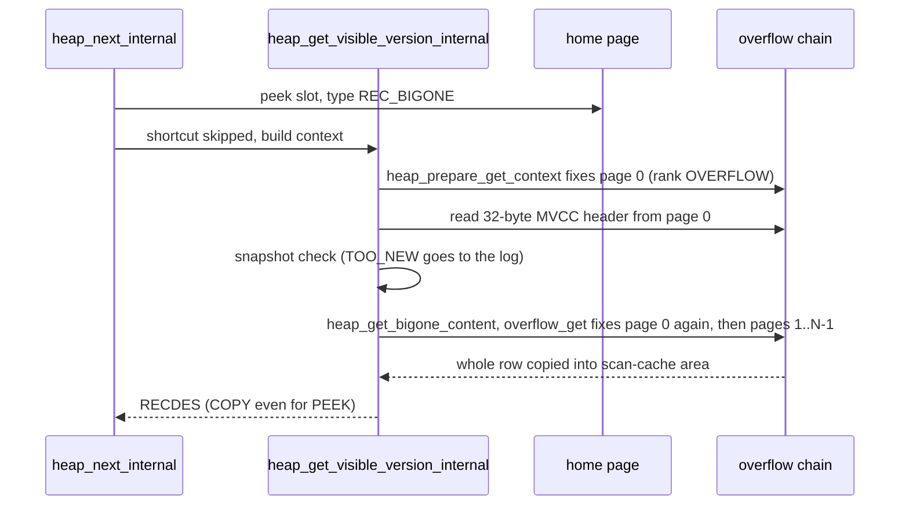
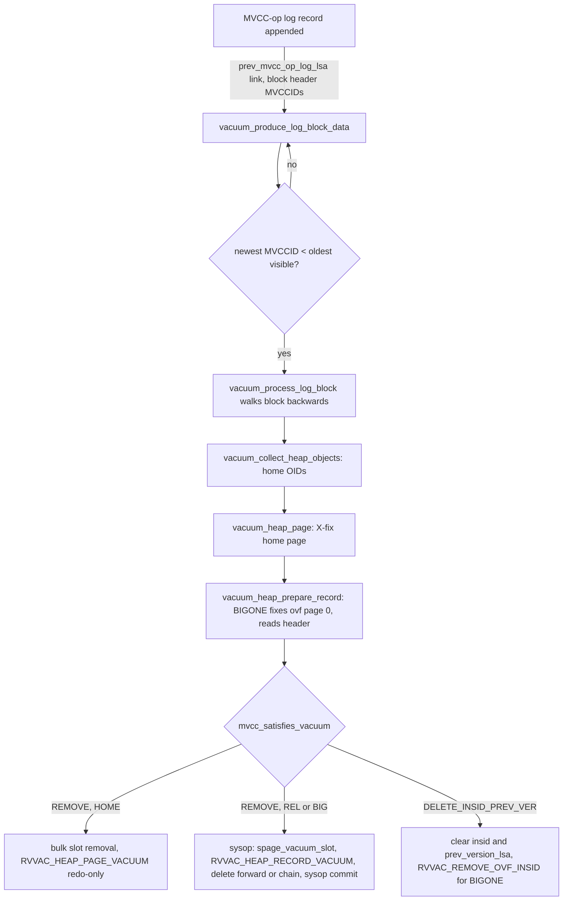
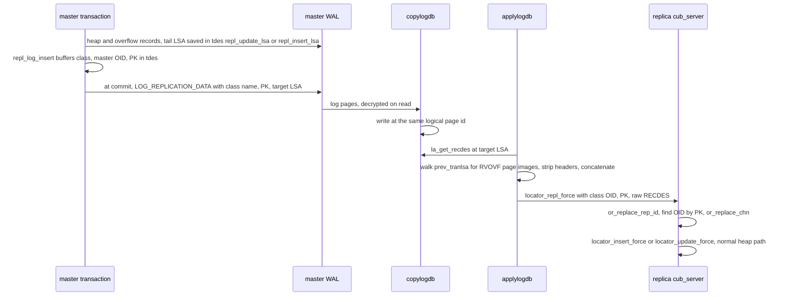

# Heap storage grounding for Sidecar

This document describes CUBRID engine revision `e64a04a79` (branch `sidecar`, cut from `develop`), as read on 2026-11-04. It describes existing behavior only. It does not propose a Sidecar design. All `path:line` citations are relative to `src/` at that revision unless stated otherwise. The OOS section cites documents about `feature/oos-merge` at `dcbf09e4f`, whose line numbers differ.

Five explorer reports were merged into this document. Where they disagreed, the source was read again. The "Gotchas" section marks each claim as verified at this revision or carried from an explorer.

## Overview

A CUBRID heap row is one byte string, a `RECDES`, stored in one slot of a slotted page. The row starts with a 4-byte word that packs the representation id, MVCC flags, the offset-table width and a bound-bit flag. A CHN, optional MVCC ids and an optional pointer to the previous version follow. After the header come a variable-offset table, the fixed columns, the null bits and the variable columns. When the encoded row is larger than about one page (`heap_Maxslotted_reclength`), the whole row, including its header, moves into a private chain of overflow pages. The home slot then holds an 8-byte `REC_BIGONE` pointer. No row is split by column. Every reader receives the whole row, and decode picks columns afterwards. So a query that reads only small columns still reads every overflow page of a big row.

Versioning is "newest in place, older in the log". An MVCC update overwrites the row in its slot, or overwrites the overflow chain in place. The old image survives only as an undo log record. The new row's `prev_version_lsa` points to that record. Vacuum finds work by following MVCC log records, not by scanning pages. It removes dead rows. It also clears `insid` and `prev_version_lsa` when no snapshot can need the old image. That is when the log stops being a version store for the row. The same log is the replication and CDC transport. HA ships log pages, and the applier rebuilds full rows from the master's heap and overflow redo images, found by LSA. CDC and flashback rebuild rows from the same records. Many other components decode the raw record bytes themselves. These include client libraries through copy areas, `unloaddb`, the page-batch query engine, the catalog, index builds and the applier. So the record layout is a contract with many parties, not a private heap detail.

## Key concepts

| Term | Meaning | Where |
|---|---|---|
| `RECDES` | Record descriptor: `data`, `length`, `area_size`, `type`. Every read and write of a row passes one. | `storage/storage_common.h` |
| Record type | 4-bit slot field. `REC_HOME` 2 (row in slot), `REC_NEWHOME` 3 (relocated body), `REC_RELOCATION` 4 (pointer to NEWHOME), `REC_BIGONE` 5 (pointer to overflow chain), `REC_MARKDELETED` 6, `REC_DELETED_WILL_REUSE` 7, `REC_ASSIGN_ADDRESS` 1. Values 8 to 15 are reserved. | `storage/storage_common.h:1177-1215` |
| `SPAGE_SLOT` | 4 bytes: 14-bit offset, 14-bit length, 4-bit type. | `storage/slotted_page.h:86-91` |
| Anchor type | Slot policy of a slotted page. Heap pages are always `ANCHORED_DONT_REUSE_SLOTS`. | `storage/heap_file.c:1083-1087` |
| MVCC header | Repid word, CHN, then optional `insid` (flag 0x01), `delid` (0x02) and `prev_version_lsa` (0x04). It is 8 to 32 bytes. | `base/object_representation_constants.h:142-173` |
| `mvcc_header_size_lookup[8]` | Header size indexed by the flag value. | `object/object_representation.c:71-80` |
| `HEAP_CHAIN` | Slot-0 record of each heap page: class OID, prev and next VPID, `max_mvccid`, vacuum status flags. | `storage/heap_file.c:274-283` |
| `HEAP_HDR_STATS` | Heap header page record. Holds `ovf_vfid`, the one overflow file per heap, created on first need. | `storage/heap_file.c:196`, `:6062` |
| Overflow chain | Singly linked pages. First page `{next_vpid, length, data}`, other pages `{next_vpid, data}`. Pages are never locked. They are reachable only through the home slot. | `storage/overflow_file.h:37-50`, `storage/overflow_file.c:77-79` |
| `OR_CLASSREP` and repid | Column layout for one representation. Each record names its repid. ALTER creates a new representation and does not rewrite rows. | `storage/heap_file.c:10900`, `object/schema_manager.c:10066-10106` |
| `HEAP_CACHE_ATTRINFO` | Per-scan decode state for a subset of attributes, with per-representation decode plans. | `query/heap_attrinfo.h:54-139` |
| `HEAP_SCANCACHE` | Per-scan state: snapshot, page watcher, private record area for COPY reads. | `storage/heap_file.h:141-181` |
| PEEK and COPY | PEEK returns a pointer into the latched page. COPY copies into a caller or scan-cache area. A BIGONE row cannot be peeked. | `storage/heap_file.c:20640-20660` |
| sysop | System operation: a nested atomic unit inside a transaction. It ends with commit, abort, or attach-to-outer. | `transaction/log_manager.c:3676-4174` |
| Postpone | Log record whose action runs at commit, or at sysop commit. Used for slot reuse and page dealloc. | `transaction/log_manager.c:8325` |
| Vacuum block | Range of log pages with oldest and newest MVCCID. A block becomes a vacuum job when all its MVCCIDs are older than every snapshot. | `query/vacuum.c:2916`, `:3129-3156` |
| `LC_COPYAREA` | Buffer of raw records plus descriptors. It is used for client fetch and flush. | `transaction/locator.h:243-252` |
| `LOG_REPLICATION_DATA` | Commit-time record: class name, packed PK, LSA of the heap log record. | `transaction/log_record.hpp:227-233` |
| `LOG_SUPPLEMENTAL_INFO` | CDC record. It usually holds a class OID plus undo and redo LSAs, and sometimes a full old row. | `transaction/log_record.hpp:136`, `:421-436` |

## How it works

### Record layout and decode

The record header is written by `heap_attrinfo_transform_header_to_disk` (`storage/heap_file.c:13218`). The body is written by `heap_attrinfo_transform_columns_to_disk` (`:13549`).

```text
offset 0  repid word  [31 bound-bit flag][30:29 offset width][28:24 MVCC flags][23:0 repid]
offset 4  CHN (4 B, always present)
+8        insid                 if flag 0x01
+8        delid                 if flag 0x02
+8        prev_version_lsa      if flag 0x04
H         var offset table: (n_variable + 1) entries of 1, 2 or 4 B, padded to 4 B
H+T       fixed area (fixed_length bytes, column at attrepr->location)
H+T+F     bound bits for fixed columns
H+T+F+B   variable data
```

The offset width is chosen per record from the total size, with thresholds at 127 and 32767 bytes (`storage/heap_file.c:13115-13143`). So the record is already self-describing for one layout choice. The MVCC flag field has 5 bits (mask 0x1f, `base/object_representation_constants.h:160-161`). Only 0x01, 0x02 and 0x04 are defined (`:165-171`). `or_header_size` indexes the 8-entry `mvcc_header_size_lookup` with the raw flag value (`object/object_representation.c:5797-5800`).

Decode does not walk the record. `heap_rec_layout_init` computes the var-table base, fixed base, bound bits and offset width once per record (`storage/heap_file.c:11091-11105`). `heap_attrvalue_read` (`:11589`) reaches a fixed column at `fixed_base + location` (`:11235-11248`). It reaches a variable column by reading two var-table entries (`:11262-11275`). A zero-length entry means NULL. For most types the value carries its own length. BLOB, CLOB and collection types take their length from the next larger offset (`:11277-11312`). Strings decode without a copy (`copy=false`, `:11379`), except LZ4-compressed strings of 255 bytes or more, which allocate (`base/object_representation.h:1454`). Each (attribute, representation) pair gets a decode plan once, in `heap_attrvalue_resolve_plan` (`:11515`). Fixed numeric types use type-fixed kernels (`:11520-11556`).

A record written under an older repid is decoded with that older representation. `heap_attrinfo_recache` handles this (`:10900`, called at `:11768-11778`). Columns added later are answered from the catalog default (`:11603-11612`).

### Serial heap scan of a `REC_HOME` row

1. `scan_next_scan_local` (`query/scan_manager.c:5137`) dispatches to `scan_next_heap_scan` (`:5323`). That function runs either the row path, `scan_next_heap_scan_rows` (`:5353`), or the page-batch iterator.
2. On the row path, `heap_next` (`storage/heap_file.c:20478`) calls `heap_next_internal` (`:7553`). It peeks each slot with `spage_next_record` (`:7774`). It skips NEWHOME, ASSIGN_ADDRESS and UNKNOWN slots (`:7799-7804`).
3. `heap_scan_get_visible_version` (`:26861`) has a `REC_HOME` shortcut (`:26882`). The shortcut decodes the MVCC header with `or_mvcc_get_header`, tests visibility, and returns the peeked bytes, or copies them for COPY mode (`:26892-26957`). It builds no `HEAP_GET_CONTEXT` and does not fix the page again. The code comment says this "brings ... close to pre-MVCC performance" (`:26866-26880`).
4. `eval_data_filter` (`query/query_evaluator.c:3326`) decodes predicate columns lazily, through `heap_attrinfo_read_dbvalues_lazy` (`storage/heap_file.c:11846`). After qualification, `heap_attrinfo_read_dbvalues` (`:11747`) decodes the `rest_attrs` columns. The attribute id arrays come from XASL generation (`parser/xasl_generation.c:5210`).
5. If the page LSA changed during a PEEK, the row is fetched again with COPY (`query/scan_manager.c:5497-5503`, `:5696-5719`).

Attribute selection saves decode CPU only. It never saves page reads. The record is already in hand before any column is chosen (`query/scan_manager.c:5441-5447`).

### Page batch (CBRD-27361, commit `309265e6d`)

`heap_page_collect_visible` (`storage/heap_file.c:8297`) checks visibility for a run of `REC_HOME` rows in one pass. It uses an inline header parser, `heap_page_row_mvcc_header` (`:8218`). `eb_layout_rows` and `eb_extract` (`query/expr_batch.c:4199`, `:4242`) then decode columns straight from record bytes. They use a `HEAP_RAW_LOCATOR` from `heap_attrinfo_raw_locator` (`storage/heap_file.c:11124`). That function accepts only SHORT, INTEGER, BIGINT, FLOAT, DOUBLE and DATE fixed columns and NUMERIC, VARCHAR and CHAR variable columns. For any other column it returns `ER_FAILED`, and the batch declines.

Any slot that is not `REC_HOME` (RELOCATION or BIGONE) is an exception (`:8370-8375`). The chunk ends before it. If nothing was collected, the collector returns `S_DOESNT_FIT` (`:8436-8441`). `scan_next_heap_scan` then calls `scan_batch_page_rowmode`, and the rest of the page runs on the row path (`query/scan_manager.c:5330-5346`). A table without big or relocated rows stays entirely on the batch path.

### Reading a `REC_BIGONE` row

The home slot holds only the 8-byte OID of overflow page 0 (`heap_build_forwarding_recdes`, `storage/heap_file.c:21547-21557`). The full row, with a 32-byte MVCC header that is always maximum size, lives in the chain (`:21672-21676`, `:20621-20629`).



`heap_prepare_get_context` fixes overflow page 0 before any visibility check (`storage/heap_file.c:7270-7300`). It uses the ordered-fix rank `PGBUF_ORDERED_HEAP_OVERFLOW` in the home page's group. `heap_get_bigone_content` (`:20640`) loops on `heap_ovf_get` while the result is `S_DOESNT_FIT`, and grows the area each time (`:20651-20660`). `overflow_get_nbytes` fixes page 0 again (`storage/overflow_file.c:770`), then fixes each page in turn. So a visible BIGONE row with N overflow pages costs about N+1 overflow fixes. An invisible one costs 1. The scan-cache area defaults to two pages (`storage/heap_file.c:27395-27412`). A larger row pays one extra fix of page 0 to learn its size. Point fetches (`heap_get_visible_version`, `:26821`) always take this general path. Index scans, join inner sides, and UPDATE or DELETE read-before-write all use it. The parallel scan calls `heap_next_1page` (`query/parallel/px_scan/px_scan_slot_iterator.cpp:117`) and has the same behavior.

No live code reads part of an overflow record. `heap_ovf_get` has a branch that reads only the 32-byte header when `chn != NULL_CHN` (`storage/heap_file.c:6330-6345`). All callers pass `NULL_CHN`. There are no skip pointers, so reaching page k means fixing pages 0 to k-1.

### Insert

`locator_insert_force` (`transaction/locator_sr.c:4913`) calls `heap_insert_logical` (`storage/heap_file.c:24649`).

1. `heap_insert_adjust_recdes_header` stamps `insid` (`:21571`). Its fast path does an 8-byte memmove (`:21596-21627`). Big records get the 32-byte header instead (`:21672-21676`).
2. `heap_insert_handle_multipage_record` (`:21865`) runs `heap_is_big_length` (`:1062`). If the row is big, it calls `heap_ovf_insert` first and replaces the record with a `REC_BIGONE` pointer (`:21878-21894`).
3. `heap_get_insert_location_with_lock` (`:21916`) picks a page from the scan-cache hint or bestspace. It picks a slot with `spage_find_free_slot`. For MVCC classes it takes only the MVCCID self-lock, not a row lock (`:22111-22156`).
4. `heap_insert_physical` and `heap_mvcc_log_insert` (`:22359`, `:17336`) log `RVHF_MVCC_INSERT`. The undo data is empty, because undo deletes the slot. The redo data omits the MVCC id, which redo rebuilds from `rcv->mvcc_id` (`:17407`). The helper also updates `HEAP_CHAIN.max_mvccid` and the page vacuum status (`heap_page_update_chain_after_mvcc_op`, `:26036`).

`overflow_insert` (`storage/overflow_file.c:82`) allocates all pages with one `file_alloc_multiple` inside a sysop (`:146`). It writes a `LOG_DUMMY_OVF_RECORD` marker on page 0 (`:202`) and redo-only `RVOVF_NEWPAGE_INSERT` page images (`:223`). It then attaches the sysop to the outer transaction (`:246`). On rollback, `RVFL_ALLOC` undo deallocates the pages. The first BIGONE insert of a heap creates the overflow file in its own sysop (`storage/heap_file.c:6091-6137`). That sysop commits even if the user transaction aborts.

### Update

The executor always builds a complete new record. `heap_attrinfo_transform_to_disk` first fills every unassigned column from the old record (`heap_attrinfo_set_uninitialized`, `storage/heap_file.c:13649`). It then encodes every column again. So an UPDATE of a small column reads and rewrites any large column on the same row. `locator_update_force` (`transaction/locator_sr.c:5372`) takes the X lock on the OID and reads the old row with COPY (`:13314-13451`, `:5700`). It then calls `heap_update_logical` (`storage/heap_file.c:25087`).

- HOME to HOME: the new image replaces the old in the same slot. `RVHF_UPDATE_NOTIFY_VACUUM` carries full old and new images (`heap_log_update_physical`, `:24506`). After logging, `heap_update_set_prev_version` (`:27093`) patches `prev_version_lsa` into the page. That patch is not logged.
- BIGONE to BIGONE (`heap_update_bigone`, `:23669`):
  1. The heap header page is X-latched (`heap_fix_header_page`, `:23698`).
  2. The whole old row is read (`:23715`). Overflow page 0 is fixed X with a plain `pgbuf_fix` (`:23722`).
  3. `RVHF_MVCC_UPDATE_OVERFLOW` is logged as undo-only, with the full old row as payload (`:23735`). Its LSA becomes the new row's `prev_version_lsa` (`:23747`).
  4. `heap_ovf_update` calls `overflow_update` (`storage/overflow_file.c:375`). In one sysop it overwrites the same chain page by page. Each page gets `RVOVF_PAGE_UPDATE` undo with the before-image and redo with the new bytes (`:454-514`). Page 0 also gets a `LOG_DUMMY_OVF_RECORD` (`:467`). A growing chain allocates pages (`RVFL_ALLOC`, `RVOVF_NEWPAGE_LINK`, `:523-532`). A shrinking chain logs `RVOVF_CHANGE_LINK` (`:554`) and postpones `RVFL_DEALLOC` of the tail pages to commit (`:594`). The sysop attaches to the outer transaction (`:606`).
  5. `RVHF_MVCC_NO_MODIFY_HOME` is logged against the home page (`storage/heap_file.c:23785`). It carries no data. It exists so that vacuum visits the home OID.

  The OID and the first-page VPID do not change. One small-column update of an N-page row logs the old row about twice (record image plus page before-images) and the new row once.
- BIGONE to HOME or RELOCATION: the new image goes to the home slot or a NEWHOME. The old chain is dropped with `heap_ovf_delete`, which postpones the deallocations (`:23852-23863`).
- MVCC DELETE adds 8 bytes of `delid` in place. A near-full HOME row can become RELOCATION, and a row just under the threshold can become BIGONE, at delete time (`:23290-23460`, `:23409`). A BIGONE delete stamps `delid` in the header on overflow page 0 (`:22663-22687`) and logs `RVHF_MVCC_NO_MODIFY_HOME` on the home page.

### Old-version reads

When the snapshot check returns TOO_NEW, `heap_get_visible_version_from_log` (`storage/heap_file.c:26693`) follows `prev_version_lsa`. Each hop calls `heap_get_undo_record_for_version` (`:26595`). That function reads the undo image from an in-flight window of unflushed prior-list nodes, from the log page buffer, or from disk. Only MVCC-op undo record types are kept in the window (`transaction/log_prior_inflight.hpp:58-71`). `RVHF_MVCC_UPDATE_OVERFLOW` is plain `LOG_UNDO_DATA`, so it never enters the window. A reader that needs an old BIGONE image that is not yet copied must release its heap pages and drain the prior list under `LOG_CS` (`storage/heap_file.c:26605-26645`). After 64 hops or 32 KB, the walk releases its held pages (`:513-514`). The result is the whole old row from the log. The current overflow chain is never read for an old version.

### Vacuum



Vacuum never scans the heap. Every MVCC-op log record is linked to the previous one through `prev_mvcc_op_log_lsa`, and the block header tracks MVCCIDs (`transaction/log_append.cpp:1330-1362`, `:1423-1448`). Only records whose rcvindex is in `LOG_IS_MVCC_HEAP_OPERATION` (`transaction/mvcc.h:249-256`) produce heap work. The overflow rcvindexes are not in that list. BIGONE work is found only through `RVHF_MVCC_NO_MODIFY_HOME` or `RVHF_MVCC_INSERT` on the home page. A block becomes a job only when its newest MVCCID is older than the oldest visible MVCCID (`query/vacuum.c:3129-3156`).

`vacuum_heap_page` (`query/vacuum.c:1592`) X-fixes the home page. For BIGONE, `vacuum_heap_prepare_record` (`:1938`, BIGONE `:2070-2149`) finds the overflow VFID through the heap header. It tries a conditional latch first. If that fails, it unfixes the home page and retries. It then X-fixes overflow page 0 and reads the header. `mvcc_satisfies_vacuum` (`transaction/mvcc.c:321`) compares MVCCIDs to the threshold. It never asks whether a transaction committed. `logtb_is_mvccid_committed` is declared at `transaction/log_impl.h:1205` and has no definition.

- REMOVE of `REC_HOME`: slots are removed in bulk under one redo-only `RVVAC_HEAP_PAGE_VACUUM` (`:2662`).
- REMOVE of RELOCATION or BIGONE (`vacuum_heap_record`, `:2374`): `log_sysop_start` (`:2387`), then `spage_vacuum_slot` on the home slot (`:2398`). The slot becomes `REC_DELETED_WILL_REUSE` only for `FILE_HEAP_REUSE_SLOTS` files (`:2568`). Otherwise it becomes `REC_MARKDELETED`. `RVVAC_HEAP_RECORD_VACUUM` is logged with an undo that inserts the record again (`:7525-7552`).
  - For BIGONE, overflow page 0 is unfixed (`:2462`). `heap_ovf_delete` postpones the deallocation of every page (`:2464`). `log_sysop_commit` (`:2474`) runs those postpones. The home page stays latched for the whole sysop.
  - For RELOCATION, the NEWHOME slot is vacuumed with `reusable=true` (`:2428`). Its full record is logged as undo. The forward page is unfixed (`:2439`) before `log_sysop_commit` (`:2442`).
- DELETE_INSID_PREV_VER (`:2208`): `insid` becomes all-visible and `prev_version_lsa` becomes NULL. For BIGONE this is done on overflow page 0 under redo-only `RVVAC_REMOVE_OVF_INSID` (`:2277-2303`). From this point no reader follows the log for this row.

Log archives are kept from `vacuum_min_log_pageid_to_keep` (`:5744`). So the log stays a valid version store until vacuum has passed. Undo of `RVHF_UPDATE_NOTIFY_VACUUM`, `RVHF_DELETE` of NEWHOME, and `RVHF_MVCC_UPDATE_OVERFLOW` calls `vacuum_rv_check_at_undo` (`:7666`). That call strips `insid` and the prev LSA from the restored record when vacuum may have skipped the record while it was in flight.

### Recovery and slot reuse

Restart runs analysis, redo, then undo (`transaction/log_recovery.c:2609`, `:3406`, `:4585`). Redo applies a record only if its LSA is greater than the page LSA (`:521-531`). Undo writes a compensation record (CLR). A CLR's redo runs the undo function (`transaction/log_recovery_redo.hpp:396-399`). So undo functions must also be idempotent under page-LSA gating. A committed sysop is not undone. A sysop without an end record is undone with its transaction (`log_recovery.c:4722-4733`).

Heap slot reuse is safe because no reusable slot or byte can be taken before the freeing action is final.

- Heap pages are `ANCHORED_DONT_REUSE_SLOTS` (`storage/heap_file.c:1083-1087`). `spage_delete` marks them `REC_MARKDELETED` (`storage/slotted_page.c:2097-2099`). `spage_find_free_slot` takes only `REC_DELETED_WILL_REUSE` (`:1286`).
- A non-MVCC delete or a forward-record delete makes the slot reusable only through the postponed `RVHF_MARK_REUSABLE_SLOT` (`storage/heap_file.c:23655-23658`), which runs at commit. Undo of a delete (`spage_insert_for_recovery`, `storage/slotted_page.c:1933`) therefore always finds the slot empty.
- Bytes freed by a shrinking operation are reserved per (transaction, page) in memory by `spage_save_space` (`:488`). Other transactions see `total_free - total_saved` (`:4610-4637`). The reservation is not logged. It is skipped during crash recovery and for vacuum workers (`:503-511`). `spage_vacuum_slot` does not reserve the bytes it frees (`:4827-4866`).
- Rollback of an insert frees the slot at once. That is safe because the OID was never visible.
- Vacuum's own slot undo is safe only while the home page latch is held through the sysop and nobody else runs during restart.

Postponed page deallocation (`RVFL_DEALLOC`) means a rolled-back shrinking update finds its tail pages still intact.

### Latches and locks

Ordered fix sorts by heap-header VPID group, then by rank `HEAP_HDR < HEAP_NORMAL < HEAP_OVERFLOW`, then by VPID (`storage/page_buffer.h:230-235`, `storage/page_buffer.c:12364-12418`). Overflow pages must be latched after their home page (`storage/heap_file.c:7282`). `overflow_file.c` fixes chain pages one at a time with plain `pgbuf_fix` and relies on that convention. Page latches have no deadlock detection. A waiter times out.

The heap header page is X-latched by a BIGONE update (`storage/heap_file.c:23698`), by a non-MVCC BIGONE delete, and by HOME-to-BIGONE or HOME-to-RELOCATION conversions (`:24272`, `:24313`). Every overflow operation S-latches the header to find `ovf_vfid` (`:6062-6080`). UPDATE and DELETE hold an X object lock on the home OID (`transaction/locator_sr.c:13314-13450`). MVCC INSERT takes no row lock (`storage/heap_file.c:22111-22156`). Overflow pages are never locked.

### HA replication



- Capture. At log-append time, `RVHF_UPDATE`, `RVOVF_CHANGE_LINK`, `RVHF_UPDATE_NOTIFY_VACUUM` and `RVHF_INSERT_NEWHOME` set `tdes->repl_update_lsa`. `RVHF_INSERT` and `RVHF_MVCC_INSERT` set `repl_insert_lsa` (`transaction/log_manager.c:2275-2288`). `repl_log_insert_internal` buffers class, master OID and packed PK (`transaction/replication.c:294`). `repl_add_update_lsa` fills in the update LSA after the heap update (`:229`, called from `transaction/locator_sr.c:6035`). At commit, `log_append_repl_info_internal` writes `LOG_REPLICATION_DATA` (`transaction/log_manager.c:4632`). The master OID is never written to the log. For BIGONE to BIGONE, the target LSA is the `RVOVF_CHANGE_LINK` record, the last record of the chain rewrite.
- Shipping. `logwr_pack_log_pages` reads pages through the decrypting path (`transaction/log_page_buffer.c:2136-2146`). copylogdb stores each page at the same logical page id (`transaction/log_writer.c:196`), so master LSAs stay valid in the copy.
- Apply. `la_get_recdes` (`transaction/log_applier.c:4673`) decodes the target record. For `RVOVF_CHANGE_LINK` it calls `la_get_overflow_recdes(..., RVOVF_PAGE_UPDATE)` (`:4703-4708`). For a `REC_BIGONE` insert it calls the same function with `RVOVF_NEWPAGE_INSERT` (`:4709-4712`). That function walks `prev_tranlsa` backwards, collects page images of the given rcvindex, stops at `LOG_DUMMY_OVF_RECORD` or a different transaction, strips the overflow page header and concatenates (`:4318-4455`). ASSIGN_ADDRESS and RELOCATION records are chased to the next update or the previous `RVHF_INSERT_NEWHOME` (`:4713-4740`). The class is resolved by name (`:5227`). The raw `RECDES` and the PK go to the server through `locator_repl_force` (`transaction/locator_cl.c:6921`), `xlocator_repl_force` (`transaction/locator_sr.c:7047`) and `locator_repl_prepare_force` (`:6904`).
- Replica server. `locator_repl_prepare_force` stamps the replica's current repid with `or_replace_rep_id` (`:6932`). It finds the replica OID by PK with `xbtree_find_unique` (`:6947`) and bumps CHN (`:6955-6978`). The normal `locator_*_force` path then decides HOME, BIGONE or RELOCATION on its own. `heap_update_adjust_recdes_header` overwrites `insid` and clears the shipped `prev_version_lsa` (`storage/heap_file.c:21721-21779`).
- DELETE ships no row image. The replica deletes by PK (`transaction/log_applier.c:5070`). Classes without a primary key are not replicated (`transaction/locator_sr.c:8987-8991`).

### CDC and flashback

Supplemental logging is on when `supplemental_log > 0` (default 0, `base/system_parameter.c:4749-4758`) and the class is not a system class (`check_supplemental_log`, `storage/heap_file.c:2871-2885`). After each DML, the heap appends `LOG_SUPPLEMENTAL_INFO` with a class OID and undo and redo LSAs (`transaction/log_manager.c:4973-5020`, heap hooks `storage/heap_file.c:24704-24720`, `:25259-25275`, `:25323`). For BIGONE to BIGONE, the undo LSA is the `RVHF_MVCC_UPDATE_OVERFLOW` record (`:23737-23740`). The redo LSA is the saved `change_link_lsa` (`:23764-23767`), because `file_dealloc` appends unrelated postpone records after it.

Some operations have no undo image in the log. These are BIGONE delete (`:22604-22616`), relocation to relocation (`:23099`) and MVCC HOME delete (`:23523`). For them, `log_append_supplemental_undo_record` copies the whole old row into the log. The CDC producer runs inside `cub_server` (`cdc_loginfo_producer_execute`, `transaction/log_manager.c:11447`). `cdc_get_recdes` (`:11726`) rebuilds rows from those LSAs. It uses `cdc_get_overflow_recdes` (`:12721`), the same walk-back-to-the-marker method as the applier. `cdc_make_dml_loginfo` (`:13242`) decodes rows with `heap_attrinfo_read_dbvalues` and the current representation. A repid mismatch becomes a "schema changed" error (`cdc_check_if_schema_changed`, `:13112`). Flashback (`transaction/flashback.c:922`) calls the same `cdc_get_recdes` and `cdc_make_dml_loginfo` with `is_flashback=true` (`:1139`, `:1188`). CDC keeps archives alive for its own reader (`cdc_update_arv_num_to_keep`, `transaction/log_manager.c:14494`).

### TDE

TDE is chosen per class (`tde_algorithm` in the class record, `object/class_object.h:796`; `heap_get_class_tde_algorithm`, `storage/heap_file.c:12339`). It is applied per file (`FILE_FLAG_ENCRYPTED_MASK`, `storage/file_manager.c:161`) and stamped per page by `file_alloc` (`:5491-5506`). Pages are encrypted at flush (`storage/page_buffer.c:10982`) and decrypted at read (`:8623`). The nonce is the page LSA (`storage/tde.c:965-1000`).

The heap file and the lazily created overflow file both apply the class algorithm at creation (`storage/heap_file.c:4985`, `:6119-6133`). `xfile_apply_tde_to_class_files` (`storage/file_manager.c:12438`) handles ALTER for a fixed list: heap, heap overflow, each B-tree, and each B-tree overflow file.

A log record is encrypted only if its rcvindex is in the closed list `LOG_MAY_CONTAIN_USER_DATA` (`storage/tde.h:107-137`) and the data page it is logged against carries a TDE flag (`transaction/log_manager.c:2248-2258`). Encryption is per log page, so neighboring records share it (`transaction/log_page_buffer.c:3026`, `:4303-4311`). `log_append_supplemental_info` never marks its node encrypted (`transaction/log_manager.c:4912-4967`).

### Copy areas and client-built records

Raw heap bytes leave the server in copy areas. `xlocator_fetch` (`transaction/locator_sr.c:2378`) starts with a `DB_PAGESIZE` area (`:2500`). `heap_get_visible_version` copies the record straight into it. `locator_return_object_assign` (`:2174`) only adds a `LC_COPYAREA_ONEOBJ` descriptor and pads to `MAX_ALIGNMENT`. On `S_DOESNT_FIT`, the area grows to the record size, or by one more page (`:2588-2595`). The client decodes the bytes with `tf_disk_to_mem` (`object/transform_cl.c:1312`). That function dispatches on repid to `get_current` or `get_old`. `heap_prefetch` adds neighbor records from the same page (`transaction/locator_sr.c:2640-2650`).

Clients also write full records. `tf_mem_to_disk` (`object/transform_cl.c:765`) encodes every attribute. `xlocator_force` (`transaction/locator_sr.c:7277`) replaces the row with `oldrecdes = NULL`.

This client path carries all system-class writes and all DDL (`tf_class_to_disk`, `object/transform_cl.c:4447`). It also carries trigger-involved INSERT and UPDATE (`query/execute_statement.c:12494-12567`, `:9660-9722`), CAS OID access and updatable cursors (`broker/cas_execute.c:2771-3274`), and `loaddb -S`.

SQL SELECT results are list-file tuples of `DB_VALUE`s (`query/query_opfunc.c:598`). They never carry heap bytes. Server-built records (qexec, CS-mode loaddb, compactdb CS) and client-built records all enter the heap through `locator_insert_force` and `locator_update_force` (`transaction/locator_sr.c:4913`, `:5372`).

### Tools

- `unloaddb` and SA `compactdb` fetch copy areas through `locator_fetch_all` and decode with their own decoder, `desc_disk_to_obj` (`loaddb/load_object.c:915`). LOBs are printed as locator strings (`executables/unload_object.c:2399-2428`).
- CS `compactdb` decodes and re-forces rows on the server. It rewrites a row only if a value changed or its representation is old (`storage/compactdb_sr.c:246-248`). It drops old representations only after a clean pass (`:623-640`).
- `checksumdb` uses SQL. `diagdb` uses `heap_dump`. Backup, restore and copydb work on pages and do not see the record format. LOB files under the LOB path are outside the volumes and are not backed up with them.

### Catalog

Records are decoded with the representation embedded in the class record (`heap_classrepr_get_from_record`, `storage/heap_file.c:2019-2050`; `or_get_classrep`, `base/object_representation_sr.c:3298-3330`). The system catalog (`DISK_REPR` and `DISK_ATTR`, `storage/system_catalog.h:62-90`) mirrors ids, types, defaults and statistics. It is kept in sync by `catalog_insert` and `catalog_update` (`transaction/locator_sr.c:5087`, `:5570`). Catalog class rows are decoded by raw layout in `catcls_get_or_value_from_buffer` (`storage/catalog_class.c:3334-3425`).

The existing precedents for a per-table property are class flags such as `SM_CLASSFLAG_REUSE_OID`, which is mirrored in the heap file type, and the fixed `ORC_CLASS_TDE_ALGORITHM` field. For a per-column property, the precedents are the `SM_ATTFLAG_*` word, with 12 of 32 bits used (`storage/storage_common.h:1089-1106`), and the attribute properties sequence. Attribute flags become `OR_ATTRIBUTE` bitfields once per representation (`base/object_representation_sr.c:2486-2488`). Old representations carry no flags (`:2993-3035`). A flag change alone does not create a new repid (`object/schema_manager.c:10066-10106`).

A new column flag touches about ten files: grammar, DDL, the SHOW CREATE printer (which unloaddb depends on), information_schema and `db_info`. The invisible-column flag shows the full list in report 04. Partitions must share the root's disk layout, because pruning only patches the repid bits (`object/object_representation.c:301-313`, `query/partition.c:3915-3925`).

### Indexes

Keys are built from the full record. Single-column keys use `heap_attrinfo_read_dbvalues` (`storage/heap_file.c:14578`). Multi-column keys use `heap_midxkey_key_generate`, which sizes its buffer from `recdes->length` and reads bytes with `heap_midxkey_get_value` (`:14582`, `:14744`, `:11652`). A prefix index reads the whole value and truncates it (`:14639-14645`). On update, `locator_update_index` decodes indexed values from old and new records and compares them (`transaction/locator_sr.c:8538-8544`). `CREATE INDEX` scans with `heap_next_1page` and decodes (`storage/btree_load.c:5776`, `:5887`). Keys of `DB_PAGESIZE/8` or more go to B-tree overflow key pages (`storage/btree_load.h:184`, `storage/btree.c:4200-4215`). An index-only scan never touches the heap.

### Disk format and compatibility

`disk_compatibility_level` 11.5 is stored in the log header and the backup header. Boot accepts only an exact match (`base/release_string.c:105`, `:272-293`; `transaction/log_manager.c:1303-1315`). `SYSTEM_METADATA_VERSION` (now 1, `object/system_metadata_version.h:32`) is checked at boot (`transaction/boot_sr.c:2611-2617`). It is upgraded by `cubrid upgradedb` SQL scripts, which change catalogs but not user rows (`executables/util_sa.c:5712-5730`). Page size, charset and collation are fixed at `createdb`. The per-record header word has two free MVCC flag bits and record types 8 to 15 are free, but neither is covered by any versioned stamp.

### Counters

`Num_data_page_fetches` (`PSTAT_PB_NUM_FETCHES`, `base/perf_monitor.c:210`) counts every `pgbuf_fix`, including buffer hits and repeated fixes of the same page (`storage/page_buffer.c:2546`, `:2599`). It counts only while a statdump watch is active or the thread is tracing. `Num_data_page_ioreads` counts only buffer misses (`:8571`). `SET TRACE ON` reports the per-scan `fetch` and `ioread` deltas (`query/scan_manager.c:5146-5152`, `:5245-5246`). `Num_data_page_fix_ext` splits fixes by page type, including `PERF_PAGE_OVERFLOW` (`base/perf_monitor.c:590`). Heap counters such as `PSTAT_HEAP_BIG_*` count writes only. No counter counts BIGONE reads.

## Where things live

| Area | Files |
|---|---|
| Record layout macros | `base/object_representation.h`, `base/object_representation_constants.h`, `object/object_representation.c`, `base/object_representation_sr.c` |
| Heap manager (read, write, decode, encode, MVCC) | `storage/heap_file.c`, `storage/heap_file.h`, `query/heap_attrinfo.h` |
| Slotted page | `storage/slotted_page.c`, `storage/slotted_page.h` |
| Overflow file | `storage/overflow_file.c`, `storage/overflow_file.h` |
| Query scan and page batch | `query/scan_manager.c`, `query/expr_batch.c`, `query/query_evaluator.c`, `query/fetch.c` |
| Locator (copy areas, force, replication apply) | `transaction/locator_sr.c`, `transaction/locator_cl.c`, `transaction/locator.h` |
| Log, recovery, sysop | `transaction/log_manager.c`, `transaction/log_append.cpp`, `transaction/log_recovery.c`, `transaction/recovery.c`, `transaction/log_prior_inflight.hpp` |
| MVCC and vacuum | `transaction/mvcc.c`, `transaction/mvcc.h`, `query/vacuum.c` |
| HA | `transaction/replication.c`, `transaction/log_writer.c`, `transaction/log_applier.c` |
| CDC and flashback | `transaction/log_manager.c` (cdc_*), `transaction/flashback.c`, `api/cubrid_log.c` |
| TDE | `storage/tde.c`, `storage/tde.h`, `storage/file_manager.c`, `storage/page_buffer.c` |
| Client transform | `object/transform_cl.c`, `loaddb/load_object.c` |
| Catalog and schema | `storage/catalog_class.c`, `storage/system_catalog.c`, `object/schema_manager.c`, `query/execute_schema.c` |
| Index | `storage/btree.c`, `storage/btree_load.c` |
| Counters | `base/perf_monitor.c`, `base/perf_monitor.h` |

## Constraints any large-column design inherits

1. Readers get whole records. `heap_next` and `heap_get_visible_version` return a full `RECDES` before any column is chosen (`query/scan_manager.c:5441-5447`). Today the only page-read saving available is to make records smaller.
2. The `REC_HOME` shortcut in `heap_scan_get_visible_version` (`storage/heap_file.c:26882-26957`) and the page-batch collector's `rec.type != REC_HOME` exception (`:8370-8375`) are the fast paths. A new record type leaves both, and leaving the batch sends the rest of the page to the row path (`query/scan_manager.c:5330-5346`).
3. The page batch decodes only through `heap_attrinfo_raw_locator`. Returning `ER_FAILED` there is the existing per-column decline (`storage/heap_file.c:11124-11185`).
4. MVCC flag bits 0x08 and 0x10 are free, but `mvcc_header_size_lookup` has 8 entries and is indexed by the raw 5-bit value (`object/object_representation.c:71-80`, `:5797-5800`). Using either bit means growing the table and checking every caller.
5. Record types 8 to 15 are free in the 4-bit slot field (`storage/storage_common.h:1196-1213`). Every switch on record type must then handle the new type.
6. Older versions live only in undo log records reached by `prev_version_lsa` (`storage/heap_file.c:26693`). Any out-of-row value that an old row image references must stay readable until vacuum clears that row's `insid` and `prev_version_lsa` (`query/vacuum.c:2208`, `:2277-2303`).
7. Vacuum discovers heap work only through rcvindexes in `LOG_IS_MVCC_HEAP_OPERATION` (`transaction/mvcc.h:249-256`). It decides from MVCCIDs, not from commit state (`transaction/mvcc.c:321`).
8. Vacuum's REL and BIG removal is one sysop with physical, same-slot undo. It is safe only while the home page latch is held to sysop commit (`query/vacuum.c:2387-2474`). Vacuum-freed space is not reserved (`storage/slotted_page.c:503-511`, `:4827-4866`).
9. Heap slots become reusable only through a postponed `RVHF_MARK_REUSABLE_SLOT` or through vacuum (`storage/heap_file.c:23655-23658`, `storage/slotted_page.c:1286`, `:2097-2099`). Page deallocation is postponed to commit (`RVFL_DEALLOC`).
10. Undo functions double as CLR redo and must be idempotent under page-LSA gating (`transaction/log_recovery_redo.hpp:396-399`, `transaction/log_recovery.c:521-531`).
11. `prev_version_lsa` is patched outside WAL (`storage/heap_file.c:27093`). After crash redo it can be NULL.
12. Ordered-fix rank is header, then heap, then overflow, within one heap's group (`storage/page_buffer.h:230-235`). Page latches have no deadlock detection. Reaching a second file's header while a heap page is held needs a conditional latch and retry (`query/vacuum.c:2082-2111`).
13. The applier needs a log record at a stable LSA. Its redo, plus same-transaction `prev_tranlsa` neighbors back to a start marker, must rebuild a full inline `RECDES` (`transaction/log_applier.c:4673-4755`, `:4318-4455`). The anchor rcvindexes are fixed lists (`transaction/log_manager.c:2275-2288`, `transaction/log_applier.c:5217-5225`).
14. The replica gets its OID from the PK and its repid from its own catalog (`transaction/locator_sr.c:6932`, `:6947`). Master physical addresses are never used on the replica. Master LSAs are valid there only because copylogdb keeps logical page ids (`transaction/log_writer.c:196`).
15. CDC and flashback decode rebuilt rows with `heap_attrinfo_read_dbvalues` (`transaction/log_manager.c:13242-13410`). They need the value bytes in the log, either as undo or redo images or as a supplemental copy (`storage/heap_file.c:22616`).
16. Overflow page images in the log are parsed as page layouts by three readers: recovery, the applier (`LA_OVF_*`) and CDC (`storage/overflow_file.h:37-50`).
17. TDE log encryption needs the rcvindex in `LOG_MAY_CONTAIN_USER_DATA` and a TDE-flagged `addr->pgptr` (`storage/tde.h:107-137`, `transaction/log_manager.c:2248-2258`). A new file type must be added to `xfile_apply_tde_to_class_files` (`storage/file_manager.c:12438`). The data-page nonce is the page LSA (`storage/tde.c:965-1000`).
18. Copy areas ship record bytes unchanged (`transaction/locator_sr.c:2174-2230`), and clients decode them with `tf_disk_to_mem`. Clients flush complete records that replace the row (`transaction/locator_sr.c:7277`). All system classes, DDL and trigger-involved DML use this path.
19. UPDATE rebuilds every column from the old record (`storage/heap_file.c:13649`). Index maintenance decodes indexed columns from old and new records (`transaction/locator_sr.c:8538-8544`).
20. Partitions must have the root's disk layout (`object/object_representation.c:301-313`).
21. Old representations carry no attribute flags, and a flag change does not create a repid (`base/object_representation_sr.c:2993-3035`, `object/schema_manager.c:10066-10106`).
22. The disk compatibility check is equality on 11.5 (`base/release_string.c:272-293`). No in-tree stamp covers a heap record format change.
23. `RECDES.length` is a 4-byte int. Copy areas grow by `DB_PAGESIZE` or to the record size (`transaction/locator_sr.c:2588-2595`).

## What OOS learned

From report 05, which summarizes OOS documents at `feature/oos-merge` `dcbf09e4f`.

| Defect class | Example tickets | Root cause | Caused by a separate address and lifecycle? |
|---|---|---|---|
| Physical undo overwrites a reused chunk or forward slot | CBRD-27781, CBRD-27858 | Chunk delete has same-slot undo while freed slots and bytes are reusable at once | Yes (27781). Partly (27858). |
| Reclaim decided from uncommitted information | CBRD-27237 | Old chain deleted because a rolled-back UPDATE's undo image named it | Yes |
| Stale identity after slot reuse | CBRD-26950 | An OOS OID names a recyclable slot, so a stamp is needed | Yes |
| Second allocator, bestspace and page reclaim | CBRD-26786, -26954, -27213, -27872 | A separate file needs its own space protocol | Yes |
| Latch-order cycles | CBRD-27860, CBRD-27827 | Finding the OOS VFID needs the heap header while a heap page is held | Mostly yes |
| Ownership and orphan invariants | CBRD-27089, -26715, -26937, -26608 | Record flag and per-heap VFID must agree | Yes |
| Stub leaks to raw-byte consumers | CBRD-26847, -26985, -26818 | Every raw `RECDES` reader must expand stubs (8 sites) | Yes |
| Writer and layout bugs | CBRD-26814, -26822, -27874..27878 | Stubs inside the serialized row touch every writer | Partly |
| Cost when unused | CBRD-27785, CBRD-27816 | Shared reader and UPDATE path dispatch for stubs on every row | Partly |
| Cold reads of external values | CBRD-27788, CBRD-27791 | A second, dependent, usually random page read per value | Yes |
| UPDATE amplification | CBRD-27230 | Unchanged values cannot be shared across versions without an ownership protocol | Yes |
| Replication and CDC | CBRD-26939, -27800, -27801 | Supplemental images carry stubs. The replica reinserts values and rewrites OIDs. | Yes |
| New file kind misses file features | CBRD-26830 (TDE leak), CBRD-27350 | Every per-file feature must be applied again | Partly |
| Boot compatibility | ADR-0006 | A new page type changes how old volumes are read | Partly |

Measurement facts that carry over:

- The cost-when-unused metric is server user-space instructions (`perf stat -e instructions:u` on `cub_server`). It is measured in ABBA order with a fresh database per UPDATE sample. Before fixes, OOS cost ordinary scans 7 to 9 percent and UPDATE about 5 percent. After fixes the cost was 0.6 to 1.7 percent, and a residual UPDATE cost remains (CBRD-27816).
- For page reads, `SET TRACE ON` `fetch` counts page accesses and is deterministic. `ioread` counts buffer misses only. The I/O study (W4, 100,000 rows) cut small-column scan fetches from 100,008 to 33,344 (heap layout) and from 300,092 to 33,344 (overflow layout). It made full-value reads worse. Heap-layout Q4 fetches rose from 100,008 to 333,344. With the file cache evicted, overflow-layout Q4 went from 2.32 s (baseline) to 5.72 s (OOS), about 2.4 times slower, because of dependent random reads.
- Harnesses: `bench.py` and `ordinary.py` (instructions), `io_bench.py` (pages and OS I/O), the reviewer's exact SQL, and TLA+ reclaim models. Paths are in report 05, section 3.1.

## Gotchas

"Verified" means read again at `e64a04a79` for this document. "Explorer" means carried from a report without a fresh read.

1. Verified. Explorer 04 says `applylogdb` decodes rows with `la_disk_to_obj` using the current layout. That function is called only by `la_write_update_sql_log` and `la_write_insert_sql_log`, behind `ha_enable_sql_logging` (`transaction/log_applier.c:5089`, `:5247-5252`, `:5444-5449`). The apply path itself ships raw `RECDES` bytes to `xlocator_repl_force`, which stamps the replica repid. So the applier trusts the byte layout, not a decoder.
2. Verified. Explorer 04 says the fetch copy area "doubles". It grows to the record size or by one more `DB_PAGESIZE` (`transaction/locator_sr.c:2588-2595`).
3. Verified. Vacuum of a `REC_RELOCATION` row unfixes the forward page (`query/vacuum.c:2439`) before `log_sysop_commit` (`:2442`), after marking the NEWHOME slot reusable (`:2428`). That leaves a small window in develop as well. This is the base mechanism behind CBRD-27858.
4. Verified. `RVVAC_HEAP_RECORD_VACUUM` logs the full NEWHOME record as undo (`query/vacuum.c:2051-2055`, `:2436`). That rcvindex is not in `LOG_MAY_CONTAIN_USER_DATA` (`storage/tde.h:107-137`). So a vacuum of a relocated TDE row may write user bytes to a plain log page, unless the page is encrypted for a neighbor record. This is inferred from the code and was not run.
5. Verified. `UNSTABLE_TDE_FOR_REPLICATION_LOG` appears 49 times in the tree and is never defined. Master log pages are read decrypted and copylogdb stores them as they are. The inference that replica log copies are plaintext is the explorer's and was not run.
6. Verified. `log_append_supplemental_info` never marks records encrypted, so a full-row `LOG_SUPPLEMENT_UNDO_RECORD` for a TDE table is plain unless a neighbor encrypts the page.
7. Verified. `heap_update_set_prev_version` patches the page without a log record. Crash redo leaves NULL prev LSAs on HOME and NEWHOME rows. Whether any consumer (replica catch-up, CDC) depends on them is still open.
8. Verified. `Num_data_page_fetches` increments only while perf tracking or tracing is on (`storage/page_buffer.c:2540-2600`). A BIGONE read fixes overflow page 0 twice, so "fetch" is not "distinct pages".
9. Verified. `logtb_is_mvccid_committed` has a declaration and no definition. Vacuum safety rests entirely on MVCCID ordering.
10. Verified. `overflow_insert` uses a sysop but attaches it to the outer transaction (`storage/overflow_file.c:146`, `:246`). The pages roll back with the transaction through `RVFL_ALLOC` undo. The page content redo is redo-only, which the code comment marks "required for HA" (`transaction/recovery.c:382`).
11. Verified. A BIGONE MVCC update fixes overflow page 0 with a plain `pgbuf_fix` X latch while it holds the home and header pages (`storage/heap_file.c:23722`). Only the read path uses the ordered overflow rank.
12. Explorer 02. The heap header X latch in `heap_update_bigone` is a per-heap serialization point. Whether correctness needs it, or only ordered fix, is open.
13. Explorer 02. Whether `RVOVF_PAGE_UPDATE` images are zipped or diffed was not read.
14. Explorer 03. `repl_update_lsa` and `repl_insert_lsa` are single slots in `tdes`. Any extra anchor-type record appended inside a heap update overwrites them. `locator_update_index` saves and restores `repl_insert_lsa` around PK-update FK checks (`transaction/locator_sr.c:8885-8902`). Whether FK or trigger actions can misplace `repl_update_lsa` for BIGONE is open.
15. Explorer 03. The applier fails hard with `ER_FAILED` on an unknown rcvindex (`transaction/log_applier.c:5217-5225`). No mixed-version HA story exists for a new record kind.
16. Explorer 03. For long transactions the applier drops items and reads them from the log again later (`transaction/log_applier.c:3500-3517`). Archive retention for very large values in that case is unexamined.
17. Explorer 04. Partition `REORGANIZE`, `locator_move_record` and TRUNCATE move or drop rows by bytes or by heap file. Their effect on values keyed by heap or class is unexamined.
18. Explorer 04. How the TDE class-record field was added to existing databases, and whether `upgradedb` can cover a class-record layout change, was not found.
19. Explorer 01. `locator_get_object` and the UPDATE read-before-write paths were not checked for a way to pass a column mask down.
20. Explorer 05. The 5 percent budget is tight. The read path is already tuned (decode plans, inline header parse, REC_HOME shortcut, page batch). OOS showed that one extra scratch buffer in the shared reader cost several percent in instructions. A cycles-only slowdown with equal instructions was traced to code layout (`pr8299-quiet-20261103`).
21. Explorer 05. Line citations in OOS documents refer to `dcbf09e4f`. For example, `heap_get_spage_type` is at `storage/heap_file.c:1083` here and `:1139` there.
